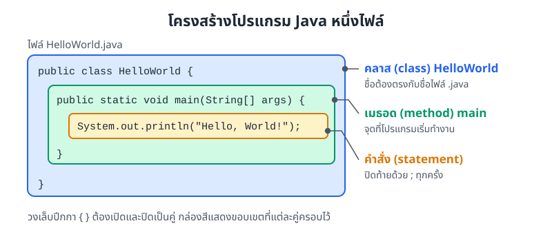
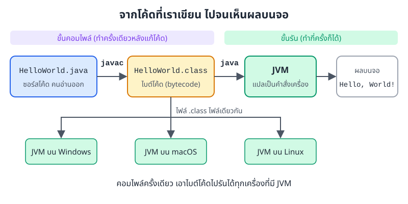
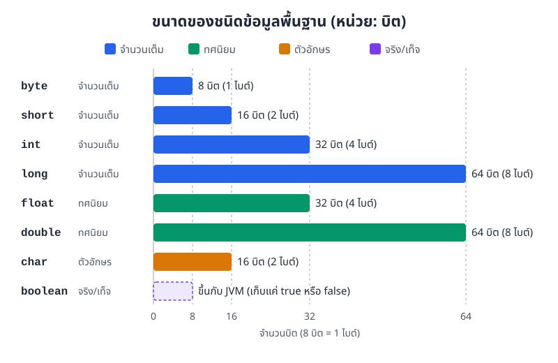
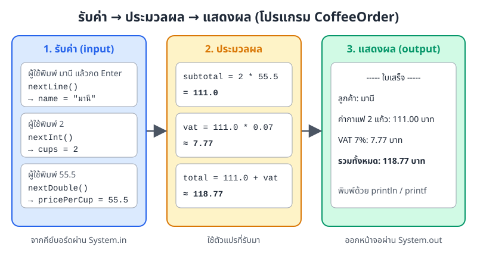
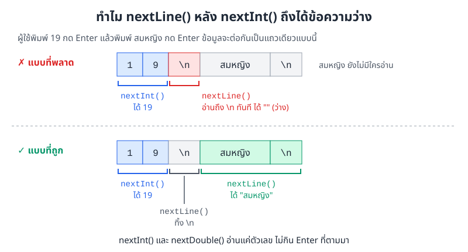
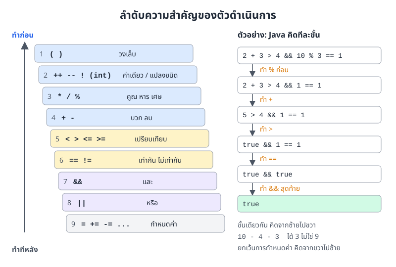

# บทที่ 1: โครงสร้างโปรแกรมและไวยากรณ์พื้นฐานของ Java

> โปรแกรม Java ทุกตัวเริ่มจากคลาสหนึ่งคลาสที่มีเมธอด `main` อยู่ข้างใน
> ข้อมูลทุกค่าต้องมีชนิดข้อมูลกำกับ และเราใช้ตัวดำเนินการคำนวณค่าเหล่านั้น
> บทนี้ปูพื้นทั้งหมดที่ต้องใช้ ก่อนจะไปเขียนคลาสและออบเจกต์ของเราเองในบทถัด ๆ ไป

## สิ่งที่จะทำได้หลังเรียนบทนี้

1. อธิบายโครงสร้างของโปรแกรม Java และขั้นตอนตั้งแต่เขียนโค้ดจนรันได้
2. เลือกชนิดข้อมูลและประกาศตัวแปรให้เหมาะกับข้อมูลที่จะเก็บ
3. เขียนนิพจน์คณิตศาสตร์และตรรกะด้วยตัวดำเนินการแบบต่าง ๆ และบอกได้ว่า Java คำนวณส่วนไหนก่อน
4. เขียนโปรแกรมที่รับค่าจากผู้ใช้ ประมวลผล และแสดงผลลัพธ์ได้

## 1. โครงสร้างโปรแกรม Java

### 1.1 โปรแกรมแรก

เริ่มจากโปรแกรมที่สั้นที่สุดที่ทำงานได้จริง คือพิมพ์ข้อความหนึ่งบรรทัดออกหน้าจอ

```java
public class HelloWorld {
    public static void main(String[] args) {
        System.out.println("Hello, World!");
    }
}
```

ผลลัพธ์

```
Hello, World!
```

แม้จะมีแค่ห้าบรรทัด แต่โปรแกรมนี้มีโครงที่โปรแกรม Java ทุกตัวต้องมี ลองดูภาพที่ 1.1 กล่องแต่ละสีคือขอบเขตของวงเล็บปีกกาแต่ละคู่



*ภาพที่ 1.1 คลาสครอบเมธอด `main` และเมธอดครอบคำสั่งที่จะทำงานจริง*

* **`public class HelloWorld`** ประกาศคลาส (class) ชื่อ `HelloWorld` ตอนนี้ให้มองคลาสเป็นกล่องที่ใส่โค้ดทั้งหมดไว้ก่อน ความหมายเต็ม ๆ ของคลาสจะอยู่ใน[บทที่ 4: เริ่มต้น OOP และ Abstraction](04-oop-abstraction.md) ถ้าคลาสเป็น `public` ชื่อไฟล์ต้องตรงกับชื่อคลาสทุกตัวอักษร คือต้องบันทึกเป็น `HelloWorld.java`
* **`public static void main(String[] args)`** คือเมธอด (method) `main` ซึ่งเป็นจุดที่โปรแกรมเริ่มทำงาน ต้องเขียนหัวเมธอดแบบนี้เป๊ะ ๆ ถ้าสะกดผิด เช่น `Main` โปรแกรมจะคอมไพล์ผ่านแต่รันไม่ได้ เพราะ JVM หา `main` ไม่เจอ
* **`System.out.println(...)`** คือคำสั่ง (statement) ให้พิมพ์ข้อความออกหน้าจอแล้วขึ้นบรรทัดใหม่ ทุกคำสั่งต้องปิดท้ายด้วยเครื่องหมาย `;`

กฎพื้นฐานที่ต้องจำตั้งแต่วันแรก

* Java แยกตัวพิมพ์เล็กกับตัวพิมพ์ใหญ่ `System` กับ `system` เป็นคนละคำ
* วงเล็บปีกกา `{ }` ต้องเปิดและปิดเป็นคู่เสมอ
* ข้อความ (string) อยู่ในเครื่องหมายคำพูดคู่ `"..."`

### 1.2 จากโค้ดไปจนรันได้

คอมพิวเตอร์อ่านไฟล์ `.java` ตรง ๆ ไม่ได้ ต้องผ่านสองขั้นตอนก่อน ดังภาพที่ 1.2



*ภาพที่ 1.2 javac แปลซอร์สโค้ดเป็นไบต์โค้ด จากนั้น JVM รันไบต์โค้ดนั้นบนเครื่องไหนก็ได้*

1. **คอมไพล์ (compile)** ด้วยคำสั่ง `javac` ตัวคอมไพเลอร์จะตรวจไวยากรณ์ ถ้าลืม `;` หรือสะกดชนิดข้อมูลผิด จะเจอ error ในขั้นนี้ ถ้าผ่านจะได้ไฟล์ `HelloWorld.class` ซึ่งเก็บไบต์โค้ด (bytecode)
2. **รัน** ด้วยคำสั่ง `java` ตัว JVM (Java Virtual Machine) จะอ่านไบต์โค้ดแล้วแปลเป็นคำสั่งที่เครื่องนั้นเข้าใจ

```
javac HelloWorld.java    (ได้ไฟล์ HelloWorld.class)
java HelloWorld          (ไม่ต้องใส่ .class)
```

ไบต์โค้ดไม่ผูกกับระบบปฏิบัติการ ไฟล์ `.class` ชุดเดียวจึงเอาไปรันได้ทั้ง Windows, macOS และ Linux ขอแค่เครื่องนั้นมี JVM นี่คือที่มาของคำโฆษณา Java ว่า "เขียนครั้งเดียว รันได้ทุกที่"

ในทางปฏิบัติ IDE อย่าง IntelliJ IDEA, VS Code หรือ NetBeans จะสั่ง `javac` และ `java` ให้เราเองเมื่อกดปุ่มรัน แต่ควรรู้ว่าข้างหลังมีสองขั้นตอนนี้ เพราะ error จากแต่ละขั้นต่างกัน ข้อผิดพลาดตอนคอมไพล์ (compile-time error) ทำให้ไม่ได้ไฟล์ `.class` เลย ส่วนข้อผิดพลาดตอนรัน (runtime error) เกิดขึ้นทั้งที่คอมไพล์ผ่านแล้ว

### 1.3 คอมเมนต์

คอมเมนต์ (comment) คือข้อความที่เขียนไว้ให้คนอ่าน คอมไพเลอร์จะข้ามไปทั้งหมด Java มีสามแบบ

```java
// คอมเมนต์บรรทัดเดียว ตั้งแต่ // ไปจนสุดบรรทัด

/*
 * คอมเมนต์หลายบรรทัด
 * ใช้อธิบายยาว ๆ หรือปิดโค้ดชั่วคราวทั้งก้อน
 */

/**
 * คอมเมนต์เอกสาร (Javadoc)
 * เครื่องมือ javadoc ดึงข้อความนี้ไปสร้างเป็นเอกสารเว็บได้
 */
```

คอมเมนต์ที่ดีบอกว่า "ทำไม" ไม่ใช่แค่พูดซ้ำว่าโค้ดทำอะไร เช่น `// ลด 10% เพราะเป็นสมาชิก` มีประโยชน์กว่า `// คูณ 0.9`

## 2. ตัวแปรและชนิดข้อมูล

### 2.1 ตัวแปรคืออะไร

นึกถึงตู้ล็อกเกอร์ในฟิตเนส แต่ละช่องมีป้ายชื่อ และแต่ละช่องมีขนาดตายตัว ช่องเล็กใส่ได้แค่กุญแจ ช่องใหญ่ใส่กระเป๋าได้

ตัวแปร (variable) ก็คือช่องเก็บข้อมูลในหน่วยความจำแบบนั้น มีชื่อไว้เรียก และมีชนิดข้อมูล (data type) กำหนดว่าช่องนี้เก็บค่าแบบไหนได้และใหญ่แค่ไหน Java บังคับให้ระบุชนิดข้อมูลตั้งแต่ตอนประกาศ ถ้าพยายามใส่ข้อความลงในช่องที่ประกาศไว้สำหรับตัวเลข จะคอมไพล์ไม่ผ่าน

รูปแบบการประกาศคือ `ชนิดข้อมูล ชื่อตัวแปร = ค่าเริ่มต้น;`

```java
int score;                 // ประกาศอย่างเดียว ยังไม่ใส่ค่า
score = 95;                // ใส่ค่าทีหลัง

int credits = 3;           // ประกาศพร้อมใส่ค่า
int x = 10, y = 20, z = 30;  // ประกาศหลายตัวในบรรทัดเดียว
```

ตัวแปรที่ประกาศไว้ในเมธอดต้องมีค่าก่อนนำไปใช้ ถ้าประกาศ `int score;` แล้วสั่งพิมพ์ทันที คอมไพเลอร์จะแจ้งว่า `variable score might not have been initialized`

### 2.2 ชนิดข้อมูลพื้นฐาน (primitive type)

Java มีชนิดข้อมูลพื้นฐานแปดชนิด แบ่งได้สี่กลุ่ม ภาพที่ 1.3 เทียบขนาดของแต่ละชนิดเป็นจำนวนบิต ยิ่งใช้บิตมาก ก็ยิ่งเก็บค่าได้กว้าง



*ภาพที่ 1.3 ขนาดของชนิดข้อมูลพื้นฐาน ตามที่ข้อกำหนดภาษา Java กำหนดไว้ (ส่วน boolean ข้อกำหนดไม่ได้ระบุขนาด)*

| ชนิด | ขนาด | ช่วงค่าที่เก็บได้ | ตัวอย่างการใช้ |
|---|---|---|---|
| `byte` | 8 บิต | -128 ถึง 127 | ข้อมูลดิบในไฟล์ |
| `short` | 16 บิต | -32,768 ถึง 32,767 | ใช้น้อยในงานทั่วไป |
| `int` | 32 บิต | ประมาณ -2.1 พันล้าน ถึง 2.1 พันล้าน | จำนวนเต็มทั่วไป ใช้เป็นค่าตั้งต้น |
| `long` | 64 บิต | ประมาณ ±9.2 × 10<sup>18</sup> | ยอดเงินในบัญชีเป็นสตางค์ เวลาเป็นมิลลิวินาที |
| `float` | 32 บิต | ทศนิยมแม่นราว 6-7 หลัก | ใช้เมื่อต้องประหยัดหน่วยความจำ |
| `double` | 64 บิต | ทศนิยมแม่นราว 15-16 หลัก | ทศนิยมทั่วไป ใช้เป็นค่าตั้งต้น |
| `char` | 16 บิต | อักขระหนึ่งตัว (Unicode) | เกรด `'A'` สัญลักษณ์ `'@'` |
| `boolean` | ไม่กำหนดตายตัว | `true` หรือ `false` | สถานะ เปิด/ปิด ผ่าน/ไม่ผ่าน |

ถ้าไม่แน่ใจ ให้ใช้ `int` กับจำนวนเต็ม และ `double` กับทศนิยม สองชนิดนี้ครอบคลุมงานส่วนใหญ่ในวิชานี้

```java
public class DataTypesDemo {
    public static void main(String[] args) {
        // จำนวนเต็ม
        byte age = 19;                 // -128 ถึง 127
        short year = 2024;             // -32,768 ถึง 32,767
        int population = 66000000;     // ประมาณ ±2.1 พันล้าน
        long distance = 9876543210L;   // เกินช่วง int ต้องลงท้ายด้วย L

        // ทศนิยม
        float price = 55.50f;          // ต้องลงท้ายด้วย f
        double pi = 3.14159265359;

        // ตัวอักษรและค่าจริง/เท็จ
        char grade = 'A';
        boolean isStudent = true;

        // ชนิดอ้างอิง
        String name = "สมชาย ใจดี";

        // ค่าคงที่
        final double VAT_RATE = 0.07;

        System.out.println("age = " + age);
        System.out.println("year = " + year);
        System.out.println("population = " + population);
        System.out.println("distance = " + distance);
        System.out.println("price = " + price);
        System.out.println("pi = " + pi);
        System.out.println("grade = " + grade);
        System.out.println("isStudent = " + isStudent);
        System.out.println("name = " + name);
        System.out.println("VAT_RATE = " + VAT_RATE);
    }
}
```

ผลลัพธ์

```
age = 19
year = 2024
population = 66000000
distance = 9876543210
price = 55.5
pi = 3.14159265359
grade = A
isStudent = true
name = สมชาย ใจดี
VAT_RATE = 0.07
```

จุดที่ควรสังเกตในโค้ดนี้

* **ตัวอักษร `L` ท้าย `9876543210L`** ตัวเลขที่เขียนตรง ๆ ในโค้ด Java ถือว่าเป็น `int` ไว้ก่อน ค่านี้เกินช่วงของ `int` จึงต้องเติม `L` บอกว่าเป็น `long` ถ้าไม่เติมจะคอมไพล์ไม่ผ่าน ควรใช้ `L` ตัวใหญ่ เพราะ `l` ตัวเล็กดูคล้ายเลข 1
* **ตัวอักษร `f` ท้าย `55.50f`** ทศนิยมที่เขียนตรง ๆ ถือว่าเป็น `double` ไว้ก่อน จะเก็บลง `float` ได้ต้องเติม `f`
* **`price` พิมพ์ออกมาเป็น `55.5`** ตัวเลขไม่เก็บเลขศูนย์ท้ายทศนิยม ถ้าต้องการให้แสดงสองตำแหน่ง ให้ใช้ `printf` ในหัวข้อ 3
* **`char` ใช้เครื่องหมายคำพูดเดี่ยว `'A'`** ส่วน `String` ใช้เครื่องหมายคำพูดคู่ `"A"` สองอย่างนี้เป็นคนละชนิดกัน

### 2.3 ชนิดอ้างอิง (reference type) และ String

นอกจากแปดชนิดข้างบน ทุกอย่างที่เหลือใน Java เป็นชนิดอ้างอิง ตัวที่ใช้บ่อยที่สุดคือ `String` สำหรับเก็บข้อความ

```java
String name = "สมชาย";
String message = "Hello, World!";
```

สังเกตว่า `String` ขึ้นต้นด้วยตัวพิมพ์ใหญ่ เพราะมันเป็นคลาส ไม่ใช่ชนิดข้อมูลพื้นฐาน ตัวแปรชนิดอ้างอิงไม่ได้เก็บข้อมูลไว้ในตัวเอง แต่เก็บ "ที่อยู่" ที่ชี้ไปหาออบเจกต์ (object) ในหน่วยความจำ เรื่องนี้จะสำคัญมากเมื่อถึงบทที่ 4 ตอนนี้ขอให้จำแค่ว่า `String` ใช้งานได้เหมือนชนิดข้อมูลทั่วไป

### 2.4 ค่าคงที่

ถ้าค่าไหนไม่ควรเปลี่ยนเลยตลอดโปรแกรม เช่น อัตรา VAT หรือจำนวนที่นั่งสูงสุดในห้องเรียน ให้ใส่ keyword `final` ไว้หน้าชนิดข้อมูล

```java
final double VAT_RATE = 0.07;
final int MAX_STUDENTS = 50;

MAX_STUDENTS = 60;   // คอมไพล์ไม่ผ่าน: cannot assign a value to final variable
```

ค่าคงที่ช่วยให้อ่านโค้ดง่ายขึ้น `total * VAT_RATE` บอกความหมายชัดกว่า `total * 0.07` และถ้าวันหนึ่งอัตรา VAT เปลี่ยน ก็แก้แค่บรรทัดเดียว

### 2.5 การตั้งชื่อ

Java มีกฎบังคับและมีธรรมเนียมที่คนเขียน Java ทั่วโลกใช้ตรงกัน

**กฎบังคับ** (ผิดแล้วคอมไพล์ไม่ผ่าน)

* ประกอบด้วยตัวอักษร ตัวเลข `_` หรือ `$` และห้ามขึ้นต้นด้วยตัวเลข
* ห้ามซ้ำกับ keyword ของภาษา เช่น `int`, `class`, `public`

**ธรรมเนียม** (ไม่บังคับ แต่ควรทำตาม)

| สิ่งที่ตั้งชื่อ | รูปแบบ | ตัวอย่าง |
|---|---|---|
| ตัวแปร เมธอด | camelCase ขึ้นต้นตัวเล็ก คำต่อไปขึ้นต้นตัวใหญ่ | `studentAge`, `totalPrice` |
| คลาส | PascalCase ขึ้นต้นตัวใหญ่ทุกคำ | `HelloWorld`, `CoffeeOrder` |
| ค่าคงที่ | ตัวใหญ่ทั้งหมด คั่นด้วย `_` | `MAX_STUDENTS`, `VAT_RATE` |

ชื่อที่ดีบอกได้ทันทีว่าเก็บอะไร

```java
// ดี
int studentAge;
String firstName;
double totalPrice;

// ไม่ดี
int a;        // ไม่รู้ว่าเก็บอะไร
String N;     // ตัวแปรควรขึ้นต้นด้วยตัวเล็ก และชื่อสั้นเกินไป
double x1;    // ไม่บอกความหมาย
```

## 3. การแสดงผลและการรับค่า

### 3.1 แสดงผลด้วย print, println และ printf

`System.out` คือช่องทางส่งข้อความออกหน้าจอ มีเมธอดให้ใช้สามตัว

```java
public class OutputDemo {
    public static void main(String[] args) {
        System.out.println("Hello");
        System.out.println("World");

        System.out.print("Hello ");
        System.out.print("World");
        System.out.println();   // ขึ้นบรรทัดใหม่เอง

        int age = 19;
        double gpa = 3.756;
        System.out.printf("Age: %d, GPA: %.2f%n", age, gpa);
        System.out.printf("[%5d] [%-5d] [%8.3f]%n", 42, 42, 3.14159);
    }
}
```

ผลลัพธ์

```
Hello
World
Hello World
Age: 19, GPA: 3.76
[   42] [42   ] [   3.142]
```

* **`println`** พิมพ์แล้วขึ้นบรรทัดใหม่
* **`print`** พิมพ์แล้วอยู่บรรทัดเดิม ข้อความถัดไปจะต่อท้ายทันที
* **`printf`** พิมพ์ตามรูปแบบที่กำหนด โดยวางตัวกำหนดรูปแบบไว้ในข้อความ แล้วส่งค่ามาเติมตามลำดับ

ตัวกำหนดรูปแบบที่ใช้บ่อย

| รูปแบบ | ใช้กับ | ตัวอย่าง | ผลลัพธ์ |
|---|---|---|---|
| `%d` | จำนวนเต็ม | `printf("%d", 42)` | `42` |
| `%.2f` | ทศนิยม ปัดเหลือ 2 ตำแหน่ง | `printf("%.2f", 3.756)` | `3.76` |
| `%s` | ข้อความ | `printf("%s", "Java")` | `Java` |
| `%c` | อักขระ | `printf("%c", 'A')` | `A` |
| `%5d` | จองที่ 5 ช่อง ชิดขวา | `printf("[%5d]", 42)` | `[   42]` |
| `%-5d` | จองที่ 5 ช่อง ชิดซ้าย | `printf("[%-5d]", 42)` | `[42   ]` |
| `%n` | ขึ้นบรรทัดใหม่ | | |
| `%%` | เครื่องหมาย % | `printf("VAT 7%%")` | `VAT 7%` |

`printf` ไม่ขึ้นบรรทัดใหม่ให้เอง ต้องปิดท้ายด้วย `%n` (หรือ `\n` ก็ได้ แต่ `%n` จะเลือกตัวขึ้นบรรทัดให้ตรงกับระบบปฏิบัติการ)

### 3.2 รับค่าด้วย Scanner

โปรแกรมส่วนใหญ่ทำงานเป็นสามจังหวะ คือรับค่า ประมวลผล แล้วแสดงผล ลองนึกถึงพนักงานร้านกาแฟ รับออร์เดอร์ว่ากี่แก้ว คิดเงินรวม VAT แล้วพิมพ์ใบเสร็จ

Java รับค่าจากคีย์บอร์ดผ่าน `System.in` และใช้คลาส `Scanner` ช่วยอ่านค่าออกมาเป็นชนิดข้อมูลที่ต้องการ

```java
import java.util.Scanner;

public class CoffeeOrder {
    public static void main(String[] args) {
        Scanner scanner = new Scanner(System.in);

        // รับค่า
        System.out.print("ชื่อลูกค้า: ");
        String name = scanner.nextLine();

        System.out.print("จำนวนแก้ว: ");
        int cups = scanner.nextInt();

        System.out.print("ราคาต่อแก้ว (บาท): ");
        double pricePerCup = scanner.nextDouble();

        // ประมวลผล
        double subtotal = cups * pricePerCup;
        double vat = subtotal * 0.07;
        double total = subtotal + vat;

        // แสดงผล
        System.out.println("----- ใบเสร็จ -----");
        System.out.println("ลูกค้า: " + name);
        System.out.printf("ค่ากาแฟ %d แก้ว: %.2f บาท%n", cups, subtotal);
        System.out.printf("VAT 7%%: %.2f บาท%n", vat);
        System.out.printf("รวมทั้งหมด: %.2f บาท%n", total);

        scanner.close();
    }
}
```

ตัวอย่างการรัน เมื่อผู้ใช้พิมพ์ `มานี`, `2` และ `55.5`

```
ชื่อลูกค้า: มานี
จำนวนแก้ว: 2
ราคาต่อแก้ว (บาท): 55.5
----- ใบเสร็จ -----
ลูกค้า: มานี
ค่ากาแฟ 2 แก้ว: 111.00 บาท
VAT 7%: 7.77 บาท
รวมทั้งหมด: 118.77 บาท
```

ภาพที่ 1.4 ไล่ให้เห็นว่าค่าที่ผู้ใช้พิมพ์เดินทางผ่านตัวแปรไปจนกลายเป็นใบเสร็จอย่างไร



*ภาพที่ 1.4 ค่าที่รับมาด้วย Scanner ไปเก็บในตัวแปร แล้วตัวแปรเหล่านั้นเข้าสู่การคำนวณและการแสดงผล*

ขั้นตอนใช้ `Scanner` มีสามข้อ

1. `import java.util.Scanner;` ไว้บนสุดของไฟล์ เพราะ `Scanner` อยู่ในแพ็กเกจ (package) `java.util` ไม่ได้มาให้อัตโนมัติ
2. สร้าง `Scanner` หนึ่งตัวด้วย `new Scanner(System.in)` แล้วใช้ตัวเดียวนี้ตลอดโปรแกรม
3. เรียกเมธอดอ่านค่าให้ตรงกับชนิดข้อมูลที่ต้องการ และเรียก `close()` เมื่อเลิกใช้

| เมธอด | อ่านค่าเป็น | หมายเหตุ |
|---|---|---|
| `nextLine()` | `String` | อ่านทั้งบรรทัด รวมช่องว่าง จนถึง Enter |
| `next()` | `String` | อ่านแค่คำเดียว หยุดที่ช่องว่าง |
| `nextInt()` | `int` | |
| `nextDouble()` | `double` | |
| `nextBoolean()` | `boolean` | ผู้ใช้ต้องพิมพ์ `true` หรือ `false` |

ถ้าผู้ใช้พิมพ์ `abc` ตอนที่โปรแกรมเรียก `nextInt()` โปรแกรมจะหยุดพร้อม exception ชื่อ `InputMismatchException` วิธีจัดการเรื่องนี้อยู่ใน[บทที่ 9: การจัดการข้อผิดพลาด (Error Handling)](09-error-handling.md)

### 3.3 กับดัก nextLine() หลัง nextInt()

ปัญหานี้เกือบทุกคนเจอในสัปดาห์แรก ลองดูโค้ดนี้

```java
System.out.print("อายุ: ");
int age = scanner.nextInt();
System.out.print("ชื่อ: ");
String name = scanner.nextLine();   // ได้ข้อความว่าง!
```

โปรแกรมไม่รอให้พิมพ์ชื่อเลย และ `name` ได้ค่าเป็นข้อความว่าง สาเหตุอยู่ที่ปุ่ม Enter ดังภาพที่ 1.5



*ภาพที่ 1.5 ทุกครั้งที่กด Enter จะมีอักขระขึ้นบรรทัดใหม่ `\n` ต่อท้าย nextInt() ไม่อ่านตัวนี้ nextLine() ตัวถัดไปจึงเจอมันทันที*

`nextInt()` และ `nextDouble()` อ่านเฉพาะตัวเลข แล้วปล่อย `\n` ค้างไว้ `nextLine()` อ่าน "จนถึง `\n`" พอเจอ `\n` ตั้งแต่ตัวแรกก็จบทันที ได้ข้อความว่างกลับไป

วิธีแก้คือเรียก `nextLine()` เปล่า ๆ หนึ่งครั้งเพื่อเก็บ `\n` ที่ค้างทิ้งไป

```java
import java.util.Scanner;

public class NextLineTrap {
    public static void main(String[] args) {
        Scanner scanner = new Scanner(System.in);
        System.out.print("อายุ: ");
        int age = scanner.nextInt();
        scanner.nextLine();              // เก็บ Enter ที่ค้างอยู่ทิ้งไป
        System.out.print("ชื่อ: ");
        String name = scanner.nextLine();
        System.out.println(name + " อายุ " + age + " ปี");
        scanner.close();
    }
}
```

```
อายุ: 19
ชื่อ: สมหญิง
สมหญิง อายุ 19 ปี
```

อีกวิธีที่ง่ายกว่าคือเรียงให้อ่าน `nextLine()` ก่อนตัวเลข อย่างที่โปรแกรม `CoffeeOrder` ทำ

## 4. ตัวดำเนินการ

ตัวดำเนินการ (operator) คือสัญลักษณ์ที่สั่งให้คำนวณหรือเปรียบเทียบค่า ตัวอย่างทั้งหมดในหัวข้อนี้มาจากโปรแกรมเดียวกัน และผลลัพธ์ในคอมเมนต์คือผลที่รันได้จริง

### 4.1 ตัวดำเนินการคณิตศาสตร์

```java
int a = 10, b = 3;
System.out.println(a + b);   // 13  บวก
System.out.println(a - b);   // 7   ลบ
System.out.println(a * b);   // 30  คูณ
System.out.println(a / b);   // 3   หารแบบจำนวนเต็ม
System.out.println(a % b);   // 1   เศษจากการหาร
```

สองบรรทัดสุดท้ายต้องระวัง

* **หารจำนวนเต็มด้วยจำนวนเต็ม ได้จำนวนเต็ม** `10 / 3` ได้ `3` ไม่ใช่ `3.333...` Java ตัดส่วนทศนิยมทิ้งไปเลยโดยไม่ปัด ถ้าอยากได้ทศนิยม ต้องให้ตัวใดตัวหนึ่งเป็น `double` ก่อน (ดูหัวข้อ 5)
* **`%` ให้เศษจากการหาร** `10 % 3` ได้ `1` เพราะ 10 = 3 × 3 + 1 ใช้บ่อยมาก เช่น เช็กเลขคู่ด้วย `n % 2 == 0` หรือแปลงนาทีเป็นชั่วโมงกับนาที `125 / 60` ได้ 2 ชั่วโมง `125 % 60` ได้ 5 นาที

**เพิ่มค่าและลดค่าทีละหนึ่ง** `x++` เท่ากับ `x = x + 1` และ `x--` เท่ากับ `x = x - 1` แต่ตำแหน่งของ `++` มีผลเมื่อใช้ในนิพจน์

```java
int x = 5;
System.out.println(x++);     // 5  พิมพ์ค่าเดิมก่อน แล้วค่อยเพิ่ม
System.out.println(x);       // 6
System.out.println(++x);     // 7  เพิ่มก่อน แล้วค่อยพิมพ์
```

ถ้าเขียน `x++;` เป็นคำสั่งเดี่ยว ๆ ทั้งสองแบบให้ผลเหมือนกัน ความต่างจะโผล่มาเมื่อเอาไปใส่ในนิพจน์อื่นเท่านั้น

### 4.2 ตัวดำเนินการเปรียบเทียบ

ผลของการเปรียบเทียบเป็น `boolean` เสมอ

```java
int p = 5, q = 10;
System.out.println(p == q);  // false  เท่ากับ
System.out.println(p != q);  // true   ไม่เท่ากับ
System.out.println(p < q);   // true   น้อยกว่า
System.out.println(p >= q);  // false  มากกว่าหรือเท่ากับ
```

ที่เหลือคือ `>` (มากกว่า) และ `<=` (น้อยกว่าหรือเท่ากับ) ระวังอย่าสับสน `==` (เปรียบเทียบ) กับ `=` (กำหนดค่า)

### 4.3 ตัวดำเนินการตรรกะ

ใช้รวมเงื่อนไขหลายข้อเข้าด้วยกัน เช่น ร้านจะให้ส่วนลดนักศึกษาเมื่ออายุ 18 ปีขึ้นไป **และ** มีบัตรนักศึกษา

```java
int age = 20;
boolean hasStudentCard = true;
System.out.println(age >= 18 && hasStudentCard);   // true
System.out.println(age < 12 || age > 60);          // false
System.out.println(!hasStudentCard);               // false
```

| ตัวดำเนินการ | ความหมาย | ได้ true เมื่อ |
|---|---|---|
| `&&` | และ (AND) | ทั้งสองฝั่งเป็น true |
| `\|\|` | หรือ (OR) | อย่างน้อยหนึ่งฝั่งเป็น true |
| `!` | ไม่ (NOT) | กลับค่า true เป็น false และ false เป็น true |

`&&` และ `||` หยุดคิดทันทีที่รู้คำตอบ เช่น `false && ...` ได้ false แน่นอนแล้ว Java จะไม่คำนวณฝั่งขวาเลย ลักษณะนี้เรียกว่า short-circuit จะมีประโยชน์ในบทถัดไป

### 4.4 ตัวดำเนินการกำหนดค่า

`=` เอาค่าทางขวาไปใส่ตัวแปรทางซ้าย และมีรูปย่อสำหรับ "คำนวณกับค่าเดิมแล้วเก็บกลับ"

```java
int n = 10;
n += 5;   // n = n + 5  → 15
n -= 3;   // n = n - 3  → 12
n *= 2;   // n = n * 2  → 24
n /= 4;   // n = n / 4  → 6
n %= 4;   // n = n % 4  → 2
```

### 4.5 ลำดับความสำคัญของตัวดำเนินการ

`10 + 5 * 2` ได้ `20` ไม่ใช่ `30` เพราะ Java คูณก่อนบวกเหมือนคณิตศาสตร์ที่เรียนมา ภาพที่ 1.6 เรียงตัวดำเนินการจากที่ทำก่อนไปทำทีหลัง พร้อมตัวอย่างการคำนวณทีละขั้น



*ภาพที่ 1.6 ตัวดำเนินการที่อยู่ขั้นบนทำก่อน ตัวอย่างทางขวาคือผลที่ Java คำนวณได้จริง*

```java
System.out.println(10 + 5 * 2);                 // 20
System.out.println((10 + 5) * 2);               // 30
System.out.println(10 - 4 - 3);                 // 3
System.out.println(2 + 3 > 4 && 10 % 3 == 1);   // true
```

สามข้อที่ควรจำ

1. วงเล็บมาก่อนทุกอย่าง ถ้าไม่แน่ใจ ใส่วงเล็บไว้เลย โค้ดอ่านง่ายขึ้นด้วย
2. ตัวดำเนินการที่อยู่ขั้นเดียวกัน คิดจากซ้ายไปขวา `10 - 4 - 3` คือ `(10 - 4) - 3` ได้ 3
3. การกำหนดค่าอยู่ล่างสุดและคิดจากขวาไปซ้าย `a = b = 5` คือ `a = (b = 5)`

## 5. การแปลงชนิดข้อมูล

### 5.1 แปลงอัตโนมัติ (widening)

ถ้าเอาค่าจากชนิดที่เล็กกว่าไปใส่ชนิดที่ใหญ่กว่า Java แปลงให้เองโดยไม่ต้องสั่ง เพราะไม่มีข้อมูลหาย เหมือนเทน้ำจากแก้วลงเหยือก

```java
int i = 100;
double d = i;              // int → double อัตโนมัติ
System.out.println(d);     // 100.0
```

ทิศทางที่แปลงอัตโนมัติได้คือ `byte` → `short` → `int` → `long` → `float` → `double` (และ `char` → `int`)

### 5.2 แปลงโดยระบุ (casting)

ทิศกลับกัน คือจากชนิดใหญ่ไปชนิดเล็ก อาจทำให้ข้อมูลหาย Java จึงบังคับให้เราเขียนชนิดปลายทางไว้ในวงเล็บ เป็นการยืนยันว่ารู้ตัว

```java
double price = 9.7;
int whole = (int) price;
System.out.println(whole);   // 9  ตัดทศนิยมทิ้ง ไม่ได้ปัดเป็น 10
```

casting ช่วยแก้ปัญหาหารจำนวนเต็มในหัวข้อ 4.1 ได้ แต่ตำแหน่งของวงเล็บสำคัญมาก

```java
int x = 5, y = 2;
System.out.println(x / y);             // 2    หารจำนวนเต็ม
System.out.println((double) x / y);    // 2.5  แปลง x เป็น double ก่อน แล้วค่อยหาร
System.out.println((double) (x / y));  // 2.0  หารได้ 2 ไปแล้ว ค่อยแปลง สายไป
```

ถ้า cast ค่าที่ใหญ่เกินช่วงของชนิดปลายทาง Java ไม่เตือน แต่ค่าจะเพี้ยนไปเลย

```java
int big = 130;
byte small = (byte) big;
System.out.println(small);   // -126
```

`byte` เก็บได้สูงสุด 127 ค่า 130 จึงล้นแล้ววนไปฝั่งติดลบ เหมือนเลขไมล์รถที่วิ่งเกินหลักสุดท้ายแล้ววนกลับ

### 5.3 แปลงระหว่างตัวเลขกับ String

ข้อมูลที่มาเป็นข้อความ เช่น ค่าที่อ่านจากไฟล์หรือช่องกรอกในแอป ต้องแปลงเป็นตัวเลขก่อนจึงจะคำนวณได้

```java
// ตัวเลข → String
int age = 19;
String s1 = String.valueOf(age);   // "19"
String s2 = "" + age;              // "19" ต่อกับข้อความว่างก็ได้ผลเหมือนกัน

// String → ตัวเลข
int num = Integer.parseInt("123");
double rate = Double.parseDouble("3.14");
System.out.println(num + 1);       // 124
System.out.println(rate * 2);      // 6.28
```

ถ้าข้อความแปลงเป็นตัวเลขไม่ได้ เช่น `Integer.parseInt("12a")` จะเกิด exception ชื่อ `NumberFormatException`

เครื่องหมาย `+` ทำได้สองอย่าง ถ้าทั้งสองฝั่งเป็นตัวเลขคือบวก ถ้าฝั่งใดฝั่งหนึ่งเป็น `String` คือต่อข้อความ และคิดจากซ้ายไปขวา

```java
System.out.println("1" + 2 + 3);   // 123  "1"+2 ได้ "12" แล้วต่อ 3
System.out.println(1 + 2 + "3");   // 33   1+2 ได้ 3 แล้วต่อ "3"
```

นี่คือเหตุผลที่โค้ดในบทนี้เขียน `"a + b = " + (a + b)` โดยมีวงเล็บครอบ ถ้าไม่มีวงเล็บ จะได้ตัวเลขสองตัวต่อกันเป็นข้อความแทนผลบวก

## 6. ตัวอย่างโปรแกรมสมบูรณ์

ไฟล์ [JavaBasicsExample.java](../examples/JavaBasicsExample.java) รวมทุกเรื่องในบทนี้ไว้ในโปรแกรมเดียว แบ่งเป็นส่วน ๆ ตามหัวข้อ

1. ประกาศตัวแปรครบทั้งแปดชนิดพื้นฐาน `String` และค่าคงที่
2. ตัวดำเนินการคณิตศาสตร์ รวม `x++` กับ `++x`
3. ตัวดำเนินการเปรียบเทียบ
4. ตัวดำเนินการตรรกะ พร้อมเงื่อนไขลงทะเบียนเรียน (อายุ 18 ปีขึ้นไปและมีบัตร)
5. การแปลงชนิดข้อมูลทั้งสามแบบ
6. งานคำนวณจริง ได้แก่ พื้นที่วงกลม ราคารวม VAT และแปลงองศาเซลเซียสเป็นฟาเรนไฮต์
7. รับชื่อ อายุ และ GPA ด้วย `Scanner` แล้วแสดงผลกลับ

ลองคอมไพล์และรันเอง แล้วเทียบผลแต่ละส่วนกับหัวข้อในบทนี้

## ข้อผิดพลาดที่เจอบ่อย

| อาการ | สาเหตุ | วิธีแก้ |
|---|---|---|
| `class HelloWorld is public, should be declared in a file named HelloWorld.java` | ชื่อไฟล์ไม่ตรงกับชื่อคลาส | เปลี่ยนชื่อไฟล์ให้ตรง รวมตัวพิมพ์เล็กใหญ่ |
| `';' expected` | ลืม `;` ท้ายคำสั่ง | ดูบรรทัดที่ error ชี้ และบรรทัดก่อนหน้า |
| `cannot find symbol` | สะกดชื่อตัวแปรหรือคลาสผิด หรือลืม `import java.util.Scanner;` | เช็กตัวสะกดและตัวพิมพ์เล็กใหญ่ |
| `incompatible types: possible lossy conversion from double to int` | เอา `double` ใส่ `int` ตรง ๆ | ใช้ `(int)` ถ้าตั้งใจตัดทศนิยมจริง |
| `integer number too large` | เขียนเลขเกินช่วง `int` โดยไม่เติม `L` | เติม `L` ท้ายตัวเลข |
| `10 / 4` ได้ `2` แทน `2.5` | หารจำนวนเต็มด้วยจำนวนเต็ม | ใช้ `10.0 / 4` หรือ `(double) a / b` |
| `nextLine()` ได้ข้อความว่าง | Enter ค้างจาก `nextInt()` | เรียก `scanner.nextLine();` ทิ้งหนึ่งครั้ง |
| พิมพ์ผลบวกออกมาเป็นตัวเลขต่อกัน เช่น `103` | `"ผลรวม " + a + b` กลายเป็นต่อข้อความ | ใส่วงเล็บ `"ผลรวม " + (a + b)` |
| `if (x = 5)` คอมไพล์ไม่ผ่าน | ใช้ `=` แทน `==` | เปรียบเทียบใช้ `==` |

## สรุปท้ายบท

* โปรแกรม Java อยู่ในคลาส และเริ่มทำงานที่ `public static void main(String[] args)` ชื่อไฟล์ต้องตรงกับชื่อคลาสที่เป็น `public`
* `javac` คอมไพล์ `.java` เป็นไบต์โค้ดใน `.class` แล้ว `java` สั่งให้ JVM รัน ไบต์โค้ดชุดเดียวรันได้ทุกระบบที่มี JVM
* ตัวแปรต้องมีชนิดข้อมูล ชนิดพื้นฐานมีแปดชนิด ใช้ `int` กับ `double` เป็นหลัก ส่วน `String` เป็นชนิดอ้างอิง
* `final` ทำให้ตัวแปรเป็นค่าคงที่ ตั้งชื่อด้วยตัวใหญ่ทั้งหมด ส่วนตัวแปรทั่วไปใช้ camelCase
* แสดงผลด้วย `print`, `println`, `printf` และรับค่าด้วย `Scanner` โดยระวัง Enter ที่ค้างหลัง `nextInt()`
* หารจำนวนเต็มได้จำนวนเต็ม `%` ให้เศษ `x++` กับ `++x` ต่างกันเมื่ออยู่ในนิพจน์
* ลำดับการคำนวณ: วงเล็บ → ตัวดำเนินการค่าเดียว → คูณหาร → บวกลบ → เปรียบเทียบ → `&&` → `||` → กำหนดค่า
* ชนิดเล็กไปใหญ่แปลงอัตโนมัติ ชนิดใหญ่ไปเล็กต้อง cast และอาจเสียข้อมูล แปลง `String` เป็นตัวเลขด้วย `Integer.parseInt` และ `Double.parseDouble`

## แบบฝึกหัด

**ข้อ 1** เขียนโปรแกรมรับชื่อและอายุจากผู้ใช้ แล้วแสดงผลเป็นประโยค เช่น `สวัสดี มานี อายุ 19 ปี`

<details>
<summary>ดูเฉลย</summary>

อ่านชื่อด้วย `nextLine()` ก่อน แล้วค่อยอ่านอายุ จะไม่เจอปัญหา Enter ค้าง

```java
import java.util.Scanner;

public class Greeting {
    public static void main(String[] args) {
        Scanner scanner = new Scanner(System.in);
        System.out.print("ชื่อ: ");
        String name = scanner.nextLine();
        System.out.print("อายุ: ");
        int age = scanner.nextInt();
        System.out.println("สวัสดี " + name + " อายุ " + age + " ปี");
        scanner.close();
    }
}
```

</details>

**ข้อ 2** เขียนโปรแกรมคำนวณพื้นที่วงกลม (π × r²) โดยรับรัศมีจากผู้ใช้ แสดงผลทศนิยมสองตำแหน่ง

<details>
<summary>ดูเฉลย</summary>

ใช้ค่าคงที่ `Math.PI` ที่ Java เตรียมไว้ให้ แม่นกว่าพิมพ์ 3.14 เอง

```java
import java.util.Scanner;

public class CircleArea {
    public static void main(String[] args) {
        Scanner scanner = new Scanner(System.in);
        System.out.print("รัศมี: ");
        double r = scanner.nextDouble();
        double area = Math.PI * r * r;
        System.out.printf("พื้นที่วงกลม = %.2f ตารางหน่วย%n", area);
        scanner.close();
    }
}
```

```
รัศมี: 5
พื้นที่วงกลม = 78.54 ตารางหน่วย
```

</details>

**ข้อ 3** เขียนโปรแกรมรับจำนวนเต็มสองตัว แล้วแสดงผล `+`, `-`, `*`, `/`, `%` ของสองตัวนั้น

<details>
<summary>ดูเฉลย</summary>

ทุกผลลัพธ์ต้องอยู่ในวงเล็บ ไม่อย่างนั้น `+` จะกลายเป็นการต่อข้อความ บรรทัดสุดท้ายเพิ่มการหารแบบทศนิยมไว้ให้เทียบ

```java
import java.util.Scanner;

public class Calculator {
    public static void main(String[] args) {
        Scanner scanner = new Scanner(System.in);
        System.out.print("ตัวเลขตัวแรก: ");
        int a = scanner.nextInt();
        System.out.print("ตัวเลขตัวที่สอง: ");
        int b = scanner.nextInt();

        System.out.println(a + " + " + b + " = " + (a + b));
        System.out.println(a + " - " + b + " = " + (a - b));
        System.out.println(a + " * " + b + " = " + (a * b));
        System.out.println(a + " / " + b + " = " + (a / b));
        System.out.println(a + " % " + b + " = " + (a % b));
        System.out.println(a + " / " + b + " (ทศนิยม) = " + ((double) a / b));
        scanner.close();
    }
}
```

```
ตัวเลขตัวแรก: 17
ตัวเลขตัวที่สอง: 5
17 + 5 = 22
17 - 5 = 12
17 * 5 = 85
17 / 5 = 3
17 % 5 = 2
17 / 5 (ทศนิยม) = 3.4
```

ถ้าตัวที่สองเป็น 0 บรรทัด `/` และ `%` จะเกิด exception ชื่อ `ArithmeticException` บทถัดไปจะใช้คำสั่งเงื่อนไขกันกรณีนี้

</details>

**ข้อ 4** เขียนโปรแกรมแปลงองศาเซลเซียสเป็นฟาเรนไฮต์ ตามสูตร F = C × 9/5 + 32

<details>
<summary>ดูเฉลย</summary>

ต้องเขียน `9.0 / 5.0` ไม่ใช่ `9 / 5` เพราะ `9 / 5` เป็นการหารจำนวนเต็มซึ่งได้ 1 ผลจะผิดทันที

```java
import java.util.Scanner;

public class TempConverter {
    public static void main(String[] args) {
        Scanner scanner = new Scanner(System.in);
        System.out.print("องศาเซลเซียส: ");
        double c = scanner.nextDouble();
        double f = c * 9.0 / 5.0 + 32;
        System.out.printf("%.1f°C = %.1f°F%n", c, f);
        scanner.close();
    }
}
```

```
องศาเซลเซียส: 25
25.0°C = 77.0°F
```

</details>

**ข้อ 5** ไม่ต้องรัน ลองทายผลของแต่ละบรรทัด แล้วค่อยเปิดเฉลย

```java
System.out.println(7 / 2);
System.out.println(7 % 2);
System.out.println((double) 7 / 2);
System.out.println((int) 3.99);
System.out.println("A" + 1 + 2);
System.out.println(1 + 2 + "A");
```

<details>
<summary>ดูเฉลย</summary>

```
3
1
3.5
3
A12
3A
```

* `7 / 2` หารจำนวนเต็ม ได้ 3
* `(double) 7 / 2` แปลง 7 เป็น 7.0 ก่อนหาร จึงได้ 3.5
* `(int) 3.99` ตัดทศนิยมทิ้ง ได้ 3 ไม่ได้ปัดเป็น 4
* `"A" + 1 + 2` เริ่มจากข้อความ จึงต่อข้อความไปเรื่อย ๆ ส่วน `1 + 2 + "A"` บวกเลขก่อนแล้วค่อยต่อข้อความ

</details>

***

[กลับไปหน้าหลัก](README.md) | [บทถัดไป: คำสั่งเงื่อนไขและลูป >](02-control-flow.md)
