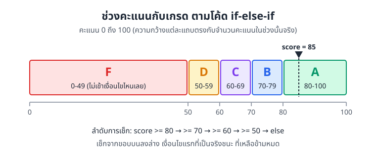
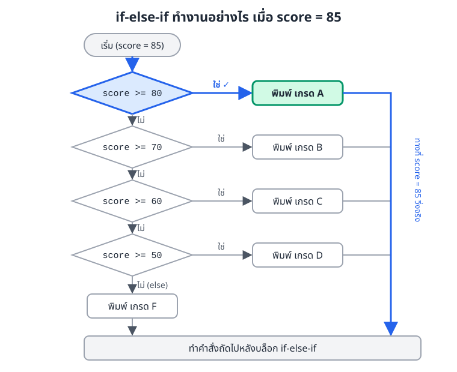
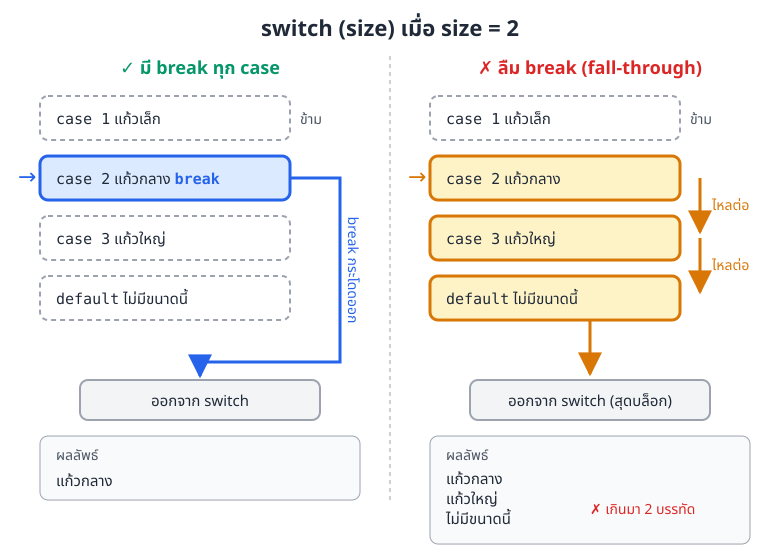
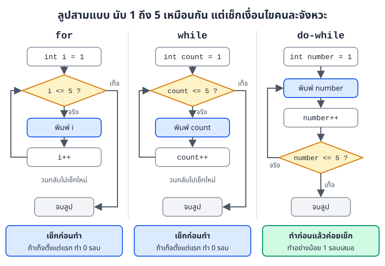
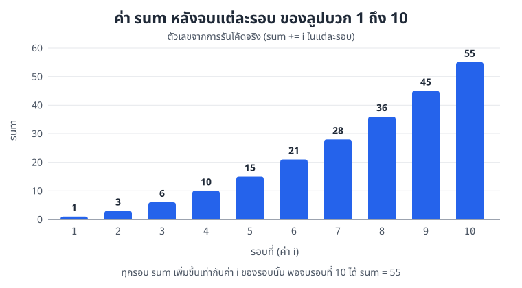
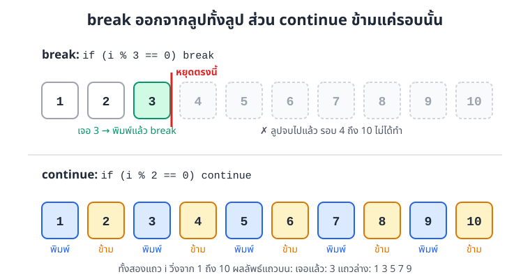

# บทที่ 2: คำสั่งเงื่อนไขและลูป

> โปรแกรมไม่ได้วิ่งจากบรรทัดบนลงล่างตรง ๆ เสมอไป บางช่วงต้องเลือกทางตามเงื่อนไข บางช่วงต้องทำซ้ำหลายรอบ
> บทนี้ว่าด้วยเครื่องมือสองกลุ่มนี้ คือคำสั่งเงื่อนไข (`if`, `switch`) กับลูป (`for`, `while`, `do-while`) และตัวช่วยคุมลูปอย่าง `break` กับ `continue`

## สิ่งที่จะทำได้หลังเรียนบทนี้

1. ใช้คำสั่งเงื่อนไข (conditional statement) `if`, `else`, `switch` เลือกทางเดินของโปรแกรมได้
2. ใช้ลูป (loop) `for`, `while`, `do-while` และ for-each สั่งให้ทำงานซ้ำได้
3. ใช้ `break` และ `continue` คุมลูปได้
4. เลือกคำสั่งที่เหมาะกับโจทย์แต่ละแบบได้
5. เขียนโปรแกรมที่ลำดับการทำงานถูกต้อง **(CLO1)**

## 1. คำสั่งเงื่อนไข

นึกถึงตู้กดน้ำหน้าคณะ หยอดเหรียญครบก็ปล่อยน้ำ ไม่ครบก็คืนเหรียญ ตู้ต้อง "ตัดสินใจ" จากข้อมูลที่มีตอนนั้น ในโค้ด Java เราใช้คำสั่งเงื่อนไขทำหน้าที่เดียวกัน

### 1.1 ตัวดำเนินการเปรียบเทียบ

เงื่อนไขทุกตัวต้องให้ผลเป็น `boolean` คือ `true` หรือ `false` อย่างใดอย่างหนึ่ง ส่วนใหญ่ได้มาจากตัวดำเนินการ (operator) เปรียบเทียบเหล่านี้

| ตัวดำเนินการ | ความหมาย | ตัวอย่าง (ให้ `a = 7`, `b = 5`) | ผล |
|---|---|---|---|
| `==` | เท่ากับ | `a == b` | `false` |
| `!=` | ไม่เท่ากับ | `a != b` | `true` |
| `>` | มากกว่า | `a > b` | `true` |
| `<` | น้อยกว่า | `a < b` | `false` |
| `>=` | มากกว่าหรือเท่ากับ | `a >= b` | `true` |
| `<=` | น้อยกว่าหรือเท่ากับ | `a <= b` | `false` |

ต่อหลายเงื่อนไขเข้าด้วยกันได้ด้วย `&&` (และ), `||` (หรือ), `!` (ไม่) ตามที่เรียนในบทที่ 1

### 1.2 if

`if` ทำบล็อกข้างในก็ต่อเมื่อเงื่อนไขเป็น `true` ถ้าเป็น `false` ก็ข้ามบล็อกไปเลย

```java
int age = 18;

if (age >= 18) {
    System.out.println("บรรลุนิติภาวะแล้ว");
}
```

### 1.3 if-else

ถ้าอยากให้มีอีกทางสำหรับกรณีที่เงื่อนไขไม่จริง ให้เติม `else` โปรแกรมจะเข้าแค่ทางใดทางหนึ่งเสมอ ไม่มีทางเข้าทั้งสองทาง

```java
int score = 75;

if (score >= 50) {
    System.out.println("ผ่าน");
} else {
    System.out.println("ไม่ผ่าน");
}
// ผลลัพธ์: ผ่าน
```

### 1.4 if-else-if

ตัดเกรดเป็นตัวอย่างที่เห็นภาพที่สุด คะแนนหนึ่งค่าต้องตกอยู่ในช่วงเดียว และแต่ละช่วงได้เกรดต่างกัน



*ภาพที่ 2.1 ช่วงคะแนนของแต่ละเกรดตามโค้ดด้านล่าง ความกว้างแต่ละแถบตรงกับจำนวนคะแนนในช่วงนั้น*

```java
int score = 85;

if (score >= 80) {
    System.out.println("เกรด A");
} else if (score >= 70) {
    System.out.println("เกรด B");
} else if (score >= 60) {
    System.out.println("เกรด C");
} else if (score >= 50) {
    System.out.println("เกรด D");
} else {
    System.out.println("เกรด F");
}
// ผลลัพธ์: เกรด A
```

Java เช็กเงื่อนไขทีละข้อจากบนลงล่าง เจอข้อแรกที่เป็นจริงเมื่อไหร่ก็ทำบล็อกนั้น แล้วข้ามที่เหลือทั้งหมดทันที ภาพที่ 2.2 แสดงทางที่ `score = 85` วิ่งจริง คือผ่านแค่เงื่อนไขแรกแล้วออกเลย



*ภาพที่ 2.2 flowchart ของ if-else-if เส้นสีน้ำเงินคือทางที่ score = 85 วิ่งจริง*

เพราะเช็กจากบนลงล่างนี่เอง ข้อ `score >= 70` จึงไม่ต้องเขียน `score < 80` ซ้ำ ถ้ามาถึงข้อนี้ได้ แปลว่าข้อก่อนหน้าไม่จริงแล้ว ลำดับเงื่อนไขจึงสำคัญมาก ถ้าสลับเอา `score >= 50` ขึ้นไปไว้บนสุด ทุกคนที่ได้ 50 ขึ้นไปจะได้ D หมด

### 1.5 if ซ้อน (nested if)

บางเรื่องต้องผ่านด่านแรกก่อนถึงจะมีด่านที่สอง เช่น จะขับรถได้ต้องอายุถึง 18 ก่อน แล้วค่อยดูว่ามีใบขับขี่ไหม

```java
int age = 20;
boolean hasLicense = true;

if (age >= 18) {
    if (hasLicense) {
        System.out.println("ขับรถได้");
    } else {
        System.out.println("ต้องสอบใบขับขี่ก่อน");
    }
} else {
    System.out.println("อายุยังไม่ถึง 18 ปี");
}
// ผลลัพธ์: ขับรถได้
```

ซ้อนได้ แต่อย่าซ้อนลึกเกินสองสามชั้น อ่านยากและหลงวงเล็บง่าย ถ้าแค่อยากเช็กสองเงื่อนไขพร้อมกัน ใช้ `if (age >= 18 && hasLicense)` จะสั้นกว่า

### 1.6 ตัวดำเนินการสามส่วน `? :`

ถ้า if-else มีหน้าที่แค่เลือกค่าหนึ่งในสองค่ามาใส่ตัวแปร (variable) เขียนย่อเป็นบรรทัดเดียวได้ด้วยตัวดำเนินการสามส่วน (ternary operator)

```java
int age = 20;
String status = (age >= 18) ? "ผู้ใหญ่" : "เด็ก";
System.out.println(status);  // ผู้ใหญ่

// เขียนแบบ if-else ได้ผลเท่ากัน
String status2;
if (age >= 18) {
    status2 = "ผู้ใหญ่";
} else {
    status2 = "เด็ก";
}
```

อ่านว่า "ถ้าเงื่อนไขจริง ใช้ค่าหลัง `?` ถ้าไม่จริง ใช้ค่าหลัง `:`" เหมาะกับเงื่อนไขสั้น ๆ เท่านั้น ถ้าเริ่มซ้อน `? :` หลายชั้น กลับไปใช้ if-else ดีกว่า

### 1.7 switch

ตู้กดน้ำมีปุ่ม 1 ถึง 7 แต่ละปุ่มคือเครื่องดื่มคนละอย่าง แบบนี้เราไม่ได้เช็ก "ช่วง" แต่เช็กว่า "ตรงกับค่าไหน" `switch` ทำงานแบบนี้พอดี

```java
int day = 3;
String dayName;

switch (day) {
    case 1:
        dayName = "จันทร์";
        break;
    case 2:
        dayName = "อังคาร";
        break;
    case 3:
        dayName = "พุธ";
        break;
    case 4:
        dayName = "พฤหัสบดี";
        break;
    case 5:
        dayName = "ศุกร์";
        break;
    case 6:
        dayName = "เสาร์";
        break;
    case 7:
        dayName = "อาทิตย์";
        break;
    default:
        dayName = "ไม่ถูกต้อง";
}

System.out.println(dayName);  // พุธ
```

`switch` เอาค่าใน `( )` ไปเทียบกับ `case` ทีละตัว ตรงกับตัวไหนก็กระโดดไปเริ่มทำที่ `case` นั้น ถ้าไม่ตรงเลยก็ไปที่ `default` (จะไม่ใส่ `default` ก็ได้ แต่ควรใส่ไว้รับค่าแปลก ๆ)

### 1.8 fall-through: ลืม break แล้วเกิดอะไรขึ้น

`break` ท้ายแต่ละ `case` คือคำสั่ง "ออกจาก switch เดี๋ยวนี้" ถ้าไม่มี `break` โปรแกรมจะไม่หยุดที่ `case` ถัดไป แต่ไหลลงไปทำต่อเรื่อย ๆ จนเจอ `break` หรือสุดบล็อก อาการนี้เรียกว่า fall-through

```java
int size = 2;

switch (size) {
    case 1:
        System.out.println("แก้วเล็ก");
    case 2:
        System.out.println("แก้วกลาง");
    case 3:
        System.out.println("แก้วใหญ่");
    default:
        System.out.println("ไม่มีขนาดนี้");
}
```

ผลลัพธ์

```
แก้วกลาง
แก้วใหญ่
ไม่มีขนาดนี้
```

ลูกค้าสั่งแก้วกลางแก้วเดียว แต่ได้ข้อความมาสามบรรทัด ภาพที่ 2.3 เทียบให้เห็นว่าสองแบบต่างกันตรงไหน



*ภาพที่ 2.3 switch ที่มี break (ซ้าย) กับที่ลืม break (ขวา) เมื่อ size = 2*

fall-through ไม่ได้แย่เสมอไป บางครั้งเราตั้งใจใช้ เพื่อให้หลาย `case` ทำคำสั่งชุดเดียวกัน เช่น นับจำนวนวันในเดือน

```java
int month = 4;

switch (month) {
    case 4:
    case 6:
    case 9:
    case 11:
        System.out.println("เดือนนี้มี 30 วัน");
        break;
    case 2:
        System.out.println("เดือนนี้มี 28 หรือ 29 วัน");
        break;
    default:
        System.out.println("เดือนนี้มี 31 วัน");
}
// ผลลัพธ์: เดือนนี้มี 30 วัน
```

### 1.9 switch กับ String

ตั้งแต่ Java 7 เป็นต้นมา `switch` ใช้กับ `String` ได้ด้วย (นอกจาก `int`, `char` และชนิดข้อมูลจำนวนเต็มอื่น ๆ)

```java
String grade = "A";

switch (grade) {
    case "A":
        System.out.println("ดีเยี่ยม");
        break;
    case "B":
        System.out.println("ดี");
        break;
    case "C":
        System.out.println("พอใช้");
        break;
    default:
        System.out.println("ต้องปรับปรุง");
}
// ผลลัพธ์: ดีเยี่ยม
```

ตัวพิมพ์เล็กใหญ่มีผล `"a"` ไม่ตรงกับ `case "A"`


**switch แบบลูกศร (Java 14 ขึ้นไป)** Java รุ่นใหม่มี `switch` อีกรูปแบบที่ใช้ `->` แทน `:` แบบนี้ไม่มี fall-through เลยไม่ต้องเขียน `break` และคืนค่าออกมาใส่ตัวแปรได้ตรง ๆ

```java
int day = 6;
String type = switch (day) {
    case 1, 2, 3, 4, 5 -> "วันทำงาน";
    case 6, 7 -> "วันหยุด";
    default -> "ไม่ถูกต้อง";
};
System.out.println(type);  // วันหยุด
```

รู้จักไว้เป็นทางเลือก แต่แบบดั้งเดิมที่มี `break` ต้องอ่านให้คล่อง เพราะเจอในโค้ดที่มีอยู่แล้วเยอะมาก


## 2. ลูป

ไรเดอร์รับงานส่งอาหาร 5 ออร์เดอร์ ทำซ้ำขั้นตอนเดิมห้ารอบ คือรับของ ขี่ไป ส่งของ ถ้าเขียนโค้ดแบบไม่มีลูปต้องก๊อปคำสั่งเดิมห้าชุด ลูปช่วยให้เขียนครั้งเดียวแล้วสั่งวนตามจำนวนที่ต้องการ

ภาพที่ 2.4 สรุปลูปสามแบบหลักไว้ข้างกัน ทั้งสามนับ 1 ถึง 5 ได้เหมือนกัน ที่ต่างคือจังหวะที่เช็กเงื่อนไข



*ภาพที่ 2.4 ลูป for, while และ do-while for กับ while มีรูปร่างเดียวกัน ส่วน do-while ย้ายจุดเช็กไปไว้ท้าย*

### 2.1 for

```java
for (ค่าเริ่มต้น; เงื่อนไข; การปรับค่า) {
    // คำสั่งที่ต้องการทำซ้ำ
}
```

`for` รวมสามเรื่องไว้ในบรรทัดเดียว

1. **ค่าเริ่มต้น** ทำครั้งเดียวตอนเริ่ม เช่น `int i = 1`
2. **เงื่อนไข** เช็กก่อนทุกรอบ ถ้าเป็น `false` ลูปจบ
3. **การปรับค่า** ทำท้ายทุกรอบ เช่น `i++`

```java
// พิมพ์ 1 ถึง 5
for (int i = 1; i <= 5; i++) {
    System.out.print(i + " ");
}
// 1 2 3 4 5

// นับถอยหลัง
for (int i = 10; i >= 1; i--) {
    System.out.print(i + " ");
}
// 10 9 8 7 6 5 4 3 2 1

// เพิ่มทีละ 2
for (int i = 0; i <= 10; i += 2) {
    System.out.print(i + " ");
}
// 0 2 4 6 8 10
```

ตัวแปร `i` ที่ประกาศในวงเล็บของ `for` ใช้ได้แค่ในลูปนั้น พ้นลูปไปแล้วเรียกใช้ไม่ได้

### 2.2 while

```java
while (เงื่อนไข) {
    // คำสั่งที่ต้องการทำซ้ำ
}
```

`while` เช็กเงื่อนไขก่อน ถ้าจริงก็ทำบล็อก แล้ววนกลับไปเช็กใหม่ ต่างจาก `for` ตรงที่ค่าเริ่มต้นกับการปรับค่าเราต้องเขียนเองข้างนอกและข้างในลูป

```java
int count = 1;

while (count <= 5) {
    System.out.print(count + " ");
    count++;   // ลืมบรรทัดนี้เมื่อไหร่ ลูปจะวนไม่จบ
}
// 1 2 3 4 5
```

`while` เหมาะกับงานที่ไม่รู้ล่วงหน้าว่าจะวนกี่รอบ เช่น ให้ผู้ใช้กรอกเลขซ้ำจนกว่าจะอยู่ในช่วงที่ถูกต้อง

```java
// ต้องมี import java.util.Scanner; ไว้บนสุดของไฟล์
Scanner scanner = new Scanner(System.in);
int number = 0;

while (number < 1 || number > 10) {
    System.out.print("กรอกตัวเลข (1-10): ");
    number = scanner.nextInt();
}

System.out.println("ตัวเลขที่ได้: " + number);
```

เราตั้ง `number = 0` ไว้ก่อน ซึ่งอยู่นอกช่วง 1-10 ลูปจึงทำงานรอบแรกแน่นอน

### 2.3 do-while

```java
do {
    // คำสั่งที่ต้องการทำซ้ำ
} while (เงื่อนไข);
```

`do-while` ทำบล็อกก่อน แล้วค่อยเช็กเงื่อนไขท้ายรอบ ผลคือ **ทำอย่างน้อย 1 รอบเสมอ** (สังเกต `;` ปิดท้าย `while (...)` ด้วย ลืมไม่ได้)

```java
int number = 1;

do {
    System.out.print(number + " ");
    number++;
} while (number <= 5);
// 1 2 3 4 5
```

ลองให้เงื่อนไขเป็นเท็จตั้งแต่แรก จะเห็นความต่างชัด

```java
int x = 10;

while (x < 5) {
    System.out.println("while: ไม่ได้พิมพ์บรรทัดนี้");
}

do {
    System.out.println("do-while: พิมพ์ 1 ครั้งแม้เงื่อนไขเป็น false");
} while (x < 5);
```

ผลลัพธ์มีบรรทัดเดียว

```
do-while: พิมพ์ 1 ครั้งแม้เงื่อนไขเป็น false
```

งานที่เข้ากับ `do-while` คือเมนู ต้องแสดงเมนูให้เห็นก่อนอย่างน้อยหนึ่งครั้งถึงจะรู้ว่าผู้ใช้เลือกอะไร เช่น เมนูแอปธนาคาร

```java
import java.util.Scanner;

public class MenuInput {
    public static void main(String[] args) {
        Scanner scanner = new Scanner(System.in);
        int choice;

        do {
            System.out.println("1) เช็กยอดเงิน  2) โอนเงิน  0) ออก");
            System.out.print("เลือกเมนู: ");
            choice = scanner.nextInt();
        } while (choice < 0 || choice > 2);   // เลือกนอก 0-2 ให้แสดงเมนูใหม่

        System.out.println("เมนูที่เลือก: " + choice);
    }
}
```

### 2.4 for-each

ถ้าแค่อยากหยิบสมาชิกในอาร์เรย์ (array) ออกมาทีละตัวจนครบ ใช้ for-each (enhanced for loop) สั้นกว่าและไม่ต้องยุ่งกับเลขตำแหน่ง ใช้ได้ทั้งกับอาร์เรย์และ collection อย่าง `ArrayList`

```java
int[] numbers = {1, 2, 3, 4, 5};

for (int num : numbers) {
    System.out.print(num + " ");
}
// 1 2 3 4 5

String[] names = {"สมชาย", "สมหญิง", "สมศรี"};

for (String name : names) {
    System.out.println("สวัสดี " + name);
}
// สวัสดี สมชาย
// สวัสดี สมหญิง
// สวัสดี สมศรี
```

อ่าน `for (int num : numbers)` ว่า "สำหรับ `num` แต่ละตัวใน `numbers`" ข้อจำกัดคือไม่รู้ว่าตอนนี้อยู่ตำแหน่งที่เท่าไหร่ และใช้แก้ค่าในอาร์เรย์ไม่ได้ เรื่องอาร์เรย์จะลงรายละเอียดใน[บทที่ 3: อาร์เรย์](03-arrays.md)

### 2.5 ลูปซ้อน (nested loop)

ลูปข้างในจะวนครบทุกรอบ ก่อนที่ลูปข้างนอกจะขยับไปหนึ่งรอบ เหมือนเข็มนาทีต้องเดินครบ 60 ครั้ง เข็มชั่วโมงถึงขยับหนึ่งช่อง

```java
// สี่เหลี่ยม 3 แถว แถวละ 5 ดาว
for (int i = 1; i <= 3; i++) {          // แถว
    for (int j = 1; j <= 5; j++) {      // ดาวในแต่ละแถว
        System.out.print("* ");
    }
    System.out.println();               // ขึ้นบรรทัดใหม่เมื่อจบแถว
}
```

ผลลัพธ์

```
* * * * * 
* * * * * 
* * * * * 
```

คำสั่ง `print` ข้างในทำงานทั้งหมด 3 × 5 = 15 ครั้ง อีกตัวอย่างคือตารางสูตรคูณ

```java
for (int i = 1; i <= 5; i++) {
    for (int j = 1; j <= 5; j++) {
        System.out.printf("%3d", i * j);  // %3d จองที่ 3 ช่องให้ตัวเลขตรงกัน
    }
    System.out.println();
}
```

ผลลัพธ์

```
  1  2  3  4  5
  2  4  6  8 10
  3  6  9 12 15
  4  8 12 16 20
  5 10 15 20 25
```

### 2.6 ไล่ค่าตัวแปรทีละรอบ (trace)

เวลาลูปให้ผลไม่ตรงที่คิด วิธีที่ได้ผลที่สุดคือไล่ค่าตัวแปรทีละรอบ จะเขียนลงกระดาษหรือพิมพ์ออกมาดูก็ได้

```java
int sum = 0;
for (int i = 1; i <= 10; i++) {
    sum += i;
    System.out.println("i = " + i + ", sum = " + sum);
}
```

| รอบที่ (`i`) | 1 | 2 | 3 | 4 | 5 | 6 | 7 | 8 | 9 | 10 |
|---|---|---|---|---|---|---|---|---|---|---|
| `sum` หลังจบรอบ | 1 | 3 | 6 | 10 | 15 | 21 | 28 | 36 | 45 | 55 |



*ภาพที่ 2.5 ค่า sum หลังจบแต่ละรอบ จากการรันโค้ดด้านบนจริง แต่ละแท่งสูงกว่าแท่งก่อนหน้าเท่ากับค่า i ของรอบนั้น*

ตารางและภาพที่ 2.5 บอกเราสองเรื่อง เรื่องแรก ลูปนี้วน 10 รอบพอดี (i = 1 ถึง 10) เรื่องที่สอง ผลสุดท้ายคือ 55 ถ้ารันแล้วได้ 45 แปลว่าน่าจะเขียนเงื่อนไขเป็น `i < 10` จนรอบสุดท้ายหายไป

## 3. break และ continue

สองคำสั่งนี้ใช้ในลูป แต่ทำงานต่างกันมาก

- `break` ออกจากลูปทั้งลูปทันที ไม่ทำรอบที่เหลือ
- `continue` ข้ามคำสั่งที่เหลือของรอบนี้ แล้วไปเริ่มรอบถัดไป



*ภาพที่ 2.6 break หยุดลูปทั้งหมดที่ i = 3 ส่วน continue ข้ามแค่รอบที่เป็นเลขคู่ แล้ววนต่อจนครบ 10*

### 3.1 break

```java
// หาเลขแรกที่หาร 3 ลงตัว
for (int i = 1; i <= 10; i++) {
    if (i % 3 == 0) {
        System.out.println("เจอแล้ว: " + i);
        break;  // เจอแล้วไม่ต้องหาต่อ
    }
}
// ผลลัพธ์: เจอแล้ว: 3
```

`break` ช่วยออกจากลูปที่เขียนเงื่อนไขเป็น `while (true)` ด้วย ลูปแบบนี้วนไม่รู้จบถ้าไม่มี `break`

```java
int count = 0;
while (true) {
    count++;
    if (count > 5) {
        break;  // ทางออกเดียวของลูปนี้
    }
    System.out.print(count + " ");
}
// 1 2 3 4 5
```

ในลูปซ้อน `break` ออกแค่ลูปชั้นที่มันอยู่ ลูปข้างนอกยังวนต่อ

### 3.2 continue

```java
// พิมพ์เฉพาะเลขคี่
for (int i = 1; i <= 10; i++) {
    if (i % 2 == 0) {
        continue;  // เลขคู่ ข้ามไปรอบถัดไป
    }
    System.out.print(i + " ");
}
// 1 3 5 7 9

// ข้ามค่าที่ไม่ต้องการ
for (int i = 1; i <= 5; i++) {
    if (i == 3) {
        continue;  // ข้าม 3
    }
    System.out.print(i + " ");
}
// 1 2 4 5
```

ใน `for` พอเจอ `continue` โปรแกรมยังทำส่วนการปรับค่า (`i++`) ตามปกติก่อนเช็กเงื่อนไขรอบถัดไป แต่ใน `while` ถ้าวาง `count++` ไว้หลัง `continue` บรรทัดนั้นจะโดนข้ามไปด้วย แล้วลูปจะวนไม่จบ

## 4. เลือกใช้คำสั่งไหนดี

### 4.1 if หรือ switch

| สถานการณ์ | ใช้ | ตัวอย่าง |
|---|---|---|
| เทียบเป็นช่วง (`>=`, `<`) | `if` | ตัดเกรดจากคะแนน |
| เงื่อนไขซับซ้อน หลายตัวแปร | `if` | อายุ 18 ขึ้นไป **และ** มีใบขับขี่ |
| ตัวแปรเดียว เทียบกับค่าตายตัวหลายค่า | `switch` | เลขวัน 1-7 เป็นชื่อวัน, ปุ่มตู้กดน้ำ |

### 4.2 for, while หรือ do-while

| ลูป | เหมาะเมื่อ | เช็กเงื่อนไข | จำนวนรอบน้อยสุด |
|---|---|---|---|
| `for` | รู้จำนวนรอบแน่นอน มีตัวนับชัดเจน | ก่อนทำแต่ละรอบ | 0 |
| `while` | ไม่รู้ว่าจะวนกี่รอบ วนจนกว่าเงื่อนไขจะเปลี่ยน | ก่อนทำแต่ละรอบ | 0 |
| `do-while` | ต้องทำอย่างน้อยหนึ่งครั้งก่อนเสมอ เช่น เมนู | หลังทำแต่ละรอบ | 1 |
| for-each | หยิบสมาชิกในอาร์เรย์ทีละตัวจนครบ | (จัดการให้เอง) | 0 |

## 5. รูปแบบที่ใช้บ่อย

### 5.1 ตรวจข้อมูลที่ผู้ใช้กรอก (input validation)

```java
import java.util.Scanner;

public class AgeInput {
    public static void main(String[] args) {
        Scanner scanner = new Scanner(System.in);
        int age = -1; // ตั้งค่าเริ่มต้นให้ผิดไว้ก่อน ลูปจะได้ทำงานรอบแรก

        while (age < 0 || age > 150) {
            System.out.print("กรอกอายุ (0-150): ");
            age = scanner.nextInt();

            if (age < 0 || age > 150) {
                System.out.println("อายุไม่ถูกต้อง ลองใหม่");
            }
        }
        System.out.println("อายุที่บันทึก: " + age);
    }
}
```

ถ้ากรอก `200`, `-5` แล้วค่อย `19` จะได้

```
กรอกอายุ (0-150): อายุไม่ถูกต้อง ลองใหม่
กรอกอายุ (0-150): อายุไม่ถูกต้อง ลองใหม่
กรอกอายุ (0-150): อายุที่บันทึก: 19
```

(ตัวเลขที่ผู้ใช้พิมพ์ไม่ปรากฏในผลลัพธ์ด้านบน เพราะเป็นข้อมูลที่ป้อนเข้า ไม่ใช่สิ่งที่โปรแกรมพิมพ์ออกมา)

### 5.2 หาผลรวม

```java
int sum = 0;               // เริ่มจาก 0 เสมอ
for (int i = 1; i <= 100; i++) {
    sum += i;
}
System.out.println("ผลรวม = " + sum);  // ผลรวม = 5050
```

รูปแบบเดียวกับภาพที่ 2.5 แค่วนไปถึง 100

### 5.3 หาค่ามากที่สุด

```java
int[] numbers = {45, 23, 78, 12, 90};
int max = numbers[0];      // สมมติว่าตัวแรกมากสุดไว้ก่อน

for (int num : numbers) {
    if (num > max) {
        max = num;         // เจอตัวที่มากกว่า ก็จำตัวนั้นแทน
    }
}
System.out.println("ค่ามากที่สุด: " + max);  // ค่ามากที่สุด: 90
```

ทำไมเริ่ม `max` จาก `numbers[0]` ไม่ใช่ 0 เพราะถ้าอาร์เรย์มีแต่เลขติดลบ เช่น `{-8, -3, -5}` การเริ่มจาก 0 จะได้คำตอบเป็น 0 ซึ่งไม่มีอยู่ในอาร์เรย์เลย (รอบแรกของลูปจะเทียบ `numbers[0]` กับตัวเอง ไม่เป็นไร แค่เสียไปหนึ่งรอบ)

## 6. ตัวอย่างโปรแกรมสมบูรณ์

ดูไฟล์ [ControlFlowExample.java](../examples/ControlFlowExample.java) โปรแกรมนี้รวมทุกเรื่องในบทไว้ในไฟล์เดียว

* คำสั่งเงื่อนไข `if-else-if`, ตัวดำเนินการสามส่วน และ `switch` ทั้งแบบ `int` และ `String`
* ลูปทุกแบบ พร้อมหา factorial ด้วย `while`
* `break` และ `continue`
* ลูปซ้อน วาดสี่เหลี่ยม สามเหลี่ยม และสูตรคูณ
* ตัวอย่างใช้งานจริง คือหาจำนวนเฉพาะ 2-30 และลำดับ Fibonacci 10 ตัวแรก

ผลลัพธ์บางส่วนเมื่อรัน

```
>>> ส่วนที่ 6: break Statement
หาเลขแรกที่หารด้วย 7 ลงตัว:
พบ: 7

>>> ส่วนที่ 9: ตัวอย่างการใช้งานจริง
จำนวนเฉพาะ 2-30:
2 3 5 7 11 13 17 19 23 29 

Fibonacci 10 ตัวแรก:
0 1 1 2 3 5 8 13 21 34 
```

## ข้อผิดพลาดที่เจอบ่อย

| อาการ | สาเหตุ | แก้ |
|---|---|---|
| `switch` พิมพ์ออกมาหลายบรรทัดเกินคาด | ลืม `break` เกิด fall-through | ใส่ `break` ท้ายทุก `case` ที่ไม่ได้ตั้งใจให้ไหลต่อ |
| ลูปวนไม่จบ | ไม่ได้ปรับค่าตัวนับ หรือเงื่อนไขไม่มีวันเป็นเท็จ | เช็กว่าในลูปมี `count++` หรือคำสั่งที่ทำให้เงื่อนไขเปลี่ยนจริง |
| ลูปขาดไปหนึ่งรอบหรือเกินไปหนึ่งรอบ | สับสนระหว่าง `<` กับ `<=` | ไล่ค่ารอบแรกและรอบสุดท้ายดูทุกครั้ง แบบหัวข้อ 2.6 |
| `if (x = 5)` คอมไพล์ไม่ผ่าน | ใช้ `=` (กำหนดค่า) แทน `==` (เปรียบเทียบ) | เปรียบเทียบใช้ `==` เสมอ |
| เทียบ String ด้วย `==` แล้วได้ผลแปลก | `==` เทียบว่าเป็นออบเจกต์ (object) ตัวเดียวกันไหม ไม่ได้เทียบข้อความ | ใช้ `name.equals("สมชาย")` (`switch` กับ String ใช้ `equals` ให้เองอยู่แล้ว) |
| บล็อกที่ควรวนกลับทำแค่ครั้งเดียว หรือโปรแกรมค้าง | ใส่ `;` ต่อท้าย `for (...)` หรือ `while (...)` ลูปจึงวนแต่คำสั่งว่าง ส่วนบล็อก `{ }` ข้างล่างหลุดออกมาอยู่นอกลูป | ลบ `;` หลังวงเล็บเงื่อนไขทิ้ง (ยกเว้นท้าย `do-while` ที่ต้องมี) |
| เกรดออกมาผิดทั้งที่เงื่อนไขแต่ละข้อดูไม่ผิด | เรียงเงื่อนไขใน if-else-if ผิดลำดับ | เรียงจากเงื่อนไขที่แคบที่สุดหรือค่าสูงสุดลงมา |
| ไม่ใส่ `{ }` แล้วคิดว่าสองบรรทัดอยู่ใน `if` | ไม่มีวงเล็บปีกกา `if` คุมได้แค่คำสั่งเดียวถัดไป | ใส่ `{ }` ทุกครั้ง ถึงจะมีคำสั่งเดียวก็ตาม |

## สรุปท้ายบท

* **if / if-else** เลือกทำหรือไม่ทำ หรือเลือกหนึ่งในสองทาง
* **if-else-if** เลือกหนึ่งทางจากหลายช่วง เช็กจากบนลงล่าง เงื่อนไขแรกที่จริงชนะ
* **`? :`** ย่อ if-else ที่เลือกค่ามาใส่ตัวแปร
* **switch** เลือกหนึ่งทางจากค่าตายตัวหลายค่า ต้องมี `break` กัน fall-through
* **for** วนตามจำนวนรอบที่รู้แน่นอน
* **while** วนจนกว่าเงื่อนไขจะเป็นเท็จ อาจไม่ทำเลยสักรอบ
* **do-while** ทำก่อนเช็กทีหลัง ทำอย่างน้อย 1 รอบ
* **for-each** หยิบสมาชิกในอาร์เรย์ทีละตัว
* **break** ออกจากลูปทันที **continue** ข้ามไปรอบถัดไป

## แบบฝึกหัด

**ข้อ 1** เขียนโปรแกรมตรวจว่าตัวเลขเป็นเลขคู่หรือเลขคี่

<details>

<summary>ดูเฉลย</summary>

เลขคู่หาร 2 ลงตัว แปลว่า `n % 2` เป็น 0

```java
int n = 7;
String kind = (n % 2 == 0) ? "เลขคู่" : "เลขคี่";
System.out.println(n + " เป็น" + kind);
// 7 เป็นเลขคี่
```

</details>

**ข้อ 2** เขียนโปรแกรมหาค่า factorial (n!) เช่น 5! = 5 × 4 × 3 × 2 × 1

<details>

<summary>ดูเฉลย</summary>

ตัวคูณสะสมต้องเริ่มที่ 1 ไม่ใช่ 0 (เริ่มที่ 0 คูณอะไรก็ได้ 0) ใช้ `long` เพราะ factorial โตเร็วมาก `int` เก็บได้ถึงแค่ 12!

```java
int k = 5;
long factorial = 1;
for (int i = 1; i <= k; i++) {
    factorial *= i;
}
System.out.println(k + "! = " + factorial);
// 5! = 120
```

</details>

**ข้อ 3** เขียนโปรแกรมพิมพ์สามเหลี่ยม

```
*
**
***
****
*****
```

<details>

<summary>ดูเฉลย</summary>

แถวที่ `i` มีดาว `i` ดวง ลูปในจึงวนถึง `i` ไม่ใช่ตัวเลขตายตัว

```java
for (int i = 1; i <= 5; i++) {
    for (int j = 1; j <= i; j++) {
        System.out.print("*");
    }
    System.out.println();
}
```

</details>

**ข้อ 4** เขียนโปรแกรมตรวจว่าตัวเลขเป็นจำนวนเฉพาะหรือไม่

<details>

<summary>ดูเฉลย</summary>

จำนวนเฉพาะต้องมากกว่าหรือเท่ากับ 2 และไม่มีตัวไหนหารลงตัวนอกจาก 1 กับตัวมันเอง เช็กตัวหารแค่ถึงรากที่สองก็พอ (`i * i <= num`) เพราะถ้ามีตัวหารที่ใหญ่กว่ารากที่สอง ก็ต้องมีคู่ของมันที่เล็กกว่ารากที่สองอยู่แล้ว เจอตัวหารตัวแรกก็ `break` ได้เลย

```java
int num = 29;
boolean isPrime = num >= 2;
for (int i = 2; i * i <= num; i++) {
    if (num % i == 0) {
        isPrime = false;
        break;
    }
}
System.out.println(num + (isPrime ? " เป็นจำนวนเฉพาะ" : " ไม่เป็นจำนวนเฉพาะ"));
// 29 เป็นจำนวนเฉพาะ
```

</details>

**ข้อ 5** เขียนโปรแกรมพิมพ์ลำดับ Fibonacci 10 ตัวแรก (แต่ละตัวคือผลบวกของสองตัวก่อนหน้า เริ่มจาก 0 กับ 1)

<details>

<summary>ดูเฉลย</summary>

เก็บสองตัวล่าสุดไว้ในตัวแปร `a` กับ `b` แล้วเลื่อนไปทีละรอบ

```java
int a = 0, b = 1;
for (int i = 1; i <= 10; i++) {
    System.out.print(a + " ");
    int next = a + b;
    a = b;
    b = next;
}
// 0 1 1 2 3 5 8 13 21 34
```

</details>

***

[< บทก่อนหน้า: โครงสร้างโปรแกรมและไวยากรณ์พื้นฐานของ Java](01-java-basics.md) | [กลับไปหน้าหลัก](README.md) | [บทถัดไป: อาร์เรย์ >](03-arrays.md)
