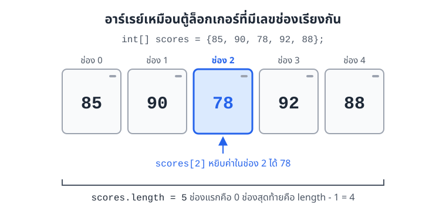
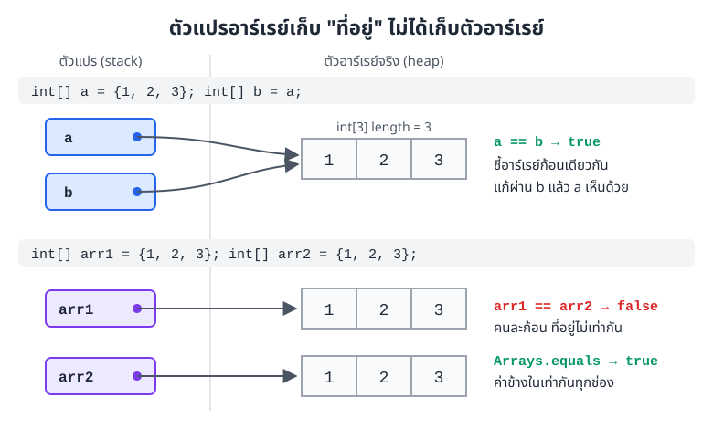
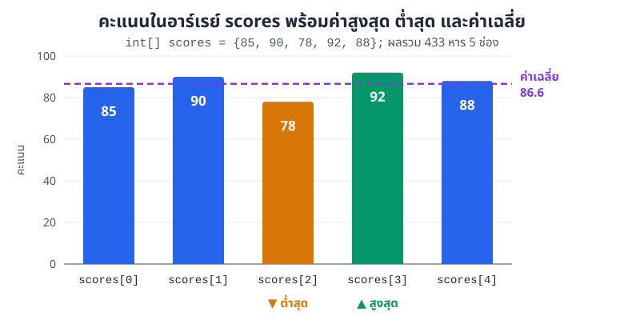
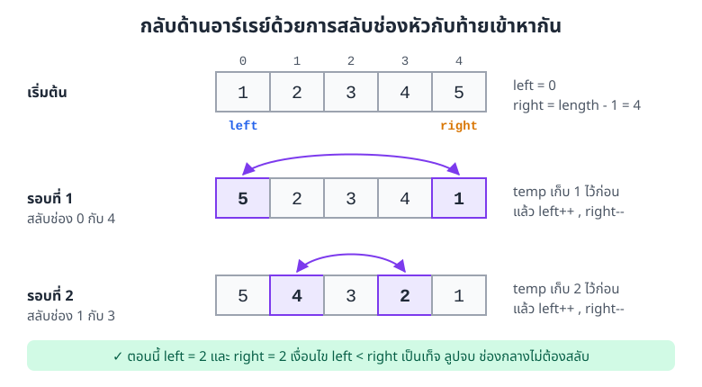
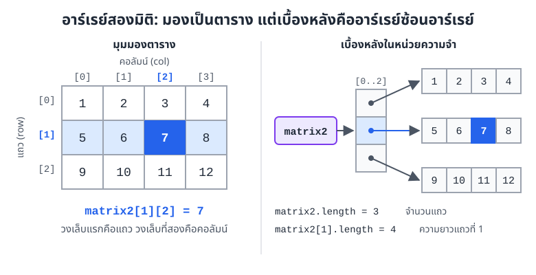
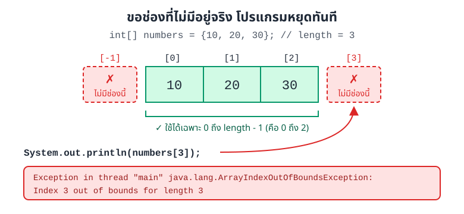

# บทที่ 3: อาร์เรย์

> อาร์เรย์ (array) คือตัวแปรตัวเดียวที่เก็บข้อมูลชนิดเดียวกันได้หลายค่า เรียงเป็นช่องที่มีเลขกำกับตั้งแต่ 0
> พอใช้คู่กับลูป เราจะหาผลรวม ค่าเฉลี่ย ค่าสูงสุด หรือค้นหาข้อมูลได้ในไม่กี่บรรทัด ไม่ว่าข้อมูลจะมี 5 ค่าหรือ 5,000 ค่า

## สิ่งที่จะทำได้หลังเรียนบทนี้

1. ประกาศและสร้างอาร์เรย์ในภาษา Java ได้ทั้งแบบกำหนดขนาดและแบบใส่ค่าเริ่มต้น
2. อ่านและแก้ค่าในอาร์เรย์ผ่าน index และใช้ `length` ได้ถูกต้อง
3. ใช้ลูป `for` และ `for-each` ประมวลผลอาร์เรย์ และเลือกได้ว่าเมื่อไรควรใช้แบบไหน
4. เขียนงานพื้นฐานกับอาร์เรย์ได้ ได้แก่ หาผลรวม ค่าเฉลี่ย ค่าสูงสุด ค่าต่ำสุด ค้นหา สลับค่า คัดลอก และเรียงลำดับ
5. ใช้อาร์เรย์สองมิติเก็บข้อมูลแบบตาราง
6. เขียนโปรแกรมที่ใช้อาร์เรย์ได้ถูกต้อง และเลี่ยงข้อผิดพลาดที่เจอบ่อย **(CLO1)**

## 1. ทำไมต้องมีอาร์เรย์

ลองนึกถึงตู้ล็อกเกอร์หน้าห้องสมุด ตู้หนึ่งแถวมีหลายช่อง แต่ละช่องมีเลขติดไว้ เวลาจะหยิบของ เราไม่ต้องจำว่าตู้ชื่ออะไร แค่บอกเลขช่องก็พอ

อาร์เรย์ทำงานแบบเดียวกัน ตัวแปร (variable) ปกติเก็บได้ค่าเดียว ส่วนอาร์เรย์คือตัวแปรตัวเดียวที่มีหลายช่อง ทุกช่องเก็บข้อมูล**ชนิดข้อมูล (data type) เดียวกัน** และแต่ละช่องมีเลขประจำช่องเรียกว่า **index**



*ภาพที่ 3.1 อาร์เรย์ `scores` เหมือนตู้ล็อกเกอร์ 5 ช่อง เลขช่องเริ่มที่ 0 และช่องสุดท้ายคือ `length - 1`*

สมมติเราต้องเก็บคะแนนสอบของเพื่อน 5 คน ถ้าไม่มีอาร์เรย์ ต้องสร้างตัวแปรแยกทีละตัว

```java
int score1 = 85;
int score2 = 90;
int score3 = 78;
int score4 = 92;
int score5 = 88;

double average = (score1 + score2 + score3 + score4 + score5) / 5.0;
```

แค่ 5 คนก็เริ่มยาวแล้ว ถ้าเป็นทั้งชั้นปี 300 คน โค้ดแบบนี้เขียนไม่ไหว และถ้าจำนวนคนเปลี่ยน ก็ต้องแก้สูตรทุกจุด

พอใช้อาร์เรย์ โค้ดสั้นลงและไม่ขึ้นกับจำนวนคนอีกต่อไป

```java
public class ScoreAverage {
    public static void main(String[] args) {
        int[] scores = {85, 90, 78, 92, 88};

        int sum = 0;
        for (int score : scores) {
            sum += score;
        }

        int averageInt = sum / scores.length;              // หารแบบจำนวนเต็ม เศษหายไป
        double average = (double) sum / scores.length;     // แปลงเป็น double ก่อนหาร

        System.out.println("sum = " + sum);
        System.out.println("averageInt = " + averageInt);
        System.out.println("average = " + average);
    }
}
```

ผลลัพธ์

```
sum = 433
averageInt = 86
average = 86.6
```

ดูบรรทัด `averageInt` ให้ดี `433 / 5` ได้ `86` ไม่ใช่ `86.6` เพราะ `int` หาร `int` ใน Java ได้จำนวนเต็มเสมอ เศษทิ้งไปเลย ถ้าอยากได้ทศนิยม ต้องแปลงตัวใดตัวหนึ่งเป็น `double` ก่อนหาร เรื่องนี้จะกลับมาอีกครั้งในหัวข้อข้อผิดพลาดที่เจอบ่อย

## 2. ประกาศและสร้างอาร์เรย์

### 2.1 รูปแบบคำสั่ง

สร้างอาร์เรย์ได้สองแบบหลัก

```java
// แบบที่ 1: บอกขนาด แล้วค่อยใส่ค่าทีละช่อง
dataType[] arrayName = new dataType[size];

// แบบที่ 2: รู้ค่าอยู่แล้ว ใส่ค่าในปีกกาได้เลย Java นับขนาดให้เอง
dataType[] arrayName = {value1, value2, value3};
```

วงเล็บเหลี่ยม `[]` ต่อท้ายชนิดข้อมูล บอกว่าตัวแปรนี้เป็นอาร์เรย์ เช่น `int[]` อ่านว่า "อาร์เรย์ของ int"

### 2.2 ตัวอย่าง

```java
int[] numbers = new int[5];        // 5 ช่อง ทุกช่องเริ่มเป็น 0
String[] names = new String[3];    // 3 ช่อง ทุกช่องเริ่มเป็น null

int[] scores = {85, 90, 78, 92, 88};
String[] fruits = {"Apple", "Banana", "Orange"};
double[] prices = {19.99, 29.99, 39.99, 49.99};
```

Java เขียน `[]` ไว้หลังชื่อตัวแปรก็ได้ แต่ไม่แนะนำ เพราะอ่านแล้วไม่ชัดว่าชนิดข้อมูลคืออาร์เรย์

```java
int[] numbers1;   // แนะนำ อ่านแล้วรู้ทันทีว่าเป็นอาร์เรย์ของ int
int numbers2[];   // คอมไพล์ผ่าน แต่ไม่แนะนำ
```

### 2.3 ค่าเริ่มต้นเมื่อสร้างด้วย `new`

ถ้าสร้างด้วย `new` แล้วยังไม่ได้ใส่ค่า ทุกช่องจะมีค่าเริ่มต้นตามชนิดข้อมูล

| ชนิดข้อมูลของช่อง | ค่าเริ่มต้น |
|---|---|
| `int`, `long`, `short`, `byte` | `0` |
| `double`, `float` | `0.0` |
| `boolean` | `false` |
| `char` | อักขระรหัส 0 (`'\u0000'`) |
| `String` และออบเจกต์ (object) อื่น ๆ | `null` (ยังไม่ชี้ไปที่ออบเจกต์ใด) |

ขนาดของอาร์เรย์กำหนดครั้งเดียวตอนสร้าง หลังจากนั้นเปลี่ยนไม่ได้ ถ้าอยากได้ช่องเพิ่ม ต้องสร้างอาร์เรย์ใหม่ที่ใหญ่กว่าแล้วคัดลอกค่าไป (ดูหัวข้อ 5.6)

### 2.4 ตัวแปรอาร์เรย์เก็บ "ที่อยู่" ไม่ได้เก็บตัวอาร์เรย์

ใน Java อาร์เรย์เป็นออบเจกต์ ตัวอาร์เรย์จริงอยู่ในหน่วยความจำส่วนที่เรียกว่า heap ส่วนตัวแปร `scores` เก็บแค่ที่อยู่ (reference) ที่บอกว่าอาร์เรย์อยู่ตรงไหน คล้ายกับการจดเลขตู้ล็อกเกอร์ไว้ในกระดาษ ตัวกระดาษไม่ใช่ตู้



*ภาพที่ 3.2 บนสุด `b = a` ไม่ได้สร้างอาร์เรย์ใหม่ แค่ทำให้ `b` ชี้ก้อนเดียวกับ `a` ด้านล่าง `arr1` กับ `arr2` เป็นคนละก้อนที่ค่าข้างในเท่ากัน*

เรื่องนี้ดูเล็ก แต่เป็นที่มาของบั๊กหลายแบบ

- เขียน `int[] b = a;` แล้วแก้ `b[0]` ค่าใน `a[0]` ก็เปลี่ยนด้วย เพราะเป็นอาร์เรย์ก้อนเดียวกัน
- `arr1 == arr2` เทียบที่อยู่ ไม่ได้เทียบค่าข้างใน จึงได้ `false` แม้ค่าทุกช่องเท่ากัน

ทั้งสองเรื่องจะมีโค้ดให้ลองในหัวข้อ 5.6 และ 7.3

## 3. อ่านและแก้ค่าในอาร์เรย์

### 3.1 index เริ่มที่ 0

ช่องแรกของอาร์เรย์คือ index `0` ไม่ใช่ `1` ถ้าอาร์เรย์มี `n` ช่อง index ที่ใช้ได้คือ `0` ถึง `n - 1`

```java
int[] numbers = {10, 20, 30, 40, 50};
// index:         0   1   2   3   4

System.out.println(numbers[0]);  // 10
System.out.println(numbers[2]);  // 30
System.out.println(numbers[4]);  // 50
```

### 3.2 ใส่ค่าลงช่อง

ใช้ชื่ออาร์เรย์ตามด้วย `[index]` ทางซ้ายของ `=` เพื่อเขียนค่าลงช่องนั้น

```java
public class ArrayBasics {
    public static void main(String[] args) {
        int[] numbers = new int[5];        // จองไว้ 5 ช่อง ทุกช่องเป็น 0
        double[] prices = new double[2];   // ทุกช่องเป็น 0.0
        boolean[] flags = new boolean[2];  // ทุกช่องเป็น false
        String[] names = new String[3];    // ทุกช่องเป็น null

        System.out.println(numbers[0] + " " + prices[0] + " " + flags[0] + " " + names[0]);

        int[] scores = new int[5];
        scores[0] = 85;
        scores[1] = 90;
        scores[2] = 78;
        scores[3] = 92;
        scores[4] = 88;

        System.out.println("scores[2] = " + scores[2]);
        System.out.println("length = " + scores.length);
        System.out.println("ตัวสุดท้าย = " + scores[scores.length - 1]);

        for (int i = 0; i < scores.length; i++) {
            System.out.println("scores[" + i + "] = " + scores[i]);
        }
    }
}
```

ผลลัพธ์

```
0 0.0 false null
scores[2] = 78
length = 5
ตัวสุดท้าย = 88
scores[0] = 85
scores[1] = 90
scores[2] = 78
scores[3] = 92
scores[4] = 88
```

### 3.3 `length` บอกจำนวนช่อง

`scores.length` บอกว่าอาร์เรย์มีกี่ช่อง สังเกตว่าไม่มีวงเล็บ `()` ต่อท้าย เพราะ `length` เป็นค่าที่ติดมากับอาร์เรย์ ไม่ใช่เมธอด (method) คนละแบบกับ `String` ที่ต้องเขียน `name.length()`

ประโยชน์หลักของ `length` คือใช้เป็นขอบเขตของลูป ถ้าวันหนึ่งเปลี่ยนจำนวนข้อมูล โค้ดลูปไม่ต้องแก้

ช่องสุดท้ายคือ `scores[scores.length - 1]` เสมอ ถ้าเผลอเขียน `scores[scores.length]` จะเกินไปหนึ่งช่อง และโปรแกรมหยุดทำงานด้วย `ArrayIndexOutOfBoundsException` (ดูภาพที่ 3.6 ในหัวข้อ 7.1)

```java
int[] numbers = {10, 20, 30};
// numbers.length คือ 3 แต่ index ที่ใช้ได้คือ 0, 1, 2 เท่านั้น
System.out.println(numbers[3]);   // เกิด ArrayIndexOutOfBoundsException
```

## 4. วนลูปกับอาร์เรย์

### 4.1 ลูป `for` แบบใช้ index

แบบนี้ใช้บ่อยที่สุด ตัวแปร `i` ไล่ตั้งแต่ `0` ไปจนถึง `length - 1` เงื่อนไขต้องเป็น `i < numbers.length` (น้อยกว่า ไม่ใช่น้อยกว่าหรือเท่ากับ)

```java
int[] numbers = {10, 20, 30, 40, 50};

for (int i = 0; i < numbers.length; i++) {
    System.out.println("numbers[" + i + "] = " + numbers[i]);
}
```

### 4.2 ลูป `for-each`

ถ้าแค่อยากอ่านค่าทุกช่องตามลำดับ ใช้ `for-each` จะสั้นกว่า อ่านว่า "สำหรับ `name` แต่ละตัวใน `names`"

```java
import java.util.Arrays;

public class ForEachDemo {
    public static void main(String[] args) {
        String[] names = {"สมชาย", "สมหญิง", "สมศรี"};
        for (String name : names) {
            System.out.println("สวัสดี " + name);
        }

        int[] numbers = {1, 2, 3, 4, 5};

        // แบบนี้ไม่ได้ผล num เป็นแค่สำเนาของค่าในช่อง
        for (int num : numbers) {
            num = num * 2;
        }
        System.out.println("หลัง for-each: " + Arrays.toString(numbers));

        // ต้องใช้ index เขียนกลับลงช่องโดยตรง
        for (int i = 0; i < numbers.length; i++) {
            numbers[i] = numbers[i] * 2;
        }
        System.out.println("หลัง for แบบ index: " + Arrays.toString(numbers));
    }
}
```

ผลลัพธ์

```
สวัสดี สมชาย
สวัสดี สมหญิง
สวัสดี สมศรี
หลัง for-each: [1, 2, 3, 4, 5]
หลัง for แบบ index: [2, 4, 6, 8, 10]
```

ลูปแรกที่คูณ 2 ไม่มีผลกับอาร์เรย์เลย เพราะทุกรอบ Java คัดลอกค่าในช่องมาใส่ตัวแปร `num` เราแก้ `num` ก็แก้แค่สำเนา ช่องในอาร์เรย์ไม่รู้เรื่องด้วย

### 4.3 เลือกใช้แบบไหนดี

| อยากทำอะไร | ใช้ `for` แบบ index | ใช้ `for-each` |
|---|---|---|
| อ่านค่าทุกช่องตามลำดับ | ได้ | ได้ และสั้นกว่า |
| รู้ว่ากำลังอยู่ช่องที่เท่าไร | ได้ (`i`) | ไม่ได้ |
| เขียนค่าใหม่ลงช่อง | ได้ | ไม่ได้ |
| เดินถอยหลัง หรือข้ามทีละ 2 ช่อง | ได้ | ไม่ได้ |
| เทียบช่องที่อยู่ติดกัน เช่น `a[i]` กับ `a[i + 1]` | ได้ | ไม่ได้ |

สรุปง่าย ๆ ถ้าแค่อ่าน ใช้ `for-each` ถ้าต้องรู้ตำแหน่งหรือต้องแก้ค่า ใช้ `for` แบบ index

## 5. งานพื้นฐานกับอาร์เรย์

งานในหัวข้อนี้เป็นแม่แบบที่ใช้ซ้ำได้แทบทุกโจทย์ ลองอ่านโปรแกรมเต็มก่อน แล้วค่อยดูคำอธิบายทีละส่วน

```java
public class ArrayOperations {
    public static void main(String[] args) {
        int[] numbers = {45, 23, 78, 12, 90, 56};

        // ผลรวม
        int sum = 0;
        for (int num : numbers) {
            sum += num;
        }
        System.out.println("Sum = " + sum);

        // ค่าเฉลี่ย
        double average = (double) sum / numbers.length;
        System.out.printf("Average = %.2f%n", average);

        // ค่าสูงสุดและต่ำสุด เริ่มจากช่องแรกเสมอ
        int max = numbers[0];
        int min = numbers[0];
        for (int num : numbers) {
            if (num > max) {
                max = num;
            }
            if (num < min) {
                min = num;
            }
        }
        System.out.println("Maximum = " + max);
        System.out.println("Minimum = " + min);

        // ค้นหาแบบไล่ทีละช่อง (linear search)
        int target = 90;
        int position = -1;            // -1 แปลว่ายังไม่เจอ
        for (int i = 0; i < numbers.length; i++) {
            if (numbers[i] == target) {
                position = i;
                break;                // เจอแล้วเลิกหา
            }
        }

        if (position != -1) {
            System.out.println("Found " + target + " at index " + position);
        } else {
            System.out.println(target + " not found");
        }
    }
}
```

ผลลัพธ์

```
Sum = 304
Average = 50.67
Maximum = 90
Minimum = 12
Found 90 at index 4
```

### 5.1 หาผลรวม

ตั้งตัวแปร `sum = 0` ไว้นอกลูป แล้วบวกค่าทุกช่องเข้าไป เหมือนพนักงานร้านกาแฟกดเครื่องคิดเงินทีละแก้วจนครบบิล

### 5.2 หาค่าเฉลี่ย

ค่าเฉลี่ยคือผลรวมหารด้วยจำนวนช่อง ต้องเขียน `(double) sum / numbers.length` เพื่อให้ได้ทศนิยม ถ้าไม่แปลงก่อน จะได้คำตอบเป็นจำนวนเต็มอย่างที่เห็นในหัวข้อ 1

### 5.3 หาค่าสูงสุดและต่ำสุด

หลักคิดคือ "สมมติว่าช่องแรกมากที่สุดไปก่อน แล้วไล่ดูทีละช่อง ถ้าเจอตัวที่มากกว่าก็เปลี่ยนแชมป์"

ต้องเริ่ม `max` จาก `numbers[0]` ไม่ใช่ `0` เพราะถ้าข้อมูลติดลบทั้งหมด เช่น `{-5, -2, -9}` การเริ่มจาก `0` จะได้คำตอบ `0` ซึ่งไม่มีอยู่ในอาร์เรย์เลย

ภาพที่ 3.3 ใช้อาร์เรย์ `scores` จากหัวข้อ 1 แสดงค่าที่ลูปหาออกมาได้ ค่าเฉลี่ยคือ 433 / 5 = 86.6 สูงสุดคือ 92 ที่ช่อง 3 และต่ำสุดคือ 78 ที่ช่อง 2



*ภาพที่ 3.3 แผนภูมิแท่งของ `scores = {85, 90, 78, 92, 88}` แท่งสีเขียวคือค่าสูงสุด แท่งสีส้มคือค่าต่ำสุด เส้นประคือค่าเฉลี่ย 86.6*

จากภาพจะเห็นว่ามี 3 ช่องที่สูงกว่าค่าเฉลี่ย (90, 92, 88) ลองเขียนลูปนับจำนวนนี้เองดู เป็นโจทย์แนวเดียวกับที่ออกสอบบ่อย

### 5.4 ค้นหาข้อมูล

ไล่ดูทีละช่องตั้งแต่ช่องแรก เจอเมื่อไรก็จำตำแหน่งไว้แล้ว `break` ออกจากลูป วิธีนี้เรียกว่า linear search

เราใช้ `position = -1` เป็นสัญญาณว่า "ยังไม่เจอ" เพราะ index จริงไม่มีทางติดลบ จึงไม่ต้องมีตัวแปร `found` แยกอีกตัว

### 5.5 สลับค่าสองช่อง และกลับด้านอาร์เรย์

จะสลับค่าในสองช่อง ต้องมีตัวแปรพักไว้หนึ่งตัว เหมือนสลับน้ำในแก้วสองใบ ต้องมีแก้วเปล่าใบที่สามมาช่วย ถ้าเขียน `a[0] = a[4]; a[4] = a[0];` ตรง ๆ ค่าเดิมของ `a[0]` จะหายไปตั้งแต่บรรทัดแรก

ใช้การสลับนี้กลับด้านอาร์เรย์ได้ โดยให้ `left` เริ่มที่หัว `right` เริ่มที่ท้าย สลับกันแล้วขยับเข้าหากันจนสวนกัน



*ภาพที่ 3.4 กลับด้านอาร์เรย์ 5 ช่องใช้แค่ 2 รอบ ช่องกลางอยู่ที่เดิมอยู่แล้วจึงไม่ต้องสลับ*

```java
import java.util.Arrays;

public class ReverseArray {
    public static void main(String[] args) {
        int[] numbers = {1, 2, 3, 4, 5};

        int left = 0;
        int right = numbers.length - 1;
        while (left < right) {
            // สลับค่าสองช่อง ต้องมีตัวแปรพักไว้ก่อน
            int temp = numbers[left];
            numbers[left] = numbers[right];
            numbers[right] = temp;

            System.out.println("สลับ index " + left + " กับ " + right + " -> " + Arrays.toString(numbers));
            left++;
            right--;
        }
    }
}
```

ผลลัพธ์

```
สลับ index 0 กับ 4 -> [5, 2, 3, 4, 1]
สลับ index 1 กับ 3 -> [5, 4, 3, 2, 1]
```

### 5.6 คัดลอกอาร์เรย์

จากภาพที่ 3.2 เรารู้แล้วว่า `int[] alias = original;` ไม่ใช่การคัดลอก ได้แค่ป้ายชื่อใหม่ที่ชี้อาร์เรย์ก้อนเดิม ถ้าอยากได้สำเนาแยกจริง ๆ มี 3 วิธี

```java
import java.util.Arrays;

public class CopyAndCompare {
    public static void main(String[] args) {
        int[] original = {1, 2, 3, 4, 5};

        // ไม่ใช่การคัดลอก แค่ได้ป้ายชื่อใหม่ชี้ไปที่อาร์เรย์เดิม
        int[] alias = original;
        alias[0] = 99;
        System.out.println("original หลังแก้ alias: " + Arrays.toString(original));
        original[0] = 1;   // คืนค่าเดิม

        // วิธีที่ 1: วนลูปคัดลอกเอง
        int[] copy1 = new int[original.length];
        for (int i = 0; i < original.length; i++) {
            copy1[i] = original[i];
        }

        // วิธีที่ 2: Arrays.copyOf
        int[] copy2 = Arrays.copyOf(original, original.length);

        // วิธีที่ 3: System.arraycopy(ต้นทาง, เริ่มที่, ปลายทาง, เริ่มที่, จำนวน)
        int[] copy3 = new int[original.length];
        System.arraycopy(original, 0, copy3, 0, original.length);

        copy1[0] = 100;
        System.out.println("original: " + Arrays.toString(original));
        System.out.println("copy1:    " + Arrays.toString(copy1));
        System.out.println("copy2:    " + Arrays.toString(copy2));
        System.out.println("copy3:    " + Arrays.toString(copy3));

        // เปรียบเทียบ
        int[] arr1 = {1, 2, 3};
        int[] arr2 = {1, 2, 3};
        System.out.println("arr1 == arr2 : " + (arr1 == arr2));
        System.out.println("Arrays.equals: " + Arrays.equals(arr1, arr2));

        // เรียงลำดับ
        int[] unsorted = {45, 23, 78, 12, 90};
        Arrays.sort(unsorted);
        System.out.println("sorted: " + Arrays.toString(unsorted));
    }
}
```

ผลลัพธ์

```
original หลังแก้ alias: [99, 2, 3, 4, 5]
original: [1, 2, 3, 4, 5]
copy1:    [100, 2, 3, 4, 5]
copy2:    [1, 2, 3, 4, 5]
copy3:    [1, 2, 3, 4, 5]
arr1 == arr2 : false
Arrays.equals: true
sorted: [12, 23, 45, 78, 90]
```

บรรทัดแรกของผลลัพธ์ยืนยันว่าแก้ผ่าน `alias` แล้ว `original` เปลี่ยนตาม ส่วน `copy1` แก้ช่องแรกเป็น 100 แล้ว `original` ยังเหมือนเดิม เพราะเป็นอาร์เรย์คนละก้อน

`Arrays.copyOf` ใส่ความยาวใหม่ที่มากกว่าเดิมได้ด้วย เช่น `Arrays.copyOf(original, 10)` จะได้อาร์เรย์ 10 ช่อง ช่องที่เกินมาเป็น `0` นี่คือวิธี "ขยาย" อาร์เรย์ที่พูดถึงในหัวข้อ 2.3

### 5.7 เรียงลำดับ

`Arrays.sort(numbers)` เรียงค่าจากน้อยไปมาก และแก้อาร์เรย์ตัวเดิมเลย ไม่ได้สร้างตัวใหม่คืนมา ต้อง `import java.util.Arrays;` ไว้บนสุดของไฟล์ก่อนประกาศคลาส (class)

### 5.8 เมธอดช่วยในคลาส `Arrays`

| เมธอด | ทำอะไร | ตัวอย่างผล |
|---|---|---|
| `Arrays.toString(a)` | แปลงอาร์เรย์เป็นข้อความไว้พิมพ์ | `[1, 2, 3]` |
| `Arrays.sort(a)` | เรียงจากน้อยไปมาก แก้ตัวเดิม | `{3, 1, 2}` กลายเป็น `{1, 2, 3}` |
| `Arrays.copyOf(a, n)` | สร้างสำเนายาว `n` ช่อง | สำเนาใหม่ คนละก้อนกับ `a` |
| `Arrays.equals(a, b)` | เทียบค่าทุกช่องว่าเท่ากันไหม | `true` หรือ `false` |
| `Arrays.fill(a, v)` | ใส่ค่า `v` ลงทุกช่อง | `Arrays.fill(a, -1)` |

ถ้าสั่ง `System.out.println(a)` ตรง ๆ จะได้ข้อความแปลก ๆ เช่น `[I@1b6d3586` ซึ่งเป็นรหัสบอกชนิดและที่อยู่ของออบเจกต์ ไม่ใช่ค่าในช่อง ต้องใช้ `Arrays.toString(a)` เสมอ

## 6. อาร์เรย์หลายมิติ

### 6.1 อาร์เรย์สองมิติ

ข้อมูลหลายอย่างมีหน้าตาเป็นตาราง เช่น ผังที่นั่งในโรงหนัง ตารางคะแนนหลายวิชา หรือตารางสูตรคูณ อาร์เรย์สองมิติเก็บข้อมูลแบบนี้ได้ตรงตัว โดยใช้วงเล็บสองคู่ `[แถว][คอลัมน์]`

```java
int[][] matrix = new int[3][4];   // 3 แถว 4 คอลัมน์ ทุกช่องเป็น 0
matrix[0][0] = 100;
matrix[1][2] = 200;

int[][] matrix2 = {
    {1, 2, 3, 4},
    {5, 6, 7, 8},
    {9, 10, 11, 12}
};
System.out.println(matrix2[0][0]);   // 1
System.out.println(matrix2[1][2]);   // 7
System.out.println(matrix2[2][3]);   // 12
```

เบื้องหลังจริง ๆ แล้ว Java ไม่มีตารางสองมิติ สิ่งที่มีคืออาร์เรย์ที่แต่ละช่องเก็บที่อยู่ของอาร์เรย์อีกตัว (อาร์เรย์ซ้อนอาร์เรย์) ภาพที่ 3.5 วางทั้งสองมุมมองไว้เทียบกัน



*ภาพที่ 3.5 ซ้ายคือมุมมองตาราง `matrix2[1][2]` หมายถึงแถว 1 คอลัมน์ 2 ขวาคือของจริงในหน่วยความจำ `matrix2` ชี้อาร์เรย์ 3 ช่อง แต่ละช่องชี้แถวหนึ่งแถว*

พอเข้าใจภาพขวา สองเรื่องนี้จะตามมาเอง

- `matrix2.length` ได้ `3` คือจำนวนแถว (จำนวนช่องของอาร์เรย์ชั้นนอก)
- `matrix2[1].length` ได้ `4` คือความยาวของแถวที่ 1

### 6.2 วนลูปกับอาร์เรย์สองมิติ

ใช้ลูปซ้อนสองชั้น ชั้นนอกเดินตามแถว ชั้นในเดินตามคอลัมน์ ให้ใช้ `matrix2[i].length` เป็นขอบเขตของลูปใน เพราะแต่ละแถวอาจยาวไม่เท่ากัน (ดูหัวข้อ 6.4)

```java
public class TwoDArray {
    public static void main(String[] args) {
        int[][] matrix = new int[3][4];   // 3 แถว 4 คอลัมน์ ทุกช่องเป็น 0
        matrix[0][0] = 100;
        matrix[1][2] = 200;
        System.out.println("matrix[1][2] = " + matrix[1][2]);

        int[][] matrix2 = {
            {1, 2, 3, 4},
            {5, 6, 7, 8},
            {9, 10, 11, 12}
        };
        System.out.println(matrix2[0][0]);   // 1
        System.out.println(matrix2[1][2]);   // 7
        System.out.println(matrix2[2][3]);   // 12
        System.out.println("rows = " + matrix2.length + ", cols = " + matrix2[0].length);

        // แบบ index
        for (int i = 0; i < matrix2.length; i++) {           // i = แถว
            for (int j = 0; j < matrix2[i].length; j++) {    // j = คอลัมน์
                System.out.printf("%3d", matrix2[i][j]);
            }
            System.out.println();
        }

        // แบบ for-each แต่ละแถวคืออาร์เรย์ int[] หนึ่งตัว
        for (int[] row : matrix2) {
            for (int value : row) {
                System.out.print(value + " ");
            }
            System.out.println();
        }

        // อาร์เรย์ที่แต่ละแถวยาวไม่เท่ากัน (jagged array)
        int[][] jagged = {
            {1},
            {2, 3},
            {4, 5, 6}
        };
        for (int[] row : jagged) {
            System.out.println("แถวนี้ยาว " + row.length);
        }
    }
}
```

ผลลัพธ์

```
matrix[1][2] = 200
1
7
12
rows = 3, cols = 4
  1  2  3  4
  5  6  7  8
  9 10 11 12
1 2 3 4 
5 6 7 8 
9 10 11 12 
แถวนี้ยาว 1
แถวนี้ยาว 2
แถวนี้ยาว 3
```

ในลูป `for-each` ชั้นนอก ตัวแปร `row` มีชนิดเป็น `int[]` ตรงกับภาพที่ 3.5 ฝั่งขวา คือแต่ละรอบเราหยิบแถวออกมาทั้งแถว

### 6.3 ตัวอย่าง: ตารางคะแนน

เก็บคะแนนนักศึกษา 3 คน คนละ 4 วิชา ให้แถวคือคน คอลัมน์คือวิชา ถ้าอยากได้ค่าเฉลี่ยรายคน ให้ลูปนอกเดินตามแถว ถ้าอยากได้ค่าเฉลี่ยรายวิชา ให้สลับ ลูปนอกเดินตามคอลัมน์แทน

```java
public class ScoreTable {
    public static void main(String[] args) {
        // นักศึกษา 3 คน คนละ 4 วิชา
        int[][] scores = {
            {85, 90, 78, 92},   // คนที่ 1
            {88, 85, 90, 87},   // คนที่ 2
            {75, 80, 85, 90}    // คนที่ 3
        };

        // ค่าเฉลี่ยของแต่ละคน (เดินตามแถว)
        for (int i = 0; i < scores.length; i++) {
            int sum = 0;
            for (int j = 0; j < scores[i].length; j++) {
                sum += scores[i][j];
            }
            double average = (double) sum / scores[i].length;
            System.out.printf("Student %d average: %.2f%n", i + 1, average);
        }

        // ค่าเฉลี่ยของแต่ละวิชา (เดินตามคอลัมน์)
        for (int j = 0; j < scores[0].length; j++) {
            int sum = 0;
            for (int i = 0; i < scores.length; i++) {
                sum += scores[i][j];
            }
            System.out.printf("Subject %d average: %.2f%n", j + 1, (double) sum / scores.length);
        }
    }
}
```

ผลลัพธ์

```
Student 1 average: 86.25
Student 2 average: 87.50
Student 3 average: 82.50
Subject 1 average: 82.67
Subject 2 average: 85.00
Subject 3 average: 84.33
Subject 4 average: 89.67
```

`%n` ใน `printf` คือขึ้นบรรทัดใหม่ ใช้แทน `\n` ได้และทำงานถูกต้องทุกระบบปฏิบัติการ

### 6.4 แถวยาวไม่เท่ากันก็ได้

เพราะแต่ละแถวเป็นอาร์เรย์แยกกัน แต่ละแถวจึงยาวไม่เท่ากันได้ เรียกว่า jagged array เช่น `jagged` ในตัวอย่าง 6.2 นี่คือเหตุผลที่ลูปในควรใช้ `matrix[i].length` ไม่ใช่ `matrix[0].length` หรือเลขตายตัว

## 7. ข้อผิดพลาดที่เจอบ่อย

### 7.1 ใช้ index เกินขอบเขต (`ArrayIndexOutOfBoundsException`)

เป็นข้อผิดพลาดอันดับหนึ่งของบทนี้ คอมไพล์ผ่าน แต่พอรันถึงบรรทัดนั้น โปรแกรมหยุดทันทีพร้อม exception



*ภาพที่ 3.6 อาร์เรย์ยาว 3 ช่อง ไม่มีช่อง `[3]` และไม่มีช่อง `[-1]` เรียกเมื่อไรเกิด `ArrayIndexOutOfBoundsException` ทันที*

```java
public class Pitfalls {
    public static void main(String[] args) {
        int[] numbers = {10, 20, 30};

        int index = 3;
        if (index >= 0 && index < numbers.length) {
            System.out.println(numbers[index]);
        } else {
            System.out.println("index " + index + " อยู่นอกช่วง 0 ถึง " + (numbers.length - 1));
        }

        int[] empty = null;
        if (empty != null) {
            System.out.println(empty.length);
        } else {
            System.out.println("ยังไม่ได้สร้างอาร์เรย์");
        }

        System.out.println(numbers[3]);   // บรรทัดนี้จะเกิด exception
    }
}
```

ผลลัพธ์

```
index 3 อยู่นอกช่วง 0 ถึง 2
ยังไม่ได้สร้างอาร์เรย์
Exception in thread "main" java.lang.ArrayIndexOutOfBoundsException: Index 3 out of bounds for length 3
	at Pitfalls.main(Pitfalls.java:19)
```

ข้อความ exception บอกครบว่า index ที่ขอคือ 3 อาร์เรย์ยาว 3 และเกิดที่บรรทัดไหนของไฟล์ อ่านข้อความนี้ก่อนทุกครั้งที่โปรแกรมพัง

ต้นเหตุที่เจอบ่อยที่สุดคือเขียนเงื่อนไขลูปเป็น `i <= numbers.length` รอบสุดท้าย `i` จะเท่ากับ `length` พอดี เกินไปหนึ่งช่อง ให้ใช้ `i < numbers.length` เสมอ

ถ้า index มาจากผู้ใช้หรือจากการคำนวณ ให้ตรวจทั้งสองฝั่งก่อนใช้ คือ `index >= 0 && index < numbers.length` อย่างในโค้ดข้างบน

### 7.2 ใช้อาร์เรย์ที่ยังเป็น `null` (`NullPointerException`)

ตัวแปร `int[] empty = null;` ยังไม่ได้ชี้อาร์เรย์ก้อนไหน ถ้าเรียก `empty.length` หรือ `empty[0]` จะเกิด `NullPointerException` ให้ตรวจ `empty != null` ก่อน หรือดีกว่านั้นคือสร้างอาร์เรย์ด้วย `new` หรือ `{...}` ตั้งแต่ตอนประกาศ

### 7.3 ใช้ `==` เทียบอาร์เรย์

`arr1 == arr2` ถามว่า "สองตัวแปรนี้ชี้อาร์เรย์ก้อนเดียวกันไหม" ไม่ได้ถามว่า "ค่าข้างในเท่ากันไหม" ผลจาก `CopyAndCompare` ในหัวข้อ 5.6 จึงเป็น `false` ทั้งที่ค่าเหมือนกันทุกช่อง ถ้าอยากเทียบค่า ใช้ `Arrays.equals(arr1, arr2)` (ย้อนดูภาพที่ 3.2)

### 7.4 คิดว่า `b = a` คือการคัดลอก

`int[] b = a;` ทำให้ `b` ชี้ก้อนเดียวกับ `a` แก้ตัวหนึ่ง อีกตัวเปลี่ยนตาม ถ้าต้องการสำเนาแยก ใช้วิธีในหัวข้อ 5.6

### 7.5 แก้ค่าในลูป `for-each`

ตัวแปรใน `for-each` เป็นสำเนาของค่าในช่อง กำหนดค่าใหม่ให้มันไม่กระทบอาร์เรย์ ต้องใช้ `for` แบบ index (หัวข้อ 4.2)

### 7.6 หารแล้วทศนิยมหาย

`sum / scores.length` เมื่อทั้งสองเป็น `int` ได้ผลเป็นจำนวนเต็ม ต้องเขียน `(double) sum / scores.length` อย่าเขียน `(double) (sum / scores.length)` เพราะแบบนั้นหารเป็นจำนวนเต็มเสร็จแล้ว เศษหายไปก่อนจะแปลง

### 7.7 พิมพ์อาร์เรย์ตรง ๆ

`System.out.println(scores)` ได้ข้อความแบบ `[I@1b6d3586` ไม่ใช่ค่าในอาร์เรย์ ใช้ `Arrays.toString(scores)` แทน และ `import java.util.Arrays;` ไว้บนสุดของไฟล์

## 8. ตัวอย่างโปรแกรมสมบูรณ์

ดูไฟล์ [ArraysExample.java](../examples/ArraysExample.java) โปรแกรมนี้รวมทุกเรื่องในบทไว้ในไฟล์เดียว

* สร้างและใช้อาร์เรย์ทั้งแบบใส่ค่าเริ่มต้นและแบบ `new`
* หาผลรวม ค่าเฉลี่ย ค่าสูงสุด ค่าต่ำสุด และค้นหา
* เรียงลำดับด้วย `Arrays.sort`
* อาร์เรย์สองมิติ และตารางคะแนนที่หาค่าเฉลี่ยทั้งรายคนและรายวิชา

ถ้ารันบน Windows แล้วภาษาไทยในผลลัพธ์กลายเป็น `?` ให้รันด้วย `java -Dstdout.encoding=UTF-8 ArraysExample` (Java 19 ขึ้นไป) หรือตั้ง encoding ของ terminal เป็น UTF-8

## สรุปท้ายบท

* **อาร์เรย์** เก็บข้อมูลชนิดเดียวกันได้หลายค่าในตัวแปรตัวเดียว ขนาดกำหนดครั้งเดียวตอนสร้าง
* **index** เริ่มที่ `0` และช่องสุดท้ายคือ `length - 1`
* **`length`** บอกจำนวนช่อง ไม่มี `()` ต่อท้าย ใช้เป็นขอบเขตลูปเสมอ
* **ตัวแปรอาร์เรย์เก็บที่อยู่** `b = a` จึงไม่ใช่การคัดลอก และ `==` เทียบที่อยู่ ไม่ได้เทียบค่า
* **`for` แบบ index** ใช้เมื่อต้องรู้ตำแหน่งหรือต้องแก้ค่า **`for-each`** ใช้เมื่อแค่อ่าน
* **แม่แบบที่ใช้บ่อย** ผลรวม ค่าเฉลี่ย (อย่าลืม `double`) ค่าสูงสุดต่ำสุด (เริ่มจากช่องแรก) ค้นหา (`-1` คือไม่เจอ) สลับค่า (ใช้ `temp`)
* **อาร์เรย์สองมิติ** คืออาร์เรย์ซ้อนอาร์เรย์ `a.length` คือจำนวนแถว `a[i].length` คือความยาวแถว `i`
* **คลาส `Arrays`** มีเมธอดช่วย เช่น `toString`, `sort`, `copyOf`, `equals`, `fill`

## แบบฝึกหัด

**ข้อ 1** เขียนโปรแกรมรับคะแนนของนักศึกษา 5 คนจากแป้นพิมพ์ เก็บในอาร์เรย์ แล้วแสดงค่าเฉลี่ยทศนิยม 2 ตำแหน่ง

<details>
<summary>ดูเฉลย</summary>

```java
import java.util.Scanner;

public class Ex1Average {
    public static void main(String[] args) {
        Scanner sc = new Scanner(System.in);
        int[] scores = new int[5];

        for (int i = 0; i < scores.length; i++) {
            System.out.print("คะแนนคนที่ " + (i + 1) + ": ");
            scores[i] = sc.nextInt();
        }

        int sum = 0;
        for (int score : scores) {
            sum += score;
        }
        System.out.printf("ค่าเฉลี่ย = %.2f%n", (double) sum / scores.length);
    }
}
```

ถ้าป้อน `80 75 90 65 88` จะได้ `ค่าเฉลี่ย = 79.60` ตอนรับค่าต้องใช้ `for` แบบ index เพราะต้องเขียนลงช่อง ส่วนตอนรวมใช้ `for-each` ได้เพราะแค่อ่าน

</details>

**ข้อ 2** เขียนโปรแกรมตรวจว่าในอาร์เรย์ `{4, 7, 1, 7, 9}` มีเลขซ้ำหรือไม่ และซ้ำที่ index ไหน

<details>
<summary>ดูเฉลย</summary>

```java
public class Ex2Duplicate {
    public static void main(String[] args) {
        int[] numbers = {4, 7, 1, 7, 9};
        boolean hasDuplicate = false;

        // เทียบทุกคู่ j เริ่มที่ i + 1 จะได้ไม่เทียบกับตัวเองและไม่เทียบคู่เดิมซ้ำ
        for (int i = 0; i < numbers.length; i++) {
            for (int j = i + 1; j < numbers.length; j++) {
                if (numbers[i] == numbers[j]) {
                    hasDuplicate = true;
                    System.out.println("เลข " + numbers[i] + " ซ้ำที่ index " + i + " และ " + j);
                }
            }
        }
        System.out.println("มีเลขซ้ำ: " + hasDuplicate);
    }
}
```

ผลลัพธ์

```
เลข 7 ซ้ำที่ index 1 และ 3
มีเลขซ้ำ: true
```

</details>

**ข้อ 3** เขียนโปรแกรมกลับด้านอาร์เรย์ เช่น `{1, 2, 3, 4, 5}` กลายเป็น `{5, 4, 3, 2, 1}` โดยไม่สร้างอาร์เรย์ใหม่

<details>
<summary>ดูเฉลย</summary>

ใช้โปรแกรม `ReverseArray` ในหัวข้อ 5.5 ได้เลย หัวใจคือสลับ `numbers[left]` กับ `numbers[right]` ด้วยตัวแปร `temp` แล้วขยับ `left++` กับ `right--` จนกว่า `left < right` จะเป็นเท็จ (ภาพที่ 3.4)

ถ้าอยากเขียนด้วยลูป `for` ก็ได้ ให้วนแค่ครึ่งอาร์เรย์

```java
for (int i = 0; i < numbers.length / 2; i++) {
    int temp = numbers[i];
    numbers[i] = numbers[numbers.length - 1 - i];
    numbers[numbers.length - 1 - i] = temp;
}
```

ถ้าวนครบทั้งอาร์เรย์แทนที่จะวนครึ่งเดียว แต่ละคู่จะสลับสองรอบ อาร์เรย์เลยกลับมาเหมือนเดิม

</details>

**ข้อ 4** สร้างตารางสูตรคูณ 12 × 12 เก็บในอาร์เรย์สองมิติ แล้วพิมพ์ออกมาเป็นตาราง

<details>
<summary>ดูเฉลย</summary>

```java
public class Ex4Times {
    public static void main(String[] args) {
        int[][] table = new int[12][12];

        for (int i = 0; i < table.length; i++) {
            for (int j = 0; j < table[i].length; j++) {
                table[i][j] = (i + 1) * (j + 1);   // index เริ่ม 0 แต่สูตรคูณเริ่ม 1
            }
        }

        for (int[] row : table) {
            for (int value : row) {
                System.out.printf("%4d", value);
            }
            System.out.println();
        }
    }
}
```

สามบรรทัดแรกของผลลัพธ์

```
   1   2   3   4   5   6   7   8   9  10  11  12
   2   4   6   8  10  12  14  16  18  20  22  24
   3   6   9  12  15  18  21  24  27  30  33  36
```

</details>

**ข้อ 5** รวมอาร์เรย์ `{1, 2, 3}` กับ `{10, 20}` เป็นอาร์เรย์ใหม่ตัวเดียว

<details>
<summary>ดูเฉลย</summary>

```java
import java.util.Arrays;

public class Ex5Merge {
    public static void main(String[] args) {
        int[] a = {1, 2, 3};
        int[] b = {10, 20};

        int[] merged = new int[a.length + b.length];
        for (int i = 0; i < a.length; i++) {
            merged[i] = a[i];
        }
        for (int i = 0; i < b.length; i++) {
            merged[a.length + i] = b[i];   // ต่อท้ายจากช่องสุดท้ายของ a
        }
        System.out.println(Arrays.toString(merged));
    }
}
```

ผลลัพธ์คือ `[1, 2, 3, 10, 20]` ขนาดอาร์เรย์เปลี่ยนไม่ได้ จึงต้องสร้างตัวใหม่ที่ยาว `a.length + b.length` ไว้ก่อน

</details>

**ข้อ 6 (แนวข้อสอบ)** ให้อาร์เรย์สองมิติต่อไปนี้ นับว่ามีกี่ช่องที่เป็นเลขคู่และมากกว่า 0 และหาผลรวมของช่องเหล่านั้น

```java
int[][] grid = {
    {3, -1, 8},
    {0, 12, -5},
    {7, 4, 10}
};
```

<details>
<summary>ดูเฉลย</summary>

```java
public class Ex6Count {
    public static void main(String[] args) {
        int[][] grid = {
            {3, -1, 8},
            {0, 12, -5},
            {7, 4, 10}
        };

        int count = 0;
        int sum = 0;
        for (int[] row : grid) {
            for (int value : row) {
                if (value > 0 && value % 2 == 0) {   // บวกและเป็นเลขคู่
                    count++;
                    sum += value;
                }
            }
        }
        System.out.println("count = " + count + ", sum = " + sum);
    }
}
```

ผลลัพธ์คือ `count = 4, sum = 34` (ช่องที่ผ่านคือ 8, 12, 4, 10) ส่วน `0` เป็นเลขคู่แต่ไม่มากกว่า 0 จึงไม่นับ

</details>

### แนวข้อสอบ

1. นับสมาชิกในอาร์เรย์ตามเงื่อนไขที่โจทย์กำหนด ลองทำได้ที่ [https://onlinegdb.com/usPeZEuDUG](https://onlinegdb.com/usPeZEuDUG)
2. โจทย์ให้ข้อมูลมาเป็นอาร์เรย์สองมิติ แล้วให้ตรวจเงื่อนไขตามที่กำหนด
3. หาผลรวมของสมาชิกในอาร์เรย์สองมิติที่ผ่านเงื่อนไขที่โจทย์กำหนด (แบบเดียวกับข้อ 6)

***

[< บทก่อนหน้า: คำสั่งเงื่อนไขและลูป](02-control-flow.md) | [กลับไปหน้าหลัก](../) | [บทถัดไป: เริ่มต้น OOP และ Abstraction >](04-oop-abstraction.md)
