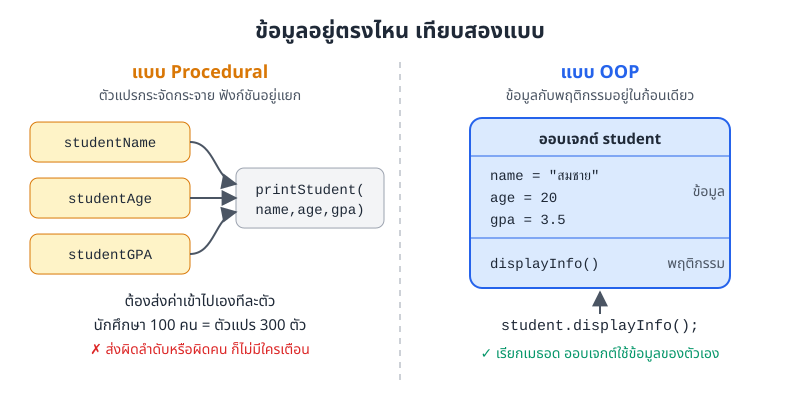
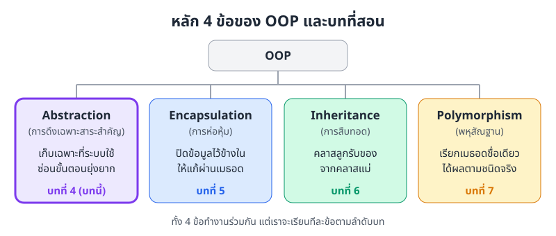
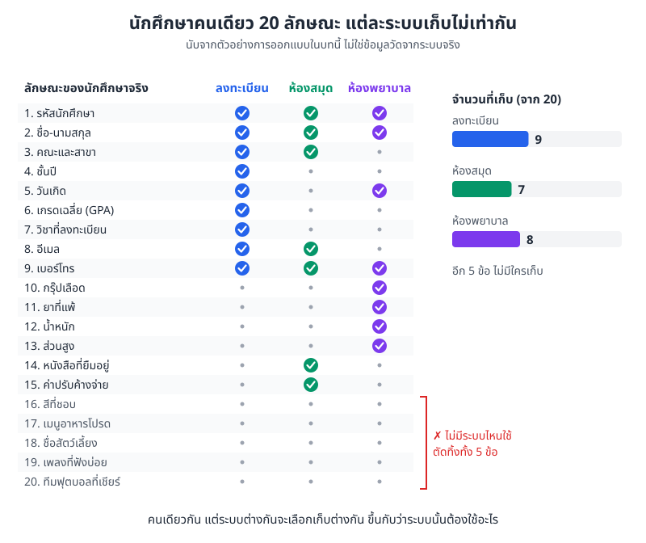
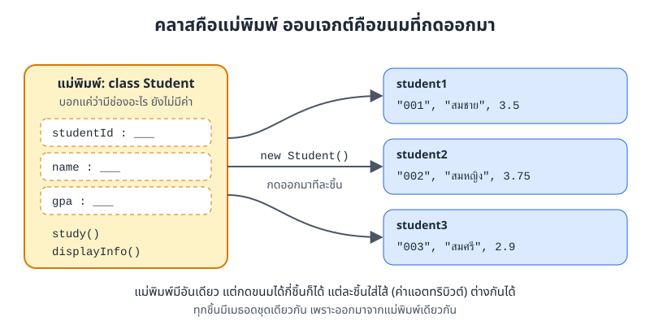
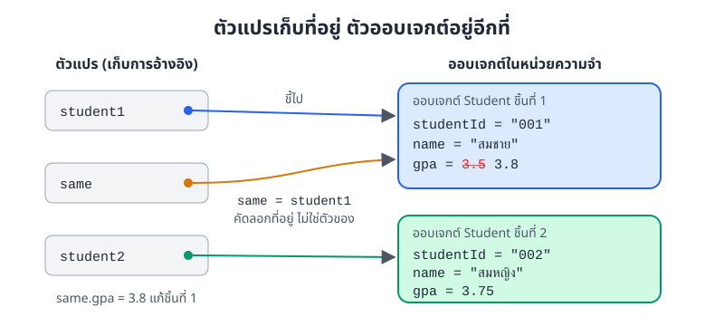
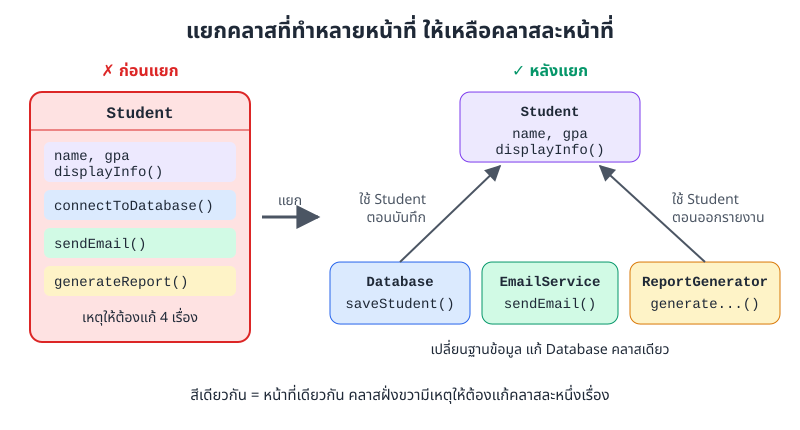
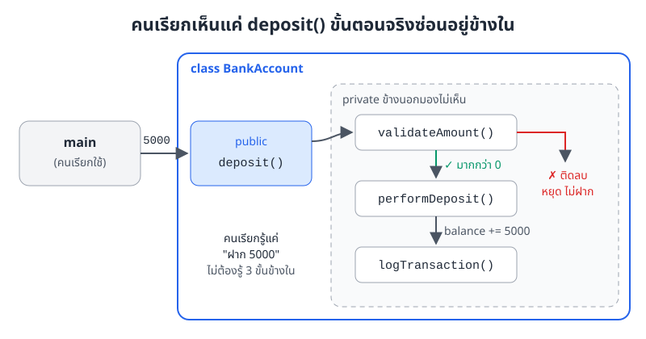

# บทที่ 4: เริ่มต้น OOP และ Abstraction

> OOP คือการเขียนโปรแกรมโดยมัดข้อมูลกับพฤติกรรมไว้ด้วยกันเป็นออบเจกต์ ส่วน Abstraction คือทักษะแรกที่ต้องมี เลือกเก็บเฉพาะสิ่งที่ระบบใช้จริง และซ่อนขั้นตอนยุ่งยากไว้ข้างใน
> บทนี้จะพาจากโปรแกรมที่ตัวแปรกระจัดกระจาย ไปสู่คลาสที่แต่ละตัวมีหน้าที่ชัดเจนหนึ่งเรื่อง

## สิ่งที่จะทำได้หลังเรียนบทนี้

1. **อธิบาย** ว่า Object-Oriented Programming (OOP) คืออะไร และองค์ประกอบพื้นฐานอย่างคลาส (class) ออบเจกต์ (object) แอตทริบิวต์ (attribute) และเมธอด (method) คืออะไร
2. **ใช้** แนวคิด Abstraction เลือกแอตทริบิวต์และเมธอดที่โจทย์ต้องใช้ และตัดรายละเอียดที่ไม่เกี่ยวออก
3. **กำหนด** ความรับผิดชอบ (responsibility) ของแต่ละคลาสจากโจทย์ ให้ตรงกับบทบาทของคลาสนั้นในระบบ
4. **เขียน Java** สร้างคลาสและออบเจกต์ กำหนดแอตทริบิวต์และเมธอด แล้วเรียกใช้เมธอดผ่านออบเจกต์ได้ถูกต้อง
5. **ออกแบบ** คลาสตามหลัก Single Responsibility Principle (SRP) โดยแยกคลาสที่ทำหลายหน้าที่ออกเป็นคลาสที่ทำหน้าที่เดียว

***

## 1. OOP คืออะไร

ลองนึกถึงบัตรนักศึกษาหนึ่งใบ บนบัตรมีรหัส ชื่อ คณะ และบัตรนั้นใช้แตะเข้าห้องสมุดหรือจ่ายค่าข้าวในโรงอาหารได้ ข้อมูลกับสิ่งที่บัตรทำได้มาด้วยกันเสมอ ไม่มีใครถือรหัสไว้ใบหนึ่ง ชื่อไว้อีกใบ

OOP ย่อมาจาก **Object-Oriented Programming** คือการเขียนโปรแกรมแบบเดียวกันนี้ เราจัดโค้ดเป็นก้อน ๆ เรียกว่า **ออบเจกต์ (object)** แต่ละก้อนมีทั้ง **ข้อมูล (data)** และ **พฤติกรรม (behavior)** ของตัวเอง

### 1.1 เทียบกับการเขียนแบบ Procedural

ในบทที่ 1-3 เราเขียนแบบ Procedural คือมีตัวแปรอยู่ทางหนึ่ง มีเมธอดอยู่อีกทางหนึ่ง แล้วส่งค่าจากตัวแปรเข้าเมธอดเอง

```java
public class ProceduralStyle {
    // ข้อมูลกับฟังก์ชันอยู่แยกกัน ต้องส่งข้อมูลเข้าไปทีละตัว
    static void printStudent(String name, int age, double gpa) {
        System.out.println("Name: " + name);
        System.out.println("Age: " + age);
        System.out.println("GPA: " + gpa);
    }

    public static void main(String[] args) {
        String studentName = "สมชาย";
        int studentAge = 20;
        double studentGPA = 3.50;
        printStudent(studentName, studentAge, studentGPA);
    }
}
```

แบบ OOP เราสร้าง **คลาส (class)** ชื่อ `Student` ที่รวมข้อมูลกับเมธอดไว้ด้วยกัน แล้วสร้างออบเจกต์จากคลาสนั้น

```java
// ข้อมูลกับพฤติกรรมอยู่ด้วยกันในคลาส Student
class Student {
    String name;
    int age;
    double gpa;

    void displayInfo() {
        System.out.println("Name: " + name);
        System.out.println("Age: " + age);
        System.out.println("GPA: " + gpa);
    }
}

public class OopStyle {
    public static void main(String[] args) {
        Student student = new Student();
        student.name = "สมชาย";
        student.age = 20;
        student.gpa = 3.50;
        student.displayInfo();
    }
}
```

ผลลัพธ์ของทั้งสองโปรแกรมเหมือนกัน

```
Name: สมชาย
Age: 20
GPA: 3.5
```



*ภาพที่ 4.1 ฝั่งซ้ายต้องส่งค่าสามตัวเข้าเมธอดเอง ฝั่งขวาแค่สั่ง `student.displayInfo()` ออบเจกต์ก็ใช้ข้อมูลของตัวเอง*

ผลเหมือนกัน แต่ต่างกันตอนโปรแกรมโตขึ้น ภาพที่ 4.1 ชี้ให้เห็นจุดนี้ ถ้ามีนักศึกษา 100 คน แบบ Procedural ต้องดูแลตัวแปร 300 ตัว และถ้าส่งชื่อของคนหนึ่งคู่กับเกรดของอีกคน ก็ไม่มีอะไรเตือนเรา แบบ OOP มีออบเจกต์ 100 ชิ้น แต่ละชิ้นถือข้อมูลของตัวเองครบชุด

> ในโค้ด Procedural ข้างบน เมธอด `printStudent` ต้องอยู่ในคลาสและมี `static` นำหน้า เพราะ Java ไม่ยอมให้เขียนเมธอดลอย ๆ นอกคลาส ถ้าย้ายเมธอดออกไปไว้นอกคลาสจะคอมไพล์ไม่ผ่าน

### 1.2 หลัก 4 ข้อของ OOP

OOP มีหลักใหญ่ 4 ข้อ หนังสือเล่มนี้สอนทีละข้อตามภาพที่ 4.2



*ภาพที่ 4.2 หลัก 4 ข้อของ OOP กับบทที่สอน บทนี้เริ่มที่ Abstraction*

1. **Abstraction (การดึงเฉพาะสาระสำคัญ)** เก็บเฉพาะสิ่งที่ระบบต้องใช้ แล้วซ่อนรายละเอียดที่คนใช้ไม่ต้องรู้ (บทนี้)
2. **การห่อหุ้ม (encapsulation)** ปิดข้อมูลไว้ในออบเจกต์ และให้แก้ผ่านเมธอดที่ตรวจสอบได้ (บทที่ 5)
3. **การสืบทอด (inheritance)** ให้คลาสลูกรับแอตทริบิวต์และเมธอดจากคลาสแม่ไปใช้ต่อ (บทที่ 6)
4. **พหุสัณฐาน (polymorphism)** เรียกเมธอดชื่อเดียวกัน แต่ได้ผลต่างกันตามชนิดจริงของออบเจกต์ (บทที่ 7)

## 2. Abstraction

### 2.1 เก็บเฉพาะที่ระบบใช้

นักศึกษาคนหนึ่งในชีวิตจริงมีรายละเอียดเยอะมาก ทั้งรหัส ชื่อ กรุ๊ปเลือด ยาที่แพ้ สีที่ชอบ ทีมฟุตบอลที่เชียร์ แต่ไม่มีระบบไหนต้องเก็บทั้งหมด

ระบบลงทะเบียนเรียนต้องรู้เกรดเฉลี่ยกับวิชาที่ลง แต่ไม่สนกรุ๊ปเลือด ห้องพยาบาลกลับต้องรู้กรุ๊ปเลือดกับยาที่แพ้ แต่ไม่สนเกรด และไม่มีระบบไหนอยากรู้ว่าเราชอบเพลงอะไร



*ภาพที่ 4.3 นักศึกษาคนเดียวกัน 20 ลักษณะ ระบบลงทะเบียนเก็บ 9 ข้อ ห้องสมุด 7 ข้อ ห้องพยาบาล 8 ข้อ และอีก 5 ข้อไม่มีระบบไหนใช้ (นับจากตัวอย่างการออกแบบในบทนี้)*

การตัดสินใจแบบในภาพที่ 4.3 นี่แหละคือ **Abstraction (การดึงเฉพาะสาระสำคัญ)** เราดูโจทย์ก่อน แล้วถามทีละข้อว่า "ระบบนี้ต้องใช้ข้อมูลนี้ไหม" ข้อที่ไม่ใช้ก็ไม่ต้องใส่ในคลาส

ภาพนี้ยังบอกอีกอย่าง คลาส `Student` ของแต่ละระบบหน้าตาไม่เหมือนกัน ไม่มีคลาส `Student` ที่ "ถูกที่สุด" มีแต่คลาสที่ตรงกับโจทย์ของระบบนั้น ๆ

```java
// Student ของระบบลงทะเบียน เก็บแค่ที่ระบบใช้
class Student {
    String studentId;
    String name;
    String major;
    int year;
    double gpa;
}
```

### 2.2 ซ่อนขั้นตอนยุ่งยาก

Abstraction มีอีกด้านหนึ่ง คือให้คนใช้เห็นแค่ปุ่มที่ต้องกด ส่วนขั้นตอนข้างในซ่อนไว้

- **รถยนต์** คนขับเห็นพวงมาลัย เบรก คันเร่ง ส่วนเครื่องยนต์ ระบบเกียร์ ระบบไฟฟ้า ซ่อนอยู่ใต้ฝากระโปรง เราไม่ต้องรู้ว่าเครื่องยนต์ทำงานยังไง แค่รู้ว่าเหยียบคันเร่งแล้วรถวิ่ง
- **โทรศัพท์มือถือ** เราเห็นปุ่มโทรกับแป้นพิมพ์ ส่วนการหาสัญญาณและเชื่อมต่อเครือข่ายเป็นเรื่องที่เครื่องจัดการเอง
- **ตู้กดน้ำ** หยอดเหรียญ กดปุ่ม ได้น้ำ เราไม่ต้องรู้ว่าตู้นับเหรียญหรือทอนเงินยังไง

ในโปรแกรมก็เหมือนกัน คลาส `EmailService` ด้านล่างมีเมธอดให้คนข้างนอกเรียกแค่ตัวเดียว คือ `sendEmail` ส่วนขั้นตอนอีกหกขั้นซ่อนไว้ในเมธอดที่ขึ้นต้นด้วย `private`

```java
class EmailService {
    // ส่วนที่คนใช้เห็น มีเมธอดเดียว
    public void sendEmail(String to, String subject, String message) {
        validateEmail(to);
        connectToServer();
        authenticateUser();
        composeMessage(to, subject, message);
        transmitData();
        closeConnection();
        System.out.println("ส่งอีเมลถึง " + to + " แล้ว");
    }

    // รายละเอียดที่ซ่อนไว้ คนเรียกใช้ไม่ต้องรู้
    private void validateEmail(String email) { /* ตรวจรูปแบบอีเมล */ }
    private void connectToServer() { /* เชื่อมต่อเซิร์ฟเวอร์อีเมล */ }
    private void authenticateUser() { /* ยืนยันตัวตนกับเซิร์ฟเวอร์ */ }
    private void composeMessage(String to, String subject, String message) { /* ประกอบหัวและเนื้อความ */ }
    private void transmitData() { /* ส่งข้อมูลออกไป */ }
    private void closeConnection() { /* ปิดการเชื่อมต่อ */ }
}

public class EmailDemo {
    public static void main(String[] args) {
        EmailService email = new EmailService();
        email.sendEmail("friend@example.com", "Hello", "How are you?");
    }
}
```

```
ส่งอีเมลถึง friend@example.com แล้ว
```

คนเขียน `main` เรียกบรรทัดเดียวก็ส่งอีเมลได้ ถ้าวันหนึ่งเปลี่ยนวิธีเชื่อมต่อเซิร์ฟเวอร์ ก็แก้แค่ใน `EmailService` โค้ดที่เรียกใช้ไม่ต้องแก้เลย

คำว่า `public` และ `private` คือ **ตัวกำหนดสิทธิ์การเข้าถึง (access modifier)** `public` แปลว่าใครก็เรียกได้ `private` แปลว่าเรียกได้เฉพาะในคลาสนี้ ที่จริงมีทั้งหมด 4 ระดับ รายละเอียดเต็มอยู่ใน[บทที่ 5: การห่อหุ้ม (Encapsulation)](05-encapsulation.md)

## 3. คลาสและออบเจกต์

### 3.1 คลาส คือแม่พิมพ์

**คลาส (class)** คือแบบที่บอกว่าออบเจกต์แต่ละชิ้นจะมีอะไรบ้าง เหมือนแม่พิมพ์ขนมที่บอกรูปร่างและช่องใส่ไส้ แต่ตัวแม่พิมพ์ยังไม่ใช่ขนม

คลาสมีสองส่วน

- **แอตทริบิวต์ (attribute)** คือข้อมูลที่ออบเจกต์แต่ละชิ้นเก็บ เช่น รหัส ชื่อ เกรด
- **เมธอด (method)** คือสิ่งที่ออบเจกต์ทำได้ เช่น เรียน แสดงข้อมูล

```java
class Student {
    // แอตทริบิวต์
    String studentId;
    String name;
    double gpa;

    // เมธอด
    void study() {
        System.out.println(name + " กำลังเรียน");
    }

    void displayInfo() {
        System.out.println("ID: " + studentId);
        System.out.println("Name: " + name);
        System.out.println("GPA: " + gpa);
    }
}
```

### 3.2 ออบเจกต์ คือขนมที่กดออกมา

**ออบเจกต์ (object)** คือของจริงที่สร้างจากคลาส ภาษาอังกฤษเรียกอีกชื่อว่า instance เราสร้างด้วยคำสั่ง `new`



*ภาพที่ 4.4 คลาส `Student` มีช่องว่างรอใส่ค่า ทุกครั้งที่สั่ง `new Student()` จะได้ออบเจกต์ชิ้นใหม่ที่ใส่ค่าของตัวเองได้*

```java
public class StudentObjects {
    public static void main(String[] args) {
        Student student1 = new Student();
        student1.studentId = "001";
        student1.name = "สมชาย";
        student1.gpa = 3.50;

        Student student2 = new Student();
        student2.studentId = "002";
        student2.name = "สมหญิง";
        student2.gpa = 3.75;

        // แต่ละออบเจกต์มีข้อมูลของตัวเอง
        student1.displayInfo();
        student2.displayInfo();
        student2.study();

        // ให้ตัวแปรใหม่ชี้ไปที่ออบเจกต์เดิม
        Student same = student1;
        same.gpa = 3.80;
        System.out.println("student1.gpa = " + student1.gpa);
    }
}
```

```
ID: 001
Name: สมชาย
GPA: 3.5
ID: 002
Name: สมหญิง
GPA: 3.75
สมหญิง กำลังเรียน
student1.gpa = 3.8
```

จุดที่ต้องจำจากโค้ดนี้

- เข้าถึงแอตทริบิวต์และเรียกเมธอดด้วยจุด เช่น `student1.name` หรือ `student2.study()`
- `student1` กับ `student2` มาจากคลาสเดียวกัน แต่ข้อมูลแยกกันเด็ดขาด แก้ชิ้นหนึ่งไม่กระทบอีกชิ้น
- เมื่อ `study()` ทำงานบน `student2` คำว่า `name` ในเมธอดหมายถึงชื่อของ `student2`

### 3.3 ตัวแปรเก็บที่อยู่ ไม่ได้เก็บตัวออบเจกต์

สามบรรทัดสุดท้ายของโค้ดข้างบนอาจทำให้งง เราแก้ `same.gpa` แต่ `student1.gpa` เปลี่ยนตาม

เหตุผลคือ ตัวแปรชนิดคลาสไม่ได้เก็บออบเจกต์ไว้ในตัว มันเก็บแค่ **การอ้างอิง (reference)** หรือพูดง่าย ๆ ว่าเก็บที่อยู่ของออบเจกต์ เหมือนเบอร์โทรที่จดไว้ในกระดาษ ไม่ใช่ตัวคนจริง



*ภาพที่ 4.5 `same = student1` คัดลอกที่อยู่ ไม่ได้สร้างออบเจกต์ใหม่ ตัวแปรสองตัวจึงชี้ไปที่ชิ้นเดียวกัน*

ภาพที่ 4.5 แสดงว่ามีออบเจกต์อยู่แค่สองชิ้น แต่มีตัวแปรสามตัว ตัวแปร `same` กับ `student1` ชี้ไปที่ชิ้นเดียวกัน แก้ผ่านตัวไหนก็เปลี่ยนที่ชิ้นเดียวกัน ถ้าอยากได้ออบเจกต์ชิ้นใหม่จริง ๆ ต้องใช้ `new` อีกครั้ง

เรื่องนี้เหมือนกับอาร์เรย์ (array) ในบทที่ 3 ที่ตัวแปรอาร์เรย์ก็เก็บแค่การอ้างอิงเช่นกัน

## 4. กำหนดความรับผิดชอบของคลาส

### 4.1 Single Responsibility Principle

ร้านกาแฟที่ดีมีคนชงกาแฟ มีแคชเชียร์ มีคนล้างแก้ว ถ้าให้บาริสต้าคนเดียวทำทุกอย่าง ทั้งชง คิดเงิน ทำบัญชี ส่งของ วันไหนร้านเปลี่ยนระบบคิดเงิน บาริสต้าก็ต้องไปเรียนใหม่ทั้งที่งานชงกาแฟไม่ได้เปลี่ยนเลย

คลาสก็เหมือนกัน หลักนี้ชื่อ **Single Responsibility Principle (SRP)** บอกว่า **คลาสหนึ่งควรรับผิดชอบเรื่องเดียว** หรือพูดอีกแบบคือ ควรมีเหตุให้ต้องแก้คลาสนี้แค่เรื่องเดียว

**แบบที่ไม่ดี** คลาส `Student` ทำงานที่ไม่ใช่เรื่องของนักศึกษา

```java
class Student {
    String name;
    double gpa;

    void displayInfo() { /* ... */ }

    // ✗ สามเมธอดนี้ไม่ใช่หน้าที่ของ Student
    void connectToDatabase() { /* ... */ }
    void sendEmail() { /* ... */ }
    void generateReport() { /* ... */ }
}
```

**แบบที่ดี** แยกแต่ละหน้าที่ออกเป็นคลาสของตัวเอง



*ภาพที่ 4.6 ซ้ายคือคลาสเดียวที่มีเหตุให้ต้องแก้ 4 เรื่อง ขวาคือสี่คลาสที่แต่ละคลาสมีหน้าที่เดียว Database และ ReportGenerator รับออบเจกต์ Student มาใช้*

```java
class Student {
    String name;
    double gpa;

    void displayInfo() {
        System.out.println(name + " GPA " + gpa);
    }
}

class Database {
    void connect() { System.out.println("[DB] เชื่อมต่อฐานข้อมูล"); }
    void saveStudent(Student s) { System.out.println("[DB] บันทึก " + s.name); }
}

class EmailService {
    void sendEmail(String to, String message) {
        System.out.println("[Email] ถึง " + to + ": " + message);
    }
}

class ReportGenerator {
    void generateStudentReport(Student s) {
        System.out.println("[Report] รายงานผลการเรียนของ " + s.name);
    }
}

public class SrpDemo {
    public static void main(String[] args) {
        Student s = new Student();
        s.name = "สมหญิง";
        s.gpa = 3.75;

        s.displayInfo();
        Database db = new Database();
        db.connect();
        db.saveStudent(s);
        new ReportGenerator().generateStudentReport(s);
        new EmailService().sendEmail("somying@example.com", "ผลการเรียนออกแล้ว");
    }
}
```

```
สมหญิง GPA 3.75
[DB] เชื่อมต่อฐานข้อมูล
[DB] บันทึก สมหญิง
[Report] รายงานผลการเรียนของ สมหญิง
[Email] ถึง somying@example.com: ผลการเรียนออกแล้ว
```

ตอนนี้ถ้ามหาวิทยาลัยเปลี่ยนฐานข้อมูล เราแก้แค่ `Database` ถ้าเปลี่ยนหน้าตารายงาน ก็แก้แค่ `ReportGenerator` คลาส `Student` ไม่ต้องแตะเลย สังเกตด้วยว่า `saveStudent(Student s)` รับออบเจกต์เป็นพารามิเตอร์ได้ เหมือนรับ `int` หรือ `String`

### 4.2 ตัวอย่างระบบห้องสมุด

ระบบยืมคืนหนังสือมีสามเรื่องที่ต่างกันชัดเจน ข้อมูลหนังสือ ข้อมูลสมาชิก และการยืมคืน จึงแยกเป็นสามคลาส

```java
// Book รับผิดชอบข้อมูลหนังสือ
class Book {
    String isbn;
    String title;
    String author;
    boolean isAvailable;

    void displayInfo() {
        System.out.println("Title: " + title);
        System.out.println("Author: " + author);
        System.out.println("Available: " + isAvailable);
    }
}

// Member รับผิดชอบข้อมูลสมาชิก
class Member {
    String memberId;
    String name;

    void displayInfo() {
        System.out.println("Member ID: " + memberId);
        System.out.println("Name: " + name);
    }
}

// Library รับผิดชอบการยืมและคืน
class Library {
    void borrowBook(Member member, Book book) {
        if (book.isAvailable) {
            book.isAvailable = false;
            System.out.println(member.name + " ยืม " + book.title);
        } else {
            System.out.println("หนังสือไม่ว่าง");
        }
    }

    void returnBook(Book book) {
        book.isAvailable = true;
        System.out.println("คืนหนังสือ " + book.title + " แล้ว");
    }
}

public class LibraryDemo {
    public static void main(String[] args) {
        Book book = new Book();
        book.isbn = "978-0-13-235088-4";
        book.title = "Clean Code";
        book.author = "Robert C. Martin";
        book.isAvailable = true;

        Member a = new Member();
        a.memberId = "M01";
        a.name = "สมชาย";
        Member b = new Member();
        b.memberId = "M02";
        b.name = "สมหญิง";

        Library library = new Library();
        library.borrowBook(a, book);
        library.borrowBook(b, book);   // เล่มนี้มีคนยืมไปแล้ว
        library.returnBook(book);
        library.borrowBook(b, book);
    }
}
```

```
สมชาย ยืม Clean Code
หนังสือไม่ว่าง
คืนหนังสือ Clean Code แล้ว
สมหญิง ยืม Clean Code
```

`Library` แก้ค่า `book.isAvailable` ของออบเจกต์ที่ส่งเข้ามาได้ เพราะได้การอ้างอิงไปยังหนังสือเล่มเดียวกันกับใน `main` (ตามหลักในหัวข้อ 3.3)

### 4.3 หาคลาสและเมธอดจากโจทย์

เวลาเจอโจทย์ใหม่ ลองทำสามขั้นนี้

1. **ขีดเส้นใต้คำนาม** คำนามมักกลายเป็นคลาสหรือแอตทริบิวต์
2. **วงคำกริยา** คำกริยามักกลายเป็นเมธอด
3. **จัดกลุ่ม** ถามว่ากริยาแต่ละตัวเป็นหน้าที่ของคำนามไหน แล้วตัดคำนามที่ระบบไม่ต้องใช้ทิ้ง (นี่คือ Abstraction อีกรอบ)

**ตัวอย่าง ระบบร้านอาหาร** "ลูกค้าจองโต๊ะ สั่งอาหารจากเมนู พนักงานเสิร์ฟ แล้วลูกค้าจ่ายเงินตามออเดอร์"

- คำนาม: ลูกค้า เมนู ออเดอร์ พนักงาน โต๊ะ
- คำกริยา: จองโต๊ะ สั่งอาหาร เสิร์ฟ จ่ายเงิน

ตัวอย่างนี้เลือกทำสี่คลาส คือ `Customer`, `MenuItem`, `Order`, `Table` ส่วนพนักงานยังไม่ใส่ เพราะโจทย์รอบนี้ยังไม่ต้องเก็บข้อมูลพนักงาน กริยา "สั่งอาหาร" ไปอยู่ที่ `Order.addItem()` และ "จองโต๊ะ" ไปอยู่ที่ `Table.reserve()`

```java
class Customer {
    String name;
    String phone;
}

class MenuItem {
    String name;
    double price;
}

class Order {
    Customer customer;
    MenuItem[] items = new MenuItem[10];  // รับได้สูงสุด 10 รายการ
    int itemCount = 0;
    double totalAmount;

    void addItem(MenuItem item) {
        if (itemCount < items.length) {
            items[itemCount] = item;
            itemCount++;
        } else {
            System.out.println("ออเดอร์เต็มแล้ว");
        }
    }

    double calculateTotal() {
        double sum = 0;
        for (int i = 0; i < itemCount; i++) {
            sum += items[i].price;
        }
        totalAmount = sum;
        return totalAmount;
    }
}

class Table {
    int tableNumber;
    boolean isOccupied;

    void reserve() {
        if (isOccupied) {
            System.out.println("โต๊ะ " + tableNumber + " มีคนจองแล้ว");
        } else {
            isOccupied = true;
            System.out.println("จองโต๊ะ " + tableNumber + " สำเร็จ");
        }
    }

    void release() {
        isOccupied = false;
        System.out.println("โต๊ะ " + tableNumber + " ว่างแล้ว");
    }
}

public class RestaurantDemo {
    public static void main(String[] args) {
        Table table = new Table();
        table.tableNumber = 5;
        table.reserve();
        table.reserve();

        Customer c = new Customer();
        c.name = "คุณเอ";
        c.phone = "081-234-5678";

        MenuItem padThai = new MenuItem();
        padThai.name = "ผัดไทย";
        padThai.price = 60;
        MenuItem tea = new MenuItem();
        tea.name = "ชาเย็น";
        tea.price = 35;

        Order order = new Order();
        order.customer = c;
        order.addItem(padThai);
        order.addItem(tea);
        System.out.println(order.customer.name + " ต้องจ่าย " + order.calculateTotal() + " บาท");
        table.release();
    }
}
```

```
จองโต๊ะ 5 สำเร็จ
โต๊ะ 5 มีคนจองแล้ว
คุณเอ ต้องจ่าย 95.0 บาท
โต๊ะ 5 ว่างแล้ว
```

สังเกตว่าแอตทริบิวต์ของคลาสหนึ่งเป็นออบเจกต์ของอีกคลาสได้ เช่น `Order` มี `Customer customer` และมีอาร์เรย์ `MenuItem[] items` เราใช้อาร์เรย์ขนาด 10 คู่กับตัวนับ `itemCount` ตามที่เรียนในบทที่ 3

## 5. ระดับของ Abstraction

โค้ดเดียวกันมองได้หลายระดับ เหมือนแผนที่ที่ซูมเข้าซูมออกได้ ซูมออกเห็นแค่ "ไปเชียงใหม่" ซูมเข้าเห็นทุกแยกที่ต้องเลี้ยว

โค้ดสามชุดข้างล่างเป็นภาพร่างเพื่อเทียบระดับเท่านั้น ยังไม่ใช่โปรแกรมที่รันได้ เมธอดบางตัวในนั้นยังไม่มีอยู่จริงในคลาสที่เราเขียน

**ระดับสูง** มองเป็นงานเดียว

```java
restaurant.processOrder(customer, items);
```

**ระดับกลาง** เห็นขั้นตอนหลักของงาน

```java
Order order = new Order();
order.addItems(items);
order.calculateTotal();
order.process();
```

**ระดับล่าง** เห็นทุกรายละเอียด

```java
for (MenuItem item : items) {
    validateItem(item);
    checkInventory(item);
    updateStock(item);
    addToOrder(item);
}
calculateTax();
applyDiscount();
generateReceipt();
```

เวลาออกแบบ ให้คิดจากระดับสูงก่อนว่าระบบต้องทำอะไร แล้วค่อยลงไปทีละชั้น แต่ละชั้นซ่อนรายละเอียดของชั้นที่อยู่ข้างล่างไว้ คนที่เรียก `processOrder` ไม่ต้องรู้ว่าข้างในตัดสต็อกยังไง

## 6. ตัวอย่างโปรแกรมเต็ม: บัญชีธนาคาร

ไฟล์ [AbstractionExample.java](../examples/AbstractionExample.java) รวมทุกเรื่องในบทนี้ไว้ในคลาส `BankAccount` คลาสเดียว

- **Abstraction** คนเรียกเห็นแค่ `deposit`, `withdraw`, `displayInfo`
- **ซ่อนรายละเอียด** การตรวจจำนวนเงิน การเช็กยอด และการบันทึกประวัติ อยู่ในเมธอด `private`
- **SRP** `BankAccount` ดูแลเรื่องบัญชีอย่างเดียว ไม่ไปยุ่งกับการส่งอีเมลหรือพิมพ์รายงาน

```java
class BankAccount {
    private String accountNumber;
    private String accountName;
    private double balance;

    public BankAccount(String accountNumber, String accountName) {
        this.accountNumber = accountNumber;
        this.accountName = accountName;
        this.balance = 0.0;
    }

    // ส่วนที่คนใช้เห็น
    public void deposit(double amount) {
        if (validateAmount(amount)) {
            performDeposit(amount);
            logTransaction("Deposit", amount);
        }
    }

    public void withdraw(double amount) {
        if (validateAmount(amount) && checkBalance(amount)) {
            performWithdrawal(amount);
            logTransaction("Withdrawal", amount);
        }
    }

    public void displayInfo() {
        System.out.println("Account: " + accountNumber);
        System.out.println("Name: " + accountName);
        System.out.println("Balance: " + balance + " บาท");
    }

    // รายละเอียดที่ซ่อนไว้
    private boolean validateAmount(double amount) {
        if (amount <= 0) {
            System.out.println("✗ จำนวนเงินต้องมากกว่า 0");
            return false;
        }
        return true;
    }

    private boolean checkBalance(double amount) {
        if (amount > balance) {
            System.out.println("✗ ยอดเงินไม่เพียงพอ");
            return false;
        }
        return true;
    }

    private void performDeposit(double amount) {
        balance += amount;
        System.out.println("✓ ฝากเงิน " + amount + " บาท สำเร็จ");
    }

    private void performWithdrawal(double amount) {
        balance -= amount;
        System.out.println("✓ ถอนเงิน " + amount + " บาท สำเร็จ");
    }

    private void logTransaction(String type, double amount) {
        System.out.println("  [Log] " + type + ": " + amount);
    }
}
```

ภาพที่ 4.7 ไล่ให้ดูว่าเรียก `deposit(5000)` ครั้งเดียว ข้างในทำอะไรบ้าง



*ภาพที่ 4.7 `main` เห็นแค่ `deposit()` ข้างในตรวจจำนวนเงินก่อน ถ้าติดลบก็หยุด ถ้าผ่านจึงเพิ่มยอดและบันทึกประวัติ*

ส่วน `main` ในไฟล์ตัวอย่างเรียกใช้แบบนี้

```java
BankAccount account = new BankAccount("001-1-12345", "สมชาย ใจดี");
account.displayInfo();
account.deposit(5000);
account.deposit(-100);    // ติดการตรวจจำนวนเงิน
account.withdraw(2000);
account.withdraw(10000);  // ติดการเช็กยอด
account.displayInfo();
```

ผลรันจริง (ตัดบรรทัดหัวและท้ายที่เป็นเส้นตกแต่งออก)

```
Account: 001-1-12345
Name: สมชาย ใจดี
Balance: 0.0 บาท

✓ ฝากเงิน 5000.0 บาท สำเร็จ
  [Log] Deposit: 5000.0
✗ จำนวนเงินต้องมากกว่า 0

✓ ถอนเงิน 2000.0 บาท สำเร็จ
  [Log] Withdrawal: 2000.0
✗ ยอดเงินไม่เพียงพอ

Account: 001-1-12345
Name: สมชาย ใจดี
Balance: 3000.0 บาท
```

โค้ดนี้มีของใหม่สองอย่างที่จะเรียนละเอียดในบทที่ 5 คือ `private` หน้าแอตทริบิวต์ และ **คอนสตรักเตอร์ (constructor)** `public BankAccount(...)` ที่กำหนดค่าเริ่มต้นให้ออบเจกต์ตั้งแต่ตอน `new` ตอนนี้ขอให้เห็นภาพก่อนว่าสองอย่างนี้ช่วยซ่อนรายละเอียดได้ดีขึ้น เพราะคนข้างนอกแก้ `balance` ตรง ๆ ไม่ได้ ต้องผ่าน `deposit` หรือ `withdraw` เท่านั้น

## 7. หลักการตั้งชื่อและออกแบบ

### 7.1 ชื่อคลาส

- ใช้คำนาม เพราะคลาสคือ "สิ่งของ"
- ใช้ PascalCase คือขึ้นต้นทุกคำด้วยตัวใหญ่ เช่น `Student`, `BankAccount`, `OrderService`
- อ่านแล้วรู้ทันทีว่าคืออะไร ไม่ย่อจนเดาไม่ออก

### 7.2 ชื่อเมธอด

- ใช้คำกริยา เพราะเมธอดคือ "การกระทำ"
- ใช้ camelCase คือคำแรกตัวเล็ก คำต่อไปขึ้นต้นตัวใหญ่ เช่น `calculateTotal()`, `sendEmail()`, `displayInfo()`
- ชื่อต้องบอกว่าเมธอดทำอะไร

### 7.3 ทำให้เรียบง่าย

- คลาสหนึ่งไม่ควรรับผิดชอบหลายเรื่อง
- เมธอดหนึ่งควรทำงานเดียว
- Abstraction ที่ดีทำให้คนใช้งานง่ายขึ้น ถ้าออกแบบแล้วคนเรียกต้องรู้ขั้นตอนข้างในมากกว่าเดิม แปลว่ายังไม่ดี

## ข้อผิดพลาดที่เจอบ่อย

**1. เรียกเมธอดผ่านชื่อคลาสแทนชื่อออบเจกต์**

```java
Student.displayInfo();   // ✗
```

```
error: non-static method displayInfo() cannot be referenced from a static context
```

คลาสเป็นแค่แม่พิมพ์ ยังไม่มีชื่อหรือเกรดให้แสดง ต้องสร้างออบเจกต์ก่อนแล้วเรียกผ่านตัวแปร เช่น `student1.displayInfo()`

**2. ประกาศตัวแปรแต่ลืม `new`**

```java
Student s;
s.name = "A";   // ✗
```

```
error: variable s might not have been initialized
```

บรรทัด `Student s;` สร้างแค่ตัวแปรที่จะเก็บการอ้างอิง ยังไม่มีออบเจกต์ให้ชี้ ถ้าเขียน `Student s = null;` แล้วใช้ต่อ จะคอมไพล์ผ่าน แต่ตอนรันจะเจอ exception ชื่อ `java.lang.NullPointerException` แก้ด้วย `Student s = new Student();`

**3. คิดว่า `b = a` คือการคัดลอกออบเจกต์**

`b = a` คัดลอกแค่การอ้างอิง แก้ผ่าน `b` แล้ว `a` เปลี่ยนตาม (ดูภาพที่ 4.5) ถ้าต้องการชิ้นใหม่ต้อง `new`

**4. ลืมว่าแอตทริบิวต์มีค่าเริ่มต้น**

ถ้ายังไม่กำหนดค่า แอตทริบิวต์ชนิด `String` จะเป็น `null` ชนิด `double` เป็น `0.0` ชนิด `int` เป็น `0` และ `boolean` เป็น `false` พิมพ์ออกมาจะเห็นเป็น `null 0.0` ไม่ใช่ error จึงมักหลุดรอดไปโดยไม่รู้ตัว

**5. ใส่ทุกอย่างลงคลาสเดียว**

คลาส `Student` ที่ต่อฐานข้อมูลเอง ส่งอีเมลเอง ทำรายงานเอง ทำให้แก้เรื่องหนึ่งแล้วกระทบเรื่องอื่น ให้ถามว่า "ถ้าเรื่องนี้เปลี่ยน ต้องแก้คลาสไหน" ถ้าคำตอบคือคลาสเดียวกันทุกเรื่อง ให้แยก

**6. เก็บข้อมูลเกินโจทย์**

ใส่แอตทริบิวต์ "เผื่อไว้" เช่น สีที่ชอบ ในระบบลงทะเบียน ทำให้คลาสรกและต้องดูแลข้อมูลที่ไม่มีใครใช้ ย้อนดูภาพที่ 4.3 แล้วถามทีละข้อว่าระบบใช้จริงไหม

**7. ตั้งชื่อคลาสเป็นกริยา หรือชื่อเมธอดเป็นคำนาม**

`class Calculate` หรือ `void student()` อ่านแล้วสับสน คลาสใช้คำนาม เมธอดใช้คำกริยา

## สรุปท้ายบท

- **OOP** จัดโค้ดเป็นออบเจกต์ที่รวมข้อมูลกับพฤติกรรมไว้ด้วยกัน มีหลัก 4 ข้อ คือ Abstraction การห่อหุ้ม การสืบทอด และพหุสัณฐาน
- **Abstraction** มีสองด้าน เลือกเก็บเฉพาะข้อมูลที่ระบบใช้ และซ่อนขั้นตอนยุ่งยากไว้หลังเมธอดที่เรียกง่าย
- **คลาส** คือแม่พิมพ์ที่บอกว่ามีแอตทริบิวต์และเมธอดอะไร **ออบเจกต์** คือของจริงที่สร้างด้วย `new` แต่ละชิ้นมีข้อมูลของตัวเอง
- ตัวแปรชนิดคลาสเก็บ **การอ้างอิง** `b = a` จึงทำให้สองตัวแปรชี้ออบเจกต์เดียวกัน
- **SRP** คลาสหนึ่งรับผิดชอบเรื่องเดียว มีเหตุให้ต้องแก้แค่เรื่องเดียว
- หาคลาสจากคำนาม หาเมธอดจากคำกริยา แล้วตัดสิ่งที่ระบบไม่ใช้ทิ้ง
- คิดจากระดับสูงลงไปหาระดับล่าง แต่ละชั้นซ่อนรายละเอียดของชั้นล่าง

## แบบฝึกหัด

**ข้อ 1.** ออกแบบคลาสสำหรับระบบจองโรงแรม ได้แก่ `Hotel`, `Room`, `Guest`, `Reservation` บอกแอตทริบิวต์และเมธอดของแต่ละคลาส

<details>
<summary>ดูเฉลย</summary>

ตัวอย่างหนึ่งที่ใช้ได้ (คำตอบอื่นที่เหตุผลดีก็ถูก)

```java
class Room {
    String roomNumber;
    String type;        // เช่น เตียงเดี่ยว เตียงคู่
    double pricePerNight;
    boolean isAvailable;
}

class Guest {
    String name;
    String phone;
    String idCardNumber;
}

class Reservation {
    Guest guest;
    Room room;
    int nights;

    double calculateCost() {
        return room.pricePerNight * nights;
    }
}

class Hotel {
    String name;
    Room[] rooms;

    Room findAvailableRoom(String type) { /* หาห้องว่างตามชนิด */ return null; }
    Reservation book(Guest guest, Room room, int nights) { /* จองและเปลี่ยนสถานะห้อง */ return null; }
}
```

</details>

**ข้อ 2.** จากข้อ 1 เขียนความรับผิดชอบของแต่ละคลาสเป็นประโยคเดียว

<details>
<summary>ดูเฉลย</summary>

- `Room` ดูแลข้อมูลห้องและสถานะว่างหรือไม่ว่าง
- `Guest` ดูแลข้อมูลผู้เข้าพัก
- `Reservation` ดูแลรายละเอียดการจองหนึ่งครั้งและคิดค่าห้องของการจองนั้น
- `Hotel` ดูแลห้องทั้งหมดของโรงแรม หาห้องว่าง และสร้างการจอง

ถ้าเขียนประโยคเดียวไม่ได้ หรือต้องใช้คำว่า "และ" เชื่อมเรื่องที่ไม่เกี่ยวกัน แปลว่าคลาสนั้นอาจต้องแยก

</details>

**ข้อ 3.** เขียนคลาส `Calculator` ที่มีเมธอด `add()`, `subtract()`, `multiply()`, `divide()` รับเลขสองตัวและคืนผลลัพธ์

<details>
<summary>ดูเฉลย</summary>

```java
public class Calculator {
    double add(double a, double b) { return a + b; }
    double subtract(double a, double b) { return a - b; }
    double multiply(double a, double b) { return a * b; }

    double divide(double a, double b) {
        if (b == 0) {
            System.out.println("หารด้วยศูนย์ไม่ได้");
            return 0;
        }
        return a / b;
    }

    public static void main(String[] args) {
        Calculator calc = new Calculator();
        System.out.println(calc.add(7, 3));
        System.out.println(calc.subtract(7, 3));
        System.out.println(calc.multiply(7, 3));
        System.out.println(calc.divide(7, 2));
        System.out.println(calc.divide(7, 0));
    }
}
```

```
10.0
4.0
21.0
3.5
หารด้วยศูนย์ไม่ได้
0.0
```

การคืนค่า `0` ตอนหารด้วยศูนย์เป็นทางออกชั่วคราว ในบทที่ 9 จะเรียนวิธีที่ดีกว่าด้วย exception

</details>

**ข้อ 4.** ออกแบบคลาสสำหรับระบบโรงพยาบาลขนาดเล็ก (มีผู้ป่วย แพทย์ การนัดหมาย และใบสั่งยา) แล้วอธิบายความรับผิดชอบของแต่ละคลาส

<details>
<summary>ดูเฉลย</summary>

- `Patient` เก็บรหัสผู้ป่วย ชื่อ กรุ๊ปเลือด ยาที่แพ้ (ข้อมูลที่การรักษาต้องใช้ ไม่ต้องเก็บเกรดหรือคณะ)
- `Doctor` เก็บรหัสแพทย์ ชื่อ แผนก
- `Appointment` เก็บผู้ป่วย แพทย์ วันเวลา มีเมธอด `confirm()` และ `cancel()`
- `Prescription` เก็บผู้ป่วย แพทย์ รายการยา มีเมธอด `addMedicine()` และเมธอดตรวจว่ายาที่สั่งตรงกับยาที่ผู้ป่วยแพ้หรือไม่

ทุกคลาสมีหน้าที่เดียว ถ้าเปลี่ยนรูปแบบใบสั่งยา ก็แก้แค่ `Prescription`

</details>

**ข้อ 5.** เทียบการเขียนระบบจัดการรายชื่อนักศึกษาแบบ Procedural กับแบบ OOP ว่าต่างกันอย่างไร ถ้าต้องเพิ่มข้อมูล "อีเมล" ให้นักศึกษาทุกคน แบบไหนแก้ง่ายกว่า

<details>
<summary>ดูเฉลย</summary>

แบบ Procedural เก็บข้อมูลเป็นอาร์เรย์แยกกัน เช่น `names[]`, `ids[]`, `gpas[]` และต้องระวังให้ช่องที่ `i` ของทุกอาร์เรย์เป็นคนเดียวกัน ถ้าเพิ่มอีเมล ต้องสร้างอาร์เรย์ `emails[]` ใหม่ และแก้ทุกเมธอดที่รับข้อมูลนักศึกษาให้รับพารามิเตอร์เพิ่ม

แบบ OOP มีคลาส `Student` กับอาร์เรย์ `Student[] students` ตัวเดียว เพิ่มอีเมลก็แค่เพิ่มแอตทริบิวต์ `String email;` ในคลาส `Student` เมธอดที่รับ `Student` อยู่แล้วไม่ต้องเปลี่ยนพารามิเตอร์ แบบ OOP จึงแก้ง่ายกว่า

</details>

### แนวข้อสอบ

**ข้อ 6.** ข้อใดเป็นผลดีของการออกแบบให้แต่ละคลาสมีหน้าที่ชัดเจน

- A) โค้ดยาวขึ้น
- B) คลาสทำงานหลายอย่าง
- C) โปรแกรมดูแลรักษาและแก้ไขได้ง่าย
- D) ใช้หน่วยความจำมากขึ้น

<details>
<summary>ดูเฉลย</summary>

**C** เมื่อแต่ละคลาสมีหน้าที่เดียว การแก้เรื่องหนึ่งจะอยู่ในคลาสเดียว ไม่ลามไปคลาสอื่น

</details>

**ข้อ 7.** ข้อใดเหมาะสมที่สุดที่จะเป็นชื่อคลาส

- A) `calculate()`
- B) `balance`
- C) `Student`
- D) `print()`

<details>
<summary>ดูเฉลย</summary>

**C** เป็นคำนามและขึ้นต้นตัวใหญ่ตาม PascalCase ข้อ A และ D เป็นชื่อเมธอด ข้อ B เป็นชื่อแอตทริบิวต์หรือตัวแปร

</details>

**ข้อ 8.** เขียนคลาส `Student` ที่มีแอตทริบิวต์ `name` เก็บชื่อ และ `id` เก็บรหัสนักศึกษา

<details>
<summary>ดูเฉลย</summary>

```java
class Student {
    String name;
    String id;
}
```

ถ้าใช้ `int id` ก็คอมไพล์ผ่าน แต่รหัสนักศึกษามักขึ้นต้นด้วย 0 หรือมีขีด และไม่มีใครเอารหัสไปบวกลบ การเก็บเป็น `String` จึงเหมาะกว่า ถ้าโจทย์กำหนด `int` มาก็ใช้ตามโจทย์

</details>

**ข้อ 9.** จากคลาส `Student` ในข้อ 8 เขียนโค้ดสร้างออบเจกต์ชื่อ `s1`

<details>
<summary>ดูเฉลย</summary>

```java
Student s1 = new Student();
```

</details>

**ข้อ 10.** (อัตนัย ไม่ต้องเขียนเมธอด `main`) เขียนคลาส `Product` ที่มีแอตทริบิวต์ `name` และ `price` และมีเมธอด `priceWithVat()` คืนราคารวม VAT 7%

<details>
<summary>ดูเฉลย</summary>

```java
class Product {
    String name;
    double price;

    double priceWithVat() {
        return price * 1.07;
    }
}
```

</details>

***

[< บทก่อนหน้า: บทที่ 3: อาร์เรย์](03-arrays.md) | [กลับไปหน้าหลัก](README.md) | [บทถัดไป: บทที่ 5: การห่อหุ้ม (Encapsulation) >](05-encapsulation.md)
