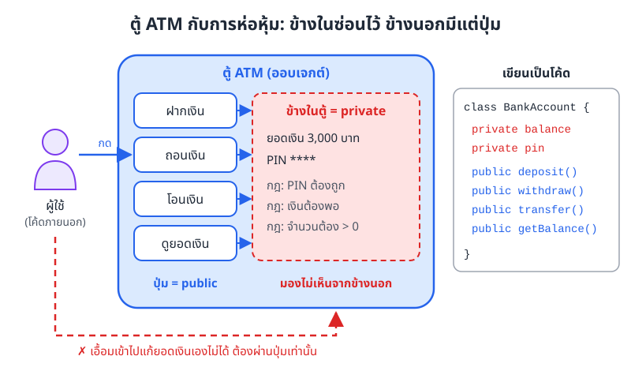
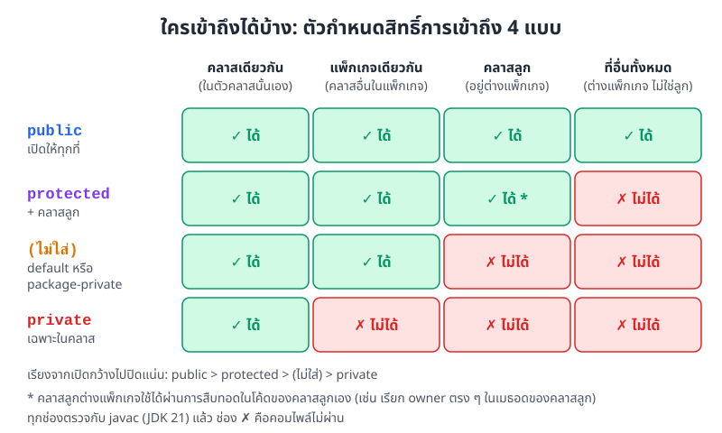
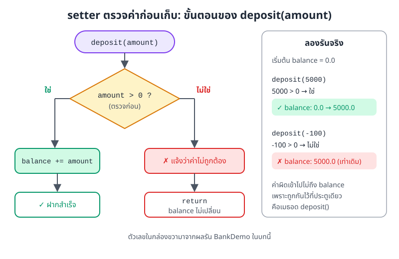
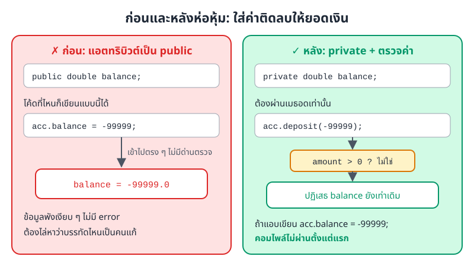
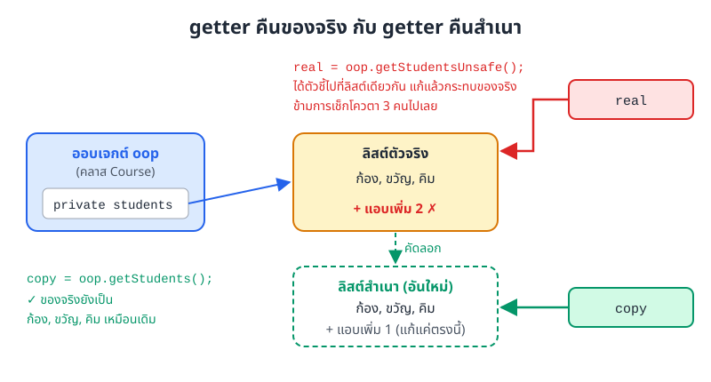

# บทที่ 5: การห่อหุ้ม (Encapsulation)

> การห่อหุ้มคือการเก็บข้อมูลไว้ในคลาสแล้วปิดไม่ให้คนนอกแตะตรง ๆ ใครอยากอ่านหรือแก้ต้องผ่านเมธอดที่เราเปิดไว้
> เมธอดพวกนี้ทำหน้าที่เป็นด่านตรวจ ค่าที่ผิดจึงเข้าไปทำข้อมูลพังไม่ได้ และเราแก้ไส้ในได้โดยไม่ต้องไปแก้โค้ดของคนที่เรียกใช้

## สิ่งที่จะทำได้หลังเรียนบทนี้

1. อธิบายได้ว่าการห่อหุ้มคืออะไร และช่วยแก้ปัญหาอะไร
2. เลือกใช้ตัวกำหนดสิทธิ์การเข้าถึงทั้ง 4 แบบ (`public`, `protected`, ไม่ใส่อะไร, `private`) ได้ถูกที่
3. เขียน getter และ setter ที่ตรวจค่าก่อนเก็บได้
4. ออกแบบคลาสที่ห่อหุ้มข้อมูลได้ดี รวมถึงคลาสที่อ่านได้อย่างเดียวและคลาสที่สร้างแล้วเปลี่ยนไม่ได้
5. บอกประโยชน์ของการห่อหุ้มต่อการดูแลโค้ดในระยะยาวได้

## 1. การห่อหุ้มคืออะไร

### เริ่มจากตู้ ATM

ลองนึกถึงตู้ ATM หน้าเซเว่น เราเดินไปกดปุ่ม "ถอนเงิน" ใส่ PIN ใส่จำนวนเงิน แล้วรอรับเงิน เราไม่เคยเห็นว่าข้างในตู้เก็บยอดเงินไว้ตรงไหน และไม่มีทางเปิดตู้เข้าไปแก้ตัวเลขยอดเงินเองได้

ตู้ทำแบบนี้เพราะทุกปุ่มมีกฎคุมอยู่ PIN ต้องถูก เงินในบัญชีต้องพอ จำนวนเงินต้องมากกว่าศูนย์ ถ้าใครเอื้อมเข้าไปแก้ยอดเงินได้ตรง ๆ กฎพวกนี้ก็ไม่มีความหมาย



*ภาพที่ 5.1 ตู้ ATM เทียบกับคลาส ปุ่มด้านนอกคือเมธอด public ส่วนข้อมูลและกฎข้างในคือส่วนที่เป็น private*

### นิยาม

**การห่อหุ้ม (encapsulation)** เป็นหลักพื้นฐานข้อหนึ่งของ OOP มีสองส่วนที่ไปด้วยกันเสมอ

**ส่วนที่ 1 รวมของที่เกี่ยวกันไว้ด้วยกัน (bundling)** ข้อมูลหรือแอตทริบิวต์ (attribute) กับเมธอด (method) ที่ใช้ข้อมูลนั้น อยู่ในคลาส (class) เดียวกัน เช่น ยอดเงินกับเมธอดฝาก ถอน โอน อยู่ในคลาส `BankAccount` ด้วยกัน คลาสจึงเป็นหน่วยที่ครบในตัว

**ส่วนที่ 2 ซ่อนรายละเอียดข้างใน (information hiding)** คนนอกคลาสเห็นแค่เมธอดที่เราเปิดให้ใช้ ซึ่งเรียกรวมกันว่า public interface ส่วนข้อมูลและวิธีทำงานข้างในเราปิดไว้ คนนอกแก้ข้อมูลตรง ๆ ไม่ได้

ถ้าเทียบกับภาพที่ 5.1 ปุ่มบนตู้คือ public interface ส่วนห้องข้างในตู้คือสิ่งที่ซ่อนไว้ คนใช้ตู้ไม่ต้องรู้ว่าข้างในทำงานอย่างไร รู้แค่ว่ากดปุ่มไหนแล้วได้อะไรก็พอ

## 2. ตัวกำหนดสิทธิ์การเข้าถึง

Java ใช้ **ตัวกำหนดสิทธิ์การเข้าถึง (access modifier)** บอกว่าแอตทริบิวต์ เมธอด หรือคอนสตรักเตอร์ (constructor) แต่ละตัว ใครเข้าถึงได้บ้าง มีทั้งหมด 4 ระดับ เรียงจากปิดแน่นไปเปิดกว้าง

### 2.1 `private` ใช้ได้เฉพาะในคลาสนั้น

สมาชิกที่เป็น `private` ใช้ได้เฉพาะในโค้ดของคลาสที่ประกาศมันเท่านั้น คลาสอื่นมองไม่เห็นเลย เหมาะกับแอตทริบิวต์ที่อยากซ่อน และเมธอดช่วยที่ใช้กันเองข้างใน

```java
class BankAccount {
    private double balance;   // คลาสอื่นอ่านหรือแก้ตรง ๆ ไม่ได้
}
```

ถ้าคลาสอื่นพยายามเขียน `acc.balance = 1000000;` จะคอมไพล์ไม่ผ่าน javac แจ้งว่า `balance has private access in BankAccount`

`private` กันที่ระดับ "คลาส" ไม่ใช่ระดับ "ออบเจกต์" แปลว่าโค้ดในคลาส `BankAccount` แตะ `balance` ของออบเจกต์ (object) `BankAccount` อีกตัวได้ เราจะเห็นตัวอย่างในเมธอด `transfer()` ข้อ 6

### 2.2 ไม่ใส่อะไรเลย (default หรือ package-private)

ถ้าไม่เขียนตัวกำหนดสิทธิ์ใด ๆ สมาชิกตัวนั้นจะใช้ได้ทุกคลาสที่อยู่ใน **แพ็กเกจ (package)** เดียวกัน แต่คลาสนอกแพ็กเกจใช้ไม่ได้ ระดับนี้มักเรียกว่า default หรือ package-private

```java
class Example {
    int value;   // ไม่ใส่อะไร = ใช้ได้เฉพาะในแพ็กเกจเดียวกัน
}
```

ระวังอย่าเขียนคำว่า `default` นำหน้าแอตทริบิวต์ เพราะคำนี้ไม่ใช่ตัวกำหนดสิทธิ์ ระดับนี้ได้มาจากการ "ไม่เขียนอะไร" เท่านั้น (keyword `default` ใน Java มีไว้ใช้กับ `switch` และเมธอดในอินเทอร์เฟซ ซึ่งเป็นคนละเรื่อง)

### 2.3 `protected` ในแพ็กเกจ บวกคลาสลูก

`protected` เปิดกว้างกว่าแบบไม่ใส่อะไรอีกขั้นหนึ่ง ใช้ได้ทุกคลาสในแพ็กเกจเดียวกัน และใช้ได้ใน **คลาสลูก (subclass)** แม้คลาสลูกนั้นจะอยู่ต่างแพ็กเกจ เรื่องคลาสลูกจะเรียนละเอียดในบทการสืบทอด (inheritance)

### 2.4 `public` ใช้ได้ทุกที่

สมาชิกที่เป็น `public` ใช้ได้จากทุกคลาสทุกแพ็กเกจ เหมาะกับเมธอดที่ตั้งใจให้คนนอกเรียกใช้

```java
class BankAccount {
    public void deposit(double amount) {
        // เรียกใช้ได้จากทุกที่
    }
}
```

### 2.5 ตารางสรุป



*ภาพที่ 5.2 ตัวกำหนดสิทธิ์แต่ละแบบเข้าถึงได้จากที่ใดบ้าง ทุกช่องตรวจกับคอมไพเลอร์จริงด้วยโค้ดตัวอย่างด้านล่าง*

ภาพที่ 5.2 อ่านจากบนลงล่าง ยิ่งลงมาช่องเขียวยิ่งน้อย แปลว่ายิ่งปิดแน่น ส่วนช่อง "คลาสลูก ต่างแพ็กเกจ" ของ `protected` มีเงื่อนไขนิดหนึ่ง คลาสลูกใช้สมาชิกนั้นได้ในโค้ดของตัวเอง (ผ่านการสืบทอด) แต่ถ้าเป็นคลาสทั่วไปในแพ็กเกจอื่นสร้างออบเจกต์ขึ้นมาแล้วเรียก จะใช้ไม่ได้

ลองดูโค้ดที่ใช้ตรวจตารางนี้ มีสองแพ็กเกจ คือ `bank` และ `app`

```java
// ไฟล์ bank/Account.java
package bank;

public class Account {
    private double balance = 100;
    int branchCode = 7;               // ไม่ใส่อะไร
    protected String owner = "Mali";
    public String accountNo = "001";
}
```

```java
// ไฟล์ bank/Teller.java (แพ็กเกจเดียวกับ Account)
package bank;

public class Teller {
    void check(Account a) {
        // System.out.println(a.balance);   // ✗ private คอมไพล์ไม่ผ่าน
        System.out.println(a.branchCode);   // ✓ แพ็กเกจเดียวกัน
        System.out.println(a.owner);        // ✓ protected ใช้ในแพ็กเกจเดียวกันได้
        System.out.println(a.accountNo);    // ✓ public
    }
}
```

```java
// ไฟล์ app/SavingAccount.java (คลาสลูก แต่อยู่ต่างแพ็กเกจ)
package app;

import bank.Account;

public class SavingAccount extends Account {
    void show() {
        // System.out.println(branchCode);  // ✗ ไม่ใส่อะไร ข้ามแพ็กเกจไม่ได้
        System.out.println(owner);          // ✓ protected ได้มาจากการสืบทอด
        System.out.println(accountNo);      // ✓ public
    }
}
```

```java
// ไฟล์ app/Main.java (ต่างแพ็กเกจ และไม่ใช่คลาสลูก)
package app;

import bank.Account;

public class Main {
    public static void main(String[] args) {
        Account a = new Account();
        System.out.println(a.accountNo);    // ✓ public
        // System.out.println(a.owner);     // ✗ protected คอมไพล์ไม่ผ่าน
    }
}
```

ถ้าลองเอาคอมเมนต์หน้าบรรทัดที่มีเครื่องหมาย ✗ ออก javac จะแจ้ง error ตามลำดับนี้

```
balance has private access in Account
branchCode is not public in Account; cannot be accessed from outside package
owner has protected access in Account
```

> **หมายเหตุ** ตัวกำหนดสิทธิ์ทั้ง 4 แบบใช้กับสมาชิกของคลาสได้ทั้งหมด แต่คลาสระดับบนสุด (คลาสที่ไม่ได้อยู่ในคลาสอื่น) ใส่ได้แค่ `public` หรือไม่ใส่อะไรเท่านั้น

## 3. getter และ setter

เมื่อแอตทริบิวต์เป็น `private` แล้ว คนนอกก็ต้องมีทางอ่านหรือแก้ค่าอย่างเป็นระบบ ทางนั้นคือเมธอดสองกลุ่มที่เรียกว่า getter และ setter

### 3.1 getter สำหรับอ่านค่า

getter (บางตำราเรียก accessor) คือเมธอดที่คืนค่าของแอตทริบิวต์ ตั้งชื่อด้วย `get` ตามด้วยชื่อแอตทริบิวต์ ขึ้นต้นคำด้วยตัวใหญ่

```java
public dataType getAttributeName() {
    return attributeName;
}
```

ถ้าแอตทริบิวต์เป็น `boolean` นิยมตั้งชื่อขึ้นต้นด้วย `is` แทน เช่น `isActive()`

### 3.2 setter สำหรับกำหนดค่า

setter (บางตำราเรียก mutator) คือเมธอดที่รับค่าใหม่มาเก็บ ตั้งชื่อด้วย `set` ตามด้วยชื่อแอตทริบิวต์ จุดเด่นของ setter คือ **ตรวจค่าก่อนเก็บได้**

```java
public void setAttributeName(dataType value) {
    if (/* ค่าถูกต้อง */) {
        this.attributeName = value;
    }
    // ค่าไม่ถูกต้อง ไม่เก็บ และแจ้งให้คนเรียกรู้
}
```

### 3.3 ตัวอย่าง: คลาส Student

GPA ในระบบทะเบียนต้องอยู่ระหว่าง 0.00 ถึง 4.00 เสมอ setter จึงต้องกันค่าที่หลุดช่วงนี้

```java
class Student {
    private String name;
    private double gpa;

    public String getName() {
        return name;
    }

    public void setName(String name) {
        if (name != null && !name.isEmpty()) {
            this.name = name;
        } else {
            System.out.println("ชื่อไม่ถูกต้อง");
        }
    }

    public double getGpa() {
        return gpa;
    }

    // ตรวจค่าก่อนเก็บ GPA ต้องอยู่ในช่วง 0.00 ถึง 4.00
    public void setGpa(double gpa) {
        if (gpa >= 0.0 && gpa <= 4.0) {
            this.gpa = gpa;
        } else {
            System.out.println("GPA ต้องอยู่ระหว่าง 0.00 - 4.00");
        }
    }
}

public class StudentDemo {
    public static void main(String[] args) {
        Student s = new Student();
        s.setName("มานี");
        s.setGpa(3.25);
        s.setGpa(-5.0);     // ถูกปฏิเสธ ค่าเดิมยังอยู่
        s.setName("");      // ถูกปฏิเสธ
        System.out.println(s.getName() + " GPA " + s.getGpa());
    }
}
```

ผลรัน

```
GPA ต้องอยู่ระหว่าง 0.00 - 4.00
ชื่อไม่ถูกต้อง
มานี GPA 3.25
```

สังเกตบรรทัดสุดท้าย ค่า `-5.0` กับชื่อว่างไม่ได้เข้าไปทับค่าเดิม ออบเจกต์ยังอยู่ในสภาพที่ถูกต้อง

### 3.4 setter ตรวจค่าอย่างไร

ภาพที่ 5.3 ไล่ขั้นตอนของเมธอด `deposit()` ในบัญชีธนาคาร ซึ่งทำงานแบบเดียวกับ setter ทุกค่าที่ส่งเข้ามาต้องผ่านเงื่อนไข `amount > 0` ก่อน ถ้าไม่ผ่านก็ `return` ออกไปเลย บรรทัดที่แก้ `balance` จึงไม่มีโอกาสทำงาน



*ภาพที่ 5.3 ขั้นตอนของ `deposit(amount)` ค่าผิดโดนกันไว้ที่ประตูเดียว ตัวเลขด้านขวามาจากผลรันโปรแกรม `BankDemo` ในข้อ 6*

## 4. การห่อหุ้มช่วยอะไรเรา

### 4.1 กันค่าผิดไม่ให้เข้าไปในข้อมูล

ถ้าแอตทริบิวต์เป็น `public` โค้ดที่ไหนก็ใส่ค่าอะไรก็ได้ Java ไม่ห้าม

```java
class OpenStudent {
    public String name;
    public double gpa;
}

public class PublicFieldDemo {
    public static void main(String[] args) {
        OpenStudent s = new OpenStudent();
        s.name = "มานี";
        s.gpa = -5.0;   // ค่าผิดแต่ Java ไม่ห้าม
        System.out.println(s.name + " GPA " + s.gpa);
    }
}
```

ผลรัน

```
มานี GPA -5.0
```

GPA ติดลบหลุดเข้าไปเงียบ ๆ ไม่มี error สักบรรทัด กว่าจะมีคนเห็นก็อาจเป็นตอนพิมพ์ใบเกรดไปแล้ว ส่วนคลาส `Student` ในข้อ 3.3 ปฏิเสธค่าเดียวกันนี้ทันที



*ภาพที่ 5.4 ก่อนและหลังห่อหุ้ม ทางซ้ายค่าผิดเข้าถึงข้อมูลได้ตรง ๆ ทางขวาต้องผ่านด่านตรวจในเมธอด*

ภาพที่ 5.4 ยังชี้อีกเรื่องหนึ่ง พอข้อมูลแก้ได้จากเมธอดเดียว เวลาเจอค่าผิดเราก็ไล่ดูแค่เมธอดนั้น ไม่ต้องค้นทั้งโปรเจกต์ว่าบรรทัดไหนไปแก้

### 4.2 ซ่อนวิธีทำงานข้างใน

คนเรียกใช้คลาสไม่ต้องรู้ว่าข้างในเก็บข้อมูลแบบไหน เหมือนเราสั่งอาหารผ่านแอปไรเดอร์ เราไม่ต้องรู้ว่าร้านทำอาหารอย่างไร หรือไรเดอร์ใช้เส้นทางไหน ขอแค่อาหารมาถึง

### 4.3 แก้ไส้ในได้โดยไม่กระทบคนเรียกใช้

เพราะคนนอกเห็นแค่เมธอด เราจึงเปลี่ยนวิธีเก็บข้อมูลข้างในได้ตามใจ ตราบใดที่เมธอดยังทำงานเหมือนเดิม ตัวอย่างนี้คือเครื่องวัดอุณหภูมิที่เดิมอาจเก็บองศาเซลเซียส แต่ภายหลังเปลี่ยนมาเก็บเป็นเคลวิน

```java
class Thermometer {
    // เปลี่ยนจากเก็บองศาเซลเซียสมาเก็บเคลวิน โดยคนเรียกใช้ไม่ต้องแก้โค้ดเลย
    private double kelvin;

    public void setCelsius(double c) {
        if (c < -273.15) {
            System.out.println("✗ ต่ำกว่าศูนย์สัมบูรณ์ไม่ได้");
            return;
        }
        kelvin = c + 273.15;
    }

    public double getCelsius() {
        return kelvin - 273.15;
    }
}
```

โค้ดที่เรียก `t.setCelsius(36.5)` แล้ว `t.getCelsius()` ยังได้ `36.5` เหมือนเดิมทุกอย่าง ถ้าเมื่อก่อนเราเปิดแอตทริบิวต์ `celsius` เป็น `public` ไว้ การเปลี่ยนครั้งนี้จะทำให้โค้ดทุกที่ที่เขียน `t.celsius` พังทั้งหมด

### 4.4 เพิ่มกฎทีหลังได้ง่าย

วันนี้ setter อาจยังไม่ตรวจอะไรเลย แต่วันหน้าถ้าต้องเพิ่มกฎ เช่น ห้ามตั้งชื่อยาวเกิน 50 ตัวอักษร ก็แก้ที่ setter ที่เดียว คนเรียกใช้ไม่ต้องเปลี่ยนโค้ด เพราะเรียก `setName()` เหมือนเดิม

### 4.5 คุมได้ว่าข้อมูลไหนอ่านได้ ข้อมูลไหนเขียนได้

เราเลือกได้ว่าจะให้ getter หรือ setter หรือทั้งคู่

* **อ่านได้อย่างเดียว (read-only)** มีแค่ getter เช่น เลขที่บัญชี หรือรหัสนักศึกษา ที่ไม่ควรเปลี่ยนหลังสร้าง
* **เขียนได้อย่างเดียว (write-only)** มีแค่ setter เช่น รหัสผ่าน ตั้งได้แต่ไม่มีใครอ่านออกมาได้

```java
class UserAccount {
    private String username;
    private String passwordHash;   // เก็บเฉพาะค่าที่แปลงแล้ว ไม่เก็บรหัสจริง

    public UserAccount(String username) {
        this.username = username;
    }

    // read-only: มี getter แต่ไม่มี setter
    public String getUsername() {
        return username;
    }

    // write-only: ตั้งรหัสได้ แต่ไม่มี getPassword()
    public void setPassword(String password) {
        this.passwordHash = hash(password);
    }

    public boolean checkPassword(String attempt) {
        return passwordHash != null && passwordHash.equals(hash(attempt));
    }

    // เมธอดช่วยภายใน ไม่จำเป็นต้องให้ใครเห็น จึงเป็น private
    // (ตัวอย่างนี้ใช้ hashCode() ให้ดูง่าย ระบบจริงต้องใช้อัลกอริทึมสำหรับรหัสผ่านโดยเฉพาะ)
    private String hash(String text) {
        return Integer.toHexString(text.hashCode());
    }
}
```

ถ้าเรียก `setPassword("s3cret!")` แล้วตรวจด้วย `checkPassword("123456")` จะได้ `false` และ `checkPassword("s3cret!")` จะได้ `true` คนนอกเช็กได้ว่ารหัสถูกไหม แต่ไม่มีทางดึงรหัสจริงออกมา

## 5. หลักออกแบบคลาสให้ห่อหุ้มดี

### 5.1 เริ่มจาก private ไว้ก่อน

ตั้งแอตทริบิวต์ทุกตัวเป็น `private` เป็นค่าเริ่มต้น แล้วค่อยเพิ่ม getter หรือ setter เฉพาะตัวที่จำเป็นจริง เปิดทีหลังง่ายกว่าปิดทีหลังเสมอ เพราะพอเปิดไปแล้วมีโค้ดอื่นมาใช้ การปิดจะทำให้โค้ดพวกนั้นพัง

### 5.2 ตรวจค่าทุกทางที่ข้อมูลเข้ามา

ตรวจค่าใน setter และอย่าลืมคอนสตรักเตอร์ด้วย เพราะคอนสตรักเตอร์ก็เป็นอีกทางที่ค่าเข้ามาในออบเจกต์ ถ้าค่าไม่ผ่านต้องไม่เก็บ และต้องแจ้งให้คนเรียกรู้ ในบทนี้เราใช้วิธีพิมพ์ข้อความหรือคืนค่า `boolean` ไปก่อน ในบทการจัดการข้อผิดพลาดจะใช้ exception ซึ่งเป็นวิธีที่นิยมกว่าในงานจริง

### 5.3 ออบเจกต์ที่สร้างแล้วเปลี่ยนไม่ได้ (immutable object)

บางข้อมูลไม่ควรเปลี่ยนเลยหลังสร้าง เช่น บัตรนักศึกษาที่พิมพ์ออกมาแล้ว ถ้าข้อมูลผิดก็ออกบัตรใบใหม่ ไม่ได้ขูดแก้บัตรเดิม คลาสแบบนี้เรียกว่า immutable มีหลักง่าย ๆ คือ

* แอตทริบิวต์ทุกตัวเป็น `private final`
* กำหนดค่าผ่านคอนสตรักเตอร์เท่านั้น ไม่มี setter
* ใส่ `final` ที่คลาสด้วย เพื่อไม่ให้มีคลาสลูกมาเพิ่มเมธอดแก้ค่า

```java
final class StudentCard {
    private final String studentId;
    private final String name;

    public StudentCard(String studentId, String name) {
        this.studentId = studentId;
        this.name = name;
    }

    public String getStudentId() {
        return studentId;
    }

    public String getName() {
        return name;
    }

    // ไม่มี setter เลย อยากได้ชื่อใหม่ต้องออกบัตรใบใหม่
    public StudentCard withName(String newName) {
        return new StudentCard(studentId, newName);
    }
}
```

เรียก `card.withName("ใบเตย ใจงาม")` แล้วจะได้บัตรใบใหม่ ส่วน `card` ใบเดิมยังมีชื่อ `ใบเตย` เหมือนเดิม คลาส `String` ของ Java เองก็เป็น immutable แบบนี้

### 5.4 เปิดเท่าที่จำเป็น

เมธอดที่มีไว้ช่วยงานข้างใน เช่น `hash()` ในข้อ 4.5 ให้เป็น `private` ยิ่ง public interface เล็ก คนเรียกใช้ก็ยิ่งเรียนรู้ง่าย และเรายิ่งแก้ไส้ในได้อิสระ

## 6. ตัวอย่างเต็ม: บัญชีธนาคาร

ตัวอย่างนี้ปรับจาก [EncapsulationExample.java](../examples/EncapsulationExample.java) ให้สั้นลง แต่ยังมีครบทุกเรื่องในบทนี้

```java
class BankAccount {
    // ข้อมูลสำคัญเก็บเป็น private ทั้งหมด คนนอกคลาสแตะตรง ๆ ไม่ได้
    private String accountNumber;
    private String accountName;
    private double balance;
    private String pin;

    public BankAccount(String accountNumber, String accountName, String pin) {
        this.accountNumber = accountNumber;
        this.accountName = accountName;
        this.pin = pin;
        this.balance = 0.0;   // บัญชีใหม่เริ่มที่ 0 บาทเสมอ
    }

    // อ่านเลขบัญชีได้ แต่ไม่มี setter จึงเปลี่ยนไม่ได้ (read-only)
    public String getAccountNumber() {
        return accountNumber;
    }

    public String getAccountName() {
        return accountName;
    }

    public void setAccountName(String accountName) {
        if (accountName != null && !accountName.trim().isEmpty()) {
            this.accountName = accountName;
            System.out.println("✓ เปลี่ยนชื่อบัญชีเป็น " + accountName);
        } else {
            System.out.println("✗ ชื่อบัญชีต้องไม่เป็นค่าว่าง");
        }
    }

    public double getBalance() {
        return balance;
    }

    // ไม่มี setBalance() ยอดเงินจะเปลี่ยนได้ผ่าน deposit() และ withdraw() เท่านั้น
    public void deposit(double amount) {
        if (amount <= 0) {
            System.out.println("✗ ฝากไม่สำเร็จ จำนวนเงินต้องมากกว่า 0");
            return;
        }
        balance += amount;
        System.out.println("✓ ฝาก " + amount + " บาท คงเหลือ " + balance + " บาท");
    }

    public void withdraw(double amount, String pin) {
        if (!this.pin.equals(pin)) {
            System.out.println("✗ PIN ไม่ถูกต้อง");
            return;
        }
        if (amount <= 0) {
            System.out.println("✗ จำนวนเงินต้องมากกว่า 0");
            return;
        }
        if (amount > balance) {
            System.out.println("✗ ยอดเงินไม่พอ (คงเหลือ " + balance + " บาท)");
            return;
        }
        balance -= amount;
        System.out.println("✓ ถอน " + amount + " บาท คงเหลือ " + balance + " บาท");
    }

    public void transfer(BankAccount target, double amount, String pin) {
        if (!this.pin.equals(pin)) {
            System.out.println("✗ PIN ไม่ถูกต้อง");
            return;
        }
        if (amount <= 0 || amount > balance) {
            System.out.println("✗ โอนไม่สำเร็จ จำนวนเงินไม่ถูกต้องหรือยอดเงินไม่พอ");
            return;
        }
        balance -= amount;
        // เข้าถึง private ของออบเจกต์อื่นได้ เพราะเป็นคลาสเดียวกัน
        target.balance += amount;
        System.out.println("✓ โอน " + amount + " บาท ไปบัญชี " + target.accountNumber);
    }

    public void changePin(String oldPin, String newPin) {
        if (!this.pin.equals(oldPin)) {
            System.out.println("✗ PIN เดิมไม่ถูกต้อง");
            return;
        }
        if (newPin == null || newPin.length() < 4) {
            System.out.println("✗ PIN ใหม่ต้องมีอย่างน้อย 4 หลัก");
            return;
        }
        this.pin = newPin;
        System.out.println("✓ เปลี่ยน PIN สำเร็จ");
    }
}

public class BankDemo {
    public static void main(String[] args) {
        BankAccount somchai = new BankAccount("001-1-12345-6", "สมชาย ใจดี", "1234");
        BankAccount somying = new BankAccount("001-1-67890-1", "สมหญิง รักเรียน", "5678");

        somchai.deposit(5000);
        somchai.deposit(-100);              // ค่าติดลบ ถูกปฏิเสธ
        somchai.withdraw(2000, "1234");
        somchai.withdraw(1000, "0000");     // PIN ผิด
        somchai.withdraw(10000, "1234");    // เงินไม่พอ
        somchai.transfer(somying, 1000, "1234");
        somchai.changePin("1234", "12");    // PIN สั้นเกินไป
        somchai.setAccountName("");         // ชื่อว่าง

        // somchai.balance = 1000000;       // คอมไพล์ไม่ผ่าน: balance has private access

        System.out.println("สมชายคงเหลือ " + somchai.getBalance() + " บาท");
        System.out.println("สมหญิงคงเหลือ " + somying.getBalance() + " บาท");
    }
}
```

ผลรัน

```
✓ ฝาก 5000.0 บาท คงเหลือ 5000.0 บาท
✗ ฝากไม่สำเร็จ จำนวนเงินต้องมากกว่า 0
✓ ถอน 2000.0 บาท คงเหลือ 3000.0 บาท
✗ PIN ไม่ถูกต้อง
✗ ยอดเงินไม่พอ (คงเหลือ 3000.0 บาท)
✓ โอน 1000.0 บาท ไปบัญชี 001-1-67890-1
✗ PIN ใหม่ต้องมีอย่างน้อย 4 หลัก
✗ ชื่อบัญชีต้องไม่เป็นค่าว่าง
สมชายคงเหลือ 2000.0 บาท
สมหญิงคงเหลือ 1000.0 บาท
```

> ถ้ารันบน Windows แล้วภาษาไทยหรือเครื่องหมาย ✓ ✗ เป็นเครื่องหมายคำถาม ให้รันด้วย `java -Dstdout.encoding=UTF-8 BankDemo` (JDK 19 ขึ้นไป) หรือตั้งค่า encoding ของ terminal เป็น UTF-8

สิ่งที่เห็นในตัวอย่างนี้

1. แอตทริบิวต์ทั้งสี่ตัวเป็น `private` โดยเฉพาะ `balance` และ `pin`
2. ไม่มี `setBalance()` ยอดเงินเปลี่ยนได้ผ่าน `deposit()` `withdraw()` และ `transfer()` เท่านั้น และทุกเมธอดมีกฎตรวจก่อน
3. `accountNumber` อ่านได้อย่างเดียว ส่วน `pin` ไม่มี getter เลย
4. ใน `transfer()` เขียน `target.balance += amount` ได้ เพราะ `private` กันระดับคลาส ตามที่อธิบายในข้อ 2.1
5. ค่าผิดทุกแบบถูกปฏิเสธ และยอดเงินสุดท้ายถูกต้อง 5000 - 2000 - 1000 = 2000 บาท

## 7. แบบที่ควรเลี่ยง

### 7.1 สร้าง getter และ setter ให้ทุกแอตทริบิวต์แบบไม่คิด

IDE สร้าง getter และ setter ให้ครบทุกตัวได้ในคลิกเดียว แต่ถ้าทุกแอตทริบิวต์มี setter ที่รับค่าอะไรก็ได้ ก็แทบไม่ต่างจากเปิดเป็น `public`

```java
// ไม่ดี: setter ที่ไม่ตรวจอะไรเลย กับข้อมูลที่ไม่ควรแก้จากข้างนอก
public void setBalance(double balance) {
    this.balance = balance;
}
```

ให้ถามทีละตัวว่า "คนนอกต้องแก้ค่านี้จริงไหม" ถ้าไม่ ก็ไม่ต้องมี setter ถ้าต้องแก้ ให้คิดว่าค่าแบบไหนที่ห้าม ส่วน getter ที่แค่ `return` ค่าเฉย ๆ เช่น `getName()` นั้นไม่ผิด และยังดีกว่าเปิดแอตทริบิวต์เป็น `public` เพราะวันหน้าเราเพิ่ม logic ข้างในได้โดยไม่กระทบคนเรียก

### 7.2 แอตทริบิวต์เป็น public

```java
// ไม่ดี: ไม่มีอะไรคุมเลย
public class Student {
    public String name;   // ควรเป็น private
    public double gpa;    // ควรเป็น private
}
```

ผลเสียเห็นแล้วในข้อ 4.1 และภาพที่ 5.4 ข้อยกเว้นที่พบได้คือค่าคงที่แบบ `public static final` เช่น `Math.PI` ซึ่งแก้ไม่ได้อยู่แล้ว

### 7.3 getter คืนออบเจกต์ตัวจริงที่แก้ค่าได้

ข้อนี้พลาดกันบ่อยและมองไม่ค่อยเห็น ถ้าแอตทริบิวต์เป็นออบเจกต์ที่แก้ค่าได้ เช่น `List` แล้ว getter คืนตัวมันออกไปตรง ๆ คนนอกจะได้ตัวชี้ (reference) ไปที่ลิสต์เดียวกับในคลาส แก้ลิสต์ที่ได้ไปก็เท่ากับแก้ข้อมูลข้างในคลาส ข้ามกฎทุกข้อที่เราเขียนไว้

```java
import java.util.ArrayList;
import java.util.List;

class Course {
    private List<String> students = new ArrayList<>();

    public void enroll(String name) {
        if (students.size() >= 3) {
            System.out.println("✗ วิชานี้เต็มแล้ว รับ " + name + " ไม่ได้");
            return;
        }
        students.add(name);
    }

    // แบบอันตราย: คืนลิสต์ตัวจริงออกไป
    public List<String> getStudentsUnsafe() {
        return students;
    }

    // แบบปลอดภัยกว่า: คืนสำเนา
    public List<String> getStudents() {
        return new ArrayList<>(students);
    }
}

public class CourseDemo {
    public static void main(String[] args) {
        Course oop = new Course();
        oop.enroll("ก้อง");
        oop.enroll("ขวัญ");
        oop.enroll("คิม");
        oop.enroll("งาม");                     // เกินโควตา

        List<String> copy = oop.getStudents();
        copy.add("แอบเพิ่ม 1");                  // แก้แค่สำเนา
        System.out.println("หลังแก้สำเนา: " + oop.getStudents());

        List<String> real = oop.getStudentsUnsafe();
        real.add("แอบเพิ่ม 2");                  // แก้ลิสต์ตัวจริง ข้ามการเช็กโควตา
        System.out.println("หลังแก้ตัวจริง: " + oop.getStudents());
    }
}
```

ผลรัน

```
✗ วิชานี้เต็มแล้ว รับ งาม ไม่ได้
หลังแก้สำเนา: [ก้อง, ขวัญ, คิม]
หลังแก้ตัวจริง: [ก้อง, ขวัญ, คิม, แอบเพิ่ม 2]
```



*ภาพที่ 5.5 getter ที่คืนลิสต์ตัวจริงเปิดช่องให้คนนอกแก้ข้อมูลข้างในได้ ส่วน getter ที่คืนสำเนาปิดช่องนี้*

วิชานี้รับได้ 3 คน แต่สุดท้ายมี 4 ชื่อ เพราะ `getStudentsUnsafe()` ปล่อยลิสต์ตัวจริงออกไป ทางแก้คือคืนสำเนาแบบ `getStudents()` หรือคืน `List.copyOf(students)` ซึ่งเป็นลิสต์ที่แก้ไม่ได้เลย (ถ้าคนนอกพยายามแก้จะเกิด exception)

## 8. การห่อหุ้มกับหลักการอื่นของ OOP

### 8.1 กับ Abstraction

สองเรื่องนี้มักมาคู่กันจนสับสน ลองแยกแบบนี้

* **Abstraction** ตอบคำถามว่า "ออบเจกต์นี้ทำอะไรได้" เลือกเฉพาะสิ่งสำคัญมาเป็นเมธอด เช่น บัญชีธนาคารต้องฝาก ถอน โอนได้
* **การห่อหุ้ม** ตอบคำถามว่า "ใครแตะอะไรได้บ้าง" ซ่อนวิธีทำและข้อมูลข้างในไว้หลังเมธอดเหล่านั้น

Abstraction ออกแบบหน้าตาของปุ่ม การห่อหุ้มล็อกฝาตู้ไม่ให้ใครเปิดเข้าไปยุ่งข้างใน

### 8.2 กับการสืบทอด

สมาชิกที่เป็น `protected` ใช้ได้ในคลาสลูก ทำให้คลาสลูกต่อยอดความสามารถของคลาสแม่ได้ แต่ต้องใช้อย่างระวัง เพราะ `protected` เปิดให้ทั้งแพ็กเกจและคลาสลูกทุกตัว แนวทางที่นิยมคือให้แอตทริบิวต์เป็น `private` เหมือนเดิม แล้วให้คลาสลูกใช้ผ่านเมธอด `protected` หรือ `public` แทน เรื่องนี้จะเห็นชัดในบทถัดไป

## ข้อผิดพลาดที่เจอบ่อย

| อาการ | สาเหตุ | วิธีแก้ |
|---|---|---|
| `balance has private access in BankAccount` | เข้าถึงแอตทริบิวต์ `private` จากคลาสอื่น | เรียกผ่าน getter หรือเมธอดที่คลาสเปิดไว้ |
| setter ไม่เก็บค่า แอตทริบิวต์ยังเป็น 0 หรือ `null` | เขียน `name = name;` ชื่อพารามิเตอร์ซ้ำกับแอตทริบิวต์ เลยกำหนดค่าให้ตัวเอง | ใช้ `this.name = name;` |
| ค่าผิดหลุดเข้าออบเจกต์ทั้งที่มี setter ตรวจแล้ว | คอนสตรักเตอร์กำหนดค่าตรง ๆ ไม่ได้ตรวจ | ให้คอนสตรักเตอร์เรียก setter หรือตรวจค่าแบบเดียวกัน |
| ใส่ค่าผิดแล้วโปรแกรมเงียบ ไม่รู้ว่าไม่สำเร็จ | setter ไม่เก็บค่าแต่ก็ไม่บอกอะไร | พิมพ์ข้อความ คืน `boolean` หรือโยน exception |
| เขียน `default int value;` แล้วคอมไพล์ไม่ผ่าน | `default` ไม่ใช่ตัวกำหนดสิทธิ์ | ไม่ต้องเขียนอะไรนำหน้า |
| ข้อมูลในลิสต์เปลี่ยนเองทั้งที่ไม่มี setter | getter คืนลิสต์ตัวจริงออกไป | คืนสำเนาหรือ `List.copyOf(...)` |

## สรุปท้ายบท

* การห่อหุ้มคือรวมข้อมูลกับเมธอดไว้ในคลาสเดียวกัน แล้วซ่อนข้อมูลไว้หลังเมธอดที่เราเปิดให้ใช้
* ตัวกำหนดสิทธิ์การเข้าถึงมี 4 ระดับ `private` (เฉพาะในคลาส) ไม่ใส่อะไร (เฉพาะในแพ็กเกจ) `protected` (แพ็กเกจ + คลาสลูก) และ `public` (ทุกที่)
* `private` กันระดับคลาส โค้ดในคลาสเดียวกันแตะ `private` ของออบเจกต์อื่นในคลาสเดียวกันได้
* getter ใช้อ่านค่า setter ใช้แก้ค่าและเป็นด่านตรวจค่าผิด
* เลือกได้ว่าข้อมูลไหนอ่านได้อย่างเดียว เขียนได้อย่างเดียว หรือเปลี่ยนไม่ได้เลย (immutable)
* ประโยชน์หลักคือข้อมูลถูกต้องเสมอ หาจุดผิดง่าย และแก้ไส้ในได้โดยไม่กระทบคนเรียกใช้
* ระวัง setter ที่ไม่ตรวจอะไร และ getter ที่คืนออบเจกต์ตัวจริงที่แก้ค่าได้

## แบบฝึกหัด

**ข้อ 1** เขียนคลาส `Person` ที่มีแอตทริบิวต์ `private` สามตัว คือ `name`, `age`, `email` พร้อม getter และ setter ที่ตรวจค่าดังนี้

* `name` ต้องไม่เป็นค่าว่าง (ช่องว่างล้วนก็นับว่าว่าง)
* `age` ต้องอยู่ระหว่าง 0-150
* `email` ต้องมี `@` และมี `.` อยู่หลัง `@`

แล้วเขียน `main` ทดสอบทั้งค่าที่ถูกและค่าที่ผิด

<details>
<summary>ดูเฉลย</summary>

ตัวอย่างนี้ให้ setter คืน `boolean` ด้วย คนเรียกจะได้รู้ว่าสำเร็จหรือไม่

```java
class Person {
    private String name;
    private int age;
    private String email;

    public String getName() { return name; }
    public int getAge() { return age; }
    public String getEmail() { return email; }

    public boolean setName(String name) {
        if (name == null || name.trim().isEmpty()) {
            System.out.println("✗ ชื่อต้องไม่เป็นค่าว่าง");
            return false;
        }
        this.name = name.trim();
        return true;
    }

    public boolean setAge(int age) {
        if (age < 0 || age > 150) {
            System.out.println("✗ อายุต้องอยู่ระหว่าง 0-150");
            return false;
        }
        this.age = age;
        return true;
    }

    public boolean setEmail(String email) {
        // เช็กแบบง่าย: ต้องมี @ และมีจุดอยู่หลัง @
        if (email == null) {
            System.out.println("✗ อีเมลไม่ถูกต้อง");
            return false;
        }
        int at = email.indexOf('@');
        if (at <= 0 || email.indexOf('.', at) < 0) {
            System.out.println("✗ อีเมลไม่ถูกต้อง");
            return false;
        }
        this.email = email;
        return true;
    }
}

public class PersonDemo {
    public static void main(String[] args) {
        Person p = new Person();
        p.setName("ปิติ");
        p.setAge(19);
        p.setEmail("piti@uni.ac.th");

        p.setName("   ");
        p.setAge(200);
        p.setEmail("piti.uni.ac.th");

        System.out.println(p.getName() + ", " + p.getAge() + ", " + p.getEmail());
    }
}
```

ผลรัน

```
✗ ชื่อต้องไม่เป็นค่าว่าง
✗ อายุต้องอยู่ระหว่าง 0-150
✗ อีเมลไม่ถูกต้อง
ปิติ, 19, piti@uni.ac.th
```

ค่าผิดทั้งสามถูกปฏิเสธ ค่าเดิมที่ถูกต้องยังอยู่ครบ

</details>

**ข้อ 2** จากคลาส `Person` ข้อ 1 ถ้าเปลี่ยนแอตทริบิวต์ทั้งหมดเป็น `public` แล้วลบ setter ทิ้ง โค้ด `p.age = 200;` จะเกิดอะไรขึ้น อธิบายว่าการห่อหุ้มกันปัญหานี้อย่างไร

<details>
<summary>ดูเฉลย</summary>

`p.age = 200;` คอมไพล์ผ่านและรันได้ปกติ อายุ 200 ปีจะอยู่ในออบเจกต์โดยไม่มีอะไรเตือน ข้อมูลผิดตั้งแต่ตอนนั้นและอาจไปโผล่เป็นปัญหาในส่วนอื่นของโปรแกรมทีหลัง

เมื่อห่อหุ้มแล้ว ทางเดียวที่จะแก้ `age` ได้คือ `setAge()` ซึ่งตรวจช่วง 0-150 ก่อนเสมอ ค่าผิดจึงเข้าไม่ถึงข้อมูล และถ้ามีคนพยายามเขียน `p.age = 200;` ก็จะคอมไพล์ไม่ผ่านตั้งแต่แรก

</details>

**ข้อ 3** ดูตารางในภาพที่ 5.2 แล้วตอบว่า ถ้าอยากให้เมธอด `calculateInterest()` ของคลาส `Account` ในแพ็กเกจ `bank` เรียกได้จากคลาสอื่นในแพ็กเกจ `bank` และจากคลาสลูกที่อยู่แพ็กเกจอื่น แต่ไม่ให้คลาสทั่วไปในแพ็กเกจอื่นเรียก ควรใช้ตัวกำหนดสิทธิ์อะไร

<details>
<summary>ดูเฉลย</summary>

ใช้ `protected` เพราะเป็นระดับเดียวที่เปิดให้ทั้งแพ็กเกจเดียวกันและคลาสลูกต่างแพ็กเกจ แต่ปิดคลาสทั่วไปในแพ็กเกจอื่น ถ้าไม่ใส่อะไร คลาสลูกต่างแพ็กเกจจะเรียกไม่ได้ ถ้าใช้ `public` คลาสทั่วไปก็เรียกได้ด้วย

</details>

**ข้อ 4** โค้ดนี้มีปัญหาเรื่องการห่อหุ้มตรงไหน แก้อย่างไร

```java
class Playlist {
    private ArrayList<String> songs = new ArrayList<>();

    public ArrayList<String> getSongs() {
        return songs;
    }
}
```

<details>
<summary>ดูเฉลย</summary>

`getSongs()` คืนลิสต์ตัวจริงออกไป คนนอกเรียก `getSongs().clear()` แล้วเพลงในเพลย์ลิสต์หายหมด ทั้งที่ `songs` เป็น `private` (ดูภาพที่ 5.5) แก้ได้โดยคืนสำเนาแทน

```java
public List<String> getSongs() {
    return new ArrayList<>(songs);
}
```

ถ้าอยากให้เพิ่มเพลงได้ ให้เขียนเมธอด `addSong(String title)` ที่ตรวจค่าก่อนเพิ่ม แทนการปล่อยลิสต์ออกไปให้แก้ตรง ๆ

</details>

***

[< บทก่อนหน้า: OOP และ Abstraction](04-oop-abstraction.md) | [กลับไปหน้าหลัก](../) | [บทถัดไป: การสืบทอด >](06-inheritance.md)
