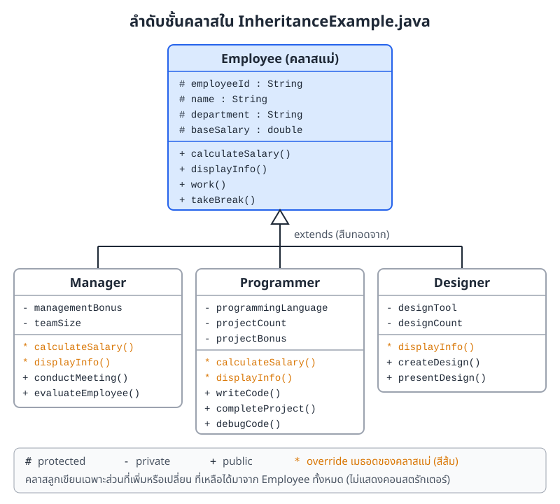
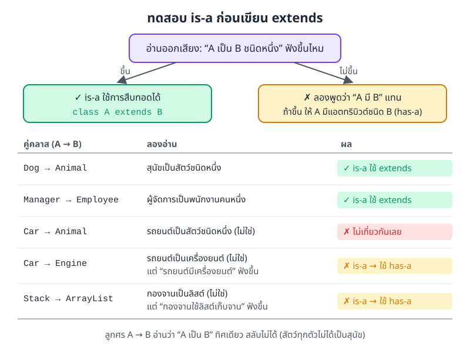
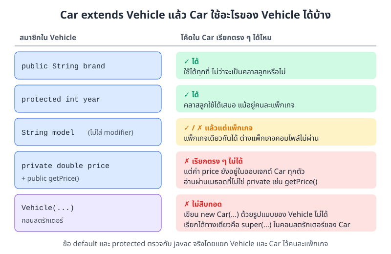
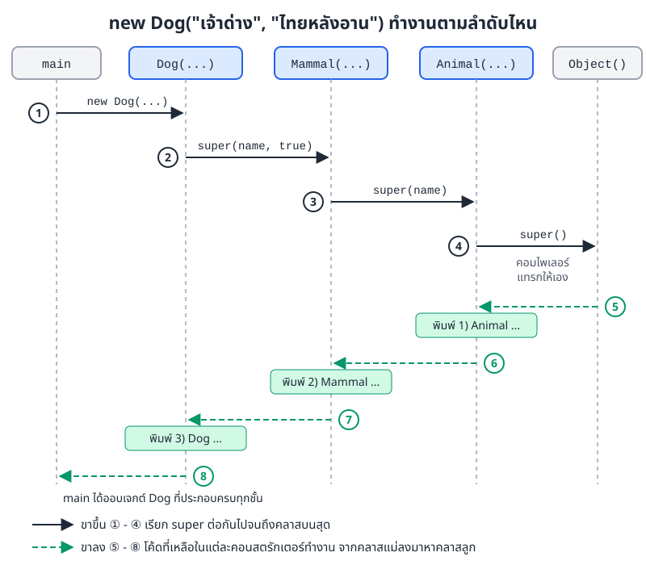
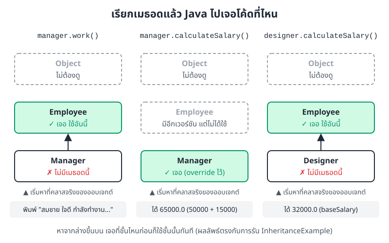
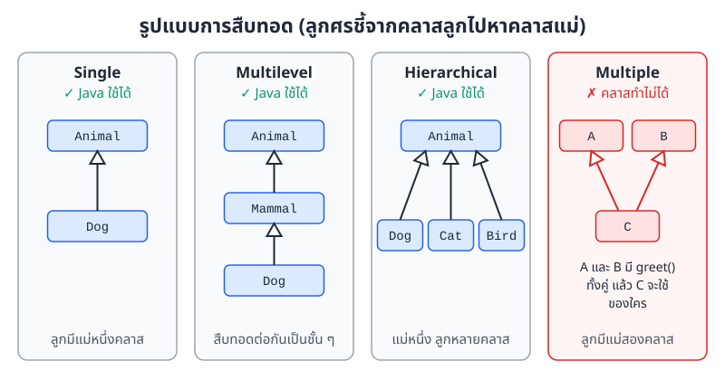
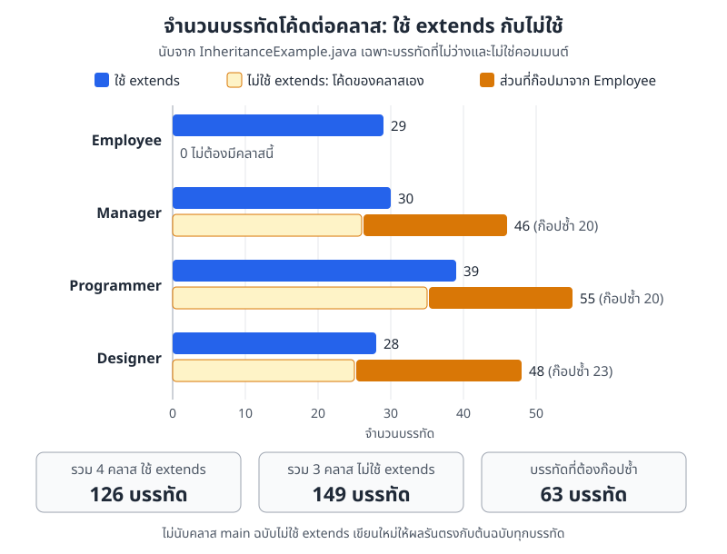

# บทที่ 6: การสืบทอด (Inheritance)

> การสืบทอดช่วยให้คลาสใหม่ได้แอตทริบิวต์และเมธอดของคลาสเดิมมาใช้ทันที แล้วเขียนเพิ่มเฉพาะส่วนที่ต่างออกไป
> ใช้เมื่อประโยค "A เป็น B ชนิดหนึ่ง" ฟังขึ้นเท่านั้น ส่วน keyword `super` คือทางติดต่อจากคลาสลูกกลับไปหาคลาสแม่

## สิ่งที่จะทำได้หลังเรียนบทนี้

1. อธิบายได้ว่าการสืบทอดคืออะไร และช่วยแก้ปัญหาอะไร
2. สร้างคลาสลูกจากคลาสแม่ด้วย keyword `extends` ได้
3. ใช้การทดสอบ is-a ตัดสินได้ว่าควรใช้การสืบทอดหรือไม่
4. บอกได้ว่าคลาสลูกเข้าถึงสมาชิกตัวไหนของคลาสแม่ได้บ้าง
5. ใช้ `super` เรียกแอตทริบิวต์ เมธอด และคอนสตรักเตอร์ของคลาสแม่ได้ และอธิบายลำดับการทำงานของคอนสตรักเตอร์ได้
6. อธิบายประโยชน์และข้อควรระวังของการสืบทอดได้

## 6.1 เริ่มจากปัญหา: โค้ดที่ต้องก๊อปซ้ำ

ลองนึกถึงระบบเงินเดือนของบริษัทหนึ่ง พนักงานทุกคนมีรหัสพนักงาน ชื่อ แผนก และเงินเดือนพื้นฐาน ทุกคนทำงานและพักเที่ยงเหมือนกัน

แต่แต่ละตำแหน่งก็มีของเฉพาะตัว ผู้จัดการมีโบนัสและลูกทีม โปรแกรมเมอร์มีภาษาที่ถนัดและโบนัสโปรเจกต์ นักออกแบบมีโปรแกรมที่ใช้ออกแบบ

ถ้าเขียนคลาส `Manager`, `Programmer`, `Designer` แยกกันโดยไม่มีอะไรเชื่อม เราต้องพิมพ์แอตทริบิวต์ชุดเดิม 4 ตัว และเมธอด `work()` กับ `takeBreak()` ซ้ำในทุกคลาส วันหนึ่งถ้าต้องแก้ข้อความใน `work()` ก็ต้องตามแก้สามที่ และถ้าลืมแก้ที่ใดที่หนึ่ง โปรแกรมก็ทำงานไม่ตรงกัน

การสืบทอด (inheritance) แก้ปัญหานี้ เราเขียนส่วนที่ทุกตำแหน่งมีเหมือนกันไว้ในคลาส `Employee` ที่เดียว แล้วให้ทุกตำแหน่ง "รับช่วง" ไปจากคลาสนั้น

## 6.2 การสืบทอดคืออะไร

การสืบทอดคือกลไกที่ให้คลาสหนึ่งรับแอตทริบิวต์ (attribute) และเมธอด (method) ของอีกคลาสหนึ่งมาใช้ได้เลย โดยไม่ต้องเขียนใหม่

- **คลาสแม่ (superclass)** คือคลาสต้นแบบที่ให้คนอื่นสืบทอด บางตำราเรียก parent class หรือ base class
- **คลาสลูก (subclass)** คือคลาสใหม่ที่สืบทอดจากคลาสแม่ บางตำราเรียก child class หรือ derived class

เทียบกับครอบครัวก็ได้ ลูกได้หน้าตาและนิสัยบางอย่างมาจากพ่อแม่โดยไม่ต้องทำอะไร แต่ลูกก็มีความสามารถของตัวเองเพิ่มขึ้นมาด้วย คลาสลูกก็เหมือนกัน ได้ทุกอย่างที่คลาสแม่เปิดให้ใช้ แล้วเพิ่มของตัวเองหรือปรับบางอย่างให้ต่างจากแม่ได้

ภาพที่ 6.1 คือโครงสร้างคลาสจากไฟล์ตัวอย่าง [InheritanceExample.java](../examples/InheritanceExample.java) ที่จะใช้ตลอดบทนี้



*ภาพที่ 6.1 คลาส Employee เก็บส่วนที่พนักงานทุกคนมีเหมือนกัน ส่วนคลาสลูกแต่ละคลาสเขียนเฉพาะสิ่งที่เพิ่มหรือเปลี่ยน (ข้อมูลในภาพนำมาจากโค้ดตัวอย่างจริง)*

สังเกตว่าในกล่องคลาสลูกไม่มี `name` หรือ `work()` เลย แต่ออบเจกต์ (object) ของ `Manager` ก็ยังมี `name` และเรียก `work()` ได้ เพราะได้มาจาก `Employee` นั่นเอง

## 6.3 เขียนการสืบทอดด้วย `extends`

รูปแบบการเขียนมีแค่นี้

```java
class Superclass {
    // แอตทริบิวต์และเมธอดที่ต้องการให้คลาสลูกใช้ร่วมกัน
}

class Subclass extends Superclass {
    // ได้ทุกอย่างของ Superclass มาแล้ว
    // เขียนเพิ่มเฉพาะแอตทริบิวต์และเมธอดใหม่
}
```

ตัวอย่างที่เล็กที่สุดคือสัตว์กับสุนัข

```java
// คลาสแม่: สัตว์
class Animal {
    String name;
    int age;

    void eat() {
        System.out.println(name + " กำลังกินอาหาร");
    }

    void sleep() {
        System.out.println(name + " กำลังนอนหลับ");
    }
}

// คลาสลูก: สุนัข ได้ name, age, eat(), sleep() มาจาก Animal
class Dog extends Animal {
    String breed;  // แอตทริบิวต์ที่มีเฉพาะสุนัข

    void bark() {
        System.out.println(name + " เห่า: โฮ่ง โฮ่ง!");
    }
}

public class AnimalDemo {
    public static void main(String[] args) {
        Dog dog = new Dog();
        dog.name = "เจ้าด่าง";   // name ประกาศไว้ใน Animal
        dog.breed = "ไทยหลังอาน";
        dog.eat();                // เมธอดที่ได้มาจาก Animal
        dog.bark();               // เมธอดของ Dog เอง

        System.out.println(dog instanceof Dog);     // true
        System.out.println(dog instanceof Animal);  // true

        Animal a = new Animal();
        System.out.println(a instanceof Dog);       // false
    }
}
```

ผลการรัน

```
เจ้าด่าง กำลังกินอาหาร
เจ้าด่าง เห่า: โฮ่ง โฮ่ง!
true
true
false
```

ในคลาส `Dog` ไม่มีบรรทัดไหนประกาศ `name` หรือ `eat()` เลย แต่ใช้ได้ทันที เพราะ `extends Animal` บอก Java ว่า "Dog คือ Animal ที่มีของเพิ่ม"

## 6.4 ความสัมพันธ์แบบ is-a

การสืบทอดสร้างความสัมพันธ์แบบ **is-a** (เป็น) เสมอ `Dog extends Animal` แปลว่า "สุนัขเป็นสัตว์ชนิดหนึ่ง" ดังนั้นก่อนเขียน `extends` ทุกครั้ง ให้ลองอ่านประโยคนี้ออกเสียงดู

```
Dog IS-A Animal          ✓ สุนัขเป็นสัตว์ชนิดหนึ่ง
Cat IS-A Animal          ✓ แมวเป็นสัตว์ชนิดหนึ่ง
Car IS-A Animal          ✗ รถยนต์ไม่ใช่สัตว์
```



*ภาพที่ 6.2 การทดสอบ is-a ถ้าประโยค "A เป็น B" ฟังไม่ขึ้น แต่ "A มี B" ฟังขึ้น แปลว่าควรให้ A มีแอตทริบิวต์ชนิด B แทนการสืบทอด*

ความสัมพันธ์ is-a มีทิศทางเดียว สุนัขทุกตัวเป็นสัตว์ แต่สัตว์ทุกตัวไม่ได้เป็นสุนัข ผลจาก `instanceof` ในตัวอย่างข้างบนยืนยันเรื่องนี้ `dog instanceof Animal` ได้ `true` แต่ `a instanceof Dog` ได้ `false`

แถวล่างสองแถวของภาพที่ 6.2 คือความสัมพันธ์อีกแบบที่ชื่อ **has-a** (มี) รถยนต์ไม่ได้เป็นเครื่องยนต์ แต่รถยนต์มีเครื่องยนต์ กรณีแบบนี้ให้ใส่เครื่องยนต์เป็นแอตทริบิวต์ในคลาสรถยนต์ ซึ่งจะเล่าต่อในหัวข้อ 6.11

## 6.5 คลาสลูกเข้าถึงอะไรของคลาสแม่ได้บ้าง

คลาสลูกได้ทุกอย่างของคลาสแม่มาอยู่ในออบเจกต์ก็จริง แต่จะ "แตะ" ได้ตรง ๆ หรือไม่ ขึ้นกับตัวกำหนดสิทธิ์การเข้าถึง (access modifier) ที่เรียนไปใน[บทที่ 5: การห่อหุ้ม (Encapsulation)](05-encapsulation.md)

### 6.5.1 ตารางสิทธิ์การเข้าถึง

| ตัวกำหนดสิทธิ์ | ในคลาสเดียวกัน | คลาสอื่นในแพ็กเกจเดียวกัน | คลาสลูกที่อยู่ต่างแพ็กเกจ | คลาสอื่นต่างแพ็กเกจ |
|---|:---:|:---:|:---:|:---:|
| `public` | ✓ | ✓ | ✓ | ✓ |
| `protected` | ✓ | ✓ | ✓ | ✗ |
| ไม่ใส่ (default) | ✓ | ✓ | ✗ | ✗ |
| `private` | ✓ | ✗ | ✗ | ✗ |

`protected` ไม่ได้แปลว่า "เฉพาะคลาสลูก" อย่างเดียว คลาสอื่นที่อยู่ในแพ็กเกจ (package) เดียวกันก็ใช้ได้ด้วย ส่วนแบบไม่ใส่อะไรเลย (default) คลาสลูกใช้ได้ก็ต่อเมื่ออยู่แพ็กเกจเดียวกันเท่านั้น

### 6.5.2 ตัวอย่างการเข้าถึง

```java
class Vehicle {
    public String brand = "Toyota";  // เข้าถึงได้จากทุกที่
    protected int year = 2024;       // คลาสลูก และคลาสในแพ็กเกจเดียวกัน
    String model = "Yaris";          // ไม่ใส่อะไรเลย (default) เฉพาะในแพ็กเกจเดียวกัน
    private double price = 559000;   // เฉพาะในคลาส Vehicle เท่านั้น

    protected void start() {
        System.out.println("เครื่องยนต์สตาร์ท");
    }

    public double getPrice() {       // ทางเข้าสำหรับอ่านค่า private
        return price;
    }
}

class Car extends Vehicle {
    void displayInfo() {
        System.out.println(brand);       // ได้
        System.out.println(year);        // ได้
        System.out.println(model);       // ได้ เพราะอยู่แพ็กเกจเดียวกัน
        // System.out.println(price);    // คอมไพล์ไม่ผ่าน price เป็น private
        System.out.println(getPrice());  // ได้ อ่านผ่านเมธอด public
        start();                         // ได้
    }
}

public class AccessDemo {
    public static void main(String[] args) {
        new Car().displayInfo();
    }
}
```

ผลการรัน

```
Toyota
2024
Yaris
559000.0
เครื่องยนต์สตาร์ท
```

ถ้าย้าย `Vehicle` ไปไว้แพ็กเกจ `garage` และ `Car` ไปไว้แพ็กเกจ `shop` บรรทัดที่ใช้ `model` จะคอมไพล์ไม่ผ่าน ส่วน `year` ที่เป็น `protected` ยังใช้ได้ตามปกติ

```
shop/Car.java:3: error: model is not public in Vehicle; cannot be accessed from outside package
```



*ภาพที่ 6.3 สมาชิกแต่ละแบบของ Vehicle กับสิทธิ์ของโค้ดในคลาส Car สองแถวล่างคือสองเรื่องที่คนเริ่มเรียนมักเข้าใจผิด*

มีสองเรื่องในภาพที่ 6.3 ที่ต้องจำให้แม่น

1. **`private` ไม่ได้หายไปไหน** ออบเจกต์ `Car` ทุกตัวมีช่องเก็บ `price` อยู่จริง แค่โค้ดในคลาส `Car` เรียกชื่อ `price` ตรง ๆ ไม่ได้ ต้องอ่านผ่านเมธอดที่คลาสแม่เปิดไว้ เช่น `getPrice()`
2. **คอนสตรักเตอร์ (constructor) ไม่สืบทอด** ถึง `Vehicle` จะมีคอนสตรักเตอร์รับพารามิเตอร์ ก็ไม่ได้แปลว่าเขียน `new Car(...)` ด้วยพารามิเตอร์ชุดเดียวกันได้ คลาสลูกต้องมีคอนสตรักเตอร์ของตัวเอง แล้วเรียกของคลาสแม่ผ่าน `super(...)` ซึ่งเป็นหัวข้อถัดไป

## 6.6 keyword `super`

`super` คือคำที่ใช้อ้างถึง "ส่วนที่เป็นคลาสแม่" ของออบเจกต์ตัวนี้ ใช้ได้สองแบบ

### 6.6.1 เรียกแอตทริบิวต์และเมธอดของคลาสแม่

```java
class Vehicle {
    String type = "ยานพาหนะ";

    void move() {
        System.out.println("ยานพาหนะเคลื่อนที่");
    }
}

class Car extends Vehicle {
    String type = "รถยนต์";   // ชื่อซ้ำกับของคลาสแม่ (บังของคลาสแม่ไว้)

    void displayType() {
        System.out.println(type);        // รถยนต์ (ของ Car)
        System.out.println(super.type);  // ยานพาหนะ (ของ Vehicle)
    }

    @Override
    void move() {
        super.move();  // ทำงานของคลาสแม่ก่อน
        System.out.println("รถยนต์วิ่งบนถนน");
    }
}

public class SuperDemo {
    public static void main(String[] args) {
        Car car = new Car();
        car.displayType();
        car.move();
    }
}
```

ผลการรัน

```
รถยนต์
ยานพาหนะ
ยานพาหนะเคลื่อนที่
รถยนต์วิ่งบนถนน
```

- `type` เฉย ๆ คือของ `Car` ส่วน `super.type` คือของ `Vehicle` การตั้งชื่อแอตทริบิวต์ซ้ำกับคลาสแม่แบบนี้เรียกว่า field hiding ใช้ได้แต่ชวนสับสน ในงานจริงควรเลี่ยง
- `super.move()` เรียกเวอร์ชันของคลาสแม่ ใช้บ่อยมากตอนที่อยากได้งานเดิมของแม่ แล้วต่อท้ายด้วยงานเพิ่มของลูก

### 6.6.2 เรียกคอนสตรักเตอร์ของคลาสแม่

ออบเจกต์คลาสลูกมีส่วนของคลาสแม่อยู่ข้างใน ส่วนนั้นต้องได้ค่าเริ่มต้นจากคอนสตรักเตอร์ของคลาสแม่ คลาสลูกจึงต้องส่งข้อมูลขึ้นไปให้ด้วย `super(...)`

ลองดูการสืบทอดสามชั้น `Animal` → `Mammal` → `Dog`

```java
class Animal {
    String name;

    Animal(String name) {
        this.name = name;
        System.out.println("1) Animal ตั้งชื่อ: " + name);
    }
}

class Mammal extends Animal {
    boolean hasFur;

    Mammal(String name, boolean hasFur) {
        super(name);           // ส่งชื่อขึ้นไปให้ Animal
        this.hasFur = hasFur;
        System.out.println("2) Mammal มีขน: " + hasFur);
    }
}

class Dog extends Mammal {
    String breed;

    Dog(String name, String breed) {
        super(name, true);     // ส่งต่อขึ้นไปให้ Mammal
        this.breed = breed;
        System.out.println("3) Dog สายพันธุ์: " + breed);
    }
}

public class ChainDemo {
    public static void main(String[] args) {
        Dog d = new Dog("เจ้าด่าง", "ไทยหลังอาน");
        System.out.println("สร้างเสร็จ: " + d.name + " " + d.hasFur + " " + d.breed);
    }
}
```

ผลการรัน

```
1) Animal ตั้งชื่อ: เจ้าด่าง
2) Mammal มีขน: true
3) Dog สายพันธุ์: ไทยหลังอาน
สร้างเสร็จ: เจ้าด่าง true ไทยหลังอาน
```

เราสั่ง `new Dog(...)` แต่ข้อความของ `Animal` ออกมาก่อน ภาพที่ 6.4 อธิบายว่าทำไม



*ภาพที่ 6.4 ลำดับการทำงานของคอนสตรักเตอร์ ขั้นที่ 1 ถึง 4 คือการเรียก super ต่อกันขึ้นไป ขั้นที่ 5 ถึง 8 คือโค้ดที่เหลือในแต่ละคอนสตรักเตอร์ทำงานไล่ลงมา*

ลำดับจริงคือ

1. `main` เรียกคอนสตรักเตอร์ของ `Dog`
2. บรรทัดแรกของ `Dog(...)` คือ `super(name, true)` จึงกระโดดไปที่ `Mammal(...)` ทันที
3. บรรทัดแรกของ `Mammal(...)` คือ `super(name)` จึงไปที่ `Animal(...)`
4. `Animal` ไม่ได้เขียน `extends` อะไร Java จึงถือว่า `Animal extends Object` และคอมไพเลอร์แทรก `super();` ให้เอง
5. พอ `Object()` ทำงานเสร็จ โค้ดที่เหลือของ `Animal` จึงได้ทำงาน พิมพ์บรรทัด `1)`
6. กลับมาที่ `Mammal` พิมพ์บรรทัด `2)`
7. กลับมาที่ `Dog` พิมพ์บรรทัด `3)`
8. `main` ได้ออบเจกต์ที่ทุกชั้นตั้งค่าเรียบร้อยแล้ว

สรุปง่าย ๆ คือ **เรียกจากล่างขึ้นบน แต่ทำงานจากบนลงล่าง** คลาสแม่ต้องพร้อมก่อน คลาสลูกถึงจะต่อยอดได้

### 6.6.3 กฎของ `super(...)`

- **`super(...)` ต้องเป็นคำสั่งแรกในคอนสตรักเตอร์** ถ้าเขียนไว้บรรทัดอื่นจะคอมไพล์ไม่ผ่าน (Java 25 ผ่อนกฎนี้ลง ให้เขียนคำสั่งที่ไม่แตะออบเจกต์ เช่น ตรวจค่าพารามิเตอร์ ไว้ก่อน `super(...)` ได้ แต่โค้ดในบทนี้ใช้ Java 21 จึงยึดกฎเดิม)
- **ถ้าไม่เขียน `super(...)` เลย คอมไพเลอร์จะแทรก `super();` (ไม่มีพารามิเตอร์) ให้** ปัญหาจะเกิดถ้าคลาสแม่ไม่มีคอนสตรักเตอร์แบบไม่มีพารามิเตอร์

```java
class Animal {
    String name;

    Animal(String name) {
        this.name = name;
    }
}

class Cat extends Animal {
    Cat() {
        // ไม่ได้เขียน super(...) คอมไพเลอร์จะแทรก super(); ให้เอง
        System.out.println("สร้างแมว");
    }
}
```

```
NoDefault.java:10: error: constructor Animal in class Animal cannot be applied to given types;
    Cat() {
          ^
  required: String
  found:    no arguments
  reason: actual and formal argument lists differ in length
1 error
```

ข้อความนี้บอกว่า `Animal` ต้องการ `String` หนึ่งตัว แต่ `super();` ที่แทรกให้ไม่ได้ส่งอะไรไปเลย วิธีแก้คือเขียน `super("ชื่อแมว");` เป็นบรรทัดแรก หรือเพิ่มคอนสตรักเตอร์แบบไม่มีพารามิเตอร์ใน `Animal`

## 6.7 override และการหาเมธอด

คลาสลูกไม่ได้แค่เพิ่มของใหม่ แต่ยังเขียนเมธอดชื่อเดียวกับคลาสแม่ เพื่อเปลี่ยนการทำงานได้ด้วย เรียกว่า **override** ในตัวอย่างพนักงาน `Manager` override `calculateSalary()` ให้บวกโบนัสผู้จัดการเข้าไป

```java
class Manager extends Employee {
    private double managementBonus;
    // ...

    @Override
    public double calculateSalary() {
        return baseSalary + managementBonus;
    }
}
```

`@Override` ที่อยู่ข้างบนเป็นป้ายบอกคอมไพเลอร์ว่า "ตั้งใจจะเขียนทับเมธอดของคลาสแม่" ถ้าเราพิมพ์ชื่อผิด เช่น `calculateSalery()` คอมไพเลอร์จะแจ้ง error ให้ทันที ถ้าไม่ใส่ป้ายนี้ Java จะเข้าใจว่าเป็นเมธอดใหม่อีกตัว แล้วโปรแกรมก็จะเรียกของคลาสแม่ต่อไปแบบเงียบ ๆ

เวลาเรียกเมธอดบนออบเจกต์ Java จะหาจากคลาสจริงของออบเจกต์ก่อน ถ้าไม่เจอจึงขึ้นไปหาที่คลาสแม่ทีละชั้น



*ภาพที่ 6.5 การหาเมธอดเริ่มที่คลาสจริงของออบเจกต์แล้วไล่ขึ้นไป เจอที่ชั้นไหนก่อนก็ใช้ชั้นนั้น ผลลัพธ์ในกล่องล่างตรงกับการรันไฟล์ตัวอย่าง*

- `manager.work()` ไม่มีใน `Manager` จึงไปเจอใน `Employee`
- `manager.calculateSalary()` เจอใน `Manager` ทันที เพราะ override ไว้ เวอร์ชันของ `Employee` จึงไม่ได้ใช้ ได้ 50000 + 15000 = 65000.0
- `designer.calculateSalary()` คลาส `Designer` ไม่ได้ override จึงใช้ของ `Employee` ที่คืนค่า `baseSalary` อย่างเดียว ได้ 32000.0

รายละเอียดของ override (กฎเรื่องชนิดข้อมูลที่คืนค่า สิทธิ์การเข้าถึง ความต่างจาก overload) จะเรียนเต็ม ๆ ใน[บทที่ 7: พหุสัณฐาน (Polymorphism)](07-polymorphism.md)

## 6.8 รูปแบบการสืบทอด



*ภาพที่ 6.6 รูปแบบการสืบทอดสี่แบบ สามแบบแรก Java รองรับ แบบสุดท้ายคลาสทำไม่ได้*

### 6.8.1 Single inheritance

คลาสลูกมีคลาสแม่หนึ่งคลาส แบบพื้นฐานที่สุด

```java
class Animal { }
class Dog extends Animal { }
```

### 6.8.2 Multilevel inheritance

สืบทอดต่อกันเป็นชั้น ๆ `Dog` ได้ทุกอย่างของ `Mammal` และของ `Animal` ด้วย ตัวอย่าง `ChainDemo` ในหัวข้อ 6.6.2 คือแบบนี้

```java
class Animal { }
class Mammal extends Animal { }
class Dog extends Mammal { }
```

### 6.8.3 Hierarchical inheritance

คลาสแม่หนึ่งคลาส มีคลาสลูกหลายคลาส ตัวอย่างพนักงานในภาพที่ 6.1 ก็เป็นแบบนี้

```java
class Animal { }
class Dog extends Animal { }
class Cat extends Animal { }
class Bird extends Animal { }
```

### 6.8.4 Multiple inheritance (คลาสใน Java ทำไม่ได้)

แบบนี้คือคลาสเดียวมีคลาสแม่สองคลาส เช่น `class C extends A, B` ซึ่งคอมไพล์ไม่ผ่านใน Java

เหตุผลคือปัญหาที่เรียกว่า diamond problem สมมติว่า `A` และ `B` ต่างก็มีเมธอด `greet()` ที่ทำงานไม่เหมือนกัน พอเรียก `c.greet()` Java จะไม่รู้ว่าควรใช้ของใคร ภาษา Java จึงตัดปัญหาด้วยการให้คลาสหนึ่ง `extends` ได้คลาสเดียว

ถ้าอยากได้ความสามารถจากหลายทาง Java มีเครื่องมืออีกตัวคืออินเทอร์เฟซ (interface) คลาสหนึ่ง implement ได้หลายอินเทอร์เฟซ หนังสือเล่มนี้ไม่มีบทที่สอนอินเทอร์เฟซโดยตรง แต่จะได้เห็นตัวอย่างการใช้งานในหัวข้อ Realization ของ[บทที่ 8: แผนภาพคลาส (UML Class Diagram) และการเขียนโค้ดตามโมเดล](08-uml-diagrams.md) และหัวข้อ Open/Closed Principle ของ[บทที่ 10: เขียนโค้ดให้ดูแลต่อได้ง่าย (Maintainable Code)](10-maintainable-code.md)

อีกเรื่องที่ควรรู้ คลาสที่ไม่ได้เขียน `extends` อะไรเลย Java จะให้สืบทอดจากคลาส `Object` อัตโนมัติ ทุกคลาสใน Java จึงมี `Object` เป็นต้นตระกูลบนสุดเสมอ (เหมือนกล่อง `Object()` ในภาพที่ 6.4 และ 6.5)

## 6.9 ประโยชน์ของการสืบทอด

### 6.9.1 นำโค้ดกลับมาใช้ซ้ำ (code reusability)

ไม่ต้องเขียนโค้ดเดิมซ้ำ และโค้ดในคลาสแม่ที่ทดสอบแล้วก็ใช้ต่อได้เลย

เพื่อให้เห็นเป็นตัวเลข เราลองเขียนตัวอย่าง `InheritanceExample.java` ใหม่อีกฉบับโดยไม่ใช้ `extends` ให้ผลการรันออกมาตรงกับต้นฉบับทุกบรรทัด แล้วนับจำนวนบรรทัดของแต่ละคลาส (ไม่นับบรรทัดว่างและคอมเมนต์)



*ภาพที่ 6.7 จำนวนบรรทัดโค้ดต่อคลาส นับจากไฟล์ตัวอย่างจริงเทียบกับฉบับที่เขียนใหม่โดยไม่ใช้ extends*

อ่านจากภาพที่ 6.7 ได้ว่า

- เมื่อไม่ใช้ `extends` คลาสลูกทุกคลาสต้องก๊อปโค้ดจาก `Employee` มา 20 ถึง 23 บรรทัด (แอตทริบิวต์ 4 ตัว การตั้งค่าในคอนสตรักเตอร์ ส่วนต้นของ `displayInfo()`, `work()`, `takeBreak()` และของ `Designer` ยังต้องมี `calculateSalary()` ด้วย) รวมแล้วก๊อปซ้ำ 63 บรรทัด
- ยอดรวมต่างกันไม่มาก (126 กับ 149 บรรทัด) เพราะฉบับที่ใช้ `extends` ต้องเขียนคลาส `Employee` เพิ่มอีก 29 บรรทัด แต่ตัวเลขนี้มาจากตำแหน่งงานแค่ 3 ตำแหน่ง ทุกครั้งที่เพิ่มตำแหน่งใหม่ ฉบับไม่ใช้ `extends` ต้องก๊อปอีกอย่างน้อย 20 บรรทัด
- สิ่งที่มีค่ากว่าจำนวนบรรทัดคือ **จำนวนที่ต้องแก้** ถ้าจะแก้ข้อความใน `work()` ฉบับที่ใช้ `extends` แก้ที่เดียว ฉบับไม่ใช้ต้องแก้ 3 ที่ให้ตรงกัน

### 6.9.2 ต่อยอดได้ง่าย (extensibility)

อยากเพิ่มตำแหน่ง `Accountant` ก็เขียน `class Accountant extends Employee` แล้วเพิ่มเฉพาะของที่นักบัญชีมี ไม่ต้องไปแตะโค้ดเดิมที่ทำงานได้อยู่แล้ว

### 6.9.3 ดูแลรักษาง่าย (maintainability)

แก้ที่คลาสแม่ที่เดียว คลาสลูกทุกคลาสได้ผลไปด้วย จุดที่ต้องแก้น้อยลง โอกาสลืมแก้ก็น้อยลง

### 6.9.4 เป็นพื้นฐานของพหุสัณฐาน

เมื่อ `Manager`, `Programmer`, `Designer` ต่างก็เป็น `Employee` เราจึงเก็บพนักงานทุกตำแหน่งไว้ในอาร์เรย์ (array) `Employee[]` อันเดียว แล้วสั่ง `calculateSalary()` ทีละคนได้ โดยแต่ละคนคำนวณตามแบบของตำแหน่งตัวเอง เรื่องนี้คือหัวใจของบทที่ 7

## 6.10 ตัวอย่างเต็ม: ระบบพนักงาน

ไฟล์ [InheritanceExample.java](../examples/InheritanceExample.java) รวมทุกเรื่องในบทนี้ไว้ในโปรแกรมเดียว ลองเปิดไฟล์คู่กับภาพที่ 6.1 แล้วไล่ดูทีละจุด

**1. คลาสแม่เก็บของที่ใช้ร่วมกัน** `Employee` ประกาศแอตทริบิวต์เป็น `protected` เพื่อให้คลาสลูกใช้ `baseSalary` และ `name` ได้ตรง ๆ

```java
class Employee {
    protected String employeeId;
    protected String name;
    protected String department;
    protected double baseSalary;
    // ...
}
```

**2. คลาสลูกส่งข้อมูลส่วนกลางขึ้นไปให้คลาสแม่ตั้งค่า** แล้วจึงตั้งค่าแอตทริบิวต์ของตัวเอง

```java
public Manager(String employeeId, String name, String department,
               double baseSalary, double managementBonus, int teamSize) {
    // เรียกคอนสตรักเตอร์ของคลาสแม่
    super(employeeId, name, department, baseSalary);
    this.managementBonus = managementBonus;
    this.teamSize = teamSize;
    System.out.println("  → เป็นตำแหน่ง Manager");
}
```

ผลการรันช่วงสร้างออบเจกต์ยืนยันลำดับในภาพที่ 6.4 ข้อความของ `Employee` ออกก่อนข้อความของคลาสลูกทุกครั้ง

```
>>> สร้างพนักงานตำแหน่ง Manager
✓ สร้าง Employee: สมชาย ใจดี
  → เป็นตำแหน่ง Manager

>>> สร้างพนักงานตำแหน่ง Programmer
✓ สร้าง Employee: สมหญิง รักเรียน
  → เป็นตำแหน่ง Programmer (Java)
✓ สร้าง Employee: สมศรี ขยัน
  → เป็นตำแหน่ง Programmer (Python)
```

**3. override แล้วต่อยอดด้วย `super`** `displayInfo()` ของคลาสลูกเรียก `super.displayInfo()` ให้คลาสแม่พิมพ์ข้อมูลพื้นฐานก่อน แล้วค่อยพิมพ์ข้อมูลของตำแหน่งต่อท้าย

```java
@Override
public void displayInfo() {
    super.displayInfo();  // ให้ Employee พิมพ์ข้อมูลพื้นฐานก่อน
    System.out.println("│ ตำแหน่ง: Manager");
    System.out.println("│ โบนัสผู้จัดการ: " + managementBonus + " บาท");
    System.out.println("│ จำนวนทีม: " + teamSize + " คน");
    System.out.println("│ เงินเดือนรวม: " + calculateSalary() + " บาท");
    System.out.println("└─────────────────────────────────────┘");
}
```

```
┌─────────────────────────────────────┐
│ รหัสพนักงาน: M001
│ ชื่อ: สมชาย ใจดี
│ แผนก: IT Management
│ เงินเดือนพื้นฐาน: 50000.0 บาท
│ ตำแหน่ง: Manager
│ โบนัสผู้จัดการ: 15000.0 บาท
│ จำนวนทีม: 10 คน
│ เงินเดือนรวม: 65000.0 บาท
└─────────────────────────────────────┘
```

สี่บรรทัดแรกมาจาก `Employee` ส่วนที่เหลือมาจาก `Manager`

**4. เมธอดที่ได้มาฟรี** `manager.work()`, `prog1.takeBreak()` เรียกได้ทั้งที่ไม่มีในคลาสลูก

**5. เมธอดเฉพาะตำแหน่ง** `conductMeeting()` มีแค่ใน `Manager` ส่วน `writeCode()` มีแค่ใน `Programmer` ออบเจกต์ `Designer` จึงเรียก `writeCode()` ไม่ได้

**6. override แล้วตัวเลขเปลี่ยนตามสถานะ** หลัง `prog2` ทำโปรเจกต์เสร็จสองครั้ง (โบนัส 6000 และ 4500) `calculateSalary()` ของ `Programmer` คืนค่า 38000 + 10500 = 48500.0

```
│ จำนวนโปรเจกต์: 2
│ โบนัสโปรเจกต์: 10500.0 บาท
│ เงินเดือนรวม: 48500.0 บาท
```

## 6.11 หลักการออกแบบที่ดี

### 6.11.1 ถ้าเลือกได้ ให้ใช้ composition ก่อน (favor composition over inheritance)

composition คือการให้คลาสหนึ่ง "มี" ออบเจกต์ของอีกคลาสเป็นแอตทริบิวต์ (ความสัมพันธ์ has-a ในภาพที่ 6.2) หลายกรณีที่ดูเหมือนจะใช้การสืบทอดได้ จริง ๆ แล้ว composition เหมาะกว่า

ตัวอย่างคลาสสิกคือกองจาน (stack) ที่หยิบได้เฉพาะใบบนสุด ถ้าเขียน `class Stack extends ArrayList` ก็ได้เมธอดของ `ArrayList` มาหมด รวมถึง `add(0, ...)` ที่แทรกจานไว้ใต้กองได้ ซึ่งผิดกติกาของกองจาน ทางที่ดีกว่าคือให้ `Stack` มี `ArrayList` อยู่ข้างใน แล้วเปิดให้ใช้แค่เมธอดที่กองจานควรมี

```java
import java.util.ArrayList;

// Stack "มี" ArrayList อยู่ข้างใน (has-a) ไม่ได้ "เป็น" ArrayList
class Stack {
    private ArrayList<String> items = new ArrayList<>();

    void push(String item) {
        items.add(item);
    }

    String pop() {
        return items.remove(items.size() - 1);
    }

    boolean isEmpty() {
        return items.isEmpty();
    }
}

public class StackDemo {
    public static void main(String[] args) {
        Stack plates = new Stack();
        plates.push("จานใบที่ 1");
        plates.push("จานใบที่ 2");
        System.out.println(plates.pop());  // จานใบที่ 2 (ใบบนสุดออกก่อน)
        // plates.add(0, "แทรกใต้กอง");   // คอมไพล์ไม่ผ่าน ดีแล้ว เพราะ Stack ไม่ควรทำแบบนี้ได้
    }
}
```

ผลการรัน

```
จานใบที่ 2
```

เรื่องนี้เกิดขึ้นจริงในไลบรารีของ Java เอง คลาส `java.util.Stack` สืบทอดจาก `Vector` จึงแทรกของกลางกองได้ เอกสารของ Java ปัจจุบันจึงแนะนำให้ใช้ `ArrayDeque` แทน

### 6.11.2 คลาสลูกต้องใช้แทนคลาสแม่ได้ (Liskov Substitution Principle)

ทุกที่ที่โค้ดใช้ออบเจกต์คลาสแม่ได้ ถ้าเปลี่ยนเป็นออบเจกต์คลาสลูกแล้วต้องยังทำงานถูก เช่น โค้ดที่คำนวณเงินเดือนของ `Employee` ต้องใช้กับ `Manager` ได้โดยไม่พัง ถ้าคลาสลูก override เมธอดแล้วทำงานขัดกับที่คลาสแม่สัญญาไว้ (เช่น `calculateSalary()` คืนค่าติดลบ หรือโยน exception ทั้งที่ของแม่ไม่เคยโยน) แปลว่าการออกแบบมีปัญหา

### 6.11.3 อย่าทำลายการห่อหุ้ม

- อย่าเปลี่ยน `private` เป็น `public` เพียงเพราะคลาสลูกอยากใช้ ให้เปิดเมธอด getter หรือเมธอดที่จำเป็นแทน
- ใช้ `protected` อย่างระวัง เพราะคลาสลูกทุกคลาส และทุกคลาสในแพ็กเกจเดียวกัน แก้ค่าได้ตรง ๆ โดยไม่ผ่านการตรวจใด ๆ ในตัวอย่างพนักงาน ถ้าคลาสลูกตั้ง `baseSalary` เป็นค่าติดลบ `Employee` ก็ห้ามไม่ได้

## 6.12 ข้อควรระวัง

### 6.12.1 อย่าใช้การสืบทอดเพียงเพราะอยากได้โค้ดมาใช้

ถ้าการทดสอบ is-a ไม่ผ่าน อย่าใช้ `extends` แม้จะประหยัดโค้ดได้ก็ตาม `class Stack extends ArrayList` ในหัวข้อ 6.11.1 คือตัวอย่างที่ชัดที่สุด

### 6.12.2 คลาสแม่เปลี่ยนแล้วคลาสลูกพัง (fragile base class problem)

คลาสลูกพึ่งพาการทำงานภายในของคลาสแม่ เวลาแก้คลาสแม่ อาจทำให้คลาสลูกที่เราไม่ได้แตะเลยทำงานผิดไปด้วย ยิ่งมีคลาสลูกมาก ยิ่งต้องระวัง ก่อนแก้คลาสแม่จึงควรนึกถึงคลาสลูกทุกคลาสเสมอ

### 6.12.3 อย่าสืบทอดลึกหลายชั้นเกินไป

ลำดับชั้นยาว ๆ เช่น `Animal` → `Mammal` → `Carnivore` → `Canine` → `Dog` → `ThaiDog` ทำให้หาไม่เจอว่าเมธอดที่เรียกอยู่จริง ๆ อยู่ชั้นไหน และแก้ชั้นบนทีหนึ่งกระทบทุกชั้นล่าง ส่วนใหญ่สองถึงสามชั้นก็พอ

## ข้อผิดพลาดที่เจอบ่อย

| อาการ | สาเหตุ | วิธีแก้ |
|---|---|---|
| `constructor X in class X cannot be applied to given types` | คลาสแม่ไม่มีคอนสตรักเตอร์แบบไม่มีพารามิเตอร์ แต่คลาสลูกไม่ได้เรียก `super(...)` | เขียน `super(...)` พร้อมพารามิเตอร์ให้ครบเป็นบรรทัดแรก |
| `call to super must be first statement in constructor` | เขียน `super(...)` ไว้หลังคำสั่งอื่น | ย้าย `super(...)` ขึ้นไปบรรทัดแรก |
| `xxx has private access in Yyy` | คลาสลูกเรียกแอตทริบิวต์ `private` ของคลาสแม่ตรง ๆ | ใช้ getter หรือเมธอดของคลาสแม่ อย่าแก้เป็น `public` |
| เขียนเมธอดใหม่แล้วโปรแกรมยังเรียกของคลาสแม่ | ชื่อหรือพารามิเตอร์ไม่ตรงกับของคลาสแม่ เลยกลายเป็นเมธอดใหม่ ไม่ใช่ override | ใส่ `@Override` ไว้เสมอ คอมไพเลอร์จะเตือนทันที |
| คิดว่า `protected` ใช้ได้เฉพาะคลาสลูก | `protected` เปิดให้ทุกคลาสในแพ็กเกจเดียวกันด้วย | ดูตารางในหัวข้อ 6.5.1 |
| เขียน `class C extends A, B` | Java ไม่ให้คลาส extends สองคลาส | เลือกคลาสแม่คลาสเดียว ส่วนที่เหลือใช้อินเทอร์เฟซหรือ composition |
| ใช้ `extends` กับคู่ที่เป็น has-a เช่น `Car extends Engine` | ไม่ได้ทดสอบ is-a ก่อน | ให้ `Car` มีแอตทริบิวต์ `Engine` แทน |

## สรุปท้ายบท

- การสืบทอดให้คลาสลูกได้แอตทริบิวต์และเมธอดของคลาสแม่มาใช้ แล้วเพิ่มหรือเปลี่ยนเฉพาะส่วนที่ต่าง
- เขียนด้วย `class Subclass extends Superclass` และคลาสหนึ่ง extends ได้คลาสเดียว
- ใช้การสืบทอดเมื่อ "A เป็น B ชนิดหนึ่ง" ฟังขึ้น (is-a) ถ้า "A มี B" ฟังขึ้นกว่า ให้ใช้ composition (has-a)
- สมาชิก `private` ของคลาสแม่ยังอยู่ในออบเจกต์คลาสลูก แต่เรียกตรง ๆ ไม่ได้ ส่วนคอนสตรักเตอร์ไม่สืบทอด
- `super.xxx` เรียกแอตทริบิวต์หรือเมธอดของคลาสแม่ `super(...)` เรียกคอนสตรักเตอร์ของคลาสแม่ และต้องเป็นบรรทัดแรก
- คอนสตรักเตอร์เรียกต่อกันจากล่างขึ้นบน แต่โค้ดทำงานจากคลาสบนสุดลงมา
- เวลาเรียกเมธอด Java หาที่คลาสจริงของออบเจกต์ก่อน แล้วไล่ขึ้นไปหาคลาสแม่ ใส่ `@Override` ทุกครั้งที่ตั้งใจเขียนทับ
- ประโยชน์หลักคือโค้ดไม่ซ้ำ ต่อยอดง่าย แก้ที่เดียว และเป็นฐานของพหุสัณฐานในบทถัดไป

## แบบฝึกหัด

**ข้อ 1** เขียนโปรแกรมตามนี้

1. สร้างคลาส `Vehicle` ที่มีแอตทริบิวต์ `brand`, `year` และเมธอด `start()`, `stop()`
2. สร้างคลาสลูก `Car` ที่เพิ่มแอตทริบิวต์ `numberOfDoors` และเมธอด `openTrunk()`
3. สร้างคลาสลูก `Motorcycle` ที่เพิ่มแอตทริบิวต์ `hasSidecar` และเมธอด `wheelie()`
4. สร้างออบเจกต์ของ `Car` และ `Motorcycle` แล้วเรียกใช้ทุกเมธอด

<details>
<summary>ดูเฉลย</summary>

```java
class Vehicle {
    protected String brand;
    protected int year;

    Vehicle(String brand, int year) {
        this.brand = brand;
        this.year = year;
    }

    void start() {
        System.out.println(brand + " สตาร์ทเครื่อง");
    }

    void stop() {
        System.out.println(brand + " ดับเครื่อง");
    }
}

class Car extends Vehicle {
    private int numberOfDoors;

    Car(String brand, int year, int numberOfDoors) {
        super(brand, year);
        this.numberOfDoors = numberOfDoors;
    }

    void openTrunk() {
        System.out.println(brand + " (" + numberOfDoors + " ประตู) เปิดท้ายรถ");
    }
}

class Motorcycle extends Vehicle {
    private boolean hasSidecar;

    Motorcycle(String brand, int year, boolean hasSidecar) {
        super(brand, year);
        this.hasSidecar = hasSidecar;
    }

    void wheelie() {
        if (hasSidecar) {
            System.out.println(brand + " มีพ่วงข้าง ยกล้อไม่ได้");
        } else {
            System.out.println(brand + " ยกล้อหน้า!");
        }
    }
}

public class Garage {
    public static void main(String[] args) {
        Car car = new Car("Honda City", 2023, 4);
        Motorcycle bike = new Motorcycle("Honda Wave", 2022, false);

        car.start();       // ได้มาจาก Vehicle
        car.openTrunk();   // ของ Car เอง
        car.stop();

        bike.start();
        bike.wheelie();
        bike.stop();
    }
}
```

ผลการรัน

```
Honda City สตาร์ทเครื่อง
Honda City (4 ประตู) เปิดท้ายรถ
Honda City ดับเครื่อง
Honda Wave สตาร์ทเครื่อง
Honda Wave ยกล้อหน้า!
Honda Wave ดับเครื่อง
```

</details>

**ข้อ 2** จากข้อ 1 อธิบายว่าการสืบทอดช่วยอะไรบ้าง

<details>
<summary>ดูเฉลย</summary>

- `brand`, `year`, `start()`, `stop()` เขียนไว้ที่ `Vehicle` ที่เดียว `Car` และ `Motorcycle` ไม่ต้องเขียนซ้ำ
- ถ้าจะเพิ่มรถบรรทุก ก็เขียน `class Truck extends Vehicle` แล้วเพิ่มเฉพาะของรถบรรทุก
- ถ้าจะแก้ข้อความใน `start()` แก้ที่ `Vehicle` ที่เดียว รถทุกแบบเปลี่ยนตาม
- ทั้ง `Car` และ `Motorcycle` เป็น `Vehicle` จึงเก็บรวมในอาร์เรย์ `Vehicle[]` อันเดียวได้

</details>

**ข้อ 3** คู่ไหนควรใช้ `extends` คู่ไหนควรใช้ has-a

1. `Student` กับ `Person`
2. `Smartphone` กับ `Battery`
3. `Square` กับ `Shape`
4. `Rider` (ไรเดอร์ส่งอาหาร) กับ `Motorcycle`
5. `SavingsAccount` (บัญชีออมทรัพย์) กับ `BankAccount`

<details>
<summary>ดูเฉลย</summary>

1. `Student extends Person` นักศึกษาเป็นคนคนหนึ่ง
2. has-a โทรศัพท์ไม่ได้เป็นแบตเตอรี่ แต่มีแบตเตอรี่
3. `Square extends Shape` สี่เหลี่ยมจัตุรัสเป็นรูปทรงชนิดหนึ่ง
4. has-a ไรเดอร์ไม่ได้เป็นมอเตอร์ไซค์ แต่มี (หรือใช้) มอเตอร์ไซค์
5. `SavingsAccount extends BankAccount` บัญชีออมทรัพย์เป็นบัญชีธนาคารชนิดหนึ่ง

</details>

**ข้อ 4** โปรแกรมนี้พิมพ์อะไรออกมา และเรียงลำดับอย่างไร

```java
class A {
    A() { System.out.println("A"); }
}

class B extends A {
    B() { System.out.println("B"); }
}

class C extends B {
    C() {
        super();
        System.out.println("C");
    }
}

public class Order {
    public static void main(String[] args) {
        new C();
    }
}
```

<details>
<summary>ดูเฉลย</summary>

```
A
B
C
```

`C()` เรียก `super()` ไปที่ `B()` ส่วน `B()` ไม่ได้เขียน `super()` แต่คอมไพเลอร์แทรกให้ จึงไปที่ `A()` ต่อ พอ `A()` พิมพ์เสร็จก็กลับลงมาที่ `B()` แล้วจึงถึง `C()` ตามภาพที่ 6.4

</details>

**ข้อ 5** โค้ดนี้คอมไพล์ไม่ผ่าน เพราะอะไร และแก้อย่างไร

```java
class Animal {
    String name;
    Animal(String name) { this.name = name; }
}

class Cat extends Animal {
    Cat() {
        System.out.println("สร้างแมว");
    }
}
```

<details>
<summary>ดูเฉลย</summary>

`Cat()` ไม่ได้เรียก `super(...)` คอมไพเลอร์จึงแทรก `super();` ให้ แต่ `Animal` ไม่มีคอนสตรักเตอร์แบบไม่มีพารามิเตอร์ จึงขึ้น error `constructor Animal in class Animal cannot be applied to given types`

แก้ได้สองทาง

```java
// ทางที่ 1: ส่งชื่อขึ้นไปให้คลาสแม่
Cat() {
    super("เหมียว");
    System.out.println("สร้างแมว");
}

// ทางที่ 2: เพิ่มคอนสตรักเตอร์แบบไม่มีพารามิเตอร์ใน Animal
Animal() { this.name = "ไม่มีชื่อ"; }
```

</details>

**ข้อ 6** ใน `InheritanceExample.java` ถ้าเรียก `designer.calculateSalary()` โปรแกรมจะใช้เมธอดของคลาสไหน และได้ค่าเท่าไร ถ้าอยากให้นักออกแบบได้โบนัส 500 บาทต่องานออกแบบ ต้องแก้อะไร

<details>
<summary>ดูเฉลย</summary>

`Designer` ไม่ได้ override `calculateSalary()` จึงใช้ของ `Employee` ที่คืน `baseSalary` ได้ 32000.0 (ดูภาพที่ 6.5)

ถ้าต้องการโบนัสต่องาน ให้ override ใน `Designer`

```java
@Override
public double calculateSalary() {
    return baseSalary + designCount * 500;
}
```

หลังสร้างงานออกแบบ 2 ชิ้นตามไฟล์ตัวอย่าง จะได้ 32000 + 1000 = 33000.0

</details>

***

[< บทก่อนหน้า: บทที่ 5: การห่อหุ้ม (Encapsulation)](05-encapsulation.md) | [กลับไปหน้าหลัก](README.md) | [บทถัดไป: บทที่ 7: พหุสัณฐาน (Polymorphism) >](07-polymorphism.md)
