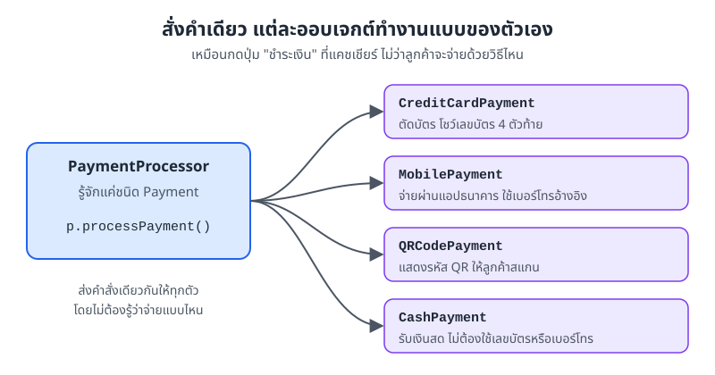
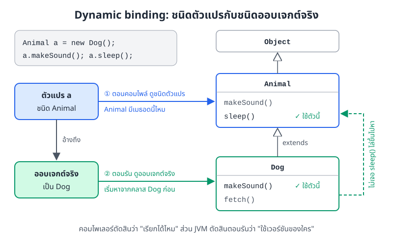
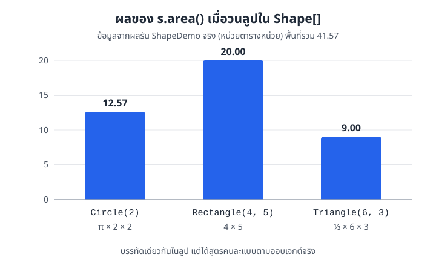
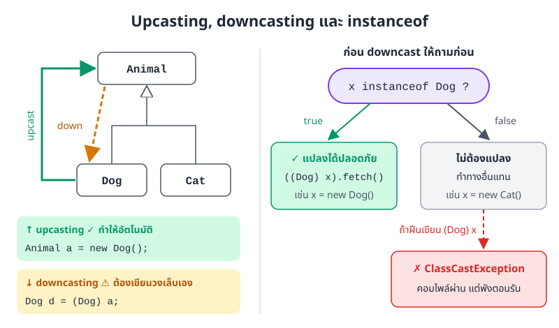
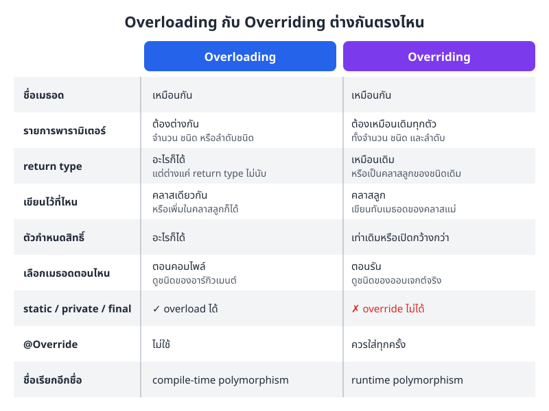
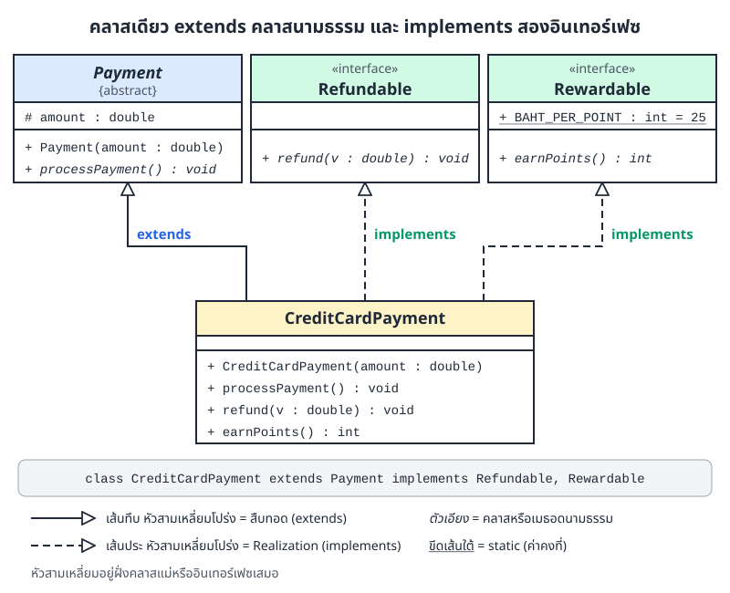
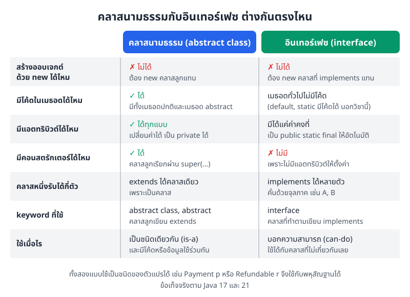

# บทที่ 7: พหุสัณฐาน (Polymorphism)

> พหุสัณฐานคือการสั่งงานด้วยคำสั่งเดียว แล้วให้ออบเจกต์แต่ละตัวทำงานตามแบบของตัวเอง
> Java มีสองแบบ คือ overload (เลือกเมธอดตอนคอมไพล์) และ override (เลือกเมธอดตอนรัน)
> ถ้าเข้าใจว่า "ชนิดของตัวแปร" กับ "ชนิดของออบเจกต์จริง" ทำหน้าที่ต่างกัน ก็จะเข้าใจบทนี้ทั้งบท

## สิ่งที่จะทำได้หลังเรียนบทนี้

1. อธิบายได้ว่าพหุสัณฐานคืออะไร และช่วยให้โค้ดยืดหยุ่นขึ้นอย่างไร
2. เขียนเมธอดแบบ overload และบอกได้ว่าคอมไพเลอร์จะเลือกเมธอดตัวไหน
3. เขียนเมธอดแบบ override ในคลาสลูก และใช้ `@Override` ได้ถูกต้อง
4. อธิบายความต่างระหว่าง compile-time polymorphism กับ runtime polymorphism (dynamic binding)
5. ใช้ upcasting, downcasting และ `instanceof` ได้อย่างปลอดภัย
6. นำพหุสัณฐานไปออกแบบโปรแกรมที่เพิ่มของใหม่ได้โดยไม่ต้องแก้โค้ดเดิม
7. เขียนคลาสนามธรรม (abstract class) และอินเทอร์เฟซ (interface) เบื้องต้น ใช้ `extends` กับ `implements` ได้ถูก และบอกได้ว่าเมื่อไรควรใช้แบบไหน

## 1. พหุสัณฐานคืออะไร

### ปุ่มเดียว ทำงานได้หลายแบบ

ลองนึกถึงแคชเชียร์ร้านกาแฟ ตอนคิดเงิน แคชเชียร์กดปุ่ม "ชำระเงิน" ปุ่มเดียวเสมอ

ถ้าลูกค้ายื่นบัตรเครดิต เครื่องก็ตัดบัตร ถ้าลูกค้าสแกนจ่าย เครื่องก็แสดง QR ถ้าจ่ายเงินสด ลิ้นชักก็เด้งออกมา แคชเชียร์ไม่ต้องจำขั้นตอนของแต่ละวิธี แค่กดปุ่มเดิม แล้ววิธีจ่ายแต่ละแบบจัดการตัวเอง



*ภาพที่ 7.1 คำสั่ง `p.processPayment()` คำสั่งเดียว แต่ออบเจกต์แต่ละชนิดทำงานไม่เหมือนกัน (จากตัวอย่าง `PolymorphismExample.java`)*

นี่คือ **พหุสัณฐาน (polymorphism)** คำนี้มาจากภาษากรีก poly แปลว่า หลาย และ morph แปลว่า รูปร่าง รวมกันคือ "มีได้หลายรูปแบบ"

ในโค้ด Java พหุสัณฐานหมายถึง **ชื่อเมธอดเดียวกัน ให้ผลต่างกันได้ ขึ้นกับว่าเรียกด้วยอะไร หรือเรียกกับออบเจกต์ชนิดไหน**

### สองแบบของพหุสัณฐานใน Java

| แบบ | ชื่อเรียกอื่น | ทำได้ด้วย | Java เลือกเมธอดตอนไหน |
|---|---|---|---|
| Compile-time polymorphism | static polymorphism | method overloading | ตอนคอมไพล์ |
| Runtime polymorphism | dynamic polymorphism | method overriding | ตอนรัน |

สองหัวข้อถัดไปจะอธิบายทีละแบบ

## 2. Method overloading: ชื่อเดียว รับข้อมูลได้หลายแบบ

### 2.1 Overloading คืออะไร

ตู้เติมเงินมือถือรับได้ทั้งเหรียญ ธนบัตร และสแกนจ่าย ทุกช่องทางเรียกว่า "เติมเงิน" เหมือนกัน แต่รับของเข้ามาคนละแบบ

**Method overloading** คือการเขียนเมธอด (method) หลายตัวที่**ชื่อเดียวกัน**ในคลาส (class) เดียวกัน แต่**รายการพารามิเตอร์ต่างกัน**

### 2.2 เงื่อนไขของ overloading

เมธอดที่ชื่อซ้ำกันต้องต่างกันอย่างน้อยหนึ่งข้อต่อไปนี้

1. **จำนวนพารามิเตอร์** เช่น `add(int, int)` กับ `add(int, int, int)`
2. **ชนิดข้อมูลของพารามิเตอร์** เช่น `add(int, int)` กับ `add(double, double)`
3. **ลำดับของชนิดข้อมูล** เช่น `add(int, double)` กับ `add(double, int)` (สลับชื่อพารามิเตอร์อย่างเดียวไม่นับ ต้องสลับชนิดข้อมูล)

ต่างกันแค่ return type ไม่พอ ชื่อพารามิเตอร์ต่างกันก็ไม่พอ เพราะตอนเรียกใช้ Java ดูแค่ชื่อเมธอดกับชนิดของอาร์กิวเมนต์ที่ส่งเข้าไป

### 2.3 ตัวอย่าง: เครื่องคิดเลขที่บวกได้หลายแบบ

```java
class Calculator {
    // บวกจำนวนเต็ม 2 ตัว
    int add(int a, int b) {
        System.out.println("เรียก add(int, int)");
        return a + b;
    }

    // บวกจำนวนเต็ม 3 ตัว (จำนวนพารามิเตอร์ต่าง)
    int add(int a, int b, int c) {
        System.out.println("เรียก add(int, int, int)");
        return a + b + c;
    }

    // บวกทศนิยม (ชนิดพารามิเตอร์ต่าง)
    double add(double a, double b) {
        System.out.println("เรียก add(double, double)");
        return a + b;
    }

    // ผสม int กับ double (ลำดับชนิดพารามิเตอร์ต่าง)
    double add(int a, double b) {
        System.out.println("เรียก add(int, double)");
        return a + b;
    }

    double add(double a, int b) {
        System.out.println("เรียก add(double, int)");
        return a + b;
    }

    // ต่อข้อความ
    String add(String a, String b) {
        System.out.println("เรียก add(String, String)");
        return a + " " + b;
    }
}

public class OverloadDemo {
    public static void main(String[] args) {
        Calculator calc = new Calculator();
        System.out.println(calc.add(5, 3));
        System.out.println(calc.add(5, 3, 2));
        System.out.println(calc.add(5.5, 3.2));
        System.out.println(calc.add(5, 3.7));
        System.out.println(calc.add(2.5, 4));
        System.out.println(calc.add("สวัสดี", "โลก"));
    }
}
```

ผลการรัน

```
เรียก add(int, int)
8
เรียก add(int, int, int)
10
เรียก add(double, double)
8.7
เรียก add(int, double)
8.7
เรียก add(double, int)
6.5
เรียก add(String, String)
สวัสดี โลก
```

คอมไพเลอร์ดูชนิดของอาร์กิวเมนต์ในวงเล็บ แล้วจับคู่กับเมธอดที่รับชนิดตรงที่สุด เช่น `calc.add(5, 3.7)` ส่ง `int` ตามด้วย `double` จึงได้ `add(int, double)` การเลือกนี้เสร็จตั้งแต่ตอนคอมไพล์ ไม่ต้องรอรันโปรแกรม จึงเรียกว่า compile-time polymorphism

### 2.4 ต่างกันแค่ return type ไม่นับเป็น overload

```java
class Calc2 {
    int add(int a, int b) { return a + b; }
    double add(int a, int b) { return a + b; }   // คอมไพล์ไม่ผ่าน
}
```

```
error: method add(int,int) is already defined in class Calc2
```

ถ้าเขียน `calc.add(1, 2)` Java ไม่มีทางรู้ว่าเราอยากได้ตัวที่คืน `int` หรือ `double` จึงไม่อนุญาตตั้งแต่แรก

### 2.5 ตัวอย่างที่ใช้กันทุกวันใน Java

เราใช้ overloading มาตั้งแต่บทแรกแล้วโดยไม่รู้ตัว `System.out.println` มีหลายเวอร์ชันที่รับชนิดข้อมูลต่างกัน

```java
System.out.println(10);       // println(int)
System.out.println("Hello");  // println(String)
System.out.println(3.14);     // println(double)
System.out.println(true);     // println(boolean)
```

### 2.6 ทำไมต้อง overload

- **จำง่าย** ไม่ต้องตั้งชื่อ `addInt`, `addDouble`, `addThree` ให้วุ่นวาย
- **อ่านง่าย** ชื่อเดียวกันบอกว่าทำงานแบบเดียวกัน ต่างกันแค่ข้อมูลที่รับเข้ามา
- **ใช้ได้กับข้อมูลหลายแบบ** คนเรียกส่งข้อมูลแบบไหนก็ได้ที่เราเตรียมไว้

## 3. Method overriding: คลาสลูกเขียนพฤติกรรมของตัวเอง

### 3.1 Overriding คืออะไร

แอปส่งอาหารทุกแอปมีปุ่ม "ติดตามไรเดอร์" เหมือนกัน แต่ไรเดอร์มอเตอร์ไซค์กับไรเดอร์จักรยานรายงานตำแหน่งและเวลาถึงไม่เหมือนกัน หน้าที่ชื่อเดิม แต่แต่ละแบบทำตามวิธีของตัวเอง

**Method overriding** คือการที่คลาสลูก (subclass) เขียนเมธอดที่**ชื่อเดียวกันและพารามิเตอร์เหมือนกัน**กับคลาสแม่ (superclass) ขึ้นมาใหม่ เพื่อเปลี่ยนพฤติกรรมให้เหมาะกับตัวเอง

### 3.2 เงื่อนไขของ overriding

1. **ต้องมีการสืบทอด (inheritance)** คลาสลูกต้อง `extends` คลาสแม่ หรือ `implements` อินเทอร์เฟซ (interface)
2. **ชื่อเมธอดเหมือนเดิม**
3. **พารามิเตอร์เหมือนเดิมทุกตัว** ทั้งจำนวน ชนิด และลำดับ
4. **return type เหมือนเดิม** หรือถ้าเป็นชนิดอ้างอิง จะคืนเป็นคลาสลูกของชนิดเดิมก็ได้ (เช่น คลาสแม่คืน `Animal` คลาสลูกคืน `Dog` ได้) ส่วนชนิดพื้นฐานอย่าง `int` ต้องเหมือนเดิมเป๊ะ
5. **ตัวกำหนดสิทธิ์การเข้าถึง (access modifier) ต้องเท่าเดิมหรือเปิดกว้างกว่า** เช่น คลาสแม่เป็น `protected` คลาสลูกเป็น `public` ได้ แต่ถ้าคลาสแม่เป็น `public` คลาสลูกจะลดเหลือ `protected` ไม่ได้

### 3.3 ตัวอย่าง: สัตว์แต่ละตัวร้องไม่เหมือนกัน

```java
class Animal {
    void makeSound() {
        System.out.println("สัตว์ส่งเสียง");
    }

    void sleep() {
        System.out.println("หลับปุ๋ย");
    }
}

class Dog extends Animal {
    @Override
    void makeSound() {
        System.out.println("หมาเห่า: โฮ่ง โฮ่ง");
    }

    void fetch() {
        System.out.println("วิ่งไปคาบลูกบอลกลับมา");
    }
}

class Cat extends Animal {
    @Override
    void makeSound() {
        System.out.println("แมวร้อง: เหมียว");
    }
}
```

`Dog` และ `Cat` override `makeSound()` แต่ไม่ได้ override `sleep()` จึงใช้ `sleep()` ของ `Animal` ตามเดิม

### 3.4 `@Override` ช่วยจับผิดให้เรา

`@Override` คือ annotation ที่เขียนไว้บนเมธอดเพื่อบอกคอมไพเลอร์ว่า "เมธอดนี้ตั้งใจเขียนทับของคลาสแม่" ถ้าเราสะกดชื่อผิดหรือใส่พารามิเตอร์ไม่ตรง คอมไพเลอร์จะแจ้ง error ทันที

```java
class Dog extends Animal {
    @Override
    void makesound() { }   // s ตัวเล็ก ชื่อไม่ตรงกับ makeSound()
}
```

```
error: method does not override or implement a method from a supertype
```

ถ้าไม่ใส่ `@Override` โค้ดนี้จะคอมไพล์ผ่านเงียบ ๆ เพราะ Java มองว่าเป็นเมธอดใหม่ชื่อ `makesound` แล้วเราจะงงว่าทำไมหมาไม่เห่า ดังนั้น**ใส่ `@Override` ทุกครั้งที่ override**

## 4. Dynamic binding: Java เลือกเมธอดตอนรัน

### 4.1 ตัวแปรชนิดคลาสแม่ เก็บออบเจกต์ของคลาสลูกได้

```java
Animal a1 = new Dog();
Animal a2 = new Cat();
a1.makeSound();   // ใช้เวอร์ชันของ Dog
a2.makeSound();   // ใช้เวอร์ชันของ Cat
a1.sleep();       // Dog ไม่ได้ override จึงใช้ของ Animal
```

ผลการรัน

```
หมาเห่า: โฮ่ง โฮ่ง
แมวร้อง: เหมียว
หลับปุ๋ย
```

ตัวแปร (variable) `a1` ประกาศเป็นชนิด `Animal` แต่ออบเจกต์ (object) ที่มันอ้างถึงจริง ๆ เป็น `Dog` เวลาเรียก `a1.makeSound()` Java ใช้เวอร์ชันของ `Dog` ไม่ใช่ของ `Animal`

การเลือกเมธอดจากชนิดของออบเจกต์จริงตอนรันแบบนี้เรียกว่า **dynamic binding** (หรือ late binding)

### 4.2 สองคำถาม สองจังหวะ



*ภาพที่ 7.2 ตอนคอมไพล์ดูชนิดของตัวแปร ตอนรันดูชนิดของออบเจกต์จริง แล้วหาเมธอดจากคลาสลูกขึ้นไปหาคลาสแม่*

การเรียก `a.makeSound()` ผ่านสองจังหวะตามภาพที่ 7.2

1. **ตอนคอมไพล์** คอมไพเลอร์ดูแค่ชนิดของตัวแปร คือ `Animal` แล้วถามว่า "`Animal` มีเมธอด `makeSound()` ไหม" ถ้ามีก็ผ่าน ถ้าไม่มีก็ error
2. **ตอนรัน** JVM ดูว่าออบเจกต์จริงเป็นอะไร ในที่นี้เป็น `Dog` จึงเริ่มหา `makeSound()` ที่คลาส `Dog` ก่อน เจอก็ใช้ตัวนั้น
3. ถ้าคลาส `Dog` ไม่มีเมธอดนั้น (เช่น `sleep()`) JVM จะไล่ขึ้นไปหาที่คลาสแม่ทีละชั้นจนเจอ

จำสั้น ๆ ว่า **ชนิดตัวแปรบอกว่า "เรียกอะไรได้บ้าง" ชนิดออบเจกต์บอกว่า "ทำงานแบบไหน"**

ผลที่ตามมาคือ ถึงออบเจกต์จะเป็น `Dog` แต่ถ้าตัวแปรเป็นชนิด `Animal` เราจะเรียก `a.fetch()` ตรง ๆ ไม่ได้ เพราะ `Animal` ไม่มีเมธอดนี้

```
error: cannot find symbol
  symbol:   method fetch()
  location: variable a of type Animal
```

วิธีเรียก `fetch()` อยู่ในหัวข้อที่ 6 เรื่อง downcasting

### 4.3 ออบเจกต์ตัดสินกันตอนรันจริง ๆ

ตัวอย่างนี้เลือกว่าจะสร้างหมาหรือแมวจากค่าที่ส่งเข้ามาตอนรันโปรแกรม คอมไพเลอร์จึงไม่มีทางรู้ล่วงหน้าว่า `pet` จะเป็นอะไร

```java
String choice = args.length > 0 ? args[0] : "cat";
Animal pet;
if (choice.equals("dog")) {
    pet = new Dog();
} else {
    pet = new Cat();
}
pet.makeSound();   // จะร้องแบบไหน รู้ตอนรันเท่านั้น
```

รัน `java AnimalDemo` (ไม่ส่งค่า) บรรทัดสุดท้ายได้ `แมวร้อง: เหมียว` ส่วนรัน `java AnimalDemo dog` ได้ `หมาเห่า: โฮ่ง โฮ่ง` โค้ดบรรทัด `pet.makeSound()` บรรทัดเดียว ให้ผลต่างกันตามออบเจกต์ที่สร้างขึ้นจริง

### 4.4 ได้อะไรจาก dynamic binding

- **ยืดหยุ่น** เปลี่ยนออบเจกต์ตอนรันได้ โดยไม่ต้องแก้โค้ดที่เรียกใช้
- **ขยายง่าย** เพิ่มคลาสลูกใหม่ได้โดยไม่กระทบโค้ดเดิม
- **แต่ละออบเจกต์รู้จักหน้าที่ตัวเอง** ไม่ต้องเขียน `if` เช็กชนิดเองทุกที่

## 5. พหุสัณฐานคู่กับการสืบทอด

### 5.1 อาร์เรย์ของคลาสแม่ เก็บออบเจกต์ได้หลายชนิด

พลังจริงของพหุสัณฐานเห็นชัดตอนเก็บออบเจกต์หลายชนิดไว้ในอาร์เรย์ (array) เดียว แล้ววนลูป (loop) เรียกเมธอดเดียวกัน

```java
class Shape {
    void draw() {
        System.out.println("วาดรูปทรง");
    }

    double area() {
        return 0;
    }
}

class Circle extends Shape {
    double radius;

    Circle(double radius) {
        this.radius = radius;
    }

    @Override
    void draw() {
        System.out.println("วาดวงกลมรัศมี " + radius);
    }

    @Override
    double area() {
        return Math.PI * radius * radius;
    }
}

class Rectangle extends Shape {
    double width, height;

    Rectangle(double width, double height) {
        this.width = width;
        this.height = height;
    }

    @Override
    void draw() {
        System.out.println("วาดสี่เหลี่ยม " + width + " x " + height);
    }

    @Override
    double area() {
        return width * height;
    }
}

class Triangle extends Shape {
    double base, height;

    Triangle(double base, double height) {
        this.base = base;
        this.height = height;
    }

    @Override
    void draw() {
        System.out.println("วาดสามเหลี่ยมฐาน " + base + " สูง " + height);
    }

    @Override
    double area() {
        return 0.5 * base * height;
    }
}

public class ShapeDemo {
    public static void main(String[] args) {
        Shape[] shapes = {
            new Circle(2),
            new Rectangle(4, 5),
            new Triangle(6, 3)
        };

        double total = 0;
        for (Shape s : shapes) {
            s.draw();                       // แต่ละออบเจกต์วาดตัวเองแบบของมัน
            double a = s.area();
            System.out.printf("  พื้นที่ = %.2f%n", a);
            total += a;
        }
        System.out.printf("พื้นที่รวม = %.2f%n", total);
    }
}
```

ผลการรัน

```
วาดวงกลมรัศมี 2.0
  พื้นที่ = 12.57
วาดสี่เหลี่ยม 4.0 x 5.0
  พื้นที่ = 20.00
วาดสามเหลี่ยมฐาน 6.0 สูง 3.0
  พื้นที่ = 9.00
พื้นที่รวม = 41.57
```



*ภาพที่ 7.3 ผลของ `s.area()` แต่ละรอบในลูป จากการรัน `ShapeDemo` จริง บรรทัดเดียวกันได้สูตรคำนวณคนละแบบ*

ในลูปมีแค่ `s.area()` บรรทัดเดียว แต่ภาพที่ 7.3 แสดงว่าแต่ละรอบได้สูตรต่างกัน รอบแรกใช้สูตรวงกลม รอบสองใช้สูตรสี่เหลี่ยม รอบสามใช้สูตรสามเหลี่ยม ลูปไม่ต้องรู้เลยว่ากำลังจับรูปทรงอะไรอยู่

### 5.2 ตัวอย่างระบบชำระเงิน

ไฟล์ [PolymorphismExample.java](../examples/PolymorphismExample.java) ใช้หลักเดียวกันกับระบบชำระเงิน คลาสแม่ `Payment` มีเมธอด `processPayment()` แล้วคลาสลูกสี่ตัว (`CreditCardPayment`, `MobilePayment`, `QRCodePayment`, `CashPayment`) override ตามวิธีจ่ายของตัวเอง ตามภาพที่ 7.1

หัวใจของตัวอย่างคือคลาส `PaymentProcessor` ซึ่งรับแค่ชนิด `Payment`

```java
// ย่อมาจาก PolymorphismExample.java (ตัดบรรทัดพิมพ์ตกแต่งออก)
class PaymentProcessor {
    // รับ Payment ได้ทุกชนิดย่อย
    public void process(Payment payment) {
        payment.displayInfo();
        payment.processPayment();   // dynamic binding เลือกเวอร์ชันที่ถูกต้องให้
    }

    public void processMultiple(Payment[] payments) {
        double total = 0;
        for (Payment payment : payments) {
            payment.processPayment();
            total += payment.amount;
        }
        System.out.println("รวมทั้งหมด: " + total + " บาท");
    }
}
```

ใน `main` ส่งอาร์เรย์ที่มีรายการ 850, 1200, 650, 300 และ 2100 บาท ปนกันหลายวิธีจ่าย ผลรันจริงแต่ละรายการพิมพ์ข้อความตามวิธีจ่ายของตัวเอง แล้วปิดท้ายด้วย

```
รวมทั้งหมด: 5100.0 บาท
```

ถ้าวันหน้าร้านรับจ่ายด้วยคริปโต เราแค่เขียนคลาส `CryptoPayment extends Payment` แล้ว override `processPayment()` ส่วน `PaymentProcessor` ไม่ต้องแก้แม้แต่บรรทัดเดียว

## 6. Upcasting, downcasting และ `instanceof`



*ภาพที่ 7.4 แปลงขึ้นไปหาคลาสแม่ปลอดภัยเสมอ แปลงลงมาหาคลาสลูกต้องเช็กด้วย `instanceof` ก่อน*

### 6.1 Upcasting: มองคลาสลูกเป็นคลาสแม่

```java
Animal a = new Dog();   // upcasting ทำให้อัตโนมัติ
```

**Upcasting** คือการเอาออบเจกต์คลาสลูกมาเก็บในตัวแปรชนิดคลาสแม่ ปลอดภัยเสมอ เพราะหมาทุกตัวเป็นสัตว์ Java จึงทำให้เองโดยไม่ต้องเขียนอะไรเพิ่ม ทุกตัวอย่างในหัวข้อที่ 4 และ 5 ใช้ upcasting ทั้งนั้น

### 6.2 Downcasting: ขอใช้ความสามารถเฉพาะของคลาสลูก

ถ้าอยากเรียก `fetch()` ซึ่งมีแค่ใน `Dog` ต้องแปลงตัวแปรกลับเป็น `Dog` ก่อน เรียกว่า **downcasting** และต้องเขียนวงเล็บชนิดเอง

```java
Dog d = (Dog) a;
d.fetch();
```

downcasting ไม่ปลอดภัยเสมอไป เพราะสัตว์ทุกตัวไม่ได้เป็นหมา ถ้าออบเจกต์จริงเป็น `Cat` แล้วเราฝืนแปลงเป็น `Dog` โค้ดจะคอมไพล์ผ่าน แต่พังตอนรันด้วย `ClassCastException`

### 6.3 เช็กก่อนแปลงด้วย `instanceof`

`instanceof` ถามว่า "ออบเจกต์จริงเป็นชนิดนี้ (หรือคลาสลูกของชนิดนี้) ไหม" แล้วตอบเป็น `true` หรือ `false`

```java
public class CastDemo {
    public static void main(String[] args) {
        Animal a = new Dog();     // upcasting ทำให้เองอัตโนมัติ
        // a.fetch();             // คอมไพล์ไม่ผ่าน เพราะ Animal ไม่มี fetch()

        if (a instanceof Dog) {
            Dog d = (Dog) a;      // downcasting ต้องเขียนเอง
            d.fetch();
        }

        // รูปแบบย่อ (Java 16 ขึ้นไป) ตรวจและประกาศตัวแปรในคราวเดียว
        if (a instanceof Dog dog) {
            dog.fetch();
        }

        Animal b = new Cat();
        System.out.println(b instanceof Dog);    // false
        System.out.println(b instanceof Animal); // true

        try {
            Dog wrong = (Dog) b;  // คอมไพล์ผ่าน แต่รันแล้วพัง
            wrong.fetch();
        } catch (ClassCastException e) {
            System.out.println("ClassCastException: แมวแปลงเป็นหมาไม่ได้");
        }
    }
}
```

ผลการรัน (คลาส `Dog` ในไฟล์นี้พิมพ์ว่า `วิ่งไปคาบลูกบอล`)

```
วิ่งไปคาบลูกบอล
วิ่งไปคาบลูกบอล
false
true
ClassCastException: แมวแปลงเป็นหมาไม่ได้
```

ถ้าพบว่าตัวเองเขียน `instanceof` เช็กชนิดทีละชนิดเยอะ ๆ ให้ลองย้อนคิดว่าควรย้ายงานนั้นไปเป็นเมธอดที่คลาสลูกแต่ละตัว override แทนหรือเปล่า ส่วนใหญ่ override จะสะอาดกว่า

## 7. ประโยชน์ของพหุสัณฐาน

### 7.1 ยืดหยุ่น (flexibility)

โค้ดที่เขียนกับชนิดคลาสแม่ใช้ได้กับออบเจกต์ของคลาสลูกทุกตัว เช่น `PaymentProcessor` รับการชำระเงินได้ทุกแบบ และสลับวิธีทำงานได้โดยเปลี่ยนแค่ออบเจกต์ที่ส่งเข้าไป

### 7.2 ดูแลง่าย (maintainability)

แต่ละคลาสดูแลพฤติกรรมของตัวเอง ถ้าต้องแก้วิธีจ่ายด้วย QR ก็แก้แค่ `QRCodePayment` ไม่ต้องไล่หาในโค้ดส่วนอื่น

### 7.3 ขยายง่าย (extensibility)

เพิ่มคลาสลูกใหม่ได้โดยไม่แตะโค้ดเดิม ตรงกับหลักการออกแบบที่เรียกว่า Open/Closed Principle คือ "เปิดให้ต่อเติม แต่ปิดไม่ให้ต้องแก้ของเดิม" ซึ่งจะเรียนละเอียดใน[บทที่ 10: เขียนโค้ดให้ดูแลต่อได้ง่าย (Maintainable Code)](10-maintainable-code.md)

### 7.4 ใช้โค้ดซ้ำได้ (reusability)

เมธอดอย่าง `process()` หรือ `processMultiple()` เขียนครั้งเดียว ใช้กับทุกชนิดย่อย ไม่ต้องเขียน `processCreditCard()`, `processCash()` แยกกัน

## 8. เทียบ overloading กับ overriding



*ภาพที่ 7.5 ความต่างระหว่าง overloading กับ overriding ที่ต้องจำให้ได้*

| ด้าน | Overloading | Overriding |
|---|---|---|
| ชื่อเมธอด | เหมือนกัน | เหมือนกัน |
| รายการพารามิเตอร์ | ต้องต่างกัน | ต้องเหมือนเดิม |
| return type | อะไรก็ได้ แต่ต่างแค่ return type ไม่นับ | เหมือนเดิม หรือเป็นคลาสลูกของชนิดเดิม |
| ต้องมีการสืบทอดไหม | ไม่ต้อง | ต้องมี |
| เลือกเมธอดตอนไหน | ตอนคอมไพล์ จากชนิดอาร์กิวเมนต์ | ตอนรัน จากชนิดออบเจกต์จริง |
| `@Override` | ไม่ใช้ | ควรใส่ทุกครั้ง |

ภาพที่ 7.5 มีรายละเอียดเพิ่มเรื่องตัวกำหนดสิทธิ์และเมธอด `static`, `private`, `final` ซึ่งจะอธิบายในหัวข้อถัดไป

## 9. เมธอดที่ override ไม่ได้

### 9.1 เมธอด `static` ไม่ override แต่ "ซ่อน" (method hiding)

เมธอด `static` เป็นของคลาส ไม่ใช่ของออบเจกต์ ถ้าคลาสลูกเขียนเมธอด `static` ชื่อเดียวกัน Java เรียกว่า method hiding และ**ไม่มี dynamic binding**

```java
class Parent {
    static void hello() {
        System.out.println("hello จาก Parent");
    }

    void greet() {
        System.out.println("greet จาก Parent");
    }
}

class Child extends Parent {
    // static ซ้อนชื่อเดิม เรียกว่า method hiding ไม่ใช่ override
    static void hello() {
        System.out.println("hello จาก Child");
    }

    @Override
    void greet() {
        System.out.println("greet จาก Child");
    }
}

public class PitfallDemo {
    public static void main(String[] args) {
        Parent p = new Child();
        p.greet();        // เมธอดปกติ ดูออบเจกต์จริง
        Parent.hello();   // static ดูแค่ชื่อคลาสที่เขียน
        Child.hello();
    }
}
```

ผลการรัน

```
greet จาก Child
hello จาก Parent
hello จาก Child
```

เมธอด `static` ควรเรียกผ่านชื่อคลาสเสมอ อย่างที่เห็นในตัวอย่าง ถ้าเขียน `p.hello()` ผ่านตัวแปร Java ก็ยังเลือกตามชนิดตัวแปร (`Parent`) ไม่ใช่ออบเจกต์จริง ซึ่งชวนให้เข้าใจผิด

### 9.2 เมธอด `private` คลาสลูกมองไม่เห็น

```java
class Parent {
    private void show() {
        System.out.println("Parent");
    }
}

class Child extends Parent {
    private void show() {   // เมธอดใหม่ของ Child ไม่ได้ override
        System.out.println("Child");
    }
}
```

คลาสลูกมองไม่เห็นเมธอด `private` ของคลาสแม่ตั้งแต่แรก จึงไม่มีอะไรให้ override `show()` ของ `Child` เป็นเมธอดใหม่ที่บังเอิญชื่อซ้ำ ถ้าลองใส่ `@Override` คอมไพเลอร์จะฟ้องว่า `method does not override or implement a method from a supertype`

### 9.3 เมธอด `final` ห้าม override

```java
class Parent {
    final void display() {
        System.out.println("ห้ามเขียนทับ");
    }
}

class Child extends Parent {
    void display() { }   // คอมไพล์ไม่ผ่าน
}
```

```
error: display() in Child cannot override display() in Parent
  overridden method is final
```

ใช้ `final` เมื่อต้องการล็อกพฤติกรรมไว้ เช่น ขั้นตอนตรวจสิทธิ์ที่ไม่อยากให้คลาสลูกเปลี่ยน

## 10. คลาสนามธรรม (abstract class) และอินเทอร์เฟซ (interface)

### 10.1 รูปทรงลอย ๆ คำนวณพื้นที่ไม่ได้

ย้อนกลับไปดูคลาส `Shape` ในหัวข้อ 5.1 เมธอด `area()` ของมันคืนค่า `0` เพราะรูปทรงที่ไม่บอกว่าเป็นรูปอะไร เราก็ไม่รู้ว่าควรมีพื้นที่เท่าไร

ปัญหาคือ Java ยังยอมให้เขียน `new Shape()` ได้ แล้วเราก็ได้รูปทรงที่พื้นที่เป็น 0 ซึ่งไม่มีความหมายอะไร อีกเรื่องคือ ถ้าคลาสลูกตัวไหนลืม override `area()` โปรแกรมก็คอมไพล์ผ่านเงียบ ๆ แล้วคืน 0 ออกมาเหมือนกัน

สิ่งที่เราอยากบอก Java จริง ๆ มีสองข้อ

- "รูปทรง" เป็นแค่แนวคิดรวม ห้ามสร้างออบเจกต์ของมันตรง ๆ
- รูปทรงทุกแบบ**ต้อง**คำนวณพื้นที่ได้ แต่สูตรให้คลาสลูกแต่ละตัวเขียนเอง

Java มีเครื่องมือสองตัวสำหรับเรื่องนี้ คือ**คลาสนามธรรม (abstract class)** และ**อินเทอร์เฟซ (interface)** หัวข้อนี้สอนเฉพาะพื้นฐานที่ใช้ในวิชานี้

### 10.2 คลาสนามธรรม (abstract class)

เขียน `Shape` ใหม่ โดยใส่ keyword `abstract` ไว้หน้าคลาสและหน้าเมธอด `area()`

```java
abstract class Shape {
    protected String name;          // คลาสนามธรรมมีแอตทริบิวต์ได้

    Shape(String name) {            // มีคอนสตรักเตอร์ได้ คลาสลูกเรียกผ่าน super(...)
        this.name = name;
    }

    abstract double area();         // เมธอดนามธรรม ไม่มีปีกกา คลาสลูกต้องเขียนเอง

    void describe() {               // เมธอดปกติ มีโค้ดได้ คลาสลูกได้ไปใช้เลย
        System.out.printf("%s พื้นที่ %.2f%n", name, area());
    }
}

class Circle extends Shape {
    private double radius;

    Circle(double radius) {
        super("วงกลม");
        this.radius = radius;
    }

    @Override
    double area() {
        return Math.PI * radius * radius;
    }
}

class Rectangle extends Shape {
    private double width, height;

    Rectangle(double width, double height) {
        super("สี่เหลี่ยม");
        this.width = width;
        this.height = height;
    }

    @Override
    double area() {
        return width * height;
    }
}

public class AbstractShapeDemo {
    public static void main(String[] args) {
        Shape[] shapes = { new Circle(2), new Rectangle(4, 5) };
        for (Shape s : shapes) {
            s.describe();           // describe() ของ Shape เรียก area() ของออบเจกต์จริง
        }
    }
}
```

ผลการรัน

```
วงกลม พื้นที่ 12.57
สี่เหลี่ยม พื้นที่ 20.00
```

อ่านโค้ดทีละส่วน

- `abstract class Shape` ทำให้ `Shape` เป็นคลาสนามธรรม
- `abstract double area();` คือ**เมธอดนามธรรม (abstract method)** มีแค่หัวเมธอดแล้วปิดด้วย `;` ไม่มีปีกกาและไม่มีโค้ด
- คลาสนามธรรมยังมีแอตทริบิวต์ (`name`) คอนสตรักเตอร์ และเมธอดปกติ (`describe()`) ได้เหมือนคลาสทั่วไป คลาสลูกได้ของพวกนี้ไปใช้ตามหลักการสืบทอดในบทที่ 6
- `describe()` เรียก `area()` ทั้งที่ `Shape` ไม่มีสูตรของตัวเอง ตอนรัน dynamic binding จะเลือก `area()` ของออบเจกต์จริงให้

คลาสนามธรรมมีกฎสองข้อที่คอมไพเลอร์ตรวจให้

**กฎข้อ 1 สร้างออบเจกต์จากคลาสนามธรรมด้วย `new` ไม่ได้** ลองเพิ่มบรรทัดนี้ใน `main` ก่อนลูป แล้วคอมไพล์

```java
Shape blob = new Shape("อะไรสักอย่าง");   // คอมไพล์ไม่ผ่าน
```

```
AbstractShapeDemo.java:47: error: Shape is abstract; cannot be instantiated
        Shape blob = new Shape("อะไรสักอย่าง");
                     ^
1 error
```

ที่ห้ามคือ `new Shape(...)` เท่านั้น ส่วนการประกาศตัวแปรชนิด `Shape` ยังทำได้ตามปกติ เช่น `Shape s = new Circle(2);` หรืออาร์เรย์ `Shape[]` ในตัวอย่าง

**กฎข้อ 2 คลาสลูกต้อง override เมธอดนามธรรมให้ครบทุกตัว ถ้าไม่ครบ คลาสลูกต้องเป็นคลาสนามธรรมด้วย**

```java
class Square extends Shape {
    Square() {
        super("จัตุรัส");
    }
    // ลืมเขียน area()
}
```

```
error: Square is not abstract and does not override abstract method area() in Shape
```

แก้ได้สองทาง คือเขียน `area()` ให้ครบ หรือประกาศเป็น `abstract class Square` ถ้าตั้งใจให้คลาสลูกชั้นถัดไปเป็นคนเขียน กฎข้อนี้คือสิ่งที่ `Shape` เวอร์ชันหัวข้อ 5.1 ทำไม่ได้ ตอนนี้ลืม override เมื่อไร คอมไพเลอร์ฟ้องทันที

เทียบกับหัวข้อ 9.3 จะเห็นว่า `final` ห้าม override ส่วน `abstract` บังคับให้ override จึงใช้สองคำนี้กับเมธอดเดียวกันไม่ได้ (คอมไพเลอร์แจ้ง `illegal combination of modifiers: abstract and final`)

### 10.3 อินเทอร์เฟซ (interface)

ร้านกาแฟในหัวข้อที่ 1 รับจ่ายได้หลายแบบ บางแบบคืนเงินได้ บางแบบสะสมแต้มได้ บัตรเครดิตทำได้ทั้งสองอย่าง ส่วนเงินสดไม่ทำทั้งสองอย่าง

"คืนเงินได้" กับ "สะสมแต้มได้" ไม่ได้บอกว่าออบเจกต์**เป็น**อะไร แต่บอกว่า**ทำ**อะไรได้ ความสามารถแบบนี้เหมาะกับอินเทอร์เฟซ

**อินเทอร์เฟซ** คือรายการเมธอดที่คลาสสัญญาว่าจะมีให้ครบ คลาสที่รับสัญญาเขียน `implements` ตามด้วยชื่ออินเทอร์เฟซ แล้ว override เมธอดทุกตัวในอินเทอร์เฟซนั้น

```java
// คลาสนามธรรม: วิธีจ่ายทุกแบบ "เป็น" การชำระเงิน และมีของร่วมกัน
abstract class Payment {
    protected double amount;

    public Payment(double amount) {
        this.amount = amount;
    }

    public abstract void processPayment();
}

// อินเทอร์เฟซ: ความสามารถ "คืนเงินได้"
interface Refundable {
    void refund(double value);          // เป็น public abstract ให้อัตโนมัติ
}

// อินเทอร์เฟซ: ความสามารถ "สะสมแต้มได้"
interface Rewardable {
    int BAHT_PER_POINT = 25;            // เป็นค่าคงที่ public static final ให้อัตโนมัติ

    int earnPoints();
}

// extends ได้คลาสเดียว แต่ implements ได้หลายอินเทอร์เฟซ
class CreditCardPayment extends Payment implements Refundable, Rewardable {
    public CreditCardPayment(double amount) {
        super(amount);
    }

    @Override
    public void processPayment() {
        System.out.println("ตัดบัตรเครดิต " + amount + " บาท");
    }

    @Override
    public void refund(double value) {
        System.out.println("คืนเงินเข้าบัตร " + value + " บาท");
    }

    @Override
    public int earnPoints() {
        return (int) (amount / BAHT_PER_POINT);
    }
}

// เงินสดเป็นการชำระเงิน แต่ไม่สะสมแต้มและไม่คืนเงินผ่านระบบ
class CashPayment extends Payment {
    public CashPayment(double amount) {
        super(amount);
    }

    @Override
    public void processPayment() {
        System.out.println("รับเงินสด " + amount + " บาท");
    }
}

public class PaymentInterfaceDemo {
    public static void main(String[] args) {
        // ตัวแปรชนิดคลาสนามธรรม เก็บออบเจกต์ของคลาสลูกได้
        Payment[] payments = { new CreditCardPayment(850), new CashPayment(300) };
        for (Payment p : payments) {
            p.processPayment();
            if (p instanceof Rewardable w) {
                System.out.println("  ได้แต้ม " + w.earnPoints() + " แต้ม");
            }
        }

        // ตัวแปรชนิดอินเทอร์เฟซ เรียกได้เฉพาะเมธอดที่อินเทอร์เฟซนั้นประกาศไว้
        Refundable r = new CreditCardPayment(1200);
        r.refund(200);

        System.out.println("ทุก " + Rewardable.BAHT_PER_POINT + " บาท ได้ 1 แต้ม");
    }
}
```

ผลการรัน

```
ตัดบัตรเครดิต 850.0 บาท
  ได้แต้ม 34 แต้ม
รับเงินสด 300.0 บาท
คืนเงินเข้าบัตร 200.0 บาท
ทุก 25 บาท ได้ 1 แต้ม
```

บัตรเครดิต 850 บาท ได้ 850 / 25 = 34 แต้ม ส่วนเงินสดไม่ได้ implements `Rewardable` จึงไม่มีบรรทัดแต้ม



*ภาพที่ 7.6 `CreditCardPayment` สืบทอดจากคลาสนามธรรมหนึ่งคลาส และทำตามอินเทอร์เฟซสองตัวพร้อมกัน*

ภาพที่ 7.6 วาดโค้ดชุดนี้เป็นแผนภาพคลาส (UML class diagram) ชื่อคลาสนามธรรมและเมธอดนามธรรมเขียนเป็นตัวเอียง อินเทอร์เฟซมี `«interface»` อยู่เหนือชื่อ เส้นทึบหัวสามเหลี่ยมโปร่งคือ `extends` ส่วนเส้นประหัวสามเหลี่ยมโปร่งคือ `implements` (UML เรียกว่า Realization) รายละเอียดของสัญลักษณ์เหล่านี้อยู่ใน[บทที่ 8: แผนภาพคลาส (UML Class Diagram) และการเขียนโค้ดตามโมเดล](08-uml-diagrams.md)

กฎของอินเทอร์เฟซที่ต้องรู้

1. **เมธอดเป็น `public abstract` ให้อัตโนมัติ** ไม่ต้องเขียนเอง แต่ตอน override ในคลาสต้องใส่ `public` เสมอ ถ้าลืม คอมไพล์ไม่ผ่าน (ดูข้อผิดพลาดข้อ 9)
2. **ตัวแปรในอินเทอร์เฟซเป็นค่าคงที่** Java ใส่ `public static final` ให้อัตโนมัติ ต้องกำหนดค่าตอนประกาศ และเรียกผ่านชื่ออินเทอร์เฟซได้ เช่น `Rewardable.BAHT_PER_POINT`
3. **ไม่มีคอนสตรักเตอร์ และ `new` ไม่ได้** เขียน `new Refundable()` ได้ error แบบเดียวกับคลาสนามธรรม คือ `Refundable is abstract; cannot be instantiated`
4. **คลาสหนึ่ง `implements` ได้หลายอินเทอร์เฟซ** คั่นด้วยจุลภาค และ `extends` คลาสแม่ได้อีกหนึ่งคลาสพร้อมกัน โดยเขียน `extends` ก่อน `implements` เสมอ
5. **implements แล้วต้องเขียนเมธอดให้ครบ** ถ้าไม่ครบ คลาสนั้นต้องเป็นคลาสนามธรรม เหมือนกฎข้อ 2 ในหัวข้อ 10.2

ข้อ 4 ตอบคำถามที่ค้างไว้ในบทที่ 6 ว่าทำไม `extends` สองคลาสไม่ได้ แต่ `implements` หลายตัวได้ เมธอดในอินเทอร์เฟซไม่มีโค้ด จึงไม่เกิดปัญหาว่า Java ต้องเลือกโค้ดของใคร คลาสที่ implements เป็นคนเขียนโค้ดเพียงชุดเดียว

ตั้งแต่ Java 8 อินเทอร์เฟซมีเมธอดแบบ `default` ที่มีโค้ดข้างในได้ด้วย แต่เรื่องนี้เกินขอบเขตของวิชานี้

### 10.4 เลือกใช้แบบไหนดี



*ภาพที่ 7.7 คลาสนามธรรมกับอินเทอร์เฟซต่างกันตรงไหน และควรเลือกใช้เมื่อไร*

ภาพที่ 7.7 สรุปความต่างทั้งหมด เวลาต้องเลือก ให้ลองพูดประโยคสองแบบนี้

- **"X เป็น Y ชนิดหนึ่ง" (is-a)** และคลาสลูกมีโค้ดหรือข้อมูลใช้ร่วมกัน ให้ใช้**คลาสนามธรรม** เช่น บัตรเครดิตเป็นการชำระเงินชนิดหนึ่ง และวิธีจ่ายทุกแบบมี `amount` เหมือนกัน
- **"X ทำ Y ได้" (can-do)** และความสามารถนั้นอาจไปอยู่กับคลาสที่ไม่เกี่ยวกันเลย ให้ใช้**อินเทอร์เฟซ** เช่น "คืนเงินได้" อาจใช้กับตั๋วหนังหรือคำสั่งซื้อออนไลน์ด้วย ซึ่งไม่ได้เป็นการชำระเงิน

ใช้ร่วมกันก็ได้ ตามภาพที่ 7.6 คลาสนามธรรมเป็นแกนหลักว่า "เป็นอะไร" ส่วนอินเทอร์เฟซเติมความสามารถเสริมว่า "ทำอะไรได้บ้าง"

### 10.5 ใช้กับพหุสัณฐานอย่างไร

ทุกอย่างในหัวข้อ 4 ถึง 6 ใช้กับคลาสนามธรรมและอินเทอร์เฟซได้เหมือนเดิม เพราะทั้งสองแบบใช้เป็นชนิดของตัวแปรได้

- **ตัวแปรชนิดคลาสนามธรรม** `Payment[] payments` เก็บได้ทั้งบัตรเครดิตและเงินสด แล้ว `p.processPayment()` เลือกเวอร์ชันของออบเจกต์จริงตอนรัน
- **ตัวแปรชนิดอินเทอร์เฟซ** `Refundable r = new CreditCardPayment(1200);` เรียกได้แค่ `refund()` เพราะคอมไพเลอร์ดูชนิดของตัวแปร (กฎเดียวกับหัวข้อ 4.2) ถึงออบเจกต์จริงจะมี `earnPoints()` ก็เรียกผ่าน `r` ไม่ได้
- **`instanceof` ใช้กับอินเทอร์เฟซได้** `p instanceof Rewardable w` ถามว่า "ออบเจกต์นี้สะสมแต้มได้ไหม" ถ้าได้ก็ใช้ `w` เรียก `earnPoints()` ต่อได้เลย

ถ้าวันหน้าร้านรับจ่ายด้วยคริปโต เราเขียน `CryptoPayment extends Payment` แล้วคอมไพเลอร์จะบังคับให้เขียน `processPayment()` ให้ครบ โค้ดที่วนลูป `Payment[]` ไม่ต้องแก้เลย แนวคิดนี้ใช้ต่อในหัวข้อ Open/Closed Principle ของ[บทที่ 10: เขียนโค้ดให้ดูแลต่อได้ง่าย (Maintainable Code)](10-maintainable-code.md) ซึ่งใช้อินเทอร์เฟซ `DiscountPolicy` เพิ่มโปรโมชันใหม่ได้โดยไม่ต้องแก้โค้ดคิดเงิน

## ข้อผิดพลาดที่เจอบ่อย

**1. คิดว่าเปลี่ยนแค่ return type ก็ overload ได้** คอมไพล์ไม่ผ่าน ต้องเปลี่ยนรายการพารามิเตอร์ (ดูหัวข้อ 2.4)

**2. ไม่ใส่ `@Override` แล้วพิมพ์ชื่อผิด** โค้ดผ่าน แต่ไม่ได้ override จริง พฤติกรรมยังเป็นของคลาสแม่ ใส่ `@Override` ไว้ให้คอมไพเลอร์ช่วยจับ

**3. override แล้วลดสิทธิ์การเข้าถึง** คลาสแม่เป็น `public` แต่คลาสลูกไม่ใส่อะไรเลย คอมไพเลอร์ฟ้อง

```
error: makeSound() in Dog cannot override makeSound() in Animal
  attempting to assign weaker access privileges; was public
```

**4. overload แล้วเรียกแบบกำกวม** ถ้ามีแค่ `add(int, double)` กับ `add(double, int)` แล้วเรียก `add(5, 3)` ทั้งสองตัวรับได้พอ ๆ กัน คอมไพเลอร์เลือกไม่ได้

```
error: reference to add is ambiguous
  both method add(int,double) in Calc and method add(double,int) in Calc match
```

แก้โดยเพิ่ม `add(int, int)` หรือส่งอาร์กิวเมนต์ให้ชนิดชัดเจน เช่น `add(5, 3.0)`

**5. เรียกเมธอดของคลาสลูกผ่านตัวแปรชนิดคลาสแม่** `Animal a = new Dog(); a.fetch();` คอมไพล์ไม่ผ่าน เพราะคอมไพเลอร์ดูชนิดตัวแปร ต้องเช็ก `instanceof` แล้ว downcast ก่อน

**6. downcast โดยไม่เช็ก** `(Dog) b` ที่ `b` เป็นแมว คอมไพล์ผ่าน แต่รันแล้วเจอ `ClassCastException`

**7. เข้าใจว่าเมธอด `static` ทำ dynamic binding** ไม่ใช่ เมธอด `static` เลือกตามชื่อคลาสหรือชนิดตัวแปรเสมอ

**8. `new` คลาสนามธรรมหรืออินเทอร์เฟซ** เช่น `new Shape("x")` หรือ `new Refundable()` คอมไพเลอร์ฟ้อง `Shape is abstract; cannot be instantiated` ให้ `new` คลาสลูกหรือคลาสที่ implements แทน แล้วเก็บไว้ในตัวแปรชนิดคลาสนามธรรมหรืออินเทอร์เฟซก็ได้

**9. ลืม `public` ตอน override เมธอดของอินเทอร์เฟซ** เมธอดในอินเทอร์เฟซเป็น `public` อยู่แล้ว ถ้าคลาสเขียนแค่ `void refund(double value)` ถือว่าลดสิทธิ์การเข้าถึง

```
error: refund(double) in CreditCardPayment cannot implement refund(double) in Refundable
  attempting to assign weaker access privileges; was public
```

**10. สลับ `extends` กับ `implements`** คลาสต่อจากคลาส (รวมคลาสนามธรรม) ใช้ `extends` คลาสต่อจากอินเทอร์เฟซใช้ `implements` ถ้าเขียน `class Fish extends Swimmable` จะได้ `error: no interface expected here` ส่วน `class Dog implements Animal` จะได้ `error: interface expected here`

## สรุปท้ายบท

- **พหุสัณฐาน** คือชื่อเมธอดเดียว ให้ผลได้หลายแบบ
- **Overloading** ชื่อเดียวกัน พารามิเตอร์ต่างกัน คอมไพเลอร์เลือกเมธอดตอนคอมไพล์จากชนิดอาร์กิวเมนต์ (compile-time polymorphism)
- **Overriding** คลาสลูกเขียนเมธอดชื่อและพารามิเตอร์เดิมของคลาสแม่ขึ้นมาใหม่ ควรใส่ `@Override` เสมอ
- **Dynamic binding** ตอนคอมไพล์ดูชนิดตัวแปรว่าเรียกได้ไหม ตอนรันดูชนิดออบเจกต์จริงว่าใช้เวอร์ชันของใคร (runtime polymorphism)
- **Upcasting** ปลอดภัยและเกิดเอง **downcasting** ต้องเขียนเองและควรเช็กด้วย `instanceof` ก่อน
- เมธอด `static`, `private` และ `final` override ไม่ได้
- **คลาสนามธรรม** (`abstract class`) สร้างออบเจกต์ด้วย `new` ไม่ได้ แต่มีแอตทริบิวต์ คอนสตรักเตอร์ และเมธอดปกติได้ ส่วนเมธอด `abstract` บังคับให้คลาสลูก override
- **อินเทอร์เฟซ** (`interface`) บอกความสามารถที่คลาสต้องมี เมธอดเป็น `public abstract` และตัวแปรเป็นค่าคงที่ให้อัตโนมัติ คลาสหนึ่ง `extends` ได้คลาสเดียว แต่ `implements` ได้หลายอินเทอร์เฟซ
- เลือกคลาสนามธรรมเมื่อเป็นชนิดเดียวกันและมีโค้ดร่วมกัน (is-a) เลือกอินเทอร์เฟซเมื่อบอกความสามารถ (can-do) และทั้งสองแบบใช้เป็นชนิดตัวแปรเพื่อทำพหุสัณฐานได้
- ประโยชน์หลักคือ ยืดหยุ่น ดูแลง่าย ขยายง่าย และใช้โค้ดซ้ำได้

## แบบฝึกหัด

**ข้อ 1** สร้างคลาส `Calculator` ที่ overload เมธอด `add()`, `subtract()` และ `multiply()` ให้รับได้ทั้งจำนวนเต็มและทศนิยม และบางเมธอดรับได้ 3 ตัว

<details>
<summary>ดูเฉลย</summary>

```java
class Calculator {
    int add(int a, int b) { return a + b; }
    int add(int a, int b, int c) { return a + b + c; }
    double add(double a, double b) { return a + b; }

    int subtract(int a, int b) { return a - b; }
    double subtract(double a, double b) { return a - b; }

    int multiply(int a, int b) { return a * b; }
    int multiply(int a, int b, int c) { return a * b * c; }
    double multiply(double a, double b) { return a * b; }
}

public class CalculatorTest {
    public static void main(String[] args) {
        Calculator c = new Calculator();
        System.out.println(c.add(1, 2));            // 3
        System.out.println(c.add(1, 2, 3));         // 6
        System.out.println(c.subtract(10.5, 0.5));  // 10.0
        System.out.println(c.multiply(2, 3, 4));    // 24
        System.out.println(c.multiply(1.5, 2.0));   // 3.0
    }
}
```

ทุกเมธอดที่ชื่อซ้ำกันต่างกันที่จำนวนหรือชนิดของพารามิเตอร์ จึงเป็น overload ที่ถูกต้อง

</details>

**ข้อ 2** สร้างคลาส `Shape` และคลาสลูก `Circle`, `Rectangle`, `Triangle` ให้แต่ละคลาส override เมธอด `area()` และ `draw()` จากนั้นสร้างอาร์เรย์ `Shape[]` ที่มี `Circle(1)`, `Rectangle(2, 3)`, `Triangle(4, 5)` แล้ววนลูปวาดและพิมพ์พื้นที่ (ทศนิยม 2 ตำแหน่ง)

<details>
<summary>ดูเฉลย</summary>

```java
class Shape {
    void draw() { System.out.println("วาดรูปทรง"); }
    double area() { return 0; }
}

class Circle extends Shape {
    double radius;
    Circle(double radius) { this.radius = radius; }

    @Override
    void draw() { System.out.println("วาดวงกลม"); }

    @Override
    double area() { return Math.PI * radius * radius; }
}

class Rectangle extends Shape {
    double width, height;
    Rectangle(double width, double height) { this.width = width; this.height = height; }

    @Override
    void draw() { System.out.println("วาดสี่เหลี่ยม"); }

    @Override
    double area() { return width * height; }
}

class Triangle extends Shape {
    double base, height;
    Triangle(double base, double height) { this.base = base; this.height = height; }

    @Override
    void draw() { System.out.println("วาดสามเหลี่ยม"); }

    @Override
    double area() { return 0.5 * base * height; }
}

public class ShapeTest {
    public static void main(String[] args) {
        Shape[] shapes = { new Circle(1), new Rectangle(2, 3), new Triangle(4, 5) };
        for (Shape s : shapes) {
            s.draw();
            System.out.printf("พื้นที่ %.2f%n", s.area());
        }
    }
}
```

ผลการรัน

```
วาดวงกลม
พื้นที่ 3.14
วาดสี่เหลี่ยม
พื้นที่ 6.00
วาดสามเหลี่ยม
พื้นที่ 10.00
```

</details>

**ข้อ 3** โปรแกรมนี้พิมพ์อะไร เพราะอะไร

```java
class A {
    void show() { System.out.println("A"); }
    void call() { show(); }
}

class B extends A {
    @Override
    void show() { System.out.println("B"); }
}

public class Main {
    public static void main(String[] args) {
        A x = new B();
        x.call();
    }
}
```

<details>
<summary>ดูเฉลย</summary>

พิมพ์ `B`

`B` ไม่ได้ override `call()` จึงใช้ `call()` ของ `A` แต่ข้างใน `call()` เรียก `show()` ซึ่งเป็นการเรียกกับออบเจกต์ตัวเดิม (ที่เป็น `B`) dynamic binding จึงเลือก `show()` ของ `B` ถึงแม้บรรทัดที่เรียกจะอยู่ในคลาส `A` ก็ตาม

</details>

**ข้อ 4** คลาส `Calc` มีแค่ `add(int, int)` กับ `add(double, double)` ถ้าเรียก `c.add(4, 2)` และ `c.add(4, 2.5)` จะเข้าเมธอดไหน และได้ผลเท่าไร

<details>
<summary>ดูเฉลย</summary>

```
int: 6
double: 6.5
```

`c.add(4, 2)` ตรงกับ `add(int, int)` พอดี ส่วน `c.add(4, 2.5)` ไม่มีเมธอดที่รับ `int` กับ `double` คอมไพเลอร์จึงขยาย `4` เป็น `4.0` แล้วใช้ `add(double, double)` ทั้งหมดนี้ตัดสินตอนคอมไพล์

</details>

**ข้อ 5** โค้ดต่อไปนี้มีปัญหาอะไร และควรแก้อย่างไร

```java
Animal a = new Cat();
Dog d = (Dog) a;
d.fetch();
```

<details>
<summary>ดูเฉลย</summary>

คอมไพล์ผ่าน แต่รันแล้วเจอ `ClassCastException` เพราะออบเจกต์จริงเป็น `Cat` แปลงเป็น `Dog` ไม่ได้ ควรเช็กก่อน

```java
if (a instanceof Dog dog) {
    dog.fetch();
}
```

</details>

**ข้อ 6** อธิบายด้วยตัวอย่างระบบชำระเงินว่า พหุสัณฐานช่วยให้โค้ดยืดหยุ่นและขยายง่ายอย่างไร

<details>
<summary>ดูเฉลย</summary>

`PaymentProcessor` เขียนกับชนิด `Payment` เท่านั้น และเรียกแค่ `payment.processPayment()` ไม่ได้เช็กว่าเป็นบัตรเครดิตหรือเงินสด

- **ยืดหยุ่น** ส่งการชำระเงินแบบไหนเข้าไปก็ได้ แต่ละแบบทำงานถูกต้องเองจาก dynamic binding
- **ขยายง่าย** ถ้าต้องรองรับวิธีจ่ายใหม่ เช่น `CryptoPayment` ก็สร้างคลาสลูกใหม่แล้ว override `processPayment()` โดยไม่ต้องแก้ `PaymentProcessor` เลย
- ถ้าไม่ใช้พหุสัณฐาน เราต้องเขียน `if` หรือ `switch` เช็กชนิดใน `PaymentProcessor` และต้องกลับมาแก้ทุกครั้งที่มีวิธีจ่ายใหม่

</details>

**ข้อ 7** (เติมคำในช่องว่าง) เลือกคำจาก `extends`, `implements`, `abstract`, `@Override`, `public` ไปเติมในช่อง (1) ถึง (6) ให้โปรแกรมคอมไพล์ผ่าน และพิมพ์ผลตามที่กำหนด บางคำใช้ได้มากกว่าหนึ่งครั้ง

```java
___(1)___ class Animal {
    protected String name;

    Animal(String name) {
        this.name = name;
    }

    ___(2)___ void makeSound();
}

interface Swimmable {
    void swim();
}

class Duck ___(3)___ Animal ___(4)___ Swimmable {
    Duck(String name) {
        super(name);
    }

    ___(5)___
    void makeSound() {
        System.out.println(name + ": ก้าบ ก้าบ");
    }

    @Override
    ___(6)___ void swim() {
        System.out.println(name + " ว่ายน้ำในบึง");
    }
}

public class DuckDemo {
    public static void main(String[] args) {
        Animal a = new Duck("เป็ดน้อย");
        a.makeSound();
        Swimmable s = new Duck("เป็ดใหญ่");
        s.swim();
    }
}
```

ผลที่ต้องการ

```
เป็ดน้อย: ก้าบ ก้าบ
เป็ดใหญ่ ว่ายน้ำในบึง
```

<details>
<summary>ดูเฉลย</summary>

| ช่อง | คำตอบ | เหตุผล |
|---|---|---|
| (1) | `abstract` | `Animal` มีเมธอดนามธรรม คลาสจึงต้องเป็นคลาสนามธรรม |
| (2) | `abstract` | `makeSound();` ไม่มีปีกกา ต้องเป็นเมธอดนามธรรม ถ้าเว้นว่างจะคอมไพล์ไม่ผ่าน |
| (3) | `extends` | `Animal` เป็นคลาส |
| (4) | `implements` | `Swimmable` เป็นอินเทอร์เฟซ และต้องเขียนหลัง `extends` |
| (5) | `@Override` | `makeSound()` เขียนทับเมธอดนามธรรมของ `Animal` (ถ้าเว้นว่างก็คอมไพล์ผ่าน แต่ควรใส่เสมอ) |
| (6) | `public` | `swim()` ในอินเทอร์เฟซเป็น `public` อัตโนมัติ ถ้าไม่ใส่จะคอมไพล์ไม่ผ่าน |

`a` เป็นตัวแปรชนิดคลาสนามธรรม ส่วน `s` เป็นตัวแปรชนิดอินเทอร์เฟซ ทั้งคู่เก็บออบเจกต์ `Duck` ได้ เพราะเป็ด "เป็น" สัตว์ และ "ว่ายน้ำได้"

</details>

**ข้อ 8** ใช้คลาส `Shape`, `Circle` จากหัวข้อ 10.2 และ `CreditCardPayment`, `Refundable`, `Rewardable` จากหัวข้อ 10.3 บรรทัดไหนคอมไพล์ผ่าน บรรทัดไหนไม่ผ่าน เพราะอะไร

```java
Shape s1 = new Circle(1);                    // (ก)
Shape s2 = new Shape("รูปทรง");               // (ข)
Rewardable w = new CreditCardPayment(100);   // (ค)
w.refund(10);                                // (ง)
```

<details>
<summary>ดูเฉลย</summary>

- **(ก) ผ่าน** ตัวแปรชนิดคลาสนามธรรมเก็บออบเจกต์ของคลาสลูกได้
- **(ข) ไม่ผ่าน** `error: Shape is abstract; cannot be instantiated` เพราะ `new` คลาสนามธรรมไม่ได้
- **(ค) ผ่าน** `CreditCardPayment` implements `Rewardable` จึงเก็บในตัวแปรชนิด `Rewardable` ได้
- **(ง) ไม่ผ่าน** `error: cannot find symbol` เพราะคอมไพเลอร์ดูชนิดของตัวแปร `w` ซึ่งเป็น `Rewardable` และ `Rewardable` ไม่มี `refund()` ถึงออบเจกต์จริงจะมีก็ตาม ถ้าต้องการคืนเงิน ให้เก็บในตัวแปรชนิด `Refundable` หรือเช็ก `w instanceof Refundable r` ก่อน

</details>

**ข้อ 9** แต่ละสถานการณ์ควรใช้คลาสนามธรรมหรืออินเทอร์เฟซ เพราะอะไร

1. ระบบเงินเดือน พนักงานประจำกับพนักงานพาร์ตไทม์มีชื่อและรหัสพนักงานเหมือนกัน แต่คิดเงินเดือนต่างกัน
2. โทรศัพท์ รถยนต์ไฟฟ้า และลำโพงบลูทูธ ชาร์จไฟได้ทั้งหมด
3. รถยนต์ไฟฟ้าเป็นยานพาหนะชนิดหนึ่ง (มีทะเบียนรถเหมือนยานพาหนะอื่น) และชาร์จไฟได้ด้วย ให้เขียนหัวคลาส `ElectricCar`

<details>
<summary>ดูเฉลย</summary>

1. **คลาสนามธรรม** `Employee` เก็บชื่อและรหัสไว้ที่เดียว แล้วประกาศ `abstract double calculateSalary();` ให้คลาสลูกแต่ละแบบเขียนสูตรเอง เพราะเป็นชนิดเดียวกัน (is-a) และมีข้อมูลร่วมกัน
2. **อินเทอร์เฟซ** `Chargeable` ที่มีเมธอด `charge()` เพราะเป็นความสามารถ (can-do) ของของสามอย่างที่ไม่ได้เป็นชนิดเดียวกันเลย
3. ใช้ทั้งสองแบบ `Vehicle` เป็นคลาสนามธรรม ส่วน `Chargeable` เป็นอินเทอร์เฟซ

```java
class ElectricCar extends Vehicle implements Chargeable {
    // ...
}
```

</details>

***

[< บทก่อนหน้า: บทที่ 6: การสืบทอด (Inheritance)](06-inheritance.md) | [กลับไปหน้าหลัก](README.md) | [บทถัดไป: บทที่ 8: แผนภาพคลาส (UML Class Diagram) และการเขียนโค้ดตามโมเดล >](08-uml-diagrams.md)
