# บทที่ 8: แผนภาพคลาส (UML Class Diagram) และการเขียนโค้ดตามโมเดล

> แผนภาพคลาสคือแบบแปลนของโปรแกรม บอกว่ามีคลาสอะไรบ้าง แต่ละคลาสเก็บอะไร ทำอะไรได้ และเกี่ยวข้องกันอย่างไร
> ถ้าอ่านแผนภาพเป็นและแปลงเป็นโค้ดได้ เราจะคุยงานกับทีมได้เร็วขึ้น และเห็นจุดผิดตั้งแต่ก่อนเขียนโค้ดสักบรรทัด

## สิ่งที่จะทำได้หลังเรียนบทนี้

1. บอกส่วนประกอบของกล่องคลาสได้ คือ ชื่อคลาส แอตทริบิวต์ (attribute) และเมธอด (method)
2. อธิบายสัญลักษณ์สิทธิ์การเข้าถึง `+` `-` `#` `~` ว่าตรงกับตัวกำหนดสิทธิ์การเข้าถึง (access modifier) ตัวไหนใน Java
3. วาดแผนภาพคลาสของออบเจกต์ง่าย ๆ ตามโจทย์ได้
4. แยกสัญลักษณ์ความสัมพันธ์หลักได้ โดยเฉพาะ Inheritance, Association และ Composition รวมถึง Aggregation, Realization และ Dependency
5. แปลงแผนภาพคลาสอย่างง่ายเป็นโครงคลาส Java (ชื่อคลาส แอตทริบิวต์ และหัวเมธอด) ได้ (CLO6)
6. ใช้แผนภาพที่ได้รับเป็นแนวทางเขียนโครงโปรแกรมเบื้องต้นได้ (CLO6)

## 8.1 แผนภาพคลาสคืออะไร

ลองนึกถึงการต่อเติมร้านกาแฟ ช่างจะไม่เริ่มก่ออิฐทันที แต่จะกางแบบแปลนให้เจ้าของร้านดูก่อน ว่าเคาน์เตอร์อยู่ตรงไหน ห้องเก็บของติดกับครัวหรือเปล่า ถ้าจะย้ายประตู ย้ายบนกระดาษถูกกว่าทุบผนังจริงเยอะ

แผนภาพคลาส (UML class diagram) คือแบบแปลนแบบนั้นสำหรับโปรแกรมเชิงวัตถุ UML ย่อมาจาก Unified Modeling Language เป็นภาษาภาพมาตรฐานที่นักพัฒนาทั่วโลกอ่านตรงกัน แผนภาพคลาสบอกสามเรื่อง

* **มีคลาสอะไรบ้าง** ในระบบ
* **แต่ละคลาสมีอะไร** คือแอตทริบิวต์และเมธอด
* **คลาสเกี่ยวข้องกันอย่างไร** คือเส้นความสัมพันธ์ (relationship) ระหว่างกล่อง

เราใช้แผนภาพคลาสใน 4 สถานการณ์หลัก

* **คุยกับทีม** ทุกคนเห็นโครงระบบภาพเดียวกัน ไม่ต้องเปิดโค้ดหลายสิบไฟล์
* **ออกแบบก่อนเขียน** วางโครงให้ลงตัวก่อนลงมือ
* **เป็นเอกสารประกอบระบบ** คนที่เข้ามาใหม่อ่านแล้วเข้าใจเร็ว
* **ทำความเข้าใจระบบเก่า** วาดย้อนจากโค้ดที่มีอยู่ เพื่อดูว่าอะไรต่อกับอะไร

## 8.2 กล่องคลาส: ชื่อ แอตทริบิวต์ เมธอด

### 8.2.1 กล่องหนึ่งกล่องมี 3 ช่อง

คลาสหนึ่งคลาสวาดเป็นสี่เหลี่ยมผืนผ้าที่แบ่งเป็น 3 ช่องจากบนลงล่าง


*ภาพที่ 8.1 กล่องคลาส Student ช่องบนคือชื่อ ช่องกลางคือแอตทริบิวต์ ช่องล่างคือเมธอด*

* **ช่องที่ 1 ชื่อคลาส** เขียนตัวหนา จัดกึ่งกลาง ขึ้นต้นด้วยตัวพิมพ์ใหญ่ เหมือนชื่อคลาสใน Java
* **ช่องที่ 2 แอตทริบิวต์** แต่ละบรรทัดเขียนแบบ `สิทธิ์ ชื่อ : ชนิดข้อมูล` เช่น `- gpa : double`
* **ช่องที่ 3 เมธอด** แต่ละบรรทัดเขียนแบบ `สิทธิ์ ชื่อ(พารามิเตอร์) : ชนิดที่คืนค่า` เช่น `+ calculateGrade() : String`

จุดที่มือใหม่สะดุดบ่อยคือลำดับ UML เขียน **ชื่อก่อน แล้วค่อยตามด้วย `: ชนิด`** ส่วน Java เขียน **ชนิดก่อนชื่อ** เช่น UML `- gpa : double` เท่ากับ Java `private double gpa;`

ถ้าเมธอดไม่คืนค่าอะไร จะเขียน `: void` หรือละไว้เลยก็ได้ ตัวอย่างเช่น `+ setName(name : String)` ในภาพที่ 8.1

### 8.2.2 สัญลักษณ์สิทธิ์การเข้าถึง

เครื่องหมายหน้าชื่อแอตทริบิวต์และเมธอดบอกว่าใครเรียกใช้ได้บ้าง ตรงกับตัวกำหนดสิทธิ์การเข้าถึง 4 แบบของ Java

| สัญลักษณ์ | ใน Java | ความหมายสั้น ๆ |
|---|---|---|
| `+` | `public` | ใครก็ใช้ได้ |
| `-` | `private` | ใช้ได้เฉพาะในคลาสตัวเอง |
| `#` | `protected` | คลาสในแพ็กเกจ (package) เดียวกัน และคลาสลูก (subclass) ใช้ได้ |
| `~` | ไม่เขียนอะไรเลย (package-private) | ใช้ได้เฉพาะคลาสในแพ็กเกจเดียวกัน |

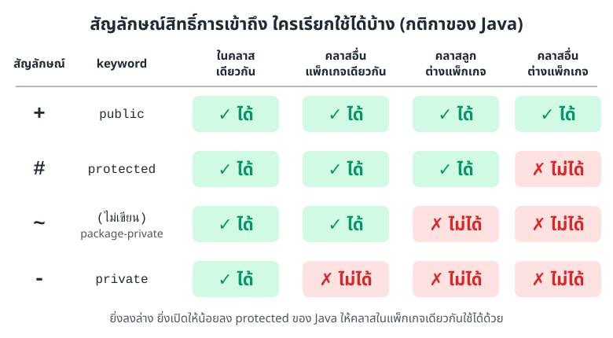

*ภาพที่ 8.2 สิทธิ์ของแต่ละสัญลักษณ์ ยิ่งลงล่างยิ่งเปิดให้คนอื่นใช้น้อยลง*

ตารางในภาพที่ 8.2 อ่านจากซ้ายไปขวา ช่องซ้ายสุดคือโค้ดในคลาสเดียวกัน ซึ่งใช้ได้ทุกแบบ ยิ่งไปทางขวา ผู้เรียกยิ่งอยู่ไกลออกไป และสิทธิ์ที่ผ่านได้ก็เหลือน้อยลง

หลักที่ใช้บ่อยที่สุดคือแอตทริบิวต์ใส่ `-` แล้วเปิดเมธอดที่จำเป็นเป็น `+` ตามหลักการห่อหุ้ม (encapsulation) ที่เรียนมาแล้ว

### 8.2.3 จากกล่อง Student เป็นโค้ด

กล่อง Student ในภาพที่ 8.1 แปลงเป็นโค้ด Java ได้แบบนี้ เราเพิ่มคอนสตรักเตอร์ (constructor) และ `main` เพื่อให้รันได้จริง

```java
public class Student {
    private String studentId;
    private String name;
    private double gpa;

    public Student(String studentId, String name, double gpa) {
        this.studentId = studentId;
        this.name = name;
        this.gpa = gpa;
    }

    public String getStudentId() {
        return studentId;
    }

    public void setName(String name) {
        this.name = name;
    }

    // แปลง GPA เป็นเกรดตัวอักษรแบบง่าย ๆ
    public String calculateGrade() {
        if (gpa >= 3.5) return "A";
        if (gpa >= 3.0) return "B";
        if (gpa >= 2.0) return "C";
        return "D";
    }

    public static void main(String[] args) {
        Student s = new Student("6601001", "Mali", 3.62);
        System.out.println(s.getStudentId() + " ได้เกรด " + s.calculateGrade());
    }
}
```

ผลลัพธ์

```
6601001 ได้เกรด A
```

สังเกตว่าแผนภาพไม่ได้บอกว่า `calculateGrade()` คิดเกรดอย่างไร แผนภาพบอกแค่ **หน้าตา** ของคลาส ส่วน **วิธีทำงานข้างใน** เป็นหน้าที่ของคนเขียนโค้ด เมธอดที่ประกาศว่าคืน `String` ต้องมี `return` ทุกทาง ไม่อย่างนั้นจะคอมไพล์ไม่ผ่าน

## 8.3 ความสัมพันธ์ระหว่างคลาส

คลาสในระบบจริงไม่ได้อยู่โดดเดี่ยว นักศึกษาลงทะเบียนวิชา ออร์เดอร์มีรายการสินค้า หมาเป็นสัตว์ชนิดหนึ่ง แผนภาพคลาสใช้ **เส้นกับหัวลูกศรคนละแบบ** แทนความสัมพันธ์แต่ละชนิด

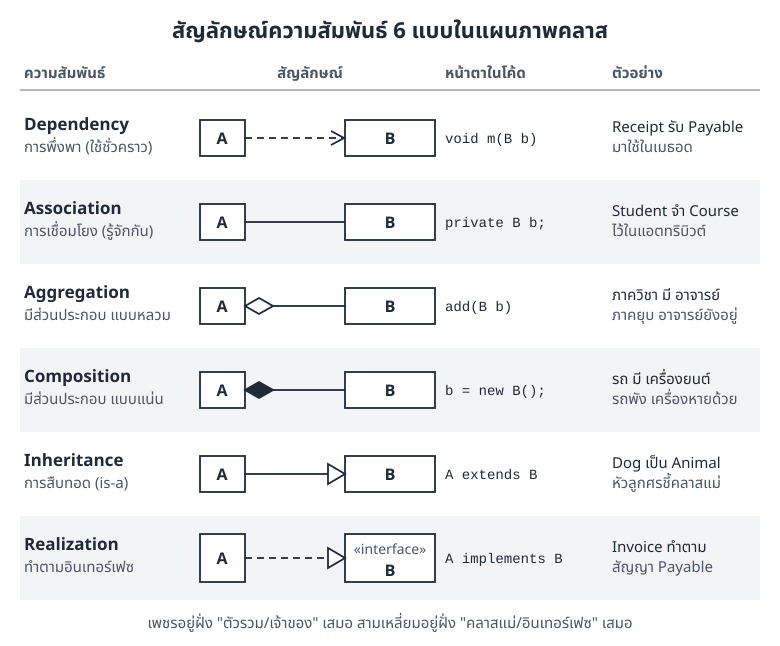

*ภาพที่ 8.3 สัญลักษณ์ความสัมพันธ์ 6 แบบ เส้นทึบหรือเส้นประ และรูปทรงที่ปลายเส้น คือสิ่งที่แยกแต่ละแบบออกจากกัน*

ภาพที่ 8.3 เป็นตารางสรุปให้เปิดดูได้ตลอดบท จำไว้สองหลัก

* **เพชร** (◇ ◆) อยู่ฝั่ง **ตัวรวมหรือเจ้าของ** เสมอ
* **สามเหลี่ยมโปร่ง** (▷) อยู่ฝั่ง **คลาสแม่หรืออินเทอร์เฟซ** เสมอ

หัวข้อย่อยต่อจากนี้จะไล่ดูทีละแบบ พร้อมโค้ด Java ที่คอมไพล์ผ่านจริง

### 8.3.1 Association: รู้จักกัน

Association (การเชื่อมโยง) คือความสัมพันธ์ทั่วไปที่สุด คลาสหนึ่ง **รู้จัก** อีกคลาสหนึ่งและเรียกใช้ได้ ในแผนภาพวาดเป็น **เส้นทึบธรรมดา** ระหว่างสองกล่อง

ถ้าอยากบอกว่ารู้จักกันทางเดียว ให้ใส่หัวลูกศรเปิด (→) ที่ปลายฝั่งคลาสที่อีกฝ่ายรู้จัก เช่น `Student ──> Course` แปลว่า Student รู้จัก Course แต่ Course ไม่ได้เก็บอะไรของ Student ไว้

ในโค้ด Association มักออกมาเป็นแอตทริบิวต์ที่มีชนิดเป็นอีกคลาส

```java
class Course {
    private String title;
    public Course(String title) { this.title = title; }
    public String getTitle() { return title; }
}

class Student {
    private String name;
    private Course course;   // Student รู้จัก Course ผ่านแอตทริบิวต์
    public Student(String name, Course course) {
        this.name = name;
        this.course = course;
    }
    public String describe() { return name + " เรียน " + course.getTitle(); }
}
```

### 8.3.2 Multiplicity: กี่ตัวต่อกี่ตัว

เส้น Association อย่างเดียวบอกแค่ว่ารู้จักกัน แต่ไม่บอกว่ากี่ตัว เราจึงเขียนตัวเลขกำกับที่ปลายเส้น เรียกว่า multiplicity (จำนวนที่เกี่ยวข้อง)

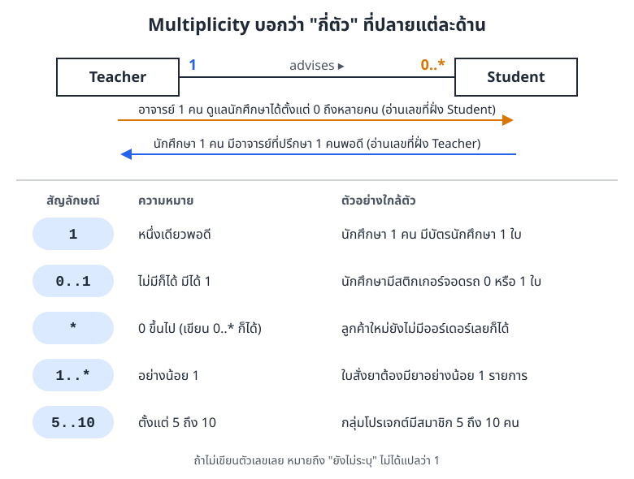

*ภาพที่ 8.4 วิธีอ่าน multiplicity และสัญลักษณ์ที่ใช้บ่อย*

กติกาการอ่านที่ต้องจำให้แม่นคือ **ตัวเลขที่อยู่ใกล้คลาสไหน บอกจำนวนของคลาสนั้น** ในภาพที่ 8.4

* ปลายฝั่ง Student เขียน `0..*` แปลว่า อาจารย์ 1 คนดูแลนักศึกษาได้ตั้งแต่ 0 ถึงหลายคน
* ปลายฝั่ง Teacher เขียน `1` แปลว่า นักศึกษา 1 คนมีอาจารย์ที่ปรึกษา 1 คนพอดี

สัญลักษณ์ที่ใช้บ่อย

| สัญลักษณ์ | ความหมาย |
|---|---|
| `1` | หนึ่งเดียวพอดี |
| `0..1` | ไม่มีก็ได้ หรือมี 1 |
| `*` หรือ `0..*` | ตั้งแต่ 0 ขึ้นไป |
| `1..*` | อย่างน้อย 1 |
| `5..10` | ตั้งแต่ 5 ถึง 10 |

เวลาแปลงเป็นโค้ด ฝั่งที่เป็น `1` หรือ `0..1` มักเป็นแอตทริบิวต์ตัวเดียว เช่น `private Teacher advisor;` ส่วนฝั่งที่เป็น `*` หรือ `1..*` มักเป็นลิสต์ เช่น `private List<Student> advisees;`

### 8.3.3 Inheritance: เป็นชนิดหนึ่งของ

การสืบทอด (inheritance) ซึ่ง UML เรียกว่า generalization ใช้เมื่อพูดได้ว่า "A **เป็น** B ชนิดหนึ่ง" (is-a) เช่น หมาเป็นสัตว์ แมวเป็นสัตว์

วาดเป็น **เส้นทึบ ปลายเป็นสามเหลี่ยมโปร่ง ชี้ไปที่คลาสแม่ (superclass)** ถ้ามีคลาสลูกหลายตัว นิยมรวมเส้นเป็นต้นไม้ แล้วใช้สามเหลี่ยมอันเดียวที่คลาสแม่ ดูตัวอย่างได้ในภาพที่ 8.6

```java
class Animal {
    public String sound() { return "..."; }
}
class Dog extends Animal {
    @Override
    public String sound() { return "โฮ่ง"; }
}
class Cat extends Animal {
    @Override
    public String sound() { return "เหมียว"; }
}
```

คำว่า `extends` ในโค้ด คือเส้นสามเหลี่ยมโปร่งในแผนภาพนั่นเอง

### 8.3.4 Composition: ส่วนประกอบแบบแน่น

Composition (การประกอบ) ใช้เมื่อคลาสหนึ่ง **ประกอบขึ้นจาก** อีกคลาส และส่วนประกอบนั้นไม่มีความหมายถ้าไม่มีตัวหลัก เช่น รถกับเครื่องยนต์ของคันนั้น หรือออร์เดอร์กับรายการสินค้าในออร์เดอร์

วาดเป็น **เส้นทึบ มีเพชรทึบ (◆) อยู่ฝั่งเจ้าของ** ในตัวอย่างนี้เพชรอยู่ฝั่ง Car

```java
class Engine {
    private int horsePower;
    public Engine(int horsePower) { this.horsePower = horsePower; }
    public int getHorsePower() { return horsePower; }
}

class Car {
    private Engine engine;
    public Car() {
        this.engine = new Engine(150);   // รถสร้างเครื่องยนต์ของตัวเอง
    }
    public int getHorsePower() { return engine.getHorsePower(); }
}
```

จุดสังเกตในโค้ดคือ **เจ้าของสร้างส่วนประกอบเองด้วย `new`** และไม่ส่งส่วนประกอบนั้นออกไปให้ใครถือต่อ พอไม่มีใครอ้างถึงรถคันนี้แล้ว เครื่องยนต์ของมันก็หมดความหมายไปพร้อมกัน

### 8.3.5 Aggregation: ส่วนประกอบแบบหลวม

Aggregation (การรวม) ก็เป็นความสัมพันธ์แบบ "มี" เหมือนกัน แต่ส่วนประกอบ **มีชีวิตของตัวเอง** เช่น ภาควิชามีอาจารย์ ถ้ายุบภาควิชา อาจารย์ก็ยังอยู่และย้ายไปสังกัดที่อื่นได้

วาดเป็น **เส้นทึบ มีเพชรโปร่ง (◇) อยู่ฝั่งตัวรวม**

```java
class Teacher {
    private String name;
    public Teacher(String name) { this.name = name; }
    public String getName() { return name; }
}

class Department {
    private List<Teacher> teachers = new ArrayList<>();
    public void addTeacher(Teacher teacher) {
        teachers.add(teacher);   // รับออบเจกต์ที่สร้างไว้แล้วจากข้างนอก
    }
    public int countTeachers() { return teachers.size(); }
}
```

ต่างจาก Composition ตรงที่ Department **ไม่ได้สร้าง** Teacher เอง แต่รับออบเจกต์ที่มีอยู่แล้วเข้ามาเก็บไว้ อย่าลืมสร้างลิสต์ด้วย `new ArrayList<>()` ก่อนใช้ ไม่อย่างนั้น `add` จะเจอ `NullPointerException`

| | Composition ◆ | Aggregation ◇ |
|---|---|---|
| ส่วนประกอบเกิดจากไหน | เจ้าของสร้างเองด้วย `new` | สร้างไว้ข้างนอก แล้วส่งเข้ามา |
| ตัวหลักหายไป | ส่วนประกอบหมดความหมายไปด้วย | ส่วนประกอบยังอยู่ต่อได้ |
| ส่วนประกอบหนึ่งชิ้นอยู่กับเจ้าของได้กี่ราย | รายเดียว | อาจอยู่หลายที่ได้ |
| ตัวอย่าง | รถ ◆ เครื่องยนต์, ออร์เดอร์ ◆ รายการสินค้า | ภาควิชา ◇ อาจารย์, ทีมฟุตบอล ◇ นักเตะ |

### 8.3.6 Realization และ Dependency

สองแบบนี้ไม่ใช่หัวข้อหลักของวิชา แต่จะเจอบ่อยมากเมื่ออ่านแผนภาพของระบบจริง

**Realization** คือคลาสที่ทำตามสัญญาของอินเทอร์เฟซ (interface) วาดเป็น **เส้นประ ปลายสามเหลี่ยมโปร่ง ชี้ไปที่อินเทอร์เฟซ** และมักเขียน `«interface»` ไว้เหนือชื่อ ในโค้ดตรงกับคำว่า `implements` (ทบทวนเรื่องอินเทอร์เฟซและคลาสนามธรรมได้ในหัวข้อ 10 ของ[บทที่ 7: พหุสัณฐาน (Polymorphism)](07-polymorphism.md))

**Dependency** (การพึ่งพา) คือคลาสที่ **ใช้** อีกคลาสแค่ชั่วคราว เช่น รับมาเป็นพารามิเตอร์ของเมธอด แต่ไม่ได้เก็บไว้เป็นแอตทริบิวต์ วาดเป็น **เส้นประ ปลายหัวลูกศรเปิด** บางครั้งเขียน `«use»` กำกับ

```java
// Realization: คลาสทำตามสัญญาของอินเทอร์เฟซ
interface Payable {
    double getAmount();
}
class Invoice implements Payable {
    private double amount;
    public Invoice(double amount) { this.amount = amount; }
    @Override
    public double getAmount() { return amount; }
}

// Dependency: ใช้คลาสอื่นแค่ชั่วคราวในเมธอด ไม่เก็บไว้เป็นแอตทริบิวต์
class Receipt {
    public String print(Payable item) {
        return "ยอดชำระ " + item.getAmount() + " บาท";
    }
}
```

ในตัวอย่างนี้ `Invoice` ทำตาม `Payable` (Realization) ส่วน `Receipt` แค่ยืม `Payable` มาใช้ในเมธอด `print` แล้วก็ปล่อยไป (Dependency)

### 8.3.7 ลองรันทุกความสัมพันธ์รวมกัน

โค้ดทุกชิ้นในหัวข้อ 8.3 อยู่ในไฟล์ `Relations.java` ไฟล์เดียว ต้องมี `import java.util.ArrayList;` และ `import java.util.List;` ที่หัวไฟล์ แล้วเพิ่มคลาสหลักนี้ต่อท้าย

```java
public class Relations {
    public static void main(String[] args) {
        Student a = new Student("Mali", new Course("OOP"));
        System.out.println(a.describe());

        Car car = new Car();
        System.out.println("แรงม้า: " + car.getHorsePower());

        Teacher t = new Teacher("Somchai");
        Department dept = new Department();
        dept.addTeacher(t);
        dept = null;   // ภาควิชาหายไป แต่ t ยังใช้ได้
        System.out.println(t.getName() + " ยังอยู่");

        Animal[] pets = { new Dog(), new Cat() };
        for (Animal p : pets) {
            System.out.println(p.sound());
        }

        Receipt r = new Receipt();
        System.out.println(r.print(new Invoice(120.0)));
    }
}
```

ผลลัพธ์

```
Mali เรียน OOP
แรงม้า: 150
Somchai ยังอยู่
โฮ่ง
เหมียว
ยอดชำระ 120.0 บาท
```

บรรทัด `Somchai ยังอยู่` คือหัวใจของ Aggregation ภาควิชาหายไปแล้ว แต่อาจารย์ยังใช้งานได้ตามปกติ

### 8.3.8 เลือกความสัมพันธ์แบบไหนดี

ความสัมพันธ์แต่ละแบบผูกสองคลาสไว้แน่นไม่เท่ากัน ยิ่งผูกแน่น พอคลาสหนึ่งเปลี่ยน อีกคลาสก็ยิ่งต้องแก้ตามมาก

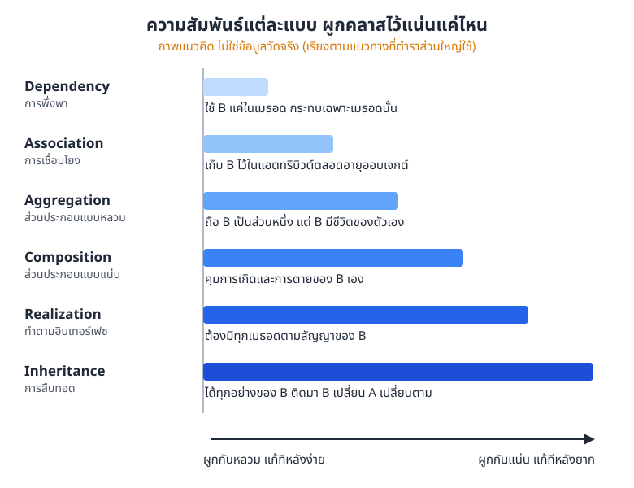

*ภาพที่ 8.5 ความสัมพันธ์เรียงจากผูกกันหลวมไปผูกกันแน่น (ภาพแนวคิด ไม่ใช่ข้อมูลวัดจริง)*

ภาพที่ 8.5 เรียงตามแนวทางที่ตำราส่วนใหญ่ใช้ ไม่ใช่กฎตายตัว แต่ช่วยตัดสินใจได้ดี ให้ถามตัวเองตามลำดับนี้

1. พูดได้ไหมว่า "A **เป็น** B ชนิดหนึ่ง" ถ้าได้ ใช้ Inheritance (หรือ Realization ถ้า B เป็นอินเทอร์เฟซ)
2. A **มี** B เป็นส่วนประกอบไหม ถ้ามี และ B ไม่มีความหมายเมื่อไม่มี A ใช้ Composition ถ้า B อยู่เองได้ ใช้ Aggregation
3. A **เก็บ** B ไว้ในแอตทริบิวต์ไหม ถ้าเก็บ ใช้ Association
4. A แค่ **ยืม** B มาใช้ในเมธอดเดียว ใช้ Dependency

ถ้ายังลังเล ให้เลือกแบบที่หลวมกว่าไว้ก่อน แก้ทีหลังง่ายกว่า

## 8.4 ตัวอย่างแผนภาพเต็ม: ระบบห้องสมุด

ลองเอาทุกอย่างมาประกอบกัน ห้องสมุดมีคนสองกลุ่ม คือสมาชิกที่มายืมหนังสือ กับบรรณารักษ์ที่ดูแลหนังสือ ทั้งสองกลุ่มมีชื่อและรหัสเหมือนกัน

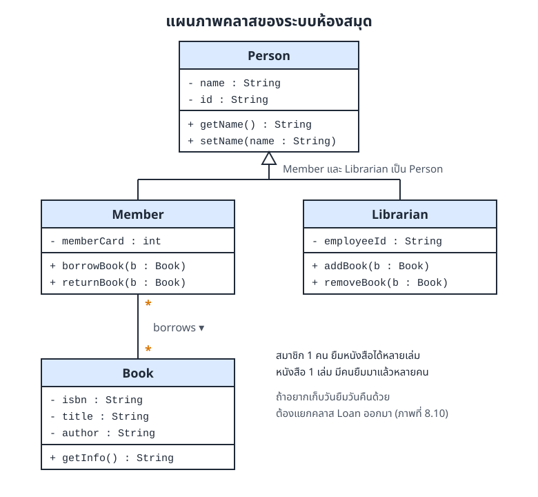

*ภาพที่ 8.6 แผนภาพคลาสของระบบห้องสมุด*

อ่านภาพที่ 8.6 ได้ดังนี้

* `Member` และ `Librarian` **เป็น** `Person` ทั้งคู่ จึงได้ `name`, `id`, `getName()` และ `setName()` ไปจากคลาสแม่ ไม่ต้องเขียนซ้ำ
* เส้นสืบทอดของคลาสลูกสองตัวรวมกันเป็นต้นไม้ และมีสามเหลี่ยมโปร่งอันเดียวที่ `Person`
* `Member` กับ `Book` เชื่อมกันด้วย Association แบบ `*` ต่อ `*` สมาชิก 1 คนยืมได้หลายเล่ม และหนังสือ 1 เล่มก็มีคนยืมมาแล้วหลายคน

แผนภาพนี้ยังมีจุดอ่อน ถ้าอยากรู้ว่ายืมวันไหน ต้องคืนวันไหน เส้น `borrows` ไม่มีที่ให้เก็บข้อมูลพวกนี้ ในหัวข้อ 8.6 เราจะแก้โดยแยกคลาส `Loan` ออกมา

## 8.5 แปลงไปมาระหว่างแผนภาพกับโค้ด

### 8.5.1 จากแผนภาพเป็นโค้ด

งานที่เจอบ่อยที่สุดคือได้แผนภาพมาจากหัวหน้าทีมหรืออาจารย์ แล้วต้องเขียนโค้ดตาม วิธีคือไล่ทีละช่อง จากบนลงล่าง

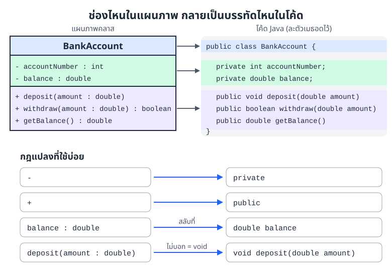

*ภาพที่ 8.7 แต่ละช่องของกล่อง BankAccount ตรงกับส่วนไหนของโค้ด*

1. **ช่องชื่อ** กลายเป็น `public class BankAccount { ... }`
2. **ช่องแอตทริบิวต์** แต่ละบรรทัดกลายเป็นแอตทริบิวต์ของคลาส แปลง `-` เป็น `private` แล้วสลับชนิดมาไว้หน้าชื่อ
3. **ช่องเมธอด** แต่ละบรรทัดกลายเป็นหัวเมธอด ถ้าไม่มี `: ชนิด` ต่อท้าย ให้ใช้ `void`

ได้โครงแล้วค่อยเติมตัวเมธอด

```java
public class BankAccount {
    private int accountNumber;
    private double balance;

    public BankAccount(int accountNumber) {
        this.accountNumber = accountNumber;
    }

    public void deposit(double amount) {
        if (amount > 0) {
            balance += amount;
        }
    }

    public boolean withdraw(double amount) {
        if (amount > 0 && amount <= balance) {
            balance -= amount;
            return true;
        }
        return false;   // เงินไม่พอ ไม่ถอนให้
    }

    public double getBalance() {
        return balance;
    }
}
```

คอนสตรักเตอร์ไม่ได้อยู่ในแผนภาพ เพราะหลายทีมไม่วาดคอนสตรักเตอร์ไว้ในกล่อง เราเพิ่มเองได้ตามที่โปรแกรมต้องใช้

### 8.5.2 จากโค้ดเป็นแผนภาพ

อีกทางหนึ่งคือได้โค้ดมา แล้วต้องวาดแผนภาพเพื่ออธิบายให้คนอื่นเข้าใจ ทำกลับกันกับหัวข้อที่แล้ว

```java
public class Rectangle {
    private double width;
    private double height;

    public Rectangle(double width, double height) {
        this.width = width;
        this.height = height;
    }

    public double calculateArea() {
        return width * height;
    }

    public double calculatePerimeter() {
        return 2 * (width + height);
    }
}
```

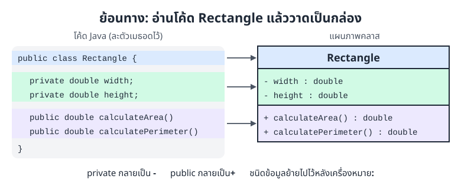

*ภาพที่ 8.8 อ่านโค้ด Rectangle แล้ววาดเป็นกล่องคลาส*

ภาพที่ 8.8 ละคอนสตรักเตอร์ไว้เหมือนเดิม ถ้าอยากใส่ ให้เขียนในช่องเมธอดเป็น `+ Rectangle(width : double, height : double)` โดยไม่มีชนิดคืนค่า

## 8.6 การเขียนโค้ดตามโมเดล (Model-Based Coding) (CLO6)

การเขียนโค้ดตามโมเดล คือการเริ่มจาก **สร้างโมเดล (แผนภาพ) ให้เสร็จก่อน** แล้วค่อยเขียนโค้ดตามโมเดลนั้น แทนที่จะนึกไปเขียนไป

### 8.6.1 ขั้นตอน

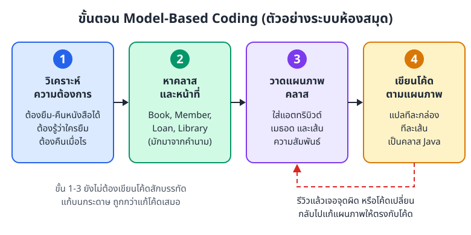

*ภาพที่ 8.9 สี่ขั้นของการเขียนโค้ดตามโมเดล และวงย้อนกลับไปแก้แผนภาพ*

ใช้ระบบห้องสมุดเป็นตัวอย่าง

**ขั้นที่ 1 วิเคราะห์ความต้องการ (requirements analysis)** จดว่าระบบต้องทำอะไรได้บ้าง

* จัดการข้อมูลหนังสือได้
* จัดการข้อมูลสมาชิกได้
* บันทึกการยืมและการคืนได้ รู้ว่าใครยืม ต้องคืนวันไหน

**ขั้นที่ 2 หาคลาสและหน้าที่** คำนามในความต้องการมักกลายเป็นคลาส

* `Book` หนังสือ
* `Member` สมาชิก
* `Loan` ใบยืม หนึ่งใบต่อการยืมหนึ่งครั้ง
* `Library` ห้องสมุด รวบรวมหนังสือและสมาชิกทั้งหมด (ตัวอย่างนี้ยังไม่เขียน)

**ขั้นที่ 3 วาดแผนภาพคลาส**

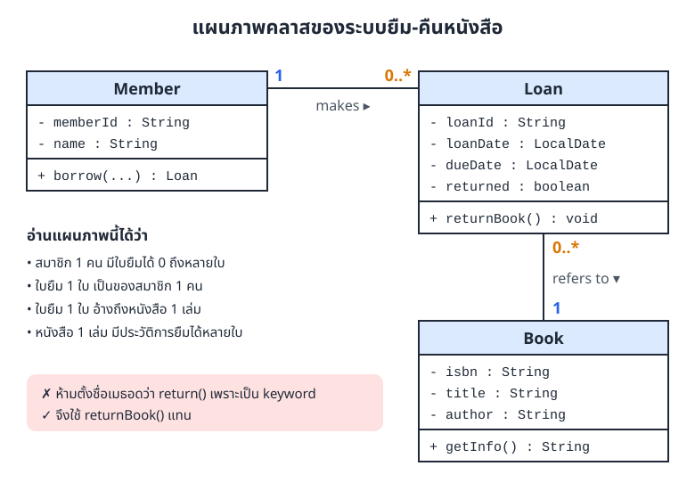

*ภาพที่ 8.10 แผนภาพคลาสของระบบยืม-คืนหนังสือ*

`Loan` อยู่ตรงกลางระหว่าง `Member` กับ `Book` และเก็บวันยืม วันกำหนดคืน และสถานะการคืนไว้ในตัวเอง ซึ่งเส้น `borrows` ในภาพที่ 8.6 ทำไม่ได้

เมธอดคืนหนังสือตั้งชื่อว่า `returnBook()` ไม่ใช่ `return()` เพราะ `return` เป็น keyword ของ Java ถ้าตั้งตามนั้นโค้ดจะคอมไพล์ไม่ผ่าน ชื่อในแผนภาพจึงต้องตรงกับที่เขียนได้จริงด้วย

**ขั้นที่ 4 เขียนโค้ดตามแผนภาพ** แปลทีละกล่องและทีละเส้น เส้น `Member 1 ── 0..* Loan` และ `Loan 0..* ── 1 Book` กลายเป็นแอตทริบิวต์ `member` และ `book` ใน `Loan`

```java
import java.time.LocalDate;

class Book {
    private String isbn;
    private String title;
    private String author;

    public Book(String isbn, String title, String author) {
        this.isbn = isbn;
        this.title = title;
        this.author = author;
    }

    public String getInfo() {
        return title + " โดย " + author;
    }
}

class Member {
    private String memberId;
    private String name;

    public Member(String memberId, String name) {
        this.memberId = memberId;
        this.name = name;
    }

    // สมาชิกยืมหนังสือ ได้ใบยืม (Loan) กลับมาหนึ่งใบ
    public Loan borrow(String loanId, Book book, LocalDate today) {
        return new Loan(loanId, this, book, today);
    }

    public String getName() {
        return name;
    }
}

class Loan {
    private String loanId;
    private Member member;      // ใบยืมหนึ่งใบเป็นของสมาชิก 1 คน
    private Book book;          // และอ้างถึงหนังสือ 1 เล่ม
    private LocalDate loanDate;
    private LocalDate dueDate;
    private boolean returned;

    public Loan(String loanId, Member member, Book book, LocalDate loanDate) {
        this.loanId = loanId;
        this.member = member;
        this.book = book;
        this.loanDate = loanDate;
        this.dueDate = loanDate.plusDays(7);   // ยืมได้ 7 วัน
    }

    // ตั้งชื่อ returnBook เพราะ return เป็น keyword ของ Java
    public void returnBook() {
        returned = true;
    }

    public String toString() {
        return loanId + ": " + member.getName() + " ยืม " + book.getInfo()
                + " คืนภายใน " + dueDate + (returned ? " (คืนแล้ว)" : "");
    }
}

public class LibraryApp {
    public static void main(String[] args) {
        Book book = new Book("978-616-00-0000-1", "Java เบื้องต้น", "Somsak");
        Member mali = new Member("M001", "Mali");

        Loan loan = mali.borrow("L001", book, LocalDate.of(2026, 6, 1));
        System.out.println(loan);
        loan.returnBook();
        System.out.println(loan);
    }
}
```

ผลลัพธ์

```
L001: Mali ยืม Java เบื้องต้น โดย Somsak คืนภายใน 2026-06-08
L001: Mali ยืม Java เบื้องต้น โดย Somsak คืนภายใน 2026-06-08 (คืนแล้ว)
```

เราใช้ `LocalDate` แทน `Date` แบบเก่า เพราะบวกวันได้ง่ายด้วย `plusDays` และต้อง `import java.time.LocalDate;` ไว้ที่หัวไฟล์

### 8.6.2 ทำไมต้องวาดก่อนเขียน

* **คุยกันรู้เรื่อง** ทั้งทีมเห็นโครงเดียวกัน รีวิวและให้ความเห็นได้ก่อนเสียเวลาเขียนโค้ด
* **วางแผนได้** เห็นภาพรวมทั้งระบบ ประเมินได้ว่างานใหญ่แค่ไหน แบ่งใครทำคลาสไหน
* **เจอจุดผิดเร็ว** อย่างเรื่อง `Loan` ในหัวข้อที่แล้ว เราเจอปัญหาตั้งแต่ตอนวาด แก้บนกระดาษถูกกว่าแก้โค้ดที่เขียนไปแล้วเสมอ
* **ดูแลระบบง่ายขึ้น** แผนภาพเป็นเอกสารที่คนมาทีหลังอ่านแล้วเข้าใจโครงได้เร็ว

### 8.6.3 ตัวอย่าง: ร้านค้าออนไลน์

โจทย์คือร้านขายของออนไลน์ที่มีลูกค้า (Customer) สินค้า (Product) และคำสั่งซื้อ (Order) ภาพที่ 8.11 คือแผนภาพเต็มของไฟล์ตัวอย่าง `ClassDiagramExample.java` ซึ่งมี `Person` กับ `Admin` เพิ่มเข้ามาด้วย

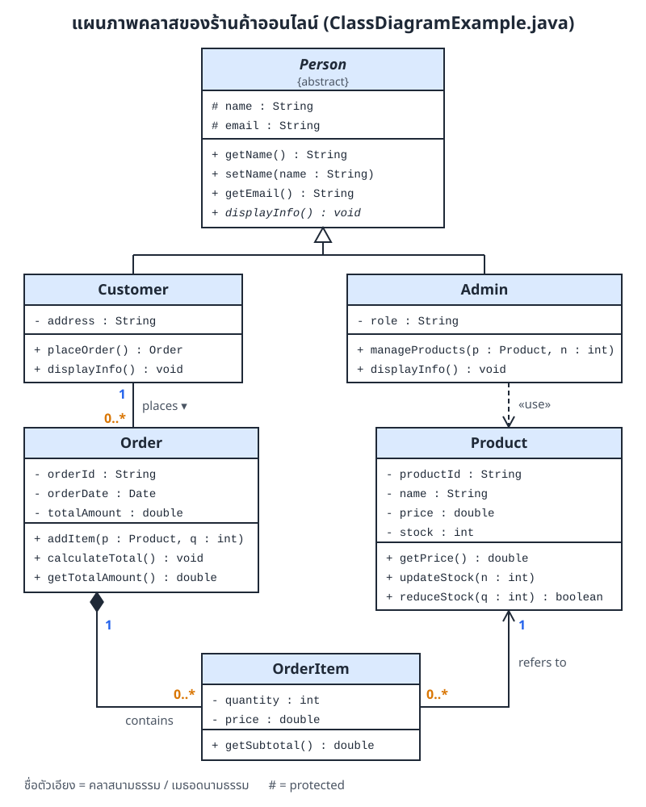

*ภาพที่ 8.11 แผนภาพคลาสของร้านค้าออนไลน์ใน ClassDiagramExample.java*

ไล่อ่านทีละเส้น

| เส้นในแผนภาพ | ชนิด | ในโค้ด |
|---|---|---|
| `Customer`, `Admin` ▷ `Person` | Inheritance | `class Customer extends Person` |
| `Customer 1 ── 0..* Order` | Association | `Customer` มี `List<Order> orders` และ `Order` มี `Customer customer` |
| `Order ◆── 0..* OrderItem` | Composition | `Order` สร้าง `new OrderItem(...)` เองใน `addItem` |
| `OrderItem 0..* ──> 1 Product` | Association ทางเดียว | `OrderItem` มี `Product product` แต่ `Product` ไม่รู้จัก `OrderItem` |
| `Admin - - -> Product` | Dependency | `Product` เป็นแค่พารามิเตอร์ของ `manageProducts` |

ชื่อ `Person` และ `displayInfo()` เป็นตัวเอียง เพราะ `Person` เป็นคลาสนามธรรม (abstract class) และ `displayInfo()` เป็นเมธอดนามธรรม เราละ getter บางตัวไว้ไม่ให้แผนภาพรก

ต่อไปเป็นโค้ดฉบับย่อที่มีแค่ 4 คลาสหลัก ตามขั้นตอนอ่านแผนภาพ ระบุแอตทริบิวต์ ระบุเมธอด แล้วระบุความสัมพันธ์

```java
import java.util.ArrayList;
import java.util.List;

class Customer {
    private String customerId;
    private String name;
    private String email;

    public Customer(String customerId, String name, String email) {
        this.customerId = customerId;
        this.name = name;
        this.email = email;
    }

    // ลูกค้า 1 คนสั่งได้หลายออร์เดอร์ แต่ละออร์เดอร์รู้ว่าใครเป็นเจ้าของ
    public Order placeOrder(String orderId) {
        return new Order(orderId, this);
    }

    public String getName() {
        return name;
    }
}

class Product {
    private String productId;
    private String name;
    private double price;

    public Product(String productId, String name, double price) {
        this.productId = productId;
        this.name = name;
        this.price = price;
    }

    public String getName() {
        return name;
    }

    public double getPrice() {
        return price;
    }
}

class OrderItem {
    private Product product;   // อ้างถึงสินค้า 1 ชิ้น (Association)
    private int quantity;
    private double price;      // จำราคา ณ ตอนสั่ง เผื่อร้านเปลี่ยนราคาทีหลัง

    public OrderItem(Product product, int quantity) {
        this.product = product;
        this.quantity = quantity;
        this.price = product.getPrice();
    }

    public double getSubtotal() {
        return price * quantity;
    }

    public String toString() {
        return product.getName() + " x " + quantity + " = " + getSubtotal();
    }
}

class Order {
    private String orderId;
    private Customer customer;                          // 1 Customer
    private List<OrderItem> items = new ArrayList<>();  // มีได้หลาย OrderItem (Composition)
    private double total;

    public Order(String orderId, Customer customer) {
        this.orderId = orderId;
        this.customer = customer;
    }

    // Order สร้าง OrderItem เอง คนข้างนอกส่งมาแค่สินค้ากับจำนวน
    public void addItem(Product product, int quantity) {
        items.add(new OrderItem(product, quantity));
        calculateTotal();
    }

    public void calculateTotal() {
        total = 0;
        for (OrderItem item : items) {
            total += item.getSubtotal();
        }
    }

    public void printSummary() {
        System.out.println("ออร์เดอร์ " + orderId + " ของ " + customer.getName());
        for (OrderItem item : items) {
            System.out.println("  " + item);
        }
        System.out.println("  รวม " + total + " บาท");
    }
}

public class ShopApp {
    public static void main(String[] args) {
        Product latte = new Product("P01", "Latte", 65);
        Product croissant = new Product("P02", "Croissant", 55);

        Customer mali = new Customer("C01", "Mali", "mali@example.com");
        Order order = mali.placeOrder("ORD-001");
        order.addItem(latte, 2);
        order.addItem(croissant, 1);
        order.printSummary();
    }
}
```

ผลลัพธ์

```
ออร์เดอร์ ORD-001 ของ Mali
  Latte x 2 = 130.0
  Croissant x 1 = 55.0
  รวม 185.0 บาท
```

### 8.6.4 แนวปฏิบัติที่ดี

1. **เริ่มจากง่าย ๆ** วาดแค่ชื่อคลาสกับเส้นก่อน แล้วค่อยเติมรายละเอียดทีละรอบ
2. **แก้แผนภาพทุกครั้งที่โค้ดเปลี่ยน** แผนภาพที่ไม่ตรงกับโค้ดอันตรายกว่าไม่มีแผนภาพ ให้ถือว่าแผนภาพเป็นเอกสารที่ต้องดูแลไปพร้อมโค้ด
3. **ใช้เครื่องมือช่วย** เช่น draw.io, PlantUML, StarUML และ IDE หลายตัวสร้างแผนภาพจากโค้ดให้ได้
4. **รีวิวแผนภาพก่อนเขียนโค้ด** ขอความเห็นจากเพื่อนร่วมทีม โดยเฉพาะชนิดของเส้นความสัมพันธ์และ multiplicity

## 8.7 ตัวอย่างโค้ดเต็ม: ClassDiagramExample.java

ไฟล์ [ClassDiagramExample.java](../examples/ClassDiagramExample.java) คือโค้ดเต็มของแผนภาพในภาพที่ 8.11 ในไฟล์นี้จะเห็น

1. **คลาสที่สร้างตามแผนภาพ** ครบทั้ง 6 คลาส
2. **ความสัมพันธ์หลายแบบ** ทั้ง Inheritance, Association, Composition และ Dependency
3. **การแปลงแผนภาพเป็นโค้ด** ตามขั้นตอนในหัวข้อ 8.6
4. **ระบบร้านค้าออนไลน์ที่รันได้จริง** มีลูกค้า 2 คนสั่งของ และแอดมินปรับสต็อก

ตอนรัน ยอดรวมออร์เดอร์แรกออกมาเป็น `28000.0 บาท` (Laptop 25000 + Mouse 2 × 500 + Keyboard 2000) ส่วน Order ID กับวันที่จะไม่ตรงกับเครื่องคนอื่น เพราะโค้ดสร้างจาก `System.currentTimeMillis()` และ `new Date()` ซึ่งเปลี่ยนทุกครั้งที่รัน

## 8.8 เครื่องมือวาดแผนภาพคลาส

เครื่องมือที่ใช้ฟรีได้

1. **draw.io (diagrams.net)** วาดบนเว็บ ลากวางได้ ไม่ต้องติดตั้ง
2. **PlantUML** เขียนเป็นข้อความแล้วได้ภาพออกมา เก็บไว้ใน Git ได้สะดวก
3. **Lucidchart** วาดบนเว็บ มีรุ่นฟรี
4. **StarUML** โปรแกรมติดตั้งบนเครื่อง
5. **Visual Paradigm Online** วาดบนเว็บ มีรุ่นฟรี

ตัวอย่าง PlantUML ของนักศึกษากับรายวิชา

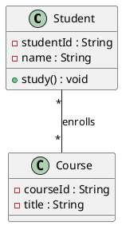

บรรทัดสุดท้ายคือเส้น Association ตัวเลขในเครื่องหมายคำพูดคือ multiplicity ของแต่ละฝั่ง ให้ใช้ `"*"` แทนคำว่า `"many"` เพื่อให้ตรงกับสัญลักษณ์ UML

## 8.9 วาดให้อ่านง่าย

### 8.9.1 เลือกระดับรายละเอียดให้เหมาะกับงาน

คลาสเดียวกันวาดได้หลายระดับ ขึ้นกับว่าวาดไปให้ใครดูและใช้ทำอะไร

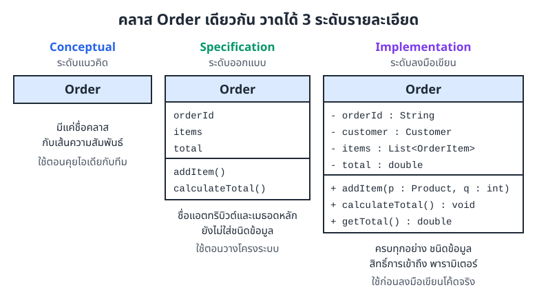

*ภาพที่ 8.12 คลาส Order เดียวกัน วาดได้ 3 ระดับรายละเอียด*

* **Conceptual (ระดับแนวคิด)** มีแค่ชื่อคลาสและเส้นความสัมพันธ์ ใช้ตอนคุยไอเดีย
* **Specification (ระดับออกแบบ)** เพิ่มแอตทริบิวต์และเมธอดหลัก ใช้ตอนวางโครงระบบ
* **Implementation (ระดับลงมือเขียน)** ครบทุกอย่าง ทั้งชนิดข้อมูล สิทธิ์ และพารามิเตอร์ ใช้ก่อนเขียนโค้ดจริง

### 8.9.2 หลักวาดให้คนอื่นอ่านรู้เรื่อง

* **ตั้งชื่อให้สื่อความหมาย** `Loan` ดีกว่า `Data1`
* **อย่าใส่ทุกอย่าง** getter และ setter ธรรมดาละไว้ได้ ใส่เฉพาะสิ่งที่ช่วยให้เข้าใจระบบ
* **ใช้รูปแบบเดียวกันทั้งแผนภาพ** ถ้าใส่ชนิดข้อมูลให้คลาสหนึ่ง ก็ใส่ให้ทุกคลาส
* **จัดวางให้เป็นระเบียบ** คลาสแม่อยู่บน คลาสลูกอยู่ล่าง เส้นไม่ตัดกันถ้าเลี่ยงได้

## ข้อผิดพลาดที่เจอบ่อย

| ข้อผิดพลาด | ที่ถูกคือ |
|---|---|
| วางเพชรไว้ฝั่งส่วนประกอบ เช่น `Car ── ◆Engine` | เพชรอยู่ฝั่งเจ้าของ `Car ◆── Engine` |
| วาดหัวลูกศรสามเหลี่ยมชี้ไปที่คลาสลูก | สามเหลี่ยมชี้ไปที่คลาสแม่เสมอ |
| ใช้หัวลูกศรทึบหรือหัวลูกศรเปิดแทนสามเหลี่ยมโปร่งของ Inheritance | Inheritance ใช้สามเหลี่ยมโปร่งเท่านั้น หัวลูกศรเปิดคือ Association ทางเดียวหรือ Dependency |
| ใช้ Composition กับทุกอย่างที่ "มี" | ถ้าส่วนประกอบอยู่เองได้ ใช้ Aggregation ถ้าแค่รู้จักกัน ใช้ Association |
| อ่าน multiplicity สลับฝั่ง | ตัวเลขใกล้คลาสไหน บอกจำนวนของคลาสนั้น |
| เขียนชนิดก่อนชื่อในแผนภาพ เช่น `- double gpa` | UML เขียน `- gpa : double` |
| คิดว่า `#` ใน Java ใช้ได้แค่คลาสลูก | `protected` ของ Java ให้คลาสในแพ็กเกจเดียวกันใช้ได้ด้วย |
| ตั้งชื่อเมธอดในแผนภาพเป็น keyword เช่น `return()` | ใช้ชื่อที่เขียนเป็นโค้ดได้จริง เช่น `returnBook()` |
| ประกาศ `List` ไว้แต่ไม่ได้สร้าง | สร้างด้วย `new ArrayList<>()` ก่อนเรียก `add` |
| แก้โค้ดแล้วไม่แก้แผนภาพ | แผนภาพต้องตรงกับโค้ดเสมอ |
| ใส่ทุกเมธอดจนกล่องยาวเต็มหน้า | เลือกระดับรายละเอียดให้เหมาะกับคนอ่าน |

## สรุปท้ายบท

* แผนภาพคลาสคือแบบแปลนของโปรแกรม บอกว่ามีคลาสอะไร แต่ละคลาสมีอะไร และเกี่ยวข้องกันอย่างไร
* กล่องคลาสมี 3 ช่อง คือชื่อ แอตทริบิวต์ และเมธอด เขียนแบบ `ชื่อ : ชนิด`
* สัญลักษณ์สิทธิ์ `+` public, `-` private, `#` protected, `~` package-private
* ความสัมพันธ์ 6 แบบ
  * Association เส้นทึบ
  * Aggregation เพชรโปร่งฝั่งตัวรวม
  * Composition เพชรทึบฝั่งเจ้าของ
  * Inheritance เส้นทึบ สามเหลี่ยมโปร่งชี้คลาสแม่
  * Realization เส้นประ สามเหลี่ยมโปร่งชี้อินเทอร์เฟซ
  * Dependency เส้นประ หัวลูกศรเปิด
* Multiplicity เช่น `1`, `0..1`, `*`, `1..*` บอกจำนวนของคลาสที่อยู่ใกล้ตัวเลข
* แปลงแผนภาพเป็นโค้ดและแปลงโค้ดกลับเป็นแผนภาพได้ทั้งสองทาง
* การเขียนโค้ดตามโมเดลคือ วิเคราะห์ความต้องการ หาคลาส วาดแผนภาพ แล้วค่อยเขียนโค้ด และแก้แผนภาพทุกครั้งที่โค้ดเปลี่ยน

## แบบฝึกหัด

**ข้อ 1** แปลงกล่องคลาสต่อไปนี้เป็นโค้ด Java (ไม่ต้องเขียนตัวเมธอด ใส่ `{ }` ว่างไว้ หรือ `return` ค่าใดก็ได้)

| Product |
|---|
| `- productId : String` |
| `- price : double` |
| `- stock : int` |
| `+ getPrice() : double` |
| `+ reduceStock(qty : int) : boolean` |
| `+ updateStock(newStock : int)` |

<details>
<summary>ดูเฉลย</summary>

```java
public class Product {
    private String productId;
    private double price;
    private int stock;

    public double getPrice() {
        return price;
    }

    public boolean reduceStock(int qty) {
        return false;
    }

    public void updateStock(int newStock) {
    }
}
```

`updateStock` ไม่มี `: ชนิด` ต่อท้าย จึงคืนค่าเป็น `void`

</details>

**ข้อ 2** คู่คลาสต่อไปนี้ควรใช้ความสัมพันธ์แบบไหน

1. `House` กับ `Room` (ห้องของบ้านหลังนั้น)
2. `FootballTeam` กับ `Player`
3. `Rider` (ไรเดอร์ส่งอาหาร) กับ `Order` ที่กำลังส่งอยู่
4. `Printer` ที่มีเมธอด `print(Document doc)`
5. `Car` กับ `Vehicle`
6. `CreditCardPayment` กับอินเทอร์เฟซ `Payment`

<details>
<summary>ดูเฉลย</summary>

1. Composition (`House ◆── Room`) ห้องไม่มีความหมายถ้าไม่มีบ้าน
2. Aggregation (`FootballTeam ◇── Player`) นักเตะย้ายทีมได้ ทีมยุบนักเตะก็ยังอยู่
3. Association ไรเดอร์เก็บออร์เดอร์ที่กำลังส่งไว้ แต่ทั้งสองฝั่งมีชีวิตของตัวเอง
4. Dependency (`Printer - - -> Document`) ใช้ `Document` แค่ในเมธอด
5. Inheritance (`Car ──▷ Vehicle`) รถยนต์เป็นยานพาหนะชนิดหนึ่ง
6. Realization (`CreditCardPayment - - -▷ Payment`) ทำตามสัญญาของอินเทอร์เฟซ

</details>

**ข้อ 3** ใบสั่งยา (`Prescription`) หนึ่งใบต้องมียา (`Medicine`) อย่างน้อย 1 รายการ และยาแต่ละชนิดอาจอยู่ในใบสั่งยาหลายใบ หรือยังไม่เคยมีใครสั่งเลยก็ได้ ต้องเขียน multiplicity ที่ปลายแต่ละฝั่งว่าอะไร

<details>
<summary>ดูเฉลย</summary>

`Prescription "0..*" ── "1..*" Medicine`

* ฝั่ง `Medicine` เขียน `1..*` เพราะใบสั่งยา 1 ใบมียาอย่างน้อย 1 รายการ
* ฝั่ง `Prescription` เขียน `0..*` เพราะยา 1 ชนิดอยู่ในใบสั่งยาได้ตั้งแต่ 0 ถึงหลายใบ

</details>

**ข้อ 4** วาดแผนภาพคลาสจากโค้ดนี้ (เขียนเป็น PlantUML ก็ได้)

```java
abstract class Shape {
    protected String color;
    public abstract double area();
}

class Circle extends Shape {
    private double radius;
    public double area() { return Math.PI * radius * radius; }
}

class Canvas {
    private List<Shape> shapes = new ArrayList<>();
    public void add(Shape s) { shapes.add(s); }
}
```

<details>
<summary>ดูเฉลย</summary>

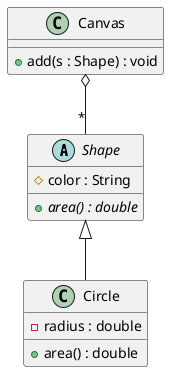

* `Circle extends Shape` คือ Inheritance (`<|--` ใน PlantUML คือสามเหลี่ยมโปร่ง)
* `Canvas` รับ `Shape` ที่สร้างจากข้างนอกมาเก็บ จึงเป็น Aggregation (`o--` คือเพชรโปร่งฝั่ง Canvas) และมีได้หลายรูป (`*`)
* `color` เป็น `protected` จึงใช้ `#`

</details>

**ข้อ 5** เพื่อนวาดแผนภาพมาแบบนี้ หาจุดผิดให้ครบ

* `Dog` กับ `Animal` เชื่อมด้วยเส้นทึบ มีสามเหลี่ยมโปร่งที่ฝั่ง `Dog`
* `Order` กับ `OrderItem` มีเพชรทึบที่ฝั่ง `OrderItem`
* แอตทริบิวต์ใน `Order` เขียนว่า `- double total`

<details>
<summary>ดูเฉลย</summary>

1. สามเหลี่ยมต้องอยู่ฝั่ง `Animal` ซึ่งเป็นคลาสแม่ ไม่ใช่ฝั่ง `Dog`
2. เพชรทึบต้องอยู่ฝั่ง `Order` ซึ่งเป็นเจ้าของ ไม่ใช่ฝั่ง `OrderItem`
3. UML เขียนชื่อก่อนชนิด ที่ถูกคือ `- total : double`

</details>

***

[< บทก่อนหน้า: พหุสัณฐาน](07-polymorphism.md) | [กลับไปหน้าหลัก](README.md) | [บทถัดไป: การจัดการข้อผิดพลาด >](09-error-handling.md)
