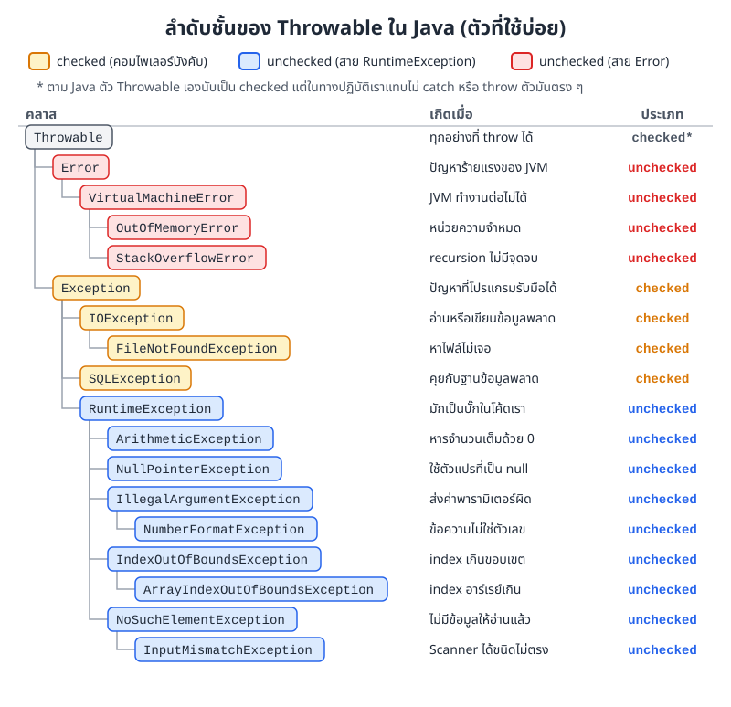
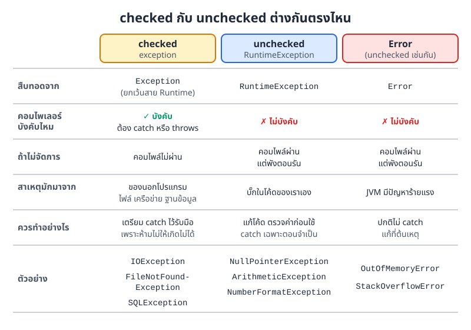
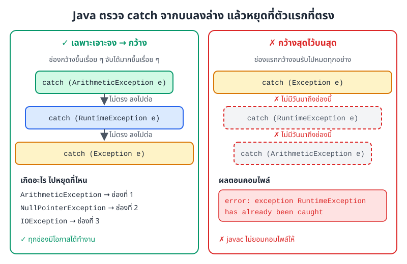
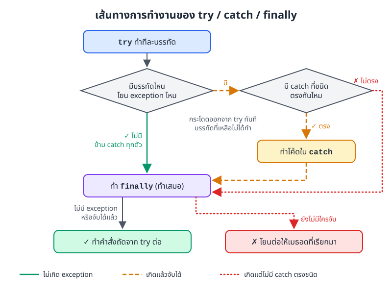
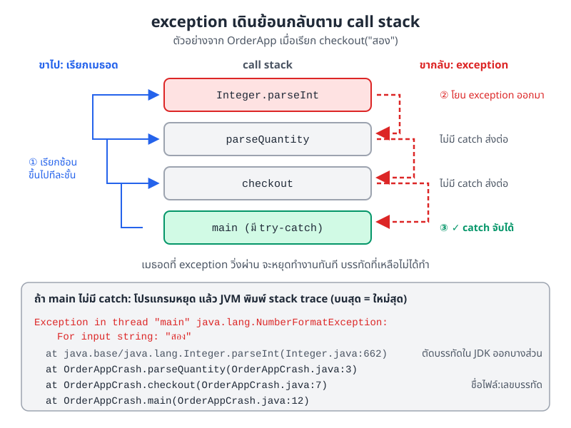

# บทที่ 9: การจัดการข้อผิดพลาด (Error Handling)

> โปรแกรมจริงต้องเจอเรื่องไม่คาดคิดเสมอ ผู้ใช้พิมพ์ตัวอักษรแทนตัวเลข ไฟล์หายไป หรือมีคนหารด้วยศูนย์
> บทนี้สอนให้เรารับมือกับเรื่องเหล่านี้ด้วย exception เพื่อให้โปรแกรมแจ้งปัญหาอย่างสุภาพแล้วทำงานต่อได้ แทนที่จะพังกลางทาง

## สิ่งที่จะทำได้หลังเรียนบทนี้

1. อธิบายได้ว่า exception คืออะไร และแยกประเภท checked, unchecked และ Error ได้
2. ใช้ `try`, `catch`, `finally` และ try-with-resources จัดการข้อผิดพลาดได้
3. ใช้ `throw` และ `throws` ส่งปัญหาต่อให้เมธอดที่เรียก และสร้าง exception ของตัวเองได้
4. เขียนโปรแกรมที่ทนทาน ไม่พังง่ายเมื่อเจอข้อมูลผิด **(CLO7)**

## 9.1 exception คืออะไร และทำไมต้องจัดการ

นึกถึงตู้กดน้ำหน้าคณะ ถ้าเราหยอดเหรียญปลอม ตู้ที่ออกแบบดีจะคืนเหรียญแล้วขึ้นข้อความว่า "เหรียญไม่ถูกต้อง" มันไม่ดับทั้งตู้จนคนอื่นซื้อน้ำไม่ได้

โปรแกรมก็ควรเป็นแบบนั้น เมื่อเกิดเรื่องผิดปกติระหว่างรัน Java จะสร้างออบเจกต์ (object) ตัวหนึ่งขึ้นมาบอกว่าเกิดอะไรขึ้น ออบเจกต์นี้เรียกว่า **exception** แล้ว Java จะ "โยน" (throw) มันออกมา

ถ้าไม่มีใครรับ exception ไว้ โปรแกรมจะหยุดทันที

```java
int result = 10 / 0;              // โยน ArithmeticException ตรงนี้ โปรแกรมหยุด
System.out.println(result);       // บรรทัดนี้ไม่มีวันได้ทำ
```

ถ้าเราครอบโค้ดเสี่ยงไว้ด้วย `try` แล้วเตรียม `catch` ไว้รับ โปรแกรมจะแจ้งปัญหาแล้วทำงานต่อได้

```java
public class DivideDemo {
    public static void main(String[] args) {
        try {
            int result = 10 / 0;           // บรรทัดนี้โยน ArithmeticException
            System.out.println(result);    // ไม่ได้ทำ เพราะกระโดดไป catch แล้ว
        } catch (ArithmeticException e) {
            System.out.println("หารด้วยศูนย์ไม่ได้");
        }
        System.out.println("โปรแกรมทำงานต่อ...");
    }
}
```

ผลลัพธ์

```
หารด้วยศูนย์ไม่ได้
โปรแกรมทำงานต่อ...
```

การเขียนโค้ดรับมือแบบนี้เรียกว่า **การจัดการข้อผิดพลาด (error handling)** เป้าหมายคือให้โปรแกรมทนทาน (robust) ใช้งานต่อได้แม้เจอข้อมูลแปลก ๆ

## 9.2 ประเภทของ exception

ทุกอย่างที่ throw ได้ใน Java สืบทอด (inheritance) มาจากคลาส (class) `Throwable` แล้วแตกเป็นสองสายใหญ่ คือ `Error` กับ `Exception` ภาพที่ 9.1 แสดงคลาสที่เจอบ่อยในวิชานี้



*ภาพที่ 9.1 ลำดับชั้นของ Throwable ใน Java สีส้มคือ checked สีน้ำเงินและสีแดงคือ unchecked*

จากภาพ ให้จำกฎสั้น ๆ ข้อเดียว

- สืบทอดจาก `RuntimeException` หรือ `Error` → **unchecked**
- สืบทอดจาก `Exception` แต่ไม่ผ่าน `RuntimeException` → **checked**

### 9.2.1 checked exception: คอมไพเลอร์บังคับให้รับมือ

checked exception มักเกิดจากของที่อยู่นอกโปรแกรม เช่น ไฟล์ เครือข่าย ฐานข้อมูล ต่อให้โค้ดเราเขียนถูกทุกบรรทัด ไฟล์ก็อาจโดนลบไปแล้วได้ Java จึงบังคับตั้งแต่ตอนคอมไพล์ว่าเราต้องเตรียมรับมือไว้

ตัวอย่างที่เจอบ่อย

- `IOException` อ่านหรือเขียนข้อมูลไม่สำเร็จ
- `FileNotFoundException` หาไฟล์ไม่เจอ (เป็นคลาสลูก (subclass) ของ `IOException`)
- `SQLException` ทำงานกับฐานข้อมูลไม่สำเร็จ

ถ้าเราเรียกโค้ดที่อาจโยน checked exception โดยไม่รับมือเลย จะคอมไพล์ไม่ผ่าน

```java
FileReader file = new FileReader("data.txt");
```

```
error: unreported exception FileNotFoundException; must be caught or declared to be thrown
```

ข้อความนี้บอกว่าเรามีสองทางเลือก ทางแรกคือ "จับเอง" ด้วย `try-catch` ทางที่สองคือ "ประกาศ" ด้วย `throws` ว่าเมธอด (method) นี้อาจโยน exception ออกไป ให้คนเรียกไปจัดการต่อ ตัวอย่างนี้ใช้ทั้งสองทาง

```java
import java.io.BufferedReader;
import java.io.FileNotFoundException;
import java.io.FileReader;
import java.io.IOException;

public class ReadFileDemo {
    // ทางที่ 1: ประกาศ throws แล้วให้คนเรียกไปจัดการต่อ
    static String readFirstLine(String fileName) throws IOException {
        BufferedReader reader = new BufferedReader(new FileReader(fileName));
        String line = reader.readLine();
        reader.close();
        return line;
    }

    public static void main(String[] args) {
        // ทางที่ 2: จับเองด้วย try-catch
        try {
            System.out.println(readFirstLine("menu.txt"));
        } catch (FileNotFoundException e) {
            System.out.println("ไม่พบไฟล์: " + e.getMessage());
        } catch (IOException e) {
            System.out.println("อ่านไฟล์ไม่สำเร็จ: " + e.getMessage());
        }
    }
}
```

ผลลัพธ์เมื่อไม่มีไฟล์ `menu.txt` (บน Linux หรือ macOS ส่วน Windows ข้อความในวงเล็บจะต่างไปเล็กน้อย)

```
ไม่พบไฟล์: menu.txt (No such file or directory)
```

### 9.2.2 unchecked exception: พังตอนรัน มักมาจากบั๊กของเราเอง

unchecked exception คือคลาสในสาย `RuntimeException` คอมไพเลอร์ไม่บังคับให้จับ โค้ดจึงคอมไพล์ผ่าน แต่จะพังตอนรันถ้าเจอข้อมูลที่ทำให้เกิดปัญหา

ตัวอย่างที่เจอบ่อย

- `NullPointerException` เรียกเมธอดจากตัวแปร (variable) ที่เป็น `null`
- `ArrayIndexOutOfBoundsException` ใช้ index เกินขนาดอาร์เรย์ (array)
- `ArithmeticException` หารจำนวนเต็มด้วยศูนย์
- `IllegalArgumentException` ส่งค่าพารามิเตอร์ที่ใช้ไม่ได้เข้าเมธอด
- `NumberFormatException` แปลงข้อความที่ไม่ใช่ตัวเลขด้วย `Integer.parseInt` (เป็นคลาสลูกของ `IllegalArgumentException`)

```java
public class UncheckedDemo {
    public static void main(String[] args) {
        // 1) ใช้ออบเจกต์ที่เป็น null
        try {
            String text = null;
            System.out.println(text.length());
        } catch (NullPointerException e) {
            System.out.println("1) " + e.getClass().getSimpleName());
        }

        // 2) index เกินขนาดอาร์เรย์
        try {
            int[] numbers = {1, 2, 3};
            System.out.println(numbers[5]);
        } catch (ArrayIndexOutOfBoundsException e) {
            System.out.println("2) " + e.getMessage());
        }

        // 3) หารจำนวนเต็มด้วยศูนย์
        try {
            int result = 10 / 0;
        } catch (ArithmeticException e) {
            System.out.println("3) " + e.getMessage());
        }

        // 4) แปลงข้อความที่ไม่ใช่ตัวเลข
        try {
            int age = Integer.parseInt("สิบแปด");
        } catch (NumberFormatException e) {
            System.out.println("4) " + e.getMessage());
        }
    }
}
```

ผลลัพธ์

```
1) NullPointerException
2) Index 5 out of bounds for length 3
3) / by zero
4) For input string: "สิบแปด"
```

unchecked exception ส่วนใหญ่ป้องกันได้ตั้งแต่ต้น เช่น เช็กว่าตัวแปรไม่ใช่ `null` หรือเช็กว่า index อยู่ในช่วง ก่อนใช้งาน (ดูหัวข้อ 9.9)


`ArithmeticException` เกิดเฉพาะการหาร**จำนวนเต็ม**ด้วยศูนย์ ถ้าเป็น `double` เช่น `7.0 / 0` จะไม่มี exception แต่ได้ค่า `Infinity` ออกมาแทน


### 9.2.3 Error: ปัญหาร้ายแรงที่โปรแกรมแก้เองไม่ได้

`Error` หมายถึงปัญหาระดับ JVM ที่โปรแกรมทั่วไปกู้คืนเองไม่ได้ ปกติเราจึงไม่ catch แต่ไปแก้ที่ต้นเหตุ

- `OutOfMemoryError` หน่วยความจำ heap หมด เช่น สร้างออบเจกต์ไม่หยุด
- `StackOverflowError` call stack เต็ม มักเกิดจาก recursion ที่ไม่มีจุดจบ

ภาพที่ 9.2 สรุปความต่างของทั้งสามกลุ่มไว้ในที่เดียว



*ภาพที่ 9.2 เปรียบเทียบ checked exception, unchecked exception และ Error*

## 9.3 try-catch

### 9.3.1 รูปแบบพื้นฐาน

```java
try {
    // โค้ดที่อาจโยน exception
} catch (ชนิดของException e) {
    // โค้ดรับมือ เมื่อเกิด exception ชนิดนั้น
}
```

เมื่อบรรทัดไหนใน `try` โยน exception ออกมา Java จะกระโดดออกจาก `try` ทันที บรรทัดที่เหลือใน `try` ไม่ได้ทำ แล้วไปหา `catch` ที่ชนิดตรงกัน ตัวแปร `e` คือออบเจกต์ exception ที่เราใช้ดูรายละเอียดได้

### 9.3.2 ตัวอย่าง: หารค่าบิลกับเพื่อน

```java
import java.util.Scanner;

public class ScannerDivide {
    public static void main(String[] args) {
        Scanner scanner = new Scanner(System.in);
        try {
            System.out.print("ยอดบิล: ");
            int bill = scanner.nextInt();
            System.out.print("จำนวนคน: ");
            int people = scanner.nextInt();
            System.out.println("จ่ายคนละ " + (bill / people) + " บาท");
        } catch (ArithmeticException e) {
            System.out.println("จำนวนคนต้องไม่เป็นศูนย์");
        } catch (Exception e) {
            System.out.println("ข้อมูลไม่ถูกต้อง");
        }
        System.out.println("จบโปรแกรม");
    }
}
```

ลองรันสามครั้ง (ค่าหลังเครื่องหมาย `:` คือสิ่งที่ผู้ใช้พิมพ์)

```
ยอดบิล: 900
จำนวนคน: 3
จ่ายคนละ 300 บาท
จบโปรแกรม
```

```
ยอดบิล: 900
จำนวนคน: 0
จำนวนคนต้องไม่เป็นศูนย์
จบโปรแกรม
```

```
ยอดบิล: abc
ข้อมูลไม่ถูกต้อง
จบโปรแกรม
```

ครั้งที่สาม `nextInt()` โยน `InputMismatchException` ซึ่งไม่ตรงกับ `catch` แรก Java จึงลงไปดู `catch (Exception e)` ที่รับได้ทุก exception ทุกครั้ง โปรแกรมไปถึงบรรทัด "จบโปรแกรม" ไม่พังกลางทาง

### 9.3.3 หลาย catch และลำดับของ catch

`try` หนึ่งตัวมี `catch` ได้หลายตัว Java จะไล่ตรวจ**จากบนลงล่าง** แล้วใช้ตัวแรกที่ชนิดตรง ตัวที่เหลือจะข้ามไป

```java
public class MultiCatchDemo {
    static void test(String input) {
        try {
            int[] prices = {45, 55, 60};
            int index = Integer.parseInt(input);   // อาจโยน NumberFormatException
            int perPerson = prices[index] / index; // อาจโยน ArrayIndexOutOfBounds หรือ Arithmetic
            System.out.println(input + " -> " + perPerson);
        } catch (ArrayIndexOutOfBoundsException e) {
            System.out.println(input + " -> ไม่มีเมนูลำดับนี้");
        } catch (ArithmeticException e) {
            System.out.println(input + " -> หารด้วยศูนย์ไม่ได้");
        } catch (Exception e) {
            System.out.println(input + " -> ผิดพลาดอื่น ๆ: " + e.getClass().getSimpleName());
        }
    }

    public static void main(String[] args) {
        test("2");
        test("7");
        test("0");
        test("abc");
    }
}
```

ผลลัพธ์

```
2 -> 30
7 -> ไม่มีเมนูลำดับนี้
0 -> หารด้วยศูนย์ไม่ได้
abc -> ผิดพลาดอื่น ๆ: NumberFormatException
```

"ตรงชนิด" ในที่นี้รวมคลาสลูกด้วย `catch (Exception e)` จึงรับได้แทบทุกอย่าง เพราะ exception ส่วนใหญ่เป็นคลาสลูกของ `Exception` ผลคือ **ต้องเรียง catch จากเฉพาะเจาะจงไปหากว้าง** ถ้าเอาตัวกว้างไว้บน ตัวล่างจะไม่มีโอกาสได้ทำงานเลย และ Java ไม่ยอมคอมไพล์ให้ ดังภาพที่ 9.3



*ภาพที่ 9.3 ซ้าย เรียงจากเฉพาะไปกว้าง ทุก catch มีโอกาสทำงาน ขวา เอา Exception ไว้บนสุดจนคอมไพล์ไม่ผ่าน*

### 9.3.4 multi-catch: จับหลายชนิดด้วยโค้ดชุดเดียว (Java 7 ขึ้นไป)

ถ้าหลาย exception ต้องจัดการเหมือนกัน ใช้ `|` คั่นใน `catch` เดียวได้

```java
public class MultiCatchPipe {
    public static void main(String[] args) {
        String[] inputs = {"abc", "9"};
        int[] stock = {10, 20, 30};
        for (String input : inputs) {
            try {
                System.out.println(stock[Integer.parseInt(input)]);
            } catch (NumberFormatException | ArrayIndexOutOfBoundsException e) {
                // จัดการสองแบบด้วยโค้ดชุดเดียว
                System.out.println("ข้อมูลไม่ถูกต้อง: " + input);
            }
        }
    }
}
```

ผลลัพธ์

```
ข้อมูลไม่ถูกต้อง: abc
ข้อมูลไม่ถูกต้อง: 9
```

ข้อควรระวังของ multi-catch มีสองข้อ ข้อแรก ชนิดที่ใส่ด้วยกันต้องไม่เป็นแม่ลูกกัน เช่น `FileNotFoundException | IOException` ใช้ไม่ได้ ข้อสอง ถ้าเป็น checked exception ใน `try` ต้องมีโค้ดที่โยนชนิดนั้นได้จริง ถ้าเขียน `catch (IOException | SQLException e)` ครอบโค้ดที่ไม่ได้อ่านไฟล์หรือต่อฐานข้อมูลเลย จะคอมไพล์ไม่ผ่าน

```
error: exception IOException is never thrown in body of corresponding try statement
```

## 9.4 finally: ส่วนที่ทำเสมอ

บางงานต้องทำให้จบไม่ว่าผลจะออกมาอย่างไร เช่น แอปธนาคารต้องปิดการเชื่อมต่อทั้งตอนโอนสำเร็จและตอนโอนไม่สำเร็จ งานแบบนี้ให้ใส่ใน `finally`

ภาพที่ 9.4 แสดงเส้นทางของโปรแกรมทั้งสามกรณี ทุกเส้นทางผ่าน `finally` เสมอ



*ภาพที่ 9.4 เส้นทางของ try / catch / finally เมื่อไม่เกิด exception เมื่อเกิดแล้วจับได้ และเมื่อเกิดแต่ไม่มี catch ตรงชนิด*

```java
public class FinallyDemo {
    static void pay(int amount) {
        System.out.println("เริ่มชำระ " + amount + " บาท");
        try {
            if (amount <= 0) {
                throw new IllegalArgumentException("ยอดเงินต้องมากกว่า 0");
            }
            System.out.println("ตัดเงินสำเร็จ");
        } catch (IllegalArgumentException e) {
            System.out.println("ชำระไม่สำเร็จ: " + e.getMessage());
        } finally {
            System.out.println("ปิดการเชื่อมต่อธนาคาร");
        }
        System.out.println("---");
    }

    public static void main(String[] args) {
        pay(120);
        pay(0);
    }
}
```

ผลลัพธ์

```
เริ่มชำระ 120 บาท
ตัดเงินสำเร็จ
ปิดการเชื่อมต่อธนาคาร
---
เริ่มชำระ 0 บาท
ชำระไม่สำเร็จ: ยอดเงินต้องมากกว่า 0
ปิดการเชื่อมต่อธนาคาร
---
```

บรรทัด "ปิดการเชื่อมต่อธนาคาร" ขึ้นทั้งสองครั้ง (คำสั่ง `throw` ในตัวอย่างนี้ จะอธิบายในหัวข้อ 9.6)

`finally` เหมาะกับงานเก็บกวาด (cleanup) เช่น ปิดไฟล์ ปิดการเชื่อมต่อฐานข้อมูล หรือคืนทรัพยากร (resource) ที่ยืมมา ตัวอย่างการปิด `Scanner` ด้วย `finally`

```java
import java.util.Scanner;

public class FinallyScanner {
    public static void main(String[] args) {
        Scanner scanner = null;
        try {
            scanner = new Scanner(System.in);
            System.out.println("อ่านได้: " + scanner.nextLine());
        } catch (Exception e) {
            System.out.println("ผิดพลาด: " + e.getMessage());
        } finally {
            if (scanner != null) {
                scanner.close();   // ปิดเสมอ ไม่ว่าจะเกิดอะไรขึ้น
                System.out.println("ปิด Scanner แล้ว");
            }
        }
    }
}
```

ผลลัพธ์เมื่อพิมพ์ `hello`

```
hello
อ่านได้: hello
ปิด Scanner แล้ว
```

ต้องเช็ก `scanner != null` ก่อนปิด เพราะถ้าพังตั้งแต่ตอนสร้าง ตัวแปรจะยังเป็น `null` อยู่

## 9.5 try-with-resources: ปิดทรัพยากรให้อัตโนมัติ (Java 7 ขึ้นไป)

เขียน `finally` เพื่อปิดทรัพยากรทุกครั้งทั้งยาวและลืมง่าย Java จึงมี try-with-resources ให้ใช้ แค่สร้างทรัพยากรไว้ในวงเล็บหลัง `try` แล้ว Java จะเรียก `close()` ให้เองตอนออกจาก `try` ไม่ว่าจะเกิด exception หรือไม่

ตัวอย่างนี้จำลองเครื่องพิมพ์ใบเสร็จในร้านกาแฟ คลาสที่ใช้กับ try-with-resources ได้ต้อง implement อินเทอร์เฟซ (interface) `AutoCloseable`

```java
// คลาสจำลองการเชื่อมต่อเครื่องพิมพ์ใบเสร็จ
class ReceiptPrinter implements AutoCloseable {
    ReceiptPrinter() {
        System.out.println("เปิดเครื่องพิมพ์");
    }

    void print(String text) {
        if (text.isEmpty()) {
            throw new IllegalStateException("ไม่มีข้อความให้พิมพ์");
        }
        System.out.println("พิมพ์: " + text);
    }

    @Override
    public void close() {
        System.out.println("ปิดเครื่องพิมพ์");
    }
}

public class ResourceDemo {
    public static void main(String[] args) {
        try (ReceiptPrinter printer = new ReceiptPrinter()) {
            printer.print("ลาเต้เย็น 55 บาท");
        }

        try (ReceiptPrinter printer = new ReceiptPrinter()) {
            printer.print("");
        } catch (IllegalStateException e) {
            System.out.println("ผิดพลาด: " + e.getMessage());
        }
    }
}
```

ผลลัพธ์

```
เปิดเครื่องพิมพ์
พิมพ์: ลาเต้เย็น 55 บาท
ปิดเครื่องพิมพ์
เปิดเครื่องพิมพ์
ปิดเครื่องพิมพ์
ผิดพลาด: ไม่มีข้อความให้พิมพ์
```

สังเกตรอบที่สอง "ปิดเครื่องพิมพ์" ขึ้น**ก่อน** "ผิดพลาด" เพราะ Java ปิดทรัพยากรทันทีที่ออกจาก `try` แล้วค่อยไปทำ `catch`

คลาสในไลบรารีของ Java ที่ใช้กับ try-with-resources ได้ เช่น

- `Scanner`
- `FileReader`, `FileWriter`
- `BufferedReader`, `BufferedWriter`
- `Connection` สำหรับต่อฐานข้อมูล

## 9.6 throw, throws และการส่ง exception ต่อ

### 9.6.1 throw: โยน exception เอง

`throw` ใช้โยน exception ออกไปเองเมื่อเราเจอข้อมูลที่ใช้ไม่ได้ เราเห็นมาแล้วใน `FinallyDemo`

```java
if (amount <= 0) {
    throw new IllegalArgumentException("ยอดเงินต้องมากกว่า 0");
}
```

### 9.6.2 throws: บอกล่วงหน้าว่าเมธอดนี้อาจโยนอะไร

`throws` เขียนต่อท้ายหัวเมธอด เพื่อบอกคนเรียกว่า "เมธอดนี้อาจโยน exception ชนิดนี้ออกไป เตรียมรับมือด้วย" สำหรับ checked exception ต้องเขียนเสมอถ้าไม่ได้จับเอง ส่วน unchecked จะเขียนหรือไม่ก็ได้

จำง่าย ๆ ว่า `throw` (ไม่มี s) คือ**การกระทำ** โยนจริงตรงนั้น ส่วน `throws` (มี s) คือ**คำประกาศ** บนหัวเมธอด

### 9.6.3 exception เดินย้อนกลับตาม call stack

ถ้าเมธอดที่เกิด exception ไม่ได้ catch ไว้ exception จะไม่หายไปไหน มันเดินย้อนกลับไปหาเมธอดที่เรียกมาทีละชั้น จนกว่าจะเจอ `catch` ที่ตรงชนิด

ลองดูแอปสั่งกาแฟที่ให้ผู้ใช้พิมพ์จำนวนแก้ว

```java
public class OrderApp {
    static int parseQuantity(String text) {
        return Integer.parseInt(text);           // โยน NumberFormatException ตรงนี้
    }

    static int checkout(String quantityText) {
        int quantity = parseQuantity(quantityText);
        return quantity * 55;                    // ไม่ได้ทำ ถ้าบรรทัดบนพัง
    }

    public static void main(String[] args) {
        try {
            System.out.println("ยอดรวม " + checkout("2") + " บาท");
            System.out.println("ยอดรวม " + checkout("สอง") + " บาท");
        } catch (NumberFormatException e) {
            System.out.println("จำนวนแก้วต้องเป็นตัวเลข (" + e.getMessage() + ")");
        }
    }
}
```

ผลลัพธ์

```
ยอดรวม 110 บาท
จำนวนแก้วต้องเป็นตัวเลข (For input string: "สอง")
```

ภาพที่ 9.5 แสดงสิ่งที่เกิดขึ้นตอนเรียก `checkout("สอง")` ขาไป `main` เรียก `checkout` แล้ว `checkout` เรียก `parseQuantity` ต่อขึ้นไปเรื่อย ๆ ขากลับ `Integer.parseInt` โยน exception ลงมา `parseQuantity` กับ `checkout` ไม่มี `catch` จึงหยุดทำงานแล้วส่งต่อ จนถึง `main` ที่มี `catch` รับไว้



*ภาพที่ 9.5 exception เดินย้อน call stack จนเจอ catch และหน้าตา stack trace เมื่อไม่มีใครจับเลย*

ถ้าเอา `try-catch` ใน `main` ออก exception จะหลุดออกจาก `main` ไปถึง JVM โปรแกรมจะหยุดแล้วพิมพ์ **stack trace** ออกมาแบบนี้ (ตัวอย่างจากไฟล์ `OrderAppCrash.java` ที่เหมือน `OrderApp` แต่ไม่มี `try-catch`)

```
Exception in thread "main" java.lang.NumberFormatException: For input string: "สอง"
	at java.base/java.lang.NumberFormatException.forInputString(NumberFormatException.java:67)
	at java.base/java.lang.Integer.parseInt(Integer.java:662)
	at java.base/java.lang.Integer.parseInt(Integer.java:778)
	at OrderAppCrash.parseQuantity(OrderAppCrash.java:3)
	at OrderAppCrash.checkout(OrderAppCrash.java:7)
	at OrderAppCrash.main(OrderAppCrash.java:12)
```

วิธีอ่าน stack trace ให้เริ่มจากบรรทัดแรกเพื่อดูว่าเป็น exception ชนิดไหน ข้อความว่าอะไร แล้วไล่ลงมาหาบรรทัดแรกที่เป็นคลาสของเราเอง ในที่นี้คือ `OrderAppCrash.java:3` นั่นคือจุดที่ควรไปดูก่อน

### 9.6.4 สร้าง exception ของเราเอง

บางปัญหาเป็นเรื่องเฉพาะของระบบเรา เช่น ถอนเงินเกินยอดในบัญชี เราสร้างคลาส exception ขึ้นมาเองได้ โดยสืบทอดจาก `Exception` (ได้แบบ checked) หรือ `RuntimeException` (ได้แบบ unchecked)

```java
// exception ของเราเอง สืบทอดจาก Exception จึงเป็นแบบ checked
class InsufficientBalanceException extends Exception {
    public InsufficientBalanceException(String message) {
        super(message);
    }
}

class BankAccount {
    private double balance;

    public BankAccount(double balance) {
        this.balance = balance;
    }

    public void withdraw(double amount) throws InsufficientBalanceException {
        if (amount <= 0) {
            throw new IllegalArgumentException("จำนวนเงินต้องมากกว่า 0");
        }
        if (amount > balance) {
            throw new InsufficientBalanceException(
                "ยอดเงินไม่พอ ขาดอีก " + (amount - balance) + " บาท");
        }
        balance -= amount;
    }

    public double getBalance() {
        return balance;
    }
}

public class BankDemo {
    public static void main(String[] args) {
        BankAccount account = new BankAccount(500);
        double[] requests = {200, 1000, -50};

        for (double amount : requests) {
            try {
                account.withdraw(amount);
                System.out.println("ถอน " + amount + " สำเร็จ เหลือ " + account.getBalance());
            } catch (InsufficientBalanceException e) {
                System.out.println("ถอน " + amount + " ไม่ได้: " + e.getMessage());
            } catch (IllegalArgumentException e) {
                System.out.println("ถอน " + amount + " ไม่ได้: " + e.getMessage());
            }
        }
    }
}
```

ผลลัพธ์

```
ถอน 200.0 สำเร็จ เหลือ 300.0
ถอน 1000.0 ไม่ได้: ยอดเงินไม่พอ ขาดอีก 700.0 บาท
ถอน -50.0 ไม่ได้: จำนวนเงินต้องมากกว่า 0
```

เมธอด `withdraw` ใช้ exception สองแบบตามเหตุผลในภาพที่ 9.2 ยอดเงินไม่พอเป็นเรื่องที่เกิดได้ตามปกติ คนเรียกควรเตรียมรับมือ จึงใช้แบบ checked ส่วนจำนวนเงินติดลบคือคนเรียกส่งค่าผิด เป็นบั๊ก จึงใช้ `IllegalArgumentException` แบบ unchecked

## 9.7 ดูรายละเอียดจาก exception

ออบเจกต์ exception มีเมธอดช่วยบอกว่าเกิดอะไรขึ้น ที่ใช้บ่อยมีสามตัว

| เมธอด | คืนค่าหรือทำอะไร | ใช้ตอนไหน |
|---|---|---|
| `getMessage()` | ข้อความอธิบายปัญหา | แสดงให้ผู้ใช้หรือเขียน log |
| `toString()` | ชื่อคลาสเต็ม ตามด้วยข้อความ | อยากรู้ชนิดของ exception ด้วย |
| `printStackTrace()` | พิมพ์ stack trace ทั้งหมดออกทาง error output | ตอน debug หาว่าพังที่บรรทัดไหน |

```java
public class InfoDemo {
    public static void main(String[] args) {
        try {
            int result = 10 / 0;
        } catch (ArithmeticException e) {
            System.out.println("getMessage(): " + e.getMessage());
            System.out.println("toString():   " + e.toString());
            e.printStackTrace();
        }
    }
}
```

ผลลัพธ์

```
getMessage(): / by zero
toString():   java.lang.ArithmeticException: / by zero
java.lang.ArithmeticException: / by zero
	at InfoDemo.main(InfoDemo.java:4)
```

## 9.8 แนวปฏิบัติที่ดี

### 9.8.1 จับให้เจาะจง

`catch (Exception e)` รับทุกอย่างก็จริง แต่จะแยกไม่ออกว่าปัญหาคืออะไร และบางทีกลบบั๊กที่ควรเห็นไปด้วย

ไม่ดี

```java
try {
    // อ่านไฟล์
} catch (Exception e) {       // กว้างเกินไป
    System.out.println("Error");
}
```

ดี

```java
try {
    // อ่านไฟล์
} catch (FileNotFoundException e) {
    System.out.println("ไม่พบไฟล์");
} catch (IOException e) {
    System.out.println("อ่านไฟล์ไม่สำเร็จ");
}
```

### 9.8.2 อย่าปล่อย catch ว่าง

`catch` ที่ไม่ทำอะไรเลยอันตรายที่สุด เพราะโปรแกรมพังเงียบ ๆ แล้วเราไม่มีทางรู้

ไม่ดี

```java
try {
    // โค้ด
} catch (Exception e) {
    // เงียบ ไม่ทำอะไร
}
```

ดี

```java
try {
    // โค้ด
} catch (Exception e) {
    System.out.println("ผิดพลาด: " + e.getMessage());   // หรือเขียนลง log
}
```

### 9.8.3 ข้อความต้องบอกว่าผิดอะไร และต้องแก้อย่างไร

เทียบ "Error" กับ "จำนวนคนต้องไม่เป็นศูนย์ กรุณาใส่ตั้งแต่ 1 ขึ้นไป" แบบหลังผู้ใช้รู้ทันทีว่าต้องทำอะไรต่อ

```java
try {
    int share = bill / people;
} catch (ArithmeticException e) {
    System.out.println("จำนวนคนต้องไม่เป็นศูนย์ กรุณาใส่ตั้งแต่ 1 ขึ้นไป");
}
```

### 9.8.4 คืนทรัพยากรเสมอ

ไฟล์ การเชื่อมต่อ หรือ `Scanner` ที่เปิดแล้วต้องปิด ให้ใช้ try-with-resources เป็นหลัก ใช้ `finally` เมื่อจำเป็น

```java
// แบบแนะนำ
try (Scanner scanner = new Scanner(System.in)) {
    // ใช้งาน scanner
}

// แบบใช้ finally
Scanner scanner = null;
try {
    scanner = new Scanner(System.in);
} finally {
    if (scanner != null) {
        scanner.close();
    }
}
```

### 9.8.5 ป้องกันได้ ให้ป้องกันก่อน

exception ใช้กับเหตุการณ์ที่ "ผิดปกติ" ถ้าเช็กล่วงหน้าได้ง่าย ๆ ด้วยคำสั่งเงื่อนไข (conditional statement) เช่น เช็ก `null` หรือเช็กช่วง index ให้เช็กก่อน โค้ดอ่านง่ายกว่าและเร็วกว่า ตัวอย่างอยู่ในหัวข้อ 9.9

## 9.9 สถานการณ์ที่เจอบ่อย

### 9.9.1 วนถามจนกว่าผู้ใช้จะพิมพ์ถูก

```java
import java.util.InputMismatchException;
import java.util.Scanner;

public class InputLoop {
    public static void main(String[] args) {
        Scanner scanner = new Scanner(System.in);
        int cups = 0;
        boolean valid = false;

        while (!valid) {
            try {
                System.out.print("จำนวนแก้ว (1-10): ");
                cups = scanner.nextInt();
                if (cups < 1 || cups > 10) {
                    System.out.println("ต้องอยู่ระหว่าง 1 ถึง 10");
                } else {
                    valid = true;
                }
            } catch (InputMismatchException e) {
                System.out.println("กรุณาพิมพ์เป็นตัวเลข");
                scanner.nextLine();   // ทิ้งข้อความที่พิมพ์ผิดออกจาก buffer
            }
        }
        System.out.println("รับออร์เดอร์ " + cups + " แก้ว");
    }
}
```

ผลลัพธ์เมื่อพิมพ์ `abc`, `15`, `3` ตามลำดับ

```
จำนวนแก้ว (1-10): abc
กรุณาพิมพ์เป็นตัวเลข
จำนวนแก้ว (1-10): 15
ต้องอยู่ระหว่าง 1 ถึง 10
จำนวนแก้ว (1-10): 3
รับออร์เดอร์ 3 แก้ว
```

บรรทัด `scanner.nextLine()` ใน `catch` สำคัญมาก เมื่อ `nextInt()` อ่านไม่สำเร็จ ข้อความ `abc` ยังค้างอยู่ใน buffer ถ้าไม่ทิ้งออกไป รอบถัดไปจะอ่านเจอ `abc` ตัวเดิมซ้ำ แล้วลูป (loop) วนไม่รู้จบ

### 9.9.2 เข้าถึงอาร์เรย์และเช็ก null

ทั้งสองเรื่องนี้เขียนได้สองแบบ แบบแรกปล่อยให้เกิด exception แล้วจับ แบบที่สองเช็กก่อนใช้ แบบที่สองดีกว่า

```java
public class Shelf {
    private int[] numbers = {1, 2, 3, 4, 5};

    // แบบที่ 1: จับ exception
    public int getElement(int index) {
        try {
            return numbers[index];
        } catch (ArrayIndexOutOfBoundsException e) {
            System.out.println("ไม่มีช่องที่ " + index);
            return -1;   // ค่าที่บอกว่า "หาไม่เจอ"
        }
    }

    // แบบที่ 2: เช็กก่อน (ดีกว่า)
    public int getElementSafe(int index) {
        if (index < 0 || index >= numbers.length) {
            System.out.println("ไม่มีช่องที่ " + index);
            return -1;
        }
        return numbers[index];
    }

    // เช็ก null ก่อนใช้ แทนการรอจับ NullPointerException
    public static void printLength(String text) {
        if (text != null) {
            System.out.println("ยาว " + text.length() + " ตัวอักษร");
        } else {
            System.out.println("ไม่มีข้อความ");
        }
    }

    public static void main(String[] args) {
        Shelf s = new Shelf();
        System.out.println(s.getElement(2));
        System.out.println(s.getElement(9));
        System.out.println(s.getElementSafe(9));
        printLength("Java");
        printLength(null);
    }
}
```

ผลลัพธ์

```
3
ไม่มีช่องที่ 9
-1
ไม่มีช่องที่ 9
-1
ยาว 4 ตัวอักษร
ไม่มีข้อความ
```

## 9.10 ตัวอย่างโปรแกรมสมบูรณ์

โปรแกรมนี้รวมทุกเรื่องในบท ได้แก่ `try-catch`, หลาย `catch`, `finally`, try-with-resources และการวนรับค่าจากผู้ใช้

```java
import java.util.InputMismatchException;
import java.util.Scanner;

public class ErrorHandlingExample {
    public static void main(String[] args) {
        // ตัวอย่างที่ 1: หารด้วยศูนย์
        try {
            int result = 10 / 0;
            System.out.println("ผลลัพธ์: " + result);
        } catch (ArithmeticException e) {
            System.out.println("1) หารด้วยศูนย์ไม่ได้ (" + e.getMessage() + ")");
        }

        // ตัวอย่างที่ 2: index เกินขนาดอาร์เรย์
        try {
            int[] numbers = {1, 2, 3};
            System.out.println(numbers[5]);
        } catch (ArrayIndexOutOfBoundsException e) {
            System.out.println("2) index เกินขนาดอาร์เรย์");
        }

        // ตัวอย่างที่ 3: หลาย catch เรียงจากเฉพาะไปทั่วไป
        try {
            String text = null;
            System.out.println(text.length());
        } catch (NullPointerException e) {
            System.out.println("3) ใช้ออบเจกต์ที่เป็น null");
        } catch (Exception e) {
            System.out.println("3) ผิดพลาดแบบอื่น");
        }

        // ตัวอย่างที่ 4: finally ทำงานเสมอ
        try {
            System.out.println("4) อยู่ใน try");
        } finally {
            System.out.println("4) finally ทำงานเสมอ");
        }

        // ตัวอย่างที่ 5: รับค่าจากผู้ใช้ ใช้ Scanner ตัวเดียว ปิดอัตโนมัติด้วย try-with-resources
        try (Scanner scanner = new Scanner(System.in)) {
            int number = readNumber(scanner);
            System.out.println("5) ได้ค่า " + number);
        }
    }

    static int readNumber(Scanner scanner) {
        while (true) {
            try {
                System.out.print("5) ใส่ตัวเลข 1-10: ");
                int number = scanner.nextInt();
                if (number >= 1 && number <= 10) {
                    return number;
                }
                System.out.println("ต้องอยู่ระหว่าง 1 ถึง 10");
            } catch (InputMismatchException e) {
                System.out.println("กรุณาพิมพ์เป็นตัวเลข");
                scanner.nextLine();
            }
        }
    }
}
```

ผลลัพธ์เมื่อพิมพ์ `ten`, `0`, `7` ตามลำดับ

```
1) หารด้วยศูนย์ไม่ได้ (/ by zero)
2) index เกินขนาดอาร์เรย์
3) ใช้ออบเจกต์ที่เป็น null
4) อยู่ใน try
4) finally ทำงานเสมอ
5) ใส่ตัวเลข 1-10: ten
กรุณาพิมพ์เป็นตัวเลข
5) ใส่ตัวเลข 1-10: 0
ต้องอยู่ระหว่าง 1 ถึง 10
5) ใส่ตัวเลข 1-10: 7
5) ได้ค่า 7
```


ไฟล์ [ErrorHandlingExample.java](../examples/ErrorHandlingExample.java) รุ่นแรกเคยปิด `Scanner` ที่อ่านจาก `System.in` ในตัวอย่างที่ 4 แล้วสร้าง `Scanner` ตัวใหม่จาก `System.in` อีกครั้งในตัวอย่างที่ 5 ผลคือตัวอย่างที่ 5 พังด้วย `NoSuchElementException` ทันที เพราะปิด `Scanner` แล้ว `System.in` ก็ปิดตามไปด้วย และเปิดใหม่ไม่ได้ ตอนนี้แก้ไฟล์นั้นแล้ว ตัวอย่างที่ 4 เปลี่ยนไปอ่านจากข้อความแทน ส่วนตัวอย่างที่ 5 ใช้ `Scanner` ของ `System.in` ตัวเดียว ปิดครั้งเดียวด้วย try-with-resources


## ข้อผิดพลาดที่เจอบ่อย

| อาการ | สาเหตุ | วิธีแก้ |
|---|---|---|
| `error: exception ... has already been caught` | เอา `catch` ที่กว้างกว่าไว้ข้างบน | เรียง `catch` จากเฉพาะเจาะจงไปหากว้าง (ภาพที่ 9.3) |
| `error: unreported exception ...` | เรียกโค้ดที่โยน checked exception โดยไม่รับมือ | ครอบด้วย `try-catch` หรือเพิ่ม `throws` ที่หัวเมธอด |
| `error: exception ... is never thrown in body ...` | `catch` checked exception ที่โค้ดใน `try` ไม่มีทางโยน | ลบ `catch` นั้นออก หรือใส่เฉพาะชนิดที่โยนได้จริง |
| ลูปรับค่าวนไม่รู้จบเมื่อพิมพ์ตัวอักษร | ไม่ได้ทิ้งข้อความผิดออกจาก buffer | เรียก `scanner.nextLine()` ใน `catch` |
| `NoSuchElementException` ตอนอ่านค่ารอบที่สอง | ปิด `Scanner` ของ `System.in` ไปแล้วสร้างใหม่ | ใช้ `Scanner` ตัวเดียวทั้งโปรแกรม ปิดครั้งเดียวตอนจบ |
| โปรแกรมทำงานผิดแต่ไม่มีข้อความอะไรเลย | `catch` ว่าง กลืน exception ไปเงียบ ๆ | อย่างน้อยให้พิมพ์ `e.getMessage()` หรือเขียน log |
| หาร `double` ด้วยศูนย์แล้วไม่มี exception | การหารทศนิยมด้วยศูนย์ได้ `Infinity` ไม่ใช่ exception | เช็กตัวหารเองแล้ว `throw` ถ้าเป็นศูนย์ (ดูแบบฝึกหัดข้อ 5) |
| สับสนระหว่าง `throw` กับ `throws` | ชื่อคล้ายกัน | `throw` โยนจริงในตัวเมธอด `throws` ประกาศบนหัวเมธอด |

## สรุปท้ายบท

- exception คือออบเจกต์ที่ Java โยนออกมาเมื่อเกิดเรื่องผิดปกติระหว่างรัน ถ้าไม่มีใครจับ โปรแกรมจะหยุด
- checked exception (สาย `Exception` ที่ไม่ใช่ `RuntimeException`) คอมไพเลอร์บังคับให้ catch หรือ `throws` ส่วน unchecked (สาย `RuntimeException`) และ `Error` ไม่บังคับ
- `try-catch` ใช้จับ exception Java ไล่ตรวจ `catch` จากบนลงล่าง จึงต้องเรียงจากเฉพาะเจาะจงไปหากว้าง
- multi-catch (`A | B`) จัดการหลายชนิดด้วยโค้ดชุดเดียว
- `finally` ทำงานเสมอ เหมาะกับงานเก็บกวาด ส่วน try-with-resources ปิดทรัพยากรให้อัตโนมัติและควรใช้เป็นหลัก
- `throw` โยน exception เอง `throws` ประกาศว่าเมธอดอาจโยนอะไร exception ที่ไม่มีใครจับจะเดินย้อน call stack ไปเรื่อย ๆ
- สร้าง exception ของตัวเองได้ด้วยการสืบทอดจาก `Exception` หรือ `RuntimeException`
- จับให้เจาะจง อย่าปล่อย `catch` ว่าง เขียนข้อความที่บอกวิธีแก้ และถ้าเช็กล่วงหน้าได้ให้เช็กก่อน
- ทั้งหมดนี้ช่วยให้โปรแกรมทนทาน ไม่พังง่าย **(CLO7)**

## แบบฝึกหัด

**ข้อ 1** เขียนโปรแกรมรับจำนวนเต็มสองตัวแล้วหารกัน ถ้าตัวหารเป็นศูนย์ หรือผู้ใช้พิมพ์ไม่ใช่ตัวเลข ให้แสดงข้อความที่บอกว่าผิดอะไร

<details>
<summary>ดูเฉลย</summary>

```java
import java.util.InputMismatchException;
import java.util.Scanner;

public class SafeDivide {
    public static void main(String[] args) {
        try (Scanner scanner = new Scanner(System.in)) {
            System.out.print("ตัวตั้ง: ");
            int a = scanner.nextInt();
            System.out.print("ตัวหาร: ");
            int b = scanner.nextInt();
            System.out.println("ผลหาร: " + (a / b));
        } catch (ArithmeticException e) {
            System.out.println("ตัวหารต้องไม่เป็นศูนย์");
        } catch (InputMismatchException e) {
            System.out.println("กรุณาพิมพ์เป็นจำนวนเต็ม");
        }
    }
}
```

พิมพ์ `10` กับ `0` ได้ `ตัวหารต้องไม่เป็นศูนย์` ส่วนพิมพ์ `10` กับ `x` ได้ `กรุณาพิมพ์เป็นจำนวนเต็ม`

</details>

**ข้อ 2** เขียนโปรแกรมอ่านไฟล์ `students.txt` แล้วพิมพ์ทีละบรรทัดพร้อมลำดับ ถ้าอ่านไม่ได้ให้แสดงข้อความแทนการพัง

<details>
<summary>ดูเฉลย</summary>

```java
import java.io.BufferedReader;
import java.io.FileReader;
import java.io.IOException;

public class FileExercise {
    public static void main(String[] args) {
        try (BufferedReader reader = new BufferedReader(new FileReader("students.txt"))) {
            String line;
            int count = 0;
            while ((line = reader.readLine()) != null) {
                count++;
                System.out.println(count + ": " + line);
            }
        } catch (IOException e) {
            System.out.println("อ่านไฟล์ไม่ได้: " + e.getMessage());
        }
    }
}
```

`catch (IOException e)` ครอบคลุม `FileNotFoundException` ด้วย เพราะเป็นคลาสลูกกัน ถ้าไม่มีไฟล์จะได้ `อ่านไฟล์ไม่ได้: students.txt (No such file or directory)`

</details>

**ข้อ 3** เขียนเมธอด `parseInt(String text, int defaultValue)` ที่แปลงข้อความเป็นจำนวนเต็ม ถ้าแปลงไม่ได้หรือข้อความเป็น `null` ให้คืน `defaultValue`

<details>
<summary>ดูเฉลย</summary>

```java
public class ParseHelper {
    // คืนค่าที่แปลงได้ ถ้าแปลงไม่ได้ให้คืนค่าสำรอง
    public static int parseInt(String text, int defaultValue) {
        try {
            return Integer.parseInt(text.trim());
        } catch (NumberFormatException | NullPointerException e) {
            return defaultValue;
        }
    }

    public static void main(String[] args) {
        System.out.println(parseInt(" 42 ", 0));
        System.out.println(parseInt("4x2", 0));
        System.out.println(parseInt(null, -1));
    }
}
```

ผลลัพธ์คือ `42`, `0`, `-1` ตามลำดับ ถ้าอยากทำตามหัวข้อ 9.8.5 ให้เช็ก `if (text == null) return defaultValue;` ก่อน แล้วเหลือ `catch` แค่ `NumberFormatException` ก็ได้

</details>

**ข้อ 4** แก้ `InputLoop` ในหัวข้อ 9.9.1 ถ้าลบบรรทัด `scanner.nextLine();` ใน `catch` ออก แล้วผู้ใช้พิมพ์ `abc` จะเกิดอะไรขึ้น เพราะอะไร

<details>
<summary>ดูเฉลย</summary>

โปรแกรมจะพิมพ์ `กรุณาพิมพ์เป็นตัวเลข` วนซ้ำไม่รู้จบ เพราะ `nextInt()` ที่อ่านไม่สำเร็จจะไม่เอา `abc` ออกจาก buffer รอบถัดไป `nextInt()` จึงอ่านเจอ `abc` ตัวเดิมแล้วโยน `InputMismatchException` ซ้ำทุกรอบ `nextLine()` มีไว้ทิ้งบรรทัดที่ผิดออกไป

</details>

**ข้อ 5** สร้างคลาส `Calculator` ที่มีเมธอด `divide(double a, double b)` ถ้า `b` เป็นศูนย์ให้โยน `IllegalArgumentException` พร้อมข้อความ แล้วเขียน `main` ทดลองเรียก

<details>
<summary>ดูเฉลย</summary>

```java
public class Calculator {
    public double divide(double a, double b) {
        if (b == 0) {
            throw new IllegalArgumentException("ตัวหารต้องไม่เป็นศูนย์");
        }
        return a / b;
    }

    public static void main(String[] args) {
        Calculator calc = new Calculator();
        double[][] pairs = {{10, 4}, {7, 0}};
        for (double[] p : pairs) {
            try {
                System.out.println(p[0] + " / " + p[1] + " = " + calc.divide(p[0], p[1]));
            } catch (IllegalArgumentException e) {
                System.out.println(p[0] + " / " + p[1] + " -> " + e.getMessage());
            }
        }
    }
}
```

ผลลัพธ์

```
10.0 / 4.0 = 2.5
7.0 / 0.0 -> ตัวหารต้องไม่เป็นศูนย์
```

ต้องเช็กและ `throw` เอง เพราะการหาร `double` ด้วยศูนย์ไม่โยน `ArithmeticException` แต่ได้ `Infinity`

</details>

***

[< บทก่อนหน้า: แผนภาพคลาส](08-uml-diagrams.md) | [กลับไปหน้าหลัก](README.md) | [บทถัดไป: เขียนโค้ดให้ดูแลต่อได้ง่าย >](10-maintainable-code.md)
