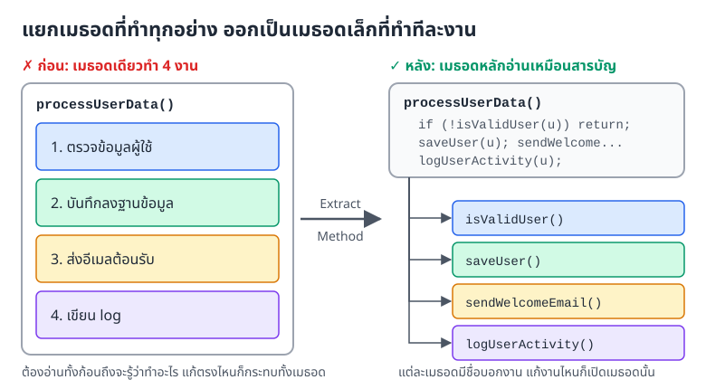
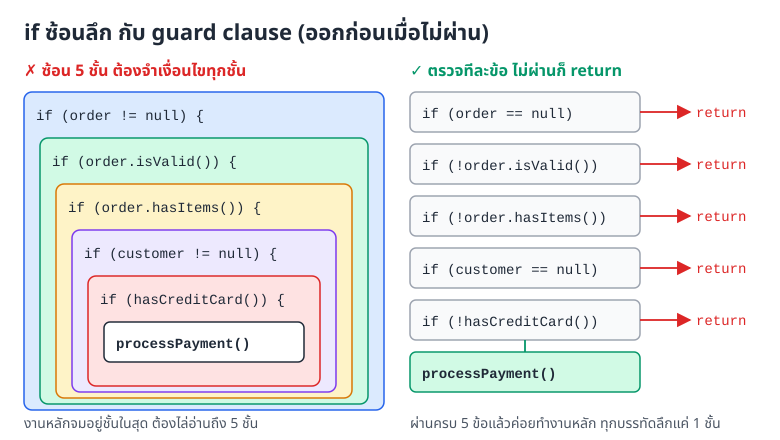
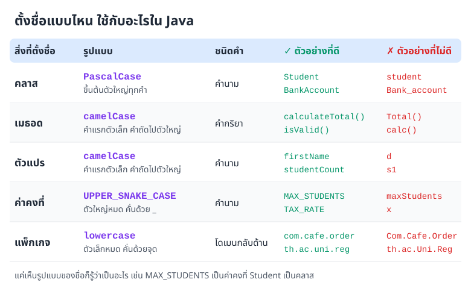
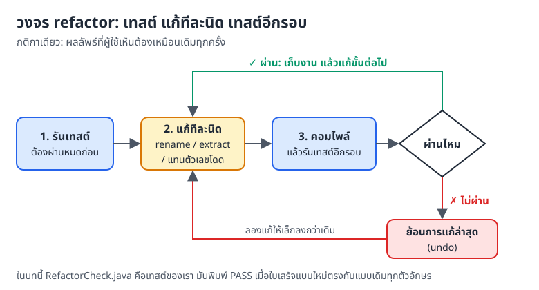
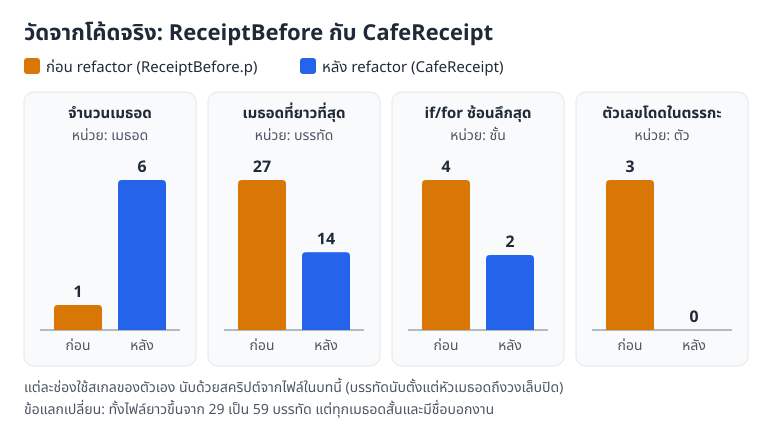
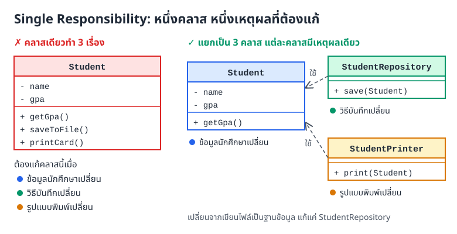
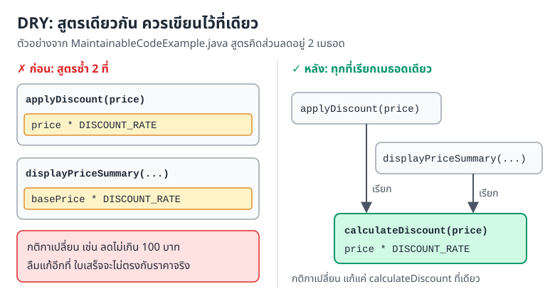

# บทที่ 10: เขียนโค้ดให้ดูแลต่อได้ง่าย (Maintainable Code)

> โค้ดที่ดีไม่ใช่แค่รันผ่าน แต่ต้องให้คนอื่น (รวมถึงตัวเราในอีกหกเดือน) อ่านรู้เรื่องและแก้ได้โดยไม่พังส่วนอื่น
> บทนี้รวมนิสัยเล็ก ๆ ที่ช่วยเรื่องนี้ ตั้งชื่อให้ดี แยกเมธอดให้สั้น เขียนคอมเมนต์เท่าที่จำเป็น และปรับโค้ดทีละนิดโดยมีเทสต์คอยกันพัง

## สิ่งที่จะทำได้หลังเรียนบทนี้

1. บอกหลักของ Clean Code และอธิบายได้ว่าโค้ดแบบไหนดูแลต่อได้ง่าย
2. เขียนโค้ดที่อ่านง่ายและดูแลต่อได้ **(CLO7)**
3. ตั้งชื่อตามธรรมเนียมของ Java (naming conventions) และจัดลำดับส่วนต่าง ๆ ในคลาสให้เป็นระเบียบ **(CLO7)**
4. เขียนคอมเมนต์และ Javadoc ที่มีประโยชน์จริง
5. refactor โค้ดขั้นพื้นฐานได้ เช่น แยกเมธอด เปลี่ยนชื่อ และแทนตัวเลขโดดด้วยค่าคงที่

## 1. โค้ดที่ดูแลต่อได้ง่ายคืออะไร

ลองนึกถึงสมุดสูตรของร้านกาแฟ ถ้าพนักงานคนเก่าเขียนไว้ว่า "ใส่ ช. 2 น. 1 ต. 30" คนใหม่ต้องเดาว่า ช. คือช็อตกาแฟหรือช้อน แต่ถ้าเขียนว่า "เอสเปรสโซ 2 ช็อต นม 1 แก้ว ตีฟอง 30 วินาที" ใครมาอ่านก็ชงได้ทันที

โค้ดก็เหมือนกัน โค้ดที่ดูแลต่อได้ง่าย (maintainable code) มีลักษณะ 4 ข้อ

* **อ่านง่าย** คนอื่นเปิดมาแล้วเข้าใจว่าโค้ดทำอะไร
* **แก้ง่าย** เปลี่ยนส่วนหนึ่งแล้วไม่กระทบส่วนอื่นโดยไม่ตั้งใจ
* **ทดสอบง่าย** แยกแต่ละส่วนออกมาเขียนเทสต์ได้
* **ต่อเติมง่าย** เพิ่มความสามารถใหม่ได้โดยไม่ต้องรื้อของเดิม

### ทำไมต้องใส่ใจเรื่องนี้

โปรแกรมที่ใช้งานจริงอยู่ได้หลายปี และตลอดช่วงนั้นต้องแก้บั๊ก เพิ่มฟีเจอร์ และปรับตามกติกาที่เปลี่ยนไป งานศึกษาด้านวิศวกรรมซอฟต์แวร์หลายชิ้นประเมินว่าค่าใช้จ่ายส่วนใหญ่ของซอฟต์แวร์อยู่ในช่วงดูแลรักษาหลังส่งมอบ (ตัวเลขที่อ้างกันบ่อยอยู่ราว 60 ถึง 80 เปอร์เซ็นต์ แล้วแต่งานศึกษา)

พูดง่าย ๆ คือ เราใช้เวลา "อ่านและแก้" โค้ดมากกว่า "เขียนใหม่" หลายเท่า ถ้าโค้ดอ่านยาก

* แก้จุดหนึ่งแล้วเกิดบั๊กอีกจุด
* ใช้เวลานานกว่าจะหาเจอว่าต้องแก้ตรงไหน
* เพิ่มฟีเจอร์ใหม่ได้ยาก เพราะไม่กล้าแตะของเดิม

## 2. หลักของ Clean Code

### 2.1 ตั้งชื่อให้สื่อความหมาย

ชื่อตัวแปร (variable) และเมธอด (method) คือคอมเมนต์ที่ดีที่สุด เพราะมันอยู่ทุกที่ที่ใช้งาน

**ไม่ดี**

```java
int d;              // จำนวนวันที่ผ่านไป
String s1, s2, s3;
```

**ดี**

```java
int elapsedTimeInDays;
String firstName, lastName, email;
```

ตัวแปร `d` ต้องพึ่งคอมเมนต์ และพอไปใช้ที่บรรทัดอื่น คอมเมนต์ก็ไม่ได้ตามไปด้วย ส่วน `elapsedTimeInDays` บอกความหมายเองทุกครั้งที่ปรากฏ

หลักการตั้งชื่อ

* ใช้ชื่อที่**บอกความหมาย** อ่านแล้วรู้ว่าเก็บอะไรหรือทำอะไร
* **เลี่ยงตัวย่อ**ที่คนอื่นเดาไม่ออก เช่น `calc`, `tmp2`, `chk`
* ใช้ชื่อที่**ค้นหาได้** ค้นคำว่า `elapsedTimeInDays` ในโปรเจกต์เจอแต่ที่เกี่ยวข้อง ค้นตัว `d` เจอเป็นร้อยที่

### 2.2 หนึ่งเมธอด ทำเรื่องเดียว

เมธอดที่ทำหลายเรื่องในก้อนเดียว (บางคนเรียกว่า god method) อ่านยาก และเวลาแก้เรื่องหนึ่งก็เสี่ยงกระทบเรื่องอื่น

**ไม่ดี** เมธอดเดียวทั้งตรวจข้อมูล บันทึก ส่งอีเมล และเขียน log

```java
public void processUserData() {
    // ตรวจข้อมูล
    if (user.name == null) return;

    // บันทึกลงฐานข้อมูล
    database.save(user);

    // ส่งอีเมล
    email.send(user.email, "Welcome!");

    // เขียน log
    logger.log("User processed");
}
```

**ดี** เมธอดหลักเหลือแค่ลำดับขั้น รายละเอียดแต่ละขั้นแยกไปอยู่ในเมธอดของมันเอง

```java
public void processUserData() {
    if (!isValidUser(user)) return;

    saveUser(user);
    sendWelcomeEmail(user);
    logUserActivity(user);
}

private boolean isValidUser(User user) {
    return user.name != null && user.email != null;
}

private void saveUser(User user) {
    database.save(user);
}

private void sendWelcomeEmail(User user) {
    email.send(user.email, "Welcome!");
}

private void logUserActivity(User user) {
    logger.log("User processed: " + user.name);
}
```



*ภาพที่ 10.1 แยกเมธอดที่ทำ 4 งานออกเป็น 4 เมธอด เมธอดหลักอ่านแล้วเหมือนสารบัญ*

ตามภาพที่ 10.1 ด้านขวา ใครเปิด `processUserData()` ก็อ่านได้ในไม่กี่วินาทีว่ามี 4 ขั้น ถ้าอยากรู้รายละเอียดขั้นไหนค่อยเปิดเมธอดนั้น

สังเกตด้วยว่าตอนแยกเมธอด `isValidUser` เราเพิ่มการตรวจ `user.email != null` เข้าไปด้วย เพราะขั้นส่งอีเมลต้องใช้ email เมื่อการตรวจข้อมูลมีที่อยู่ชัดเจนเป็นของตัวเอง เราจะเห็นได้ง่ายขึ้นว่ายังตรวจไม่ครบ

### 2.3 เมธอดควรสั้น

หลักคร่าว ๆ

* เมธอดหนึ่งไม่ควรยาวเกินราว 20 ถึง 30 บรรทัด ตัวเลขนี้ไม่ใช่กฎตายตัว แต่ถ้ายาวกว่านี้มักแปลว่าทำหลายเรื่อง
* ทำเรื่องเดียว (single responsibility)
* ทุกบรรทัดในเมธอดอยู่ระดับรายละเอียดเดียวกัน (one level of abstraction) เช่น เมธอดหลักเรียกแต่เมธอดย่อย ไม่ปนลูป (loop) ระดับล่างเข้ามา

```java
// ดี: สั้น ทำเรื่องเดียว
public double calculateTotalPrice(List<Item> items) {
    double total = 0;
    for (Item item : items) {
        total += item.getPrice();
    }
    return total;
}

// ดี: เรียกใช้เมธอดย่อย แต่ละตัวรับผิดชอบเรื่องของมัน
public double calculateTotalWithDiscount(List<Item> items, double discountRate) {
    double total = calculateTotalPrice(items);
    double discount = calculateDiscount(total, discountRate);
    return total - discount;
}

private double calculateDiscount(double total, double rate) {
    return total * rate;
}
```

### 2.4 อย่าให้ if ซ้อนกันลึก

ทุกครั้งที่ if ซ้อนเข้าไปอีกชั้น คนอ่านต้องจำเงื่อนไขของชั้นนอกไว้ในหัวเพิ่มอีกข้อ พอถึงชั้นที่ 5 ก็เริ่มหลงแล้ว

**ไม่ดี**

```java
public void processOrder(Order order) {
    if (order != null) {
        if (order.isValid()) {
            if (order.hasItems()) {
                if (order.customer != null) {
                    if (order.customer.hasCreditCard()) {
                        // ซ้อนลึกเกินไป
                        processPayment(order);
                    }
                }
            }
        }
    }
}
```

**ดี** ใช้ guard clause คือตรวจเงื่อนไขที่ "ไม่ผ่าน" ก่อน แล้ว return ออกไปเลย

```java
public void processOrder(Order order) {
    // guard clause: ไม่ผ่านข้อไหน ออกจากเมธอดทันที
    if (order == null) return;
    if (!order.isValid()) return;
    if (!order.hasItems()) return;
    if (order.customer == null) return;
    if (!order.customer.hasCreditCard()) return;

    processPayment(order);
}
```



*ภาพที่ 10.2 ซ้ายคือ if ซ้อน 5 ชั้น ขวาคือ guard clause ที่ตรวจทีละข้อในชั้นเดียว*

ทั้งสองแบบทำงานเหมือนกันทุกกรณี แต่ภาพที่ 10.2 ฝั่งขวาอ่านจากบนลงล่างได้เลย ไม่ต้องนับวงเล็บปีกกา และงานหลัก `processPayment` อยู่ระดับเดียวกับเงื่อนไข ไม่จมอยู่ข้างใน

## 3. ธรรมเนียมการตั้งชื่อใน Java

Java มีธรรมเนียมการตั้งชื่อที่โปรแกรมเมอร์ทั่วโลกใช้ตรงกัน ทำตามแล้วคนอ่านจะรู้ทันทีว่าชื่อนั้นเป็นคลาส (class) เมธอด หรือค่าคงที่ โดยไม่ต้องย้อนไปดูตอนประกาศ



*ภาพที่ 10.3 ตารางสรุปรูปแบบการตั้งชื่อใน Java พร้อมตัวอย่างที่ดีและไม่ดี*

### 3.1 คลาส

```java
// PascalCase ขึ้นต้นตัวใหญ่ทุกคำ และเป็นคำนาม
public class Student { }
public class BankAccount { }
public class OrderProcessor { }
```

### 3.2 เมธอด

```java
// camelCase และขึ้นต้นด้วยคำกริยา
public void calculateTotal() { }
public double getPrice() { }
public void setName(String name) { }
public boolean isValid() { }       // คืนค่า boolean มักขึ้นต้นด้วย is / has / can
public boolean hasPermission() { }
```

### 3.3 ตัวแปร

```java
// camelCase และเป็นคำนาม
String firstName;
int studentCount;
double totalPrice;
boolean isActive;
```

### 3.4 ค่าคงที่

```java
// UPPER_SNAKE_CASE ตัวใหญ่หมด คั่นคำด้วย _
public static final int MAX_STUDENTS = 50;
public static final double VAT_RATE = 0.07;
public static final String DEFAULT_NAME = "Unknown";
```

ค่าคงที่ทางคณิตศาสตร์อย่าง π ไม่ต้องประกาศเอง ใช้ `Math.PI` ที่ Java เตรียมไว้ให้ ซึ่งละเอียดกว่า `3.14159` ที่พิมพ์เองมาก

### 3.5 แพ็กเกจ (package)

```java
// ตัวพิมพ์เล็กทั้งหมด คั่นด้วยจุด นิยมใช้ชื่อโดเมนขององค์กรกลับด้าน
package com.company.project;
package th.ac.university.system;
```

## 4. จัดระเบียบโค้ด

### 4.1 ลำดับส่วนต่าง ๆ ในคลาส

ถ้าทุกคลาสในโปรเจกต์เรียงส่วนต่าง ๆ แบบเดียวกัน คนอ่านจะรู้ว่าต้องเลื่อนไปหาอะไรที่ตรงไหน ลำดับที่นิยมใช้คือ ค่าคงที่ ตัวแปร static แอตทริบิวต์ (attribute) ของออบเจกต์ (object) คอนสตรักเตอร์ (constructor) เมธอด public แล้วปิดท้ายด้วยเมธอด private

```java
public class Student {
    // 1. ค่าคงที่
    private static final int MAX_CREDITS = 24;

    // 2. ตัวแปร static
    private static int studentCount = 0;

    // 3. แอตทริบิวต์ของออบเจกต์
    private String studentId;
    private String name;
    private double gpa;

    // 4. คอนสตรักเตอร์
    public Student(String studentId, String name) {
        this.studentId = studentId;
        this.name = name;
        studentCount++;
    }

    // 5. เมธอด public
    public void enrollCourse(Course course) {
        // ...
    }

    public double getGpa() {
        return gpa;
    }

    // 6. เมธอด private
    private void calculateGpa() {
        // ...
    }
}
```

### 4.2 ลำดับของเมธอด

* เมธอด public มาก่อน เพราะเป็นส่วนที่คนใช้คลาสอยากเห็น
* เมธอด private ตามมาทีหลัง
* เมธอดช่วย (helper) วางใกล้เมธอดที่เรียกใช้มัน

### 4.3 ของที่เกี่ยวข้องกัน วางไว้ใกล้กัน

เมธอดที่เรียกกันควรอยู่ใกล้กันในไฟล์ คนอ่านจะได้ไล่ลงไปได้ทีละขั้นเหมือนอ่านหนังสือ ไม่ต้องกระโดดขึ้นลง

```java
public void processOrder() {
    validateOrder();      // เรียกขั้นที่ 1
    calculateTotal();     // เรียกขั้นที่ 2
    applyDiscount();      // เรียกขั้นที่ 3
}

private void validateOrder() {    // อยู่ถัดจาก processOrder
    // ...
}

private void calculateTotal() {   // อยู่ถัดจาก validateOrder
    // ...
}

private void applyDiscount() {    // อยู่ถัดจาก calculateTotal
    // ...
}
```

## 5. คอมเมนต์และเอกสาร

### 5.1 เมื่อไหร่ควรเขียนคอมเมนต์

**ควรเขียน**

* เมื่ออธิบาย **ทำไม** ต้องทำแบบนี้ ไม่ใช่บอกว่า **ทำอะไร** (โค้ดบอกอยู่แล้ว)
* เมื่ออธิบายกติกาทางธุรกิจที่ซับซ้อน
* เมื่อทิ้งโน้ตงานค้าง เช่น `TODO` หรือ `FIXME`

**ไม่ควรเขียน**

* เมื่อโค้ดอธิบายตัวเองได้แล้ว
* เมื่อคอมเมนต์แค่พูดซ้ำสิ่งที่โค้ดบอก

### 5.2 คอมเมนต์ที่ดี

```java
// ดี: บอกเหตุผล
// คูณ 1.07 เพราะต้องรวม VAT 7%
double totalWithTax = price * 1.07;

// ดี: บอกกติกาทางธุรกิจ
// ลูกค้า VIP ได้ส่วนลด 20% เมื่อซื้อเกิน 1000 บาท
if (customer.isVIP() && totalAmount > 1000) {
    discount = 0.20;
}

// ดี: โน้ตงานค้าง
// TODO: ยังไม่ได้ตรวจรูปแบบ email
public void setEmail(String email) {
    this.email = email;
}
```

ตัวอย่างแรกยังมีตัวเลข `1.07` ฝังอยู่ในโค้ด ในหัวข้อ 6.3 เราจะเห็นวิธีที่ดีกว่า คือตั้งชื่อค่าคงที่ให้มัน จนแทบไม่ต้องมีคอมเมนต์เลย

### 5.3 คอมเมนต์ที่ไม่ดี

```java
// ไม่ดี: พูดซ้ำสิ่งที่ชื่อเมธอดบอกแล้ว
// Get the name
public String getName() {
    return name;
}

// ไม่ดี: อธิบายสิ่งที่เห็นชัดอยู่แล้ว
// Loop through students
for (Student student : students) {
    // Print student name
    System.out.println(student.getName());
}

// ไม่ดี: โค้ดเก่าที่คอมเมนต์ทิ้งไว้ ควรลบออก
// public void oldMethod() {
//     // old implementation
// }
```

โค้ดเก่าที่คอมเมนต์ไว้ไม่ต้องเสียดาย ถ้าใช้ Git ประวัติทุกเวอร์ชันยังอยู่ ย้อนกลับไปดูได้เสมอ

### 5.4 Javadoc

Javadoc คือคอมเมนต์รูปแบบพิเศษที่ขึ้นต้นด้วย `/**` วางไว้เหนือคลาสหรือเมธอด IDE จะเอาไปแสดงตอนเราเอาเมาส์ชี้ชื่อเมธอด และคำสั่ง `javadoc` สร้างเป็นเว็บเอกสารได้

```java
/**
 * คำนวณพื้นที่วงกลม
 *
 * @param radius รัศมีของวงกลม (ต้องมากกว่า 0)
 * @return พื้นที่ของวงกลม
 * @throws IllegalArgumentException ถ้า radius น้อยกว่าหรือเท่ากับ 0
 */
public double calculateCircleArea(double radius) {
    if (radius <= 0) {
        throw new IllegalArgumentException("Radius must be positive");
    }
    return Math.PI * radius * radius;
}
```

* `@param` อธิบายพารามิเตอร์แต่ละตัว รวมถึงเงื่อนไขที่ต้องเป็น
* `@return` บอกว่าเมธอดคืนค่าอะไร
* `@throws` บอกว่า exception ตัวไหนอาจเกิด และเกิดเมื่อไหร่ (โยงกับบทที่ 9)

ควรเขียน Javadoc ให้เมธอด public ทุกตัว เพราะเป็นส่วนที่คนอื่นเรียกใช้โดยอาจไม่เคยเปิดดูโค้ดข้างใน

## 6. Refactoring ขั้นพื้นฐาน

Refactoring คือการปรับโครงสร้างโค้ดให้ดีขึ้น **โดยที่ผลลัพธ์ที่ผู้ใช้เห็นยังเหมือนเดิมทุกอย่าง** เหมือนจัดตู้เสื้อผ้าใหม่ เสื้อผ้าครบทุกตัวเท่าเดิม แค่หยิบง่ายขึ้น

### 6.1 แยกเมธอด (Extract Method)

ส่วนไหนของเมธอดที่ต้องมีคอมเมนต์บอกว่า "ตรงนี้ทำอะไร" มักเป็นส่วนที่ควรแยกออกมาเป็นเมธอดที่มีชื่อบอกงานแทน

**ก่อน**

```java
public void printReport() {
    System.out.println("=== Report ===");

    // คำนวณยอดรวม
    double total = 0;
    for (Item item : items) {
        total += item.getPrice();
    }

    System.out.println("Total: " + total);
}
```

**หลัง**

```java
public void printReport() {
    printHeader();
    double total = calculateTotal();
    printTotal(total);
}

private void printHeader() {
    System.out.println("=== Report ===");
}

private double calculateTotal() {
    double total = 0;
    for (Item item : items) {
        total += item.getPrice();
    }
    return total;
}

private void printTotal(double total) {
    System.out.println("Total: " + total);
}
```

### 6.2 เปลี่ยนชื่อ (Rename)

**ก่อน**

```java
int d;  // จำนวนวันที่ผ่านไป
public void calc() { }
```

**หลัง**

```java
int elapsedTimeInDays;
public void calculateTotal() { }
```

IDE ส่วนใหญ่มีคำสั่ง Rename (เช่น กด Shift+F6 ใน IntelliJ IDEA หรือ F2 ใน VS Code) ซึ่งเปลี่ยนชื่อให้ทุกที่ที่ใช้พร้อมกัน ปลอดภัยกว่าค้นแล้วแทนที่เอง

### 6.3 แทนตัวเลขโดดด้วยค่าคงที่ (Replace Magic Number)

ตัวเลขโดด (magic number) คือตัวเลขที่ฝังอยู่ในโค้ดโดยไม่มีชื่อบอกว่าหมายถึงอะไร

**ก่อน**

```java
if (age >= 18) {
    // ...
}

double tax = price * 0.07;
```

**หลัง**

```java
private static final int LEGAL_AGE = 18;
private static final double TAX_RATE = 0.07;

if (age >= LEGAL_AGE) {
    // ...
}

double tax = price * TAX_RATE;
```

ได้ประโยชน์สองต่อ ข้อแรก อ่านแล้วรู้ว่า 0.07 คืออัตราภาษี ข้อสอง ถ้าวันหนึ่ง VAT เปลี่ยน ก็แก้แค่บรรทัดเดียว ไม่ต้องไล่หา `0.07` ทั่วโปรเจกต์ (ซึ่งอาจไปเจอ 0.07 ที่หมายถึงเรื่องอื่นด้วย)

### 6.4 วงจร refactor: เทสต์ก่อน แก้ทีละนิด เทสต์อีกรอบ

refactor ที่ปลอดภัยต้องมีอะไรสักอย่างคอยยืนยันว่าผลลัพธ์ยังเหมือนเดิม ซึ่งก็คือเทสต์ (บทนี้เขียนเทสต์แบบทำเองให้เห็นหลักการก่อน ส่วนการเขียนเทสต์ด้วย JUnit ซึ่งเป็นเครื่องมือที่ใช้กันจริง อ่านได้ใน[ภาคผนวก ก ข้อ 4](lab-toolkit.md))



*ภาพที่ 10.4 วงจร refactor ที่ปลอดภัย แก้ทีละขั้นเล็ก ๆ และรันเทสต์ทุกครั้ง*

ภาพที่ 10.4 สรุปเป็นขั้นได้ดังนี้

1. รันเทสต์ให้ผ่านหมดก่อนเริ่ม ถ้ายังไม่มีเทสต์ ให้เขียนก่อน
2. แก้ทีละนิด เช่น เปลี่ยนชื่อตัวแปรหนึ่งตัว หรือแยกเมธอดหนึ่งเมธอด
3. คอมไพล์แล้วรันเทสต์อีกรอบ
4. ถ้าผ่าน ทำขั้นต่อไป ถ้าไม่ผ่าน ย้อนการแก้ล่าสุด แล้วลองแก้ให้เล็กลงกว่าเดิม

ที่ต้องแก้ทีละนิดก็เพราะ ถ้าแก้ทีเดียว 10 อย่างแล้วเทสต์ไม่ผ่าน เราจะไม่รู้ว่าอย่างไหนทำพัง

### 6.5 ลองทำจริง: ใบเสร็จร้านกาแฟ

สมมติเรารับช่วงโค้ดออกใบเสร็จของร้านกาแฟมาจากรุ่นพี่ กติกาของร้านคือ

* สมาชิกที่ซื้อตั้งแต่ 200 บาทขึ้นไป ได้ส่วนลด 10%
* คิด VAT 7% หลังหักส่วนลด
* รายการที่จำนวนเป็น 0 (ลูกค้ายกเลิก) ไม่ต้องพิมพ์

โค้ดเดิมทำงานถูกต้อง แต่อ่านยากมาก

```java
public class ReceiptBefore {
    static String p(String[] n, int[] q, double[] pr, boolean m) {
        String r = "";
        double t = 0;
        if (n != null) {
            if (n.length > 0) {
                for (int i = 0; i < n.length; i++) {
                    if (q[i] > 0) {
                        double s = q[i] * pr[i];
                        t = t + s;
                        r = r + String.format("%-14s x%d %8.2f%n", n[i], q[i], s);
                    }
                }
                if (m) {
                    if (t >= 200) {
                        double d = t * 0.1;
                        r = r + String.format("%-17s -%8.2f%n", "Member 10%", d);
                        t = t - d;
                    }
                }
                double v = t * 0.07;
                r = r + String.format("%-17s +%8.2f%n", "VAT 7%", v);
                t = t + v;
                r = r + String.format("%-17s  %8.2f%n", "Total", t);
            }
        }
        return r;
    }
}
```

ลองนับปัญหาที่เจอ ชื่อ `p`, `n`, `q`, `m`, `t` ไม่บอกอะไรเลย ตัวเลข `200`, `0.1`, `0.07` ฝังอยู่ในตรรกะ if ซ้อนลึก 4 ชั้น และเมธอดเดียวทำทั้งพิมพ์รายการ คิดส่วนลด คิด VAT และจัดรูปแบบบรรทัด

ขั้นแรกตามวงจรในภาพที่ 10.4 คือเขียนเทสต์ไว้ก่อน เทสต์ของเราเรียบง่ายมาก คือเรียกทั้งโค้ดเก่าและโค้ดใหม่ด้วยข้อมูลชุดเดียวกัน แล้วเทียบว่าข้อความใบเสร็จตรงกันทุกตัวอักษรหรือไม่

```java
public class RefactorCheck {
    public static void main(String[] args) {
        String[] names = {"Latte", "Thai Tea", "Croissant", "Brownie"};
        int[] quantities = {2, 1, 1, 0};
        double[] prices = {65, 55, 70, 45};

        // ลองทั้งกรณีเป็นสมาชิกและไม่เป็นสมาชิก
        boolean[] memberCases = {true, false};
        for (boolean isMember : memberCases) {
            String before = ReceiptBefore.p(names, quantities, prices, isMember);
            String after = CafeReceipt.buildReceipt(names, quantities, prices, isMember);
            System.out.println("isMember = " + isMember);
            System.out.print(after);
            System.out.println(before.equals(after) ? "PASS: ผลเหมือนเดิม" : "FAIL: ผลไม่ตรงกัน");
            System.out.println();
        }
    }
}
```

จากนั้นค่อย ๆ refactor ทีละขั้น เปลี่ยนชื่อ แทนตัวเลขโดดด้วยค่าคงที่ ใช้ guard clause แยกเมธอด และรันเทสต์ทุกครั้ง จนได้ผลลัพธ์สุดท้ายแบบนี้

```java
public class CafeReceipt {
    // ค่าคงที่ตามนโยบายร้าน แก้ที่เดียวแล้วมีผลทั้งคลาส
    private static final double MEMBER_DISCOUNT_RATE = 0.10;
    private static final double MEMBER_MIN_SUBTOTAL = 200;
    private static final double VAT_RATE = 0.07;

    public static String buildReceipt(String[] names, int[] quantities,
                                      double[] prices, boolean isMember) {
        if (names == null || names.length == 0) {
            return "";
        }
        StringBuilder receipt = new StringBuilder();
        double subtotal = appendItemLines(receipt, names, quantities, prices);
        double afterDiscount = applyMemberDiscount(receipt, subtotal, isMember);
        double total = applyVat(receipt, afterDiscount);
        appendLine(receipt, "Total", ' ', total);
        return receipt.toString();
    }

    private static double appendItemLines(StringBuilder receipt, String[] names,
                                          int[] quantities, double[] prices) {
        double subtotal = 0;
        for (int i = 0; i < names.length; i++) {
            if (quantities[i] <= 0) {
                continue; // ข้ามรายการที่ลูกค้ายกเลิก
            }
            double lineTotal = quantities[i] * prices[i];
            subtotal += lineTotal;
            receipt.append(String.format("%-14s x%d %8.2f%n",
                    names[i], quantities[i], lineTotal));
        }
        return subtotal;
    }

    private static double applyMemberDiscount(StringBuilder receipt,
                                              double subtotal, boolean isMember) {
        if (!isEligibleForMemberDiscount(subtotal, isMember)) {
            return subtotal;
        }
        double discount = subtotal * MEMBER_DISCOUNT_RATE;
        appendLine(receipt, "Member 10%", '-', discount);
        return subtotal - discount;
    }

    private static boolean isEligibleForMemberDiscount(double subtotal, boolean isMember) {
        return isMember && subtotal >= MEMBER_MIN_SUBTOTAL;
    }

    private static double applyVat(StringBuilder receipt, double amount) {
        double vat = amount * VAT_RATE;
        appendLine(receipt, "VAT 7%", '+', vat);
        return amount + vat;
    }

    private static void appendLine(StringBuilder receipt, String label,
                                   char sign, double amount) {
        receipt.append(String.format("%-17s %c%8.2f%n", label, sign, amount));
    }
}
```

อ่าน `buildReceipt` อย่างเดียวก็รู้ลำดับงานทั้งหมด พิมพ์รายการ หักส่วนลดสมาชิก บวก VAT แล้วพิมพ์ยอดรวม ถ้าวันหนึ่งร้านเปลี่ยนเกณฑ์สมาชิกเป็น 300 บาท ก็แก้ `MEMBER_MIN_SUBTOTAL` บรรทัดเดียว

นอกจากนี้ยังเปลี่ยนจากการต่อ String ด้วย `+` ในลูปมาใช้ `StringBuilder` ซึ่งเหมาะกับการต่อข้อความหลายครั้งมากกว่า เพราะไม่ต้องสร้าง String ใหม่ทุกรอบ

ผลรันจริงของ `RefactorCheck`

```
isMember = true
Latte          x2   130.00
Thai Tea       x1    55.00
Croissant      x1    70.00
Member 10%        -   25.50
VAT 7%            +   16.07
Total                245.57
PASS: ผลเหมือนเดิม

isMember = false
Latte          x2   130.00
Thai Tea       x1    55.00
Croissant      x1    70.00
VAT 7%            +   17.85
Total                272.85
PASS: ผลเหมือนเดิม
```

ทั้งสองกรณีขึ้น PASS แปลว่า refactor แล้วใบเสร็จยังออกมาเหมือนเดิมทุกตัวอักษร ยอดก่อนส่วนลดคือ 130 + 55 + 70 = 255 บาท สมาชิกได้ลด 25.50 บาท ส่วน Brownie ที่จำนวนเป็น 0 ไม่โผล่ในใบเสร็จทั้งสองแบบ

แล้วโค้ดใหม่ "ดีขึ้น" แค่ไหน เราลองนับจากไฟล์ทั้งสองด้วยสคริปต์ (ไม่ได้กะด้วยตา)



*ภาพที่ 10.5 ตัวเลขที่นับจาก ReceiptBefore.java และ CafeReceipt.java ในบทนี้*

| สิ่งที่นับ | ก่อน (`ReceiptBefore`) | หลัง (`CafeReceipt`) |
|---|---|---|
| จำนวนเมธอด | 1 | 6 |
| เมธอดที่ยาวที่สุด (บรรทัด) | 27 (`p`) | 14 (`appendItemLines`) |
| ความยาวเฉลี่ยต่อเมธอด (บรรทัด) | 27 | 7.8 |
| if/for ซ้อนลึกสุด (ชั้น) | 4 | 2 |
| ตัวเลขโดดในตรรกะ | 3 (`200`, `0.1`, `0.07`) | 0 |
| ความยาวทั้งไฟล์ (บรรทัด) | 29 | 59 |

แถวสุดท้ายสำคัญ ภาพที่ 10.5 ไม่ได้บอกว่าโค้ดใหม่ "สั้นกว่า" ทั้งไฟล์กลับยาวขึ้นเกือบเท่าตัว เพราะมีหัวเมธอด ค่าคงที่ และวงเล็บเพิ่มขึ้น สิ่งที่ได้คืนมาคือแต่ละชิ้นเล็กลง มีชื่อ และแก้ได้แยกกัน ซึ่งคุ้มกว่ามากเมื่อต้องกลับมาแก้ในอนาคต

## 7. หลัก SOLID ขั้นพื้นฐาน

SOLID คือหลักการออกแบบคลาส 5 ข้อ ตั้งชื่อตามอักษรตัวแรกของแต่ละข้อ บทนี้ขอแนะนำ 3 ข้อแรกก่อน ส่วนอีก 2 ข้อ (Interface Segregation และ Dependency Inversion) จะเจอเมื่อออกแบบระบบที่ใหญ่ขึ้น

### 7.1 Single Responsibility Principle (SRP)

**คลาสหนึ่งควรมีเหตุผลที่ต้องแก้เพียงเรื่องเดียว**

ลองนึกถึงคลาส `Student` ที่เก็บข้อมูลนักศึกษา บันทึกลงไฟล์ และพิมพ์บัตรนักศึกษาไปด้วยในคลาสเดียว คลาสนี้ต้องแก้เมื่อข้อมูลนักศึกษาเปลี่ยน เมื่อวิธีบันทึกเปลี่ยน และเมื่อแบบบัตรเปลี่ยน รวม 3 เหตุผล

```java
// ดี: แยกแต่ละเรื่องไปอยู่คนละคลาส
class Student {
    String name;
    double gpa;
}

class StudentRepository {
    void save(Student student) { /* บันทึกลงไฟล์หรือฐานข้อมูล */ }
}

class StudentPrinter {
    void print(Student student) { /* พิมพ์บัตรนักศึกษา */ }
}
```



*ภาพที่ 10.6 คลาสที่มี 3 เหตุผลให้ต้องแก้ แยกเป็น 3 คลาสที่มีเหตุผลละหนึ่งเรื่อง*

ในภาพที่ 10.6 ฝั่งขวา ถ้ามหาวิทยาลัยเปลี่ยนจากเก็บไฟล์ไปใช้ฐานข้อมูล เราแก้แค่ `StudentRepository` คลาส `Student` กับ `StudentPrinter` ไม่ต้องแตะเลย

### 7.2 Open/Closed Principle (OCP)

**เปิดให้ต่อเติม แต่ปิดไม่ให้ต้องแก้ของเดิม (open for extension, closed for modification)**

ถ้ามีโปรโมชันใหม่ทุกเดือน แล้วเราต้องเข้าไปเพิ่ม `else if` ในเมธอดคิดเงินทุกครั้ง โค้ดที่ทำงานดีอยู่แล้วก็เสี่ยงพังทุกเดือน OCP แนะนำให้ใช้การสืบทอด (inheritance) หรืออินเทอร์เฟซ (interface) ร่วมกับพหุสัณฐาน (polymorphism) เพื่อให้เพิ่มของใหม่ได้โดยไม่แก้ของเก่า

```java
interface DiscountPolicy {
    double discountFor(double subtotal);
}

class NoDiscount implements DiscountPolicy {
    public double discountFor(double subtotal) {
        return 0;
    }
}

class MemberDiscount implements DiscountPolicy {
    public double discountFor(double subtotal) {
        return subtotal >= 200 ? subtotal * 0.10 : 0;
    }
}

// โปรใหม่: เพิ่มคลาสใหม่ ไม่ต้องแก้ Checkout
class StudentDiscount implements DiscountPolicy {
    public double discountFor(double subtotal) {
        return 15;
    }
}

class Checkout {
    double total(double subtotal, DiscountPolicy policy) {
        return subtotal - policy.discountFor(subtotal);
    }
}

public class OcpDemo {
    public static void main(String[] args) {
        Checkout checkout = new Checkout();
        DiscountPolicy[] policies = {new NoDiscount(), new MemberDiscount(), new StudentDiscount()};
        for (DiscountPolicy policy : policies) {
            System.out.println(policy.getClass().getSimpleName() + ": " + checkout.total(255, policy));
        }
    }
}
```

ผลรัน

```
NoDiscount: 255.0
MemberDiscount: 229.5
StudentDiscount: 240.0
```

ตอนเพิ่ม `StudentDiscount` เราไม่ได้แก้ `Checkout` แม้แต่บรรทัดเดียว (ตัวอย่างนี้เขียนตัวเลขตรง ๆ ให้สั้น ในงานจริงควรตั้งเป็นค่าคงที่ตามหัวข้อ 6.3)

### 7.3 Liskov Substitution Principle (LSP)

**ออบเจกต์ของคลาสลูกต้องใช้แทนออบเจกต์ของคลาสแม่ได้ โดยโปรแกรมยังทำงานถูกต้อง**

ถ้าคลาสแม่ (superclass) สัญญาว่า "ทำสิ่งนี้ได้" คลาสลูก (subclass) ต้องทำสิ่งนั้นได้จริง ถ้าคลาสลูกไปเปลี่ยนพฤติกรรมจนคนเรียกใช้คาดไม่ถึง หรือโยน exception ใส่ ถือว่าผิดหลัก LSP

```java
class Bird {
    void fly() {
        System.out.println("บินได้");
    }
}

class Penguin extends Bird {
    @Override
    void fly() {
        // ผิด LSP: คลาสแม่สัญญาว่าบินได้ แต่คลาสลูกทำไม่ได้
        throw new UnsupportedOperationException("เพนกวินบินไม่ได้");
    }
}
```

โค้ดที่รับ `Bird` มาแล้วเรียก `fly()` จะพังทันทีเมื่อได้ `Penguin` เข้ามา ทางแก้คือออกแบบลำดับชั้นใหม่ เช่น ไม่ใส่ `fly()` ไว้ใน `Bird` แต่แยกเป็นอินเทอร์เฟซ `Flyable` ให้เฉพาะนกที่บินได้ implement

## 8. กลิ่นโค้ดที่บอกว่าถึงเวลา refactor

กลิ่นโค้ด (code smell) คือสัญญาณที่บอกว่าโค้ดตรงนั้นน่าจะมีปัญหา ไม่ใช่บั๊กโดยตรง แต่มักนำไปสู่บั๊กในอนาคต

### 8.1 เมธอดยาวเกินไป (Long Method)

เมธอดที่ต้องเลื่อนจออ่าน หรือต้องมีคอมเมนต์แบ่งเป็นช่วง ๆ ให้แยกเป็นเมธอดเล็ก ๆ ด้วย Extract Method เหมือนตัวอย่างใบเสร็จในหัวข้อ 6.5

### 8.2 คลาสใหญ่เกินไป (Large Class)

คลาสที่รับผิดชอบหลายเรื่อง ให้แยกคลาสตามหลัก SRP ในหัวข้อ 7.1

### 8.3 โค้ดซ้ำ (Duplicate Code)

โค้ดที่ซ้ำกันหลายที่ ให้แยกเป็นเมธอดเดียวแล้วเรียกใช้ หลักนี้มีชื่อเรียกว่า DRY (Don't Repeat Yourself) แปลตรง ๆ ว่า อย่าเขียนซ้ำ

โค้ดซ้ำอันตรายตรงที่ วันหนึ่งกติกาเปลี่ยน เราต้องตามแก้ให้ครบทุกที่ ถ้าลืมแค่ที่เดียว โปรแกรมก็ทำงานไม่ตรงกันเอง



*ภาพที่ 10.7 สูตรส่วนลดที่ซ้ำกันสองที่ใน MaintainableCodeExample.java และวิธีรวมไว้ที่เดียว*

ภาพที่ 10.7 มาจากไฟล์ตัวอย่างประจำบทนี้เอง สูตร `* DISCOUNT_RATE` อยู่ทั้งใน `applyDiscount` และ `displayPriceSummary` ถ้าร้านเพิ่มกติกา "ลดไม่เกิน 100 บาท" แล้วแก้แค่ `applyDiscount` ใบเสร็จจะแสดงส่วนลด 150 บาท ทั้งที่ราคาจริงลดไปแค่ 100 บาท ทางแก้คือแยกเมธอด `calculateDiscount(price)` แล้วให้ทั้งสองที่เรียกใช้

### 8.4 โค้ดที่ไม่มีใครใช้ (Dead Code)

ตัวแปร เมธอด หรือคลาสที่ไม่มีที่ไหนเรียกใช้แล้ว ให้ลบทิ้ง เก็บไว้มีแต่ทำให้คนอ่านเสียเวลาสงสัยว่ามันยังสำคัญอยู่ไหม IDE ส่วนใหญ่จะแสดงชื่อที่ไม่มีใครใช้เป็นสีจาง ๆ ให้เห็น

## 9. ตัวอย่างโปรแกรมสมบูรณ์

ดูตัวอย่างเต็มได้ที่ [MaintainableCodeExample.java](../examples/MaintainableCodeExample.java)

โปรแกรมนี้คำนวณราคาสินค้า 1,500 บาท ที่ได้ส่วนลด 10% (เพราะถึงเกณฑ์ 1,000 บาท) แล้วบวก VAT 7% ในโค้ดมีสิ่งที่เรียนในบทนี้หลายข้อ

* ชื่อสื่อความหมาย เช่น `calculateFinalPrice()`, `isEligibleForDiscount()`
* เมธอดแต่ละตัวทำเรื่องเดียว `applyDiscount()` ทำแค่ส่วนลด `addTax()` ทำแค่ภาษี
* ใช้ค่าคงที่ `TAX_RATE`, `DISCOUNT_THRESHOLD`, `DISCOUNT_RATE` แทนตัวเลขโดด
* เมธอด public มี Javadoc

ผลรันจริง

```
═══════════════════════════════════════════════════
     ตัวอย่าง Maintainable Code (CLO7)
═══════════════════════════════════════════════════

>>> การคำนวณราคา (Maintainable Code)

┌─────────────────────────────────────┐
│        สรุปราคา                     │
├─────────────────────────────────────┤
│ ราคาฐาน:           1500.00 บาท │
│ ส่วนลด (10%):   -   150.00 บาท │
│ หลังส่วนลด:        1350.00 บาท │
│ ภาษี (7%):      +    94.50 บาท │
├─────────────────────────────────────┤
│ ราคาสุดท้าย:       1444.50 บาท │
└─────────────────────────────────────┘

═══════════════════════════════════════════════════
✓ ใช้ชื่อที่สื่อความหมาย (meaningful names)
✓ Functions ทำสิ่งเดียว (single responsibility)
✓ ใช้ Constants แทน Magic numbers
✓ Code organization ที่ชัดเจน
✓ รองรับ CLO7: Develop clean, maintainable software
```

ถ้ารันบน Windows แล้วภาษาไทยหรือเส้นกรอบกลายเป็น `?` ให้รันด้วย `java -Dstdout.encoding=UTF-8 MaintainableCodeExample` (JDK 19 ขึ้นไป) หรือตั้ง encoding ของ terminal เป็น UTF-8

ตัวอย่างนี้ยังไม่สมบูรณ์แบบ อย่างที่เห็นในภาพที่ 10.7 `displayPriceSummary` คิดส่วนลดและภาษีซ้ำกับ `applyDiscount` และ `addTax` ลองแก้เป็นแบบฝึกหัดข้อ 5 ได้

## ข้อผิดพลาดที่เจอบ่อย

* **refactor พร้อมกับเพิ่มฟีเจอร์ใหม่** พอเทสต์ไม่ผ่านจะแยกไม่ออกว่าพังเพราะอะไร ให้ refactor ให้เสร็จก่อน (เทสต์ผ่าน) แล้วค่อยเพิ่มฟีเจอร์
* **refactor โดยไม่มีเทสต์** ไม่มีอะไรยืนยันว่าผลยังเหมือนเดิม แม้แต่เทสต์ง่าย ๆ แบบ `RefactorCheck` ที่เทียบผลเก่ากับใหม่ ก็ช่วยได้มาก
* **แยกเมธอดเล็กเกินไปจนต้องกระโดดไปมา** เมธอดบรรทัดเดียวที่ชื่อไม่ได้บอกอะไรมากกว่าตัวโค้ด ไม่ได้ช่วยให้อ่านง่ายขึ้น เป้าหมายคือความชัด ไม่ใช่จำนวนเมธอด
* **คอมเมนต์ไม่ตรงกับโค้ด** แก้โค้ดแล้วลืมแก้คอมเมนต์ คอมเมนต์ที่ผิดแย่กว่าไม่มีคอมเมนต์ เพราะทำให้คนอ่านเข้าใจผิด
* **ตั้งชื่อค่าคงที่ตามค่า ไม่ใช่ตามความหมาย** เช่น `SEVEN_PERCENT = 0.07` วันที่ VAT เปลี่ยนเป็น 10% ชื่อนี้จะโกหกทันที ควรตั้งว่า `VAT_RATE`
* **ใช้ camelCase กับคลาส หรือ PascalCase กับตัวแปร** คอมไพล์ผ่าน แต่คนอ่านจะสับสนว่า `student.count()` เรียกเมธอดของออบเจกต์ หรือเมธอด static ของคลาส

## สรุปท้ายบท

* โค้ดที่ดูแลต่อได้ง่าย คือโค้ดที่อ่านง่าย แก้ง่าย ทดสอบง่าย และต่อเติมง่าย **(CLO7)**
* ตั้งชื่อให้**บอกความหมาย**และค้นหาได้ ทำตามธรรมเนียม PascalCase, camelCase, UPPER_SNAKE_CASE และ lowercase ของ Java
* เมธอดควร**สั้นและทำเรื่องเดียว** ใช้ guard clause แทน if ซ้อนลึก
* จัดลำดับส่วนต่าง ๆ ในคลาสให้เหมือนกันทั้งโปรเจกต์ และวางเมธอดที่เกี่ยวข้องไว้ใกล้กัน
* คอมเมนต์บอก "ทำไม" ไม่ใช่ "ทำอะไร" และเขียน Javadoc ให้เมธอด public
* refactor คือปรับโครงสร้างโดยผลลัพธ์เหมือนเดิม ทำทีละนิด และรันเทสต์ทุกครั้ง
* SRP ให้คลาสมีเหตุผลที่ต้องแก้เรื่องเดียว OCP ให้เพิ่มของใหม่โดยไม่แก้ของเก่า LSP ให้คลาสลูกใช้แทนคลาสแม่ได้จริง
* กลิ่นโค้ดที่ควรระวัง คือ เมธอดยาว คลาสใหญ่ โค้ดซ้ำ และโค้ดที่ไม่มีใครใช้

## แบบฝึกหัด

**ข้อ 1** refactor โค้ดต่อไปนี้ที่มี if ซ้อน 3 ชั้น ให้ใช้ guard clause

```java
public void withdraw(Account account, double amount) {
    if (account != null) {
        if (amount > 0) {
            if (account.getBalance() >= amount) {
                account.setBalance(account.getBalance() - amount);
            }
        }
    }
}
```

<details>
<summary>ดูเฉลย</summary>

```java
public void withdraw(Account account, double amount) {
    if (account == null) return;
    if (amount <= 0) return;
    if (account.getBalance() < amount) return;

    account.setBalance(account.getBalance() - amount);
}
```

สังเกตว่าเงื่อนไขแต่ละข้อกลับด้าน `!= null` กลายเป็น `== null` และ `> 0` กลายเป็น `<= 0` เพราะ guard clause ตรวจกรณีที่ "ไม่ผ่าน" ในงานจริงอาจโยน exception แทน return เฉย ๆ เพื่อให้คนเรียกรู้ว่าถอนเงินไม่สำเร็จ (ดูบทที่ 9)

</details>

**ข้อ 2** เมธอดต่อไปนี้ยาวและทำหลายเรื่อง ให้แยกเป็นเมธอดย่อยอย่างน้อย 3 เมธอด

```java
public void printGradeReport(String name, int[] scores) {
    System.out.println("Student: " + name);
    int sum = 0;
    for (int s : scores) {
        sum += s;
    }
    double avg = (double) sum / scores.length;
    System.out.println("Average: " + avg);
    String grade;
    if (avg >= 80) grade = "A";
    else if (avg >= 70) grade = "B";
    else if (avg >= 60) grade = "C";
    else grade = "F";
    System.out.println("Grade: " + grade);
}
```

<details>
<summary>ดูเฉลย</summary>

```java
public void printGradeReport(String name, int[] scores) {
    double average = calculateAverage(scores);
    System.out.println("Student: " + name);
    System.out.println("Average: " + average);
    System.out.println("Grade: " + toLetterGrade(average));
}

private double calculateAverage(int[] scores) {
    int sum = 0;
    for (int score : scores) {
        sum += score;
    }
    return (double) sum / scores.length;
}

private String toLetterGrade(double average) {
    if (average >= 80) return "A";
    if (average >= 70) return "B";
    if (average >= 60) return "C";
    return "F";
}
```

เมธอดหลักเหลือ 4 บรรทัด `calculateAverage` และ `toLetterGrade` นำไปใช้ที่อื่นต่อได้ด้วย และเขียนเทสต์แยกได้ง่าย

</details>

**ข้อ 3** ตั้งชื่อใหม่ให้สื่อความหมาย

```java
double c(double w, double h) {
    return w / (h * h);
}
```

<details>
<summary>ดูเฉลย</summary>

```java
double calculateBmi(double weightKg, double heightM) {
    return weightKg / (heightM * heightM);
}
```

ใส่หน่วยไว้ในชื่อพารามิเตอร์ (`Kg`, `M`) ช่วยกันความผิดพลาดที่พบบ่อย คือส่งส่วนสูงเป็นเซนติเมตรเข้าไป

</details>

**ข้อ 4** หาตัวเลขโดดในโค้ดนี้ แล้วแทนด้วยค่าคงที่

```java
double fee = hours * 20;
if (hours > 8) {
    fee = 8 * 20 + (hours - 8) * 10;
}
```

<details>
<summary>ดูเฉลย</summary>

```java
private static final double HOURLY_RATE = 20;
private static final double OVERTIME_HOURLY_RATE = 10;
private static final int NORMAL_HOURS_LIMIT = 8;

double fee = hours * HOURLY_RATE;
if (hours > NORMAL_HOURS_LIMIT) {
    fee = NORMAL_HOURS_LIMIT * HOURLY_RATE
            + (hours - NORMAL_HOURS_LIMIT) * OVERTIME_HOURLY_RATE;
}
```

เลข 8 ปรากฏ 3 ที่ และเลข 20 ปรากฏ 2 ที่ ถ้าลานจอดรถเปลี่ยนเวลาปกติเป็น 6 ชั่วโมง โค้ดเดิมต้องแก้ 3 ที่ โค้ดใหม่แก้ที่เดียว

</details>

**ข้อ 5** ใน MaintainableCodeExample.java เมธอด `displayPriceSummary` คิดส่วนลดและภาษีซ้ำกับ `applyDiscount` และ `addTax` (ภาพที่ 10.7) จงเสนอวิธีแก้ให้สูตรอยู่ที่เดียว และลบโค้ดที่ไม่จำเป็นออก

<details>
<summary>ดูเฉลย</summary>

แยกสูตรออกมาเป็นเมธอดที่คืนค่าตัวเลขอย่างเดียว แล้วให้ทุกที่เรียกใช้

```java
private static double calculateDiscount(double price) {
    return isEligibleForDiscount(price) ? price * DISCOUNT_RATE : 0;
}

private static double calculateTax(double price) {
    return price * TAX_RATE;
}

private static double applyDiscount(double price) {
    return price - calculateDiscount(price);
}

private static double addTax(double price) {
    return price + calculateTax(price);
}
```

ใน `displayPriceSummary` ให้เปลี่ยน `basePrice * DISCOUNT_RATE` เป็น `calculateDiscount(basePrice)` และเปลี่ยน `priceAfterDiscount * TAX_RATE` เป็น `calculateTax(priceAfterDiscount)` จากนั้นรันโปรแกรมเทียบผลกับเดิม ต้องได้ 1444.50 บาทเหมือนเดิม (ตามวงจรในภาพที่ 10.4)

</details>

**ข้อ 6** เขียน Javadoc ให้เมธอดนี้ให้ครบทั้ง `@param`, `@return` และ `@throws`

```java
public static double divide(double dividend, double divisor) {
    if (divisor == 0) {
        throw new ArithmeticException("Cannot divide by zero");
    }
    return dividend / divisor;
}
```

<details>
<summary>ดูเฉลย</summary>

```java
/**
 * หารเลขสองจำนวน
 *
 * @param dividend ตัวตั้ง
 * @param divisor ตัวหาร (ต้องไม่เป็น 0)
 * @return ผลหารของ dividend ด้วย divisor
 * @throws ArithmeticException ถ้า divisor เป็น 0
 */
public static double divide(double dividend, double divisor) {
    if (divisor == 0) {
        throw new ArithmeticException("Cannot divide by zero");
    }
    return dividend / divisor;
}
```

</details>

**ข้อ 7** คลาสต่อไปนี้ผิดหลักข้อไหนของ SOLID และควรแก้อย่างไร

```java
class Report {
    String title;
    String content;

    void sendByEmail(String address) { /* ... */ }
    void exportToPdf(String path) { /* ... */ }
}
```

<details>
<summary>ดูเฉลย</summary>

ผิด SRP เพราะ `Report` มีเหตุผลที่ต้องแก้ 3 เรื่อง คือ เนื้อหารายงานเปลี่ยน วิธีส่งอีเมลเปลี่ยน และรูปแบบ PDF เปลี่ยน ควรแยกเป็น `Report` (เก็บ title และ content), `ReportEmailSender` (มี `send(Report, String)`) และ `ReportPdfExporter` (มี `export(Report, String)`) แบบเดียวกับภาพที่ 10.6

</details>

***

[< บทก่อนหน้า: การจัดการข้อผิดพลาด](09-error-handling.md) | [กลับไปหน้าหลัก](README.md)
