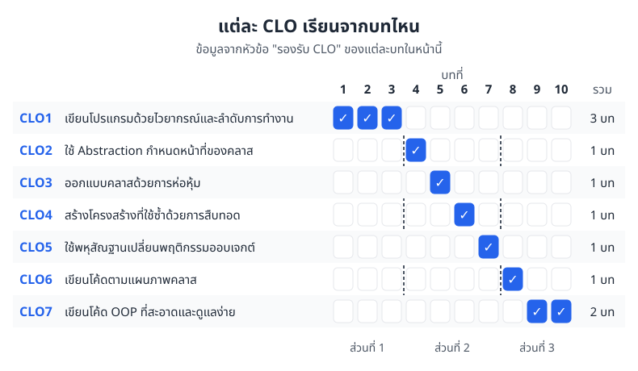
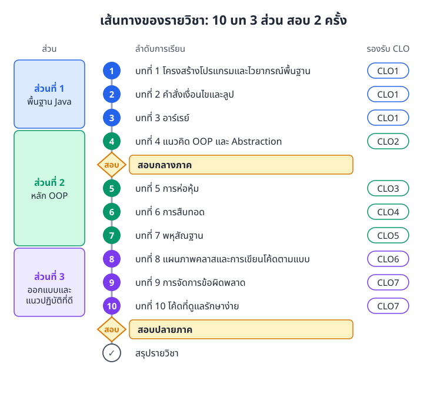

# Object-Oriented Programming (OOP) เวอร์ชัน 2

> วิชานี้พาเราจากการเขียนโปรแกรม Java พื้นฐาน ไปสู่การออกแบบโปรแกรมด้วยคลาสและออบเจกต์ (object)
> เรียนทั้งหมด 10 บท แบ่งเป็น 3 ส่วน มีสอบกลางภาคหลังบทที่ 4 และสอบปลายภาคหลังบทที่ 10

ถ้าอยากอ่านฉบับเดิม กลับไปที่ [เวอร์ชัน 1](../README.md) ได้เลย

## มีอะไรใหม่ในเวอร์ชัน 2

* **เขียนภาษาไทยใหม่ทั้งเล่ม** ให้อ่านเหมือนรุ่นพี่อธิบายให้ฟัง ไม่ใช่สำนวนแปล และใช้ศัพท์เทคนิคคำเดียวกันทุกบท
* **มีภาพทุกบท** ทั้งแผนภาพอธิบายกลไก (เช่น ตัวแปรชี้ไปที่ออบเจกต์อย่างไร) และแผนภูมิสรุปข้อมูล
* **แบบฝึกหัดมีเฉลยแบบพับได้** กดเปิดดูเมื่อลองทำเองเสร็จแล้ว จะได้ไม่เผลอเห็นคำตอบก่อน
* โค้ดตัวอย่างทุกชิ้นที่ยาวพอจะรันได้ ผ่านการคอมไพล์และรันจริง ผลลัพธ์ที่แสดงในบทตรงกับที่เครื่องพิมพ์ออกมา

## ผลลัพธ์การเรียนรู้ระดับรายวิชา (Course Learning Outcomes)

เรียนจบวิชานี้แล้ว เราจะทำสิ่งต่อไปนี้ได้

| CLO | ทำอะไรได้ | ภาษาอังกฤษ |
|---|---|---|
| **CLO1** | เขียนโปรแกรมที่ถูกต้องด้วยไวยากรณ์พื้นฐานและการควบคุมลำดับการทำงาน (control flow) | Write correct programs using basic syntax + control flow |
| **CLO2** | ใช้ Abstraction กำหนดว่าแต่ละคลาสรับผิดชอบเรื่องอะไร | Apply abstraction to define class responsibilities |
| **CLO3** | ใช้การห่อหุ้มและการควบคุมสิทธิ์การเข้าถึงในการออกแบบคลาส | Use encapsulation and access control in class design |
| **CLO4** | สร้างโครงสร้างที่นำกลับมาใช้ซ้ำได้ด้วยการสืบทอด | Build reusable structures using inheritance |
| **CLO5** | ใช้พหุสัณฐานให้ออบเจกต์แต่ละแบบทำงานต่างกันได้ | Implement polymorphism to vary object behavior |
| **CLO6** | เขียนโค้ดตามแผนภาพคลาส | Code according to class diagrams |
| **CLO7** | พัฒนาซอฟต์แวร์แบบ OOP ที่สะอาด ถูกต้อง และดูแลรักษาง่าย | Develop clean, correct, maintainable OOP software |

แต่ละ CLO มีบทที่ปูพื้นให้โดยตรง ดูได้จากภาพที่ 0.1 ส่วนที่ 1 รองรับ CLO1 ทั้งหมด ส่วนที่ 2 แบ่งให้ CLO2 ถึง CLO5 บทละหนึ่ง CLO และส่วนที่ 3 รองรับ CLO6 กับ CLO7



*ภาพที่ 0.1 แต่ละ CLO เรียนจากบทไหน (ข้อมูลจากบรรทัด "รองรับ CLO" ของแต่ละบทด้านล่าง)*

## เส้นทางของรายวิชา

ภาพที่ 0.2 คือลำดับการเรียนทั้งเทอม อ่านจากบนลงล่าง บทที่ 1 ถึง 3 ปูพื้น Java ให้แน่นก่อน บทที่ 4 เริ่มคิดแบบ OOP แล้วสอบกลางภาค จากนั้นบทที่ 5 ถึง 7 เรียนหลัก OOP ที่เหลือ และบทที่ 8 ถึง 10 เรียนวิธีออกแบบและเขียนโค้ดให้ดูแลง่าย ก่อนสอบปลายภาค



*ภาพที่ 0.2 เส้นทางของรายวิชา สีของวงกลมบอกว่าบทนั้นอยู่ส่วนไหน*

## โครงสร้างเนื้อหา

### ส่วนที่ 1: พื้นฐาน Java

#### [บทที่ 1: โครงสร้างโปรแกรมและไวยากรณ์พื้นฐานของ Java](01-java-basics.md)

* โครงสร้างโปรแกรม Java
* ตัวแปร (variable) และชนิดข้อมูล (data type)
* รับค่าจากผู้ใช้และแสดงผล (input/output)
* ตัวดำเนินการ (operator) ทางคณิตศาสตร์ การเปรียบเทียบ และตรรกะ
* **รองรับ CLO1**

#### [บทที่ 2: คำสั่งเงื่อนไขและลูป](02-control-flow.md)

* คำสั่งเงื่อนไข (conditional statement) `if` `else` `switch`
* ลูป (loop) `for` `while` `do-while`
* `break` และ `continue`
* **รองรับ CLO1**

#### [บทที่ 3: อาร์เรย์](03-arrays.md)

* ประกาศและใช้งานอาร์เรย์ (array)
* จัดการข้อมูลในอาร์เรย์
* อาร์เรย์หลายมิติ
* **รองรับ CLO1**

### ส่วนที่ 2: หลักการพื้นฐานของ OOP

#### [บทที่ 4: เริ่มต้น OOP และ Abstraction](04-oop-abstraction.md)

* OOP คืออะไร
* หลักการ Abstraction
* กำหนดหน้าที่ความรับผิดชอบของคลาส (class)
* คลาสและออบเจกต์เบื้องต้น
* **รองรับ CLO2**

#### [แนวข้อสอบกลางภาค (Midterm Exam Guideline)](midterm-exam-guideline.md)

#### [บทที่ 5: การห่อหุ้ม (Encapsulation)](05-encapsulation.md)

* การห่อหุ้ม (encapsulation) คืออะไร
* ตัวกำหนดสิทธิ์การเข้าถึง (access modifier) `public` `private` `protected` และแบบไม่ระบุ (default)
* getter และ setter
* ออกแบบคลาสให้ดี
* **รองรับ CLO3**

#### [บทที่ 6: การสืบทอด (Inheritance)](06-inheritance.md)

* การสืบทอด (inheritance) คืออะไร
* คลาสแม่และคลาสลูก (superclass / subclass)
* keyword `extends`
* นำโค้ดกลับมาใช้ซ้ำ (code reusability)
* **รองรับ CLO4**

#### [บทที่ 7: พหุสัณฐาน (Polymorphism)](07-polymorphism.md)

* พหุสัณฐาน (polymorphism) คืออะไร
* method overloading
* method overriding
* dynamic binding
* คลาสนามธรรม (abstract class) และอินเทอร์เฟซ (interface) เบื้องต้น
* **รองรับ CLO5**

### ส่วนที่ 3: การออกแบบและแนวปฏิบัติที่ดี

#### [บทที่ 8: แผนภาพคลาส (UML Class Diagram) และการเขียนโค้ดตามโมเดล](08-uml-diagrams.md)

* แผนภาพคลาส (UML class diagram) เบื้องต้น
* ความสัมพันธ์ระหว่างคลาส ได้แก่ association, inheritance และ composition
* อ่านและวาดแผนภาพคลาส
* เขียนโค้ดตามแผนภาพ (model-based coding)
* **รองรับ CLO6**

#### [บทที่ 9: การจัดการข้อผิดพลาด (Error Handling)](09-error-handling.md)

* บล็อก `try-catch`
* ชนิดของ exception
* แนวทางพื้นฐานในการรับมือข้อผิดพลาด
* **รองรับ CLO7**

#### [บทที่ 10: เขียนโค้ดให้ดูแลต่อได้ง่าย (Maintainable Code)](10-maintainable-code.md)

* หลักการเขียนโค้ดสะอาด (clean code)
* จัดระเบียบโค้ด
* การตั้งชื่อ (naming conventions)
* คอมเมนต์และเอกสารประกอบโค้ด
* ปรับปรุงโค้ดเบื้องต้น (refactoring)
* **รองรับ CLO7**

#### [แนวข้อสอบปลายภาค (Final Exam Guideline)](final-exam-guideline.md)

#### [สรุปรายวิชา](summary.md)

### ภาคผนวก

#### [ภาคผนวก ก: เครื่องมือนักพัฒนาสำหรับห้องแล็บ](lab-toolkit.md)

ใช้คู่กับวิชาปฏิบัติการวิศวกรรมคอมพิวเตอร์ 1 ที่เรียนภาคเดียวกัน ทุกหัวข้อใช้โจทย์คลาสคำนวณความต้านทานสมมูลของวงจรตัวต้านทาน

* หาบั๊กด้วย debugger: breakpoint แผง Variables และ call stack
* เขียนเทสต์ด้วย JUnit 5 แบบ Arrange-Act-Assert
* ใช้ Git: commit แตก branch แล้ว merge และแก้ conflict
* จัดโปรเจกต์ด้วย Maven หรือ Gradle และเพิ่มไลบรารีภายนอก
* อ่านได้หลังบทที่ 7 (ต้องรู้เรื่องการสืบทอดและพหุสัณฐานก่อน)

## ใช้เอกสารนี้อย่างไร

1. **อ่านตามลำดับ** เริ่มจากบทที่ 1 เพราะแต่ละบทต่อยอดจากบทก่อนหน้า
2. **ลองรันตัวอย่าง** ทุกบทมีโค้ด Java ที่คัดลอกไปรันได้ทันที
3. **แก้โค้ดเล่นเอง** เปลี่ยนค่า เพิ่มเงื่อนไข แล้วดูว่าผลเปลี่ยนไปอย่างไร วิธีนี้ช่วยให้จำได้นานกว่าอ่านอย่างเดียว
4. **เข้าใจหลัก อย่าท่องจำ** ถ้าอธิบายได้ว่าทำไมโค้ดทำงานแบบนั้น จะเอาไปใช้กับโจทย์ใหม่ได้เอง
5. **ทำแบบฝึกหัดก่อนเปิดเฉลย** เฉลยพับไว้ท้ายบท ลองคิดให้สุดก่อนแล้วค่อยกดดู

## ความรู้ที่ควรมีก่อนเรียน (Prerequisites)

* เคยเขียนโปรแกรมมาบ้าง
* เข้าใจเรื่องตัวแปร คำสั่งเงื่อนไข และลูป
* ติดตั้ง Java Development Kit (JDK) เวอร์ชัน 8 ขึ้นไป
* มีโปรแกรมสำหรับเขียน Java จะเป็น text editor หรือ IDE ก็ได้ (แนะนำ IntelliJ IDEA, Eclipse หรือ VS Code)

## คอมไพล์และรันโค้ด Java

```bash
# คอมไพล์ไฟล์ Java ได้ไฟล์ FileName.class
javac FileName.java

# รันโปรแกรม (พิมพ์ชื่อคลาส ไม่ต้องใส่ .class)
java FileName
```

ชื่อไฟล์ต้องตรงกับชื่อคลาสที่เป็น `public` ในไฟล์นั้น เช่น คลาส `public class Hello` ต้องอยู่ในไฟล์ `Hello.java`

## หมายเหตุจากผู้เขียน

เอกสารชุดนี้ทำขึ้นเพื่อการศึกษา ตั้งใจให้นักศึกษา ECP เข้าใจหลัก OOP และนำไปใช้ได้ถูกต้อง

***

**หมายเหตุ**: เนื้อหาเหมาะกับคนที่เพิ่งเริ่มเรียน OOP และคนที่อยากทบทวนพื้นฐาน
