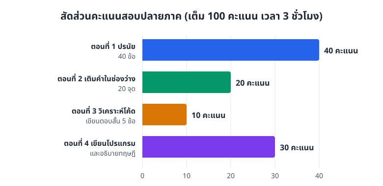
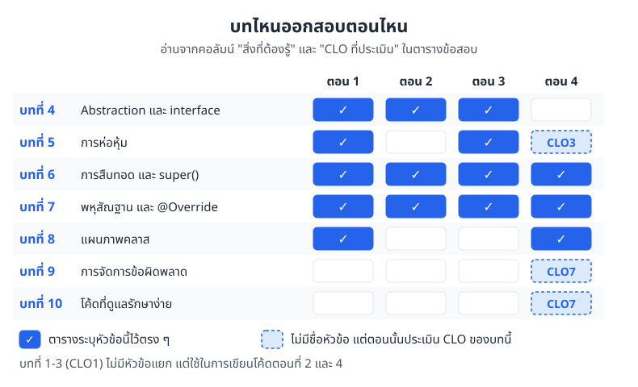

# แนวข้อสอบปลายภาค (Final Exam Guideline)

> ข้อสอบปลายภาคมี 4 ตอน รวม 100 คะแนน เวลา 3 ชั่วโมง
> เน้นอ่านโค้ดแล้วบอกได้ว่าทำงานอย่างไร และเข้าใจความสัมพันธ์ระหว่างคลาส มากกว่าท่องไวยากรณ์

## ข้อมูลการสอบ

* **วิชา** 31-407-101-105 / 31-407-102-201 การเขียนโปรแกรมเชิงวัตถุ (Object-Oriented Programming)
* **คะแนนเต็ม** 100 คะแนน
* **เวลาสอบ** 3 ชั่วโมง

ภาพที่ F.1 แสดงว่าคะแนนกระจายอยู่ตอนไหนบ้าง ตอนที่ 1 ปรนัยมีน้ำหนักมากที่สุด (40 คะแนน) รองลงมาคือตอนที่ 4 เขียนโปรแกรม (30 คะแนน) สองตอนนี้รวมกันได้ 70 คะแนน

*ภาพที่ F.1 สัดส่วนคะแนนของข้อสอบแต่ละตอน*

## เนื้อหาและ CLO ที่ประเมินในแต่ละตอน

| ตอน | หัวข้อหลัก | สิ่งที่ต้องรู้ | CLO ที่ประเมิน | รูปแบบข้อสอบ | คะแนน |
|---|---|---|---|---|---|
| 1 | ทฤษฎีและแนวคิด OOP (Conceptual Understanding & Tracing) | • การห่อหุ้ม (Encapsulation) โครงสร้างของคลาส (Class Anatomy) และตัวกำหนดสิทธิ์การเข้าถึง (Access Modifiers) • การสืบทอด (Inheritance) และการเรียกคอนสตรักเตอร์ต่อกันเป็นทอด ๆ (Constructor Chaining) ด้วย `super()` • พหุสัณฐาน (Polymorphism) และ Dynamic Binding • Abstraction และอินเทอร์เฟซ (Interfaces) • การอ่าน UML (Association, Composition, Aggregation, Multiplicity) | CLO2, CLO3, CLO4, CLO5 | ปรนัย (กากบาท) 40 ข้อ | 40 |
| 2 | เติมคำสั่งลงในโค้ด (Fill in the Blanks) | • เลือกคำสั่ง Java (`extends`, `implements`, `super`, `@Override`, `abstract`) ไปเติมในช่องว่าง • ใช้การสืบทอดและพหุสัณฐานกับสถานการณ์จริง | CLO1, CLO4, CLO5 | เติมคำในช่องว่าง 20 จุด | 20 |
| 3 | วิเคราะห์โค้ดตามหลัก OOP (OOP Pillars Analysis) | • ดูโค้ดที่กำหนดให้ แล้วบอกว่าตรงกับหลักข้อไหนใน 4 ข้อ (Encapsulation, Inheritance, Polymorphism, Abstraction) พร้อมอธิบายประโยชน์ | CLO2, CLO3, CLO4, CLO5 | เขียนตอบสั้น ๆ (5 ข้อ) | 10 |
| 4 | เขียนโปรแกรมและอธิบายทฤษฎี (Coding & Explanation) | • แปลงแผนภาพคลาส (UML Class Diagram) เป็นโค้ด Java • สืบทอดคลาส (Inheritance) และเขียนทับเมธอด (Method Overriding) • อธิบายความหมายและเขียนตัวอย่างโค้ดเรื่องพหุสัณฐาน (Polymorphism) | CLO1, CLO3, CLO4, CLO5, CLO6, CLO7 | เขียนโปรแกรมและอธิบาย | 30 |
| **รวม** | | | | | **100** |


ข้อสอบมีโจทย์ให้วิเคราะห์โค้ดเยอะ ให้เน้นทำความเข้าใจว่าโปรแกรมทำงานอย่างไรทีละบรรทัด (code tracing) และคลาสแต่ละตัวสัมพันธ์กันอย่างไร มากกว่าท่องจำไวยากรณ์


## บทไหนออกสอบตอนไหน

ภาพที่ F.2 เอาตารางด้านบนมาจับคู่กับบทเรียน ช่องทึบคือหัวข้อที่ตารางเขียนไว้ตรง ๆ ช่องเส้นประคือตอนที่ไม่มีชื่อหัวข้อของบทนั้น แต่ประเมิน CLO ของบทนั้นอยู่ เช่น ตอนที่ 4 ประเมิน CLO7 ซึ่งมาจากบทที่ 9 และ 10 โค้ดที่เขียนจึงต้องสะอาด อ่านง่าย และรับมือข้อผิดพลาดได้ด้วย

*ภาพที่ F.2 บทที่ 6 และ 7 (การสืบทอดและพหุสัณฐาน) ออกครบทั้ง 4 ตอน จึงควรทบทวนก่อน*

## เช็กลิสต์ทบทวนก่อนสอบ

ติ๊กข้อที่ทำได้แล้ว ข้อไหนยังไม่มั่นใจให้กลับไปอ่านบทนั้น

**บทที่ 4 Abstraction (ทบทวนประกอบ เพราะตอนที่ 1-3 ถามถึง)**

* [ ] บอกได้ว่าคลาสหนึ่งควรเก็บแอตทริบิวต์และเมธอดอะไร ตามระบบที่ใช้งาน
* [ ] รู้ว่า `interface` และ `abstract` ใช้บอกว่า "ต้องทำอะไร" โดยยังไม่บอกว่า "ทำอย่างไร" และใช้ `implements` กับอินเทอร์เฟซ

**บทที่ 5 การห่อหุ้ม**

* [ ] บอกได้ว่า `public` `private` `protected` และแบบไม่ระบุ (default) เข้าถึงได้จากที่ไหนบ้าง
* [ ] เขียน getter และ setter ที่ตรวจค่าก่อนเก็บได้
* [ ] ดูโค้ดแล้วชี้ได้ว่าส่วนไหนเป็นแอตทริบิวต์ คอนสตรักเตอร์ และเมธอด (class anatomy)

**บทที่ 6 การสืบทอด**

* [ ] เขียนคลาสลูกด้วย `extends` ได้
* [ ] ไล่ได้ว่าตอนสร้างออบเจกต์คลาสลูก คอนสตรักเตอร์ของคลาสแม่ทำงานเสร็จก่อนของคลาสลูกเสมอ
* [ ] ใช้ `super(...)` ส่งค่าไปให้คอนสตรักเตอร์ของคลาสแม่ได้
* [ ] ใช้ `super.methodName()` เรียกเมธอดของคลาสแม่ได้

**บทที่ 7 พหุสัณฐาน**

* [ ] override เมธอดพร้อมใส่ `@Override` ได้
* [ ] แยก overload กับ override ออก
* [ ] อ่านโค้ดแบบ `Animal a = new Dog();` แล้วบอกได้ว่าเรียก `a.makeSound()` จะได้ผลอะไร (dynamic binding)
* [ ] อธิบายพหุสัณฐานเป็นคำพูดของตัวเอง และยกตัวอย่างโค้ดประกอบได้

**บทที่ 8 แผนภาพคลาส**

* [ ] อ่านเครื่องหมาย `+` `-` `#` ในแผนภาพคลาสได้
* [ ] แยกเส้น association, inheritance, composition (เพชรทึบ) และ aggregation (เพชรโปร่ง) ได้
* [ ] อ่าน multiplicity เช่น `1`, `0..*`, `1..*` ได้
* [ ] แปลงแผนภาพคลาสเป็นโค้ด Java ได้ครบทั้งแอตทริบิวต์ เมธอด และความสัมพันธ์

**บทที่ 9 การจัดการข้อผิดพลาด**

* [ ] เขียน `try-catch` ครอบโค้ดที่อาจเกิด exception ได้
* [ ] บอกได้ว่าโปรแกรมทำงานต่อจากตรงไหนหลังเกิด exception

**บทที่ 10 โค้ดที่ดูแลรักษาง่าย**

* [ ] ตั้งชื่อคลาส เมธอด และตัวแปรตามแบบแผนของ Java
* [ ] แยกเมธอดให้แต่ละเมธอดทำงานเรื่องเดียว

## ข้อควรระวังตอนทำข้อสอบ

* **อ่านโค้ดทั้งหมดก่อนตอบ** โดยเฉพาะตอนที่ 1 และ 3 ดูให้ครบว่าคลาสไหน `extends` คลาสไหน และเมธอดไหนมีการ override
* **ตอนที่ 2 ดูบริบทรอบช่องว่าง** ถ้าคลาสต่อจากอินเทอร์เฟซให้ใช้ `implements` ถ้าต่อจากคลาสให้ใช้ `extends`
* **ตอนที่ 4 เขียนให้ตรงแผนภาพ** ชื่อคลาส ชื่อเมธอด ชนิดข้อมูล และตัวกำหนดสิทธิ์การเข้าถึงต้องตรงกับที่แผนภาพกำหนด
