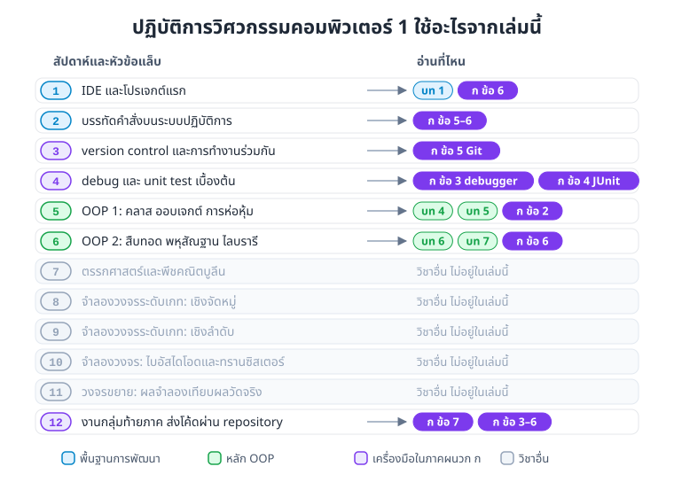
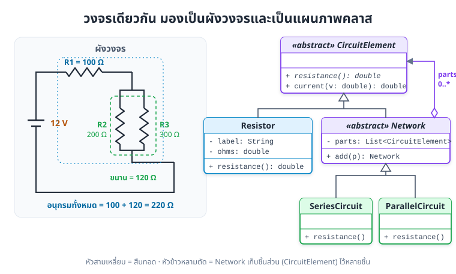
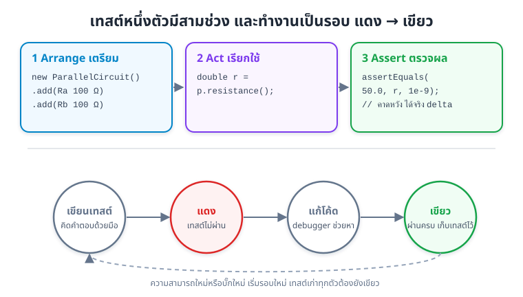
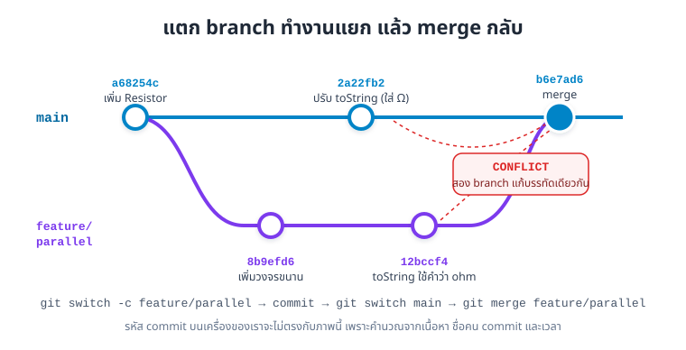
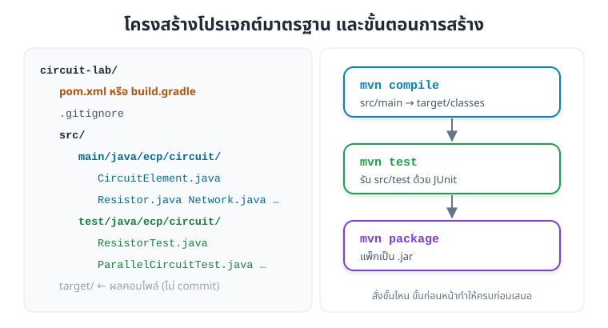

# ภาคผนวก ก: เครื่องมือนักพัฒนาสำหรับห้องแล็บ

> ภาคเรียนเดียวกับวิชานี้ เราเรียนปฏิบัติการวิศวกรรมคอมพิวเตอร์ 1 ด้วย ในห้องแล็บเราไม่ได้แค่เขียนโค้ดให้รันผ่าน แต่ต้องหาบั๊กให้เจอ เขียนเทสต์กันบั๊กกลับมา ส่งงานผ่าน repository และจัดโปรเจกต์ให้คนอื่นเปิดแล้วรันได้ทันที
> ภาคผนวกนี้สอนเครื่องมือสี่ตัวที่ใช้ทำงานพวกนั้น โดยใช้โจทย์เดียวตลอดทั้งบท คือคลาสคำนวณความต้านทานสมมูลของวงจรตัวต้านทาน

## สิ่งที่จะทำได้หลังอ่านภาคผนวกนี้

1. ใช้ debugger วาง breakpoint ดูค่าตัวแปร และไล่ call stack เพื่อหาว่าบั๊กเกิดที่บรรทัดไหน
2. เขียนเทสต์ด้วย JUnit 5 ตามรูปแบบ Arrange-Act-Assert และอ่านผลเทสต์ที่ไม่ผ่านได้
3. ใช้ Git commit งาน แตก branch แล้ว merge และแก้ conflict ได้
4. จัดโปรเจกต์ตามโครงสร้างของ Maven หรือ Gradle และเพิ่มไลบรารีภายนอกได้
5. ออกแบบคลาสวงจรไฟฟ้าที่ใช้การห่อหุ้ม การสืบทอด และพหุสัณฐานร่วมกัน

> **ต้องใช้ JDK 17 ขึ้นไป** โค้ดในภาคผนวกนี้ใช้ `List.copyOf(...)` ซึ่งมีตั้งแต่ JDK 10 และไฟล์ตั้งค่า Maven กับ Gradle ด้านล่างกำหนดไว้ที่ JDK 17

## 1. Lab 1 ใช้อะไรจากเล่มนี้บ้าง

หัวข้อปฏิบัติการวิศวกรรมคอมพิวเตอร์ 1 (31-407-101-106) มี 12 สัปดาห์ หกหัวข้อแรกเป็นงานซอฟต์แวร์ที่ต่อยอดจากวิชานี้โดยตรง ภาพที่ ก.1 จับคู่หัวข้อแล็บกับบทในเล่ม และบอกว่าหัวข้อไหนอ่านในภาคผนวกนี้



*ภาพที่ ก.1 หัวข้อแล็บแต่ละสัปดาห์ใช้บทไหนของเล่มนี้ (หัวข้อแล็บมาจากร่างหัวข้อปฏิบัติการของหลักสูตร ECP68 ซึ่งยังรอผู้รับผิดชอบรายวิชายืนยัน)*

| สัปดาห์ | หัวข้อแล็บ | อ่านที่ไหน |
|---|---|---|
| 1 | IDE และโปรเจกต์แรก | [บทที่ 1](01-java-basics.md) และข้อ 6 ของภาคผนวกนี้ |
| 2 | บรรทัดคำสั่งบนระบบปฏิบัติการ | ใช้ร่วมกับข้อ 5 และข้อ 6 |
| 3 | version control และการทำงานร่วมกัน | ข้อ 5 Git |
| 4 | debug และ unit test เบื้องต้น | ข้อ 3 debugger และข้อ 4 JUnit |
| 5 | OOP 1: คลาส ออบเจกต์ การห่อหุ้ม | [บทที่ 4](04-oop-abstraction.md) [บทที่ 5](05-encapsulation.md) และข้อ 2 |
| 6 | OOP 2: การสืบทอด พหุสัณฐาน ไลบรารี | [บทที่ 6](06-inheritance.md) [บทที่ 7](07-polymorphism.md) และข้อ 6 |
| 7-11 | ตรรกศาสตร์ วงจรดิจิทัล วงจรอิเล็กทรอนิกส์ | เป็นเนื้อหาของวิชาอื่น ไม่อยู่ในเล่มนี้ |
| 12 | งานกลุ่มท้ายภาค ส่งโค้ดผ่าน repository | ข้อ 7 ขั้นตอนทำงานครบรอบ |

## 2. โจทย์ประจำภาคผนวก: คลาสวงจรตัวต้านทาน

### 2.1 วงจรที่จะคำนวณ

นักศึกษาวิศวะคอมฯ คำนวณความต้านทานสมมูลด้วยมือกันมาแล้ว สูตรมีแค่สองข้อ

* **ต่ออนุกรม** ความต้านทานรวมคือผลบวก R = R1 + R2 + ... + Rn
* **ต่อขนาน** ส่วนกลับของความต้านทานรวมคือผลบวกของส่วนกลับ 1/R = 1/R1 + 1/R2 + ... + 1/Rn

วงจรตัวอย่างของเราคือ R1 = 100 Ω ต่ออนุกรมกับ R2 = 200 Ω ที่ขนานกับ R3 = 300 Ω คิดด้วยมือได้ว่า R2 ขนาน R3 เท่ากับ 1 / (1/200 + 1/300) = 120 Ω บวก R1 อีก 100 Ω ได้ **220 Ω** ถ้าจ่ายไฟ 12 V กระแสตามกฎของโอห์มคือ 12 / 220 = 0.05455 A หรือราว **54.55 mA**

ตัวเลขที่คิดด้วยมือนี้สำคัญ เพราะเราจะเอาไปเป็นค่าที่ถูกต้องในเทสต์ข้อ 4

### 2.2 ออกแบบคลาส

ถ้ามองแบบ OOP วงจรนี้มีของสามแบบ คือตัวต้านทานหนึ่งตัว กลุ่มที่ต่ออนุกรม และกลุ่มที่ต่อขนาน ทั้งสามแบบตอบคำถามเดียวกันได้ว่า "ความต้านทานรวมของเธอเท่าไร" แต่คิดคนละวิธี นี่คือที่ที่พหุสัณฐานจาก[บทที่ 7](07-polymorphism.md)เข้ามาช่วย



*ภาพที่ ก.2 วงจรตัวอย่าง (ซ้าย) กับแผนภาพคลาสที่ใช้แทนวงจร (ขวา) กลุ่มวงจรเก็บชิ้นส่วนเป็น `CircuitElement` จึงซ้อนกลุ่มในกลุ่มได้*

* `CircuitElement` เป็นคลาสนามธรรม (abstract class) ประกาศเมธอด `resistance()` ไว้ให้ลูกทุกตัวเขียนเอง และมี `current(voltage)` ที่ใช้กฎของโอห์มได้กับทุกชิ้น
* `Resistor` เก็บค่าความต้านทานแบบ `private final` และตรวจค่าในคอนสตรักเตอร์ ตามหลักการห่อหุ้มใน[บทที่ 5](05-encapsulation.md)
* `Network` เป็นคลาสแม่ของกลุ่มวงจร เก็บรายการชิ้นส่วนไว้ คลาสลูก `SeriesCircuit` กับ `ParallelCircuit` เขียน `resistance()` คนละสูตร
* `Network` เก็บชิ้นส่วนเป็น `CircuitElement` ไม่ใช่ `Resistor` จึงใส่กลุ่มวงจรซ้อนเข้าไปได้ วงจรตัวอย่างของเราคือกลุ่มอนุกรมที่มีกลุ่มขนานอยู่ข้างใน

### 2.3 โค้ด

ทุกไฟล์อยู่ในแพ็กเกจ `ecp.circuit` เพื่อให้ย้ายไปใส่โปรเจกต์ Maven หรือ Gradle ในข้อ 6 ได้ทันที

```java
// ไฟล์ src/main/java/ecp/circuit/CircuitElement.java
package ecp.circuit;

public abstract class CircuitElement {

    // ความต้านทานรวมของชิ้นนี้ หน่วยโอห์ม
    public abstract double resistance();

    // กฎของโอห์ม I = V / R ใช้ได้กับทุกชิ้น ไม่ว่าข้างในจะต่อแบบไหน
    public double current(double voltage) {
        return voltage / resistance();
    }
}
```

```java
// ไฟล์ src/main/java/ecp/circuit/Resistor.java
package ecp.circuit;

public final class Resistor extends CircuitElement {
    private final String label;
    private final double ohms;

    public Resistor(String label, double ohms) {
        if (ohms <= 0) {
            throw new IllegalArgumentException("ความต้านทานต้องมากกว่า 0 โอห์ม แต่ได้ " + ohms);
        }
        this.label = label;
        this.ohms = ohms;
    }

    public String getLabel() {
        return label;
    }

    @Override
    public double resistance() {
        return ohms;
    }

    @Override
    public String toString() {
        return label + "=" + ohms + "Ω";
    }
}
```

```java
// ไฟล์ src/main/java/ecp/circuit/Network.java
package ecp.circuit;

import java.util.ArrayList;
import java.util.List;

public abstract class Network extends CircuitElement {
    private final List<CircuitElement> parts = new ArrayList<>();

    // คืน this เพื่อให้เขียน add ต่อกันได้ เช่น new SeriesCircuit().add(r1).add(r2)
    public Network add(CircuitElement part) {
        parts.add(part);
        return this;
    }

    protected List<CircuitElement> parts() {
        return List.copyOf(parts);
    }
}
```

```java
// ไฟล์ src/main/java/ecp/circuit/SeriesCircuit.java
package ecp.circuit;

public class SeriesCircuit extends Network {

    // ต่ออนุกรม: R = R1 + R2 + ... + Rn
    @Override
    public double resistance() {
        double total = 0;
        for (CircuitElement part : parts()) {
            total += part.resistance();
        }
        return total;
    }
}
```

```java
// ไฟล์ src/main/java/ecp/circuit/ParallelCircuit.java
package ecp.circuit;

public class ParallelCircuit extends Network {

    // ต่อขนาน: 1/R = 1/R1 + 1/R2 + ... + 1/Rn
    @Override
    public double resistance() {
        if (parts().isEmpty()) {
            throw new IllegalStateException("วงจรขนานต้องมีอย่างน้อย 1 ชิ้น");
        }
        double sumOfInverse = 0;
        for (CircuitElement part : parts()) {
            sumOfInverse += 1 / part.resistance();
        }
        return 1 / sumOfInverse;
    }
}
```

```java
// ไฟล์ src/main/java/ecp/circuit/CircuitDemo.java
package ecp.circuit;

public class CircuitDemo {
    public static void main(String[] args) {
        Resistor r1 = new Resistor("R1", 100);
        Resistor r2 = new Resistor("R2", 200);
        Resistor r3 = new Resistor("R3", 300);

        // R1 อนุกรมกับ (R2 ขนาน R3)
        CircuitElement circuit = new SeriesCircuit()
                .add(r1)
                .add(new ParallelCircuit().add(r2).add(r3));

        System.out.println("อุปกรณ์: " + r1 + ", " + r2 + ", " + r3);
        System.out.printf("ความต้านทานสมมูล = %.1f Ω%n", circuit.resistance());
        System.out.printf("กระแสเมื่อจ่าย 12 V = %.2f mA%n", circuit.current(12) * 1000);
    }
}
```

คอมไพล์และรันจากโฟลเดอร์บนสุดของโปรเจกต์ (โฟลเดอร์ที่มี `src` อยู่ข้างใน)

```bash
javac -encoding UTF-8 -d out src/main/java/ecp/circuit/*.java
java -Dstdout.encoding=UTF-8 -cp out ecp.circuit.CircuitDemo
```

ผลรัน

```
อุปกรณ์: R1=100.0Ω, R2=200.0Ω, R3=300.0Ω
ความต้านทานสมมูล = 220.0 Ω
กระแสเมื่อจ่าย 12 V = 54.55 mA
```

ตรงกับที่คิดด้วยมือในข้อ 2.1 ทั้งสองค่า บรรทัด `circuit.resistance()` เรียกครั้งเดียว แต่ข้างในวิ่งไปทั้ง `SeriesCircuit.resistance()` และ `ParallelCircuit.resistance()` โดย `main` ไม่ต้องรู้เลยว่าวงจรต่อแบบไหน นี่คือ dynamic binding จาก[บทที่ 7](07-polymorphism.md)

## 3. Debugger: หยุดโปรแกรมกลางทางแล้วดูข้างใน

### 3.1 เมื่อผลผิดแต่ไม่มี error

สมมติว่าเพื่อนในกลุ่มพิมพ์ `ParallelCircuit` ผิดไปหนึ่งตัวอักษร ใช้ `=` แทน `+=`

```java
for (CircuitElement part : parts()) {
    sumOfInverse = 1 / part.resistance();   // บั๊ก: ควรเป็น +=
}
```

คอมไพล์ผ่าน รันได้ ไม่มี exception แต่ผลออกมาแบบนี้

```
อุปกรณ์: R1=100.0Ω, R2=200.0Ω, R3=300.0Ω
ความต้านทานสมมูล = 400.0 Ω
กระแสเมื่อจ่าย 12 V = 30.00 mA
```

400 Ω ไม่ตรงกับ 220 Ω ที่คิดด้วยมือ บั๊กแบบนี้หายากที่สุด เพราะไม่มีข้อความ error บอกบรรทัดให้ วิธีที่หลายคนทำคือแทรก `System.out.println` ไปทั่วโค้ด ใช้ได้แต่ช้า และต้องตามลบทีหลัง เครื่องมือที่ตรงงานกว่าคือ **debugger** ซึ่งหยุดโปรแกรมไว้ตรงบรรทัดที่เราเลือก แล้วให้เราดูค่าตัวแปรทุกตัวในตอนนั้น

### 3.2 สี่อย่างที่ต้องรู้

| คำ | ความหมาย |
|---|---|
| **breakpoint** | บรรทัดที่สั่งให้โปรแกรมหยุดก่อนทำบรรทัดนั้น คลิกที่ขอบซ้ายของบรรทัดจะขึ้นจุดสีแดง |
| **แผง Variables / Watch** | แผงที่แสดงค่าตัวแปรทุกตัวในเมธอดที่หยุดอยู่ เพิ่มนิพจน์ที่อยากดูเองได้ เช่น `1 / part.resistance()` |
| **call stack** | ลำดับเมธอดที่เรียกต่อกันมาจนถึงบรรทัดที่หยุด ตัวบนสุดคือเมธอดที่กำลังทำงาน (ทบทวนเรื่อง call stack ได้ใน[บทที่ 9](09-error-handling.md)) |
| **step** | สั่งให้โปรแกรมเดินต่อทีละนิด มีสามแบบตามตารางถัดไป |

ปุ่มลัดของ IDE ที่ใช้บ่อย

| ทำอะไร | VS Code | IntelliJ IDEA |
|---|---|---|
| เริ่มรันแบบ debug | F5 | Shift+F9 |
| วางหรือเอา breakpoint ออก | F9 | Ctrl+F8 |
| step over ทำบรรทัดนี้แล้วหยุดบรรทัดถัดไป ไม่เข้าไปในเมธอดที่เรียก | F10 | F8 |
| step into เข้าไปในเมธอดที่บรรทัดนี้เรียก | F11 | F7 |
| step out ทำเมธอดนี้ให้จบแล้วกลับไปหยุดที่คนเรียก | Shift+F11 | Shift+F8 |
| รันต่อจนถึง breakpoint ถัดไป | F5 | F9 |

> VS Code ต้องติดตั้ง Extension Pack for Java ก่อน ส่วน IntelliJ IDEA มี debugger มาในตัว

### 3.3 ไล่หาบั๊กทีละขั้น

**ขั้นที่ 1 หยุดให้ใกล้จุดที่สงสัย** ผลรวมผิด แต่ยังไม่รู้ว่าผิดที่อนุกรมหรือขนาน ให้วาง breakpoint ที่บรรทัด `System.out.printf("ความต้านทานสมมูล ...` ใน `main` แล้วกดรันแบบ debug

**ขั้นที่ 2 step into เข้าไปดู** โปรแกรมหยุดที่บรรทัดนั้น กด step into จะเข้าไปใน `SeriesCircuit.resistance()` กด step over ไปเรื่อย ๆ แล้วดูตัวแปร `total` รอบแรกได้ 100.0 ซึ่งถูก (R1) รอบที่สองกำลังจะเรียก `part.resistance()` ของกลุ่มขนาน ให้กด step into อีกครั้ง

**ขั้นที่ 3 ดู call stack** ตอนนี้แผง call stack แสดงสามชั้น

```
ParallelCircuit.resistance()   ← กำลังทำงานอยู่ตรงนี้
SeriesCircuit.resistance()
CircuitDemo.main(String[])
```

อ่านจากล่างขึ้นบนได้ว่า `main` เรียก `SeriesCircuit` แล้ว `SeriesCircuit` เรียก `ParallelCircuit` คลิกที่ชั้นไหนก็จะเห็นตัวแปรของชั้นนั้น

**ขั้นที่ 4 ดูค่าแต่ละรอบของลูป** step over ในลูปของ `ParallelCircuit` แล้วจดค่า `sumOfInverse` ไว้ทุกรอบ

| รอบ | `part` | `1 / part.resistance()` | `sumOfInverse` ที่ควรได้ | `sumOfInverse` ที่เห็นจริง |
|---|---|---|---|---|
| 1 | R2 (200 Ω) | 0.005 | 0.005 | 0.005 |
| 2 | R3 (300 Ω) | 0.003333 | 0.008333 | **0.003333** |

รอบที่ 2 ค่าไม่ได้บวกสะสม ค่าใหม่เขียนทับค่าเก่าไปเลย เราเจอบรรทัดที่ผิดแล้ว `1 / 0.003333` ได้ 300 พอบวก R1 อีก 100 จึงได้ 400 Ω ตรงกับผลที่ผิด



*ภาพที่ ก.3 ค่าในแผง Variables ระหว่างไล่ลูปของ `ParallelCircuit` เครื่องหมาย `=` ทำให้ค่ารอบแรกหายไป ส่วน `+=` เก็บค่าบวกสะสมไว้*

**ขั้นที่ 5 แก้แล้วยืนยัน** เปลี่ยน `=` เป็น `+=` รันใหม่ได้ 220.0 Ω แต่ยังไม่จบ ถ้าวันหน้ามีคนแก้โค้ดตรงนี้แล้วพลาดแบบเดิมอีก เราจะรู้ได้อย่างไร คำตอบอยู่ในข้อ 4

### 3.4 ทริคที่ช่วยให้เร็วขึ้น

* **conditional breakpoint** คลิกขวาที่ breakpoint แล้วใส่เงื่อนไข เช่น `part.resistance() > 250` โปรแกรมจะหยุดเฉพาะรอบที่เงื่อนไขเป็นจริง เหมาะกับลูปหลายร้อยรอบ
* **หยุดเมื่อเกิด exception** ตั้งให้ debugger หยุดทันทีที่มี exception ถูกโยน จะเห็นค่าตัวแปรตอนก่อนพังพอดี
* **แก้ค่าตัวแปรระหว่างหยุด** ในแผง Variables ดับเบิลคลิกแล้วพิมพ์ค่าใหม่ได้ ใช้ทดลองว่า "ถ้าค่านี้ถูก ผลจะถูกไหม" โดยไม่ต้องแก้โค้ดแล้วรันใหม่

## 4. JUnit: ให้เครื่องตรวจผลแทนตาเรา

### 4.1 ทำไมต้องเขียนเทสต์

ในข้อ 3 เราตรวจผลด้วยการดูตัวเลขบนจอแล้วเทียบกับที่คิดด้วยมือ ทำแบบนี้ได้ครั้งสองครั้ง แต่ถ้าโปรเจกต์มี 50 คลาส ทุกครั้งที่แก้โค้ดต้องรันแล้วไล่ดูตัวเลขทั้งหมดใหม่ ไม่มีใครทำไหว

**unit test** คือโค้ดที่เรียกเมธอดหนึ่งตัวด้วยข้อมูลที่รู้คำตอบอยู่แล้ว แล้วเทียบผลให้อัตโนมัติ เราเคยเขียนเทสต์แบบทำเองใน[บทที่ 10](10-maintainable-code.md) ข้อ 6.4 คราวนี้ใช้ **JUnit 5** ซึ่งเป็นไลบรารีทดสอบที่โปรเจกต์ Java เกือบทุกโปรเจกต์ใช้

### 4.2 เทสต์หนึ่งตัวหน้าตาเป็นอย่างไร

```java
// ไฟล์ src/test/java/ecp/circuit/ParallelCircuitTest.java
package ecp.circuit;

import static org.junit.jupiter.api.Assertions.assertEquals;
import static org.junit.jupiter.api.Assertions.assertThrows;

import org.junit.jupiter.api.Test;

class ParallelCircuitTest {

    @Test
    void twoEqualResistorsGiveHalf() {
        // Arrange: เตรียมวงจร
        Network p = new ParallelCircuit()
                .add(new Resistor("Ra", 100))
                .add(new Resistor("Rb", 100));

        // Act: เรียกเมธอดที่จะทดสอบ
        double r = p.resistance();

        // Assert: เทียบกับค่าที่คำนวณด้วยมือ
        assertEquals(50.0, r, 1e-9);
    }

    @Test
    void twoHundredParallelThreeHundredIs120() {
        Network p = new ParallelCircuit()
                .add(new Resistor("R2", 200))
                .add(new Resistor("R3", 300));

        assertEquals(120.0, p.resistance(), 1e-9);
    }

    @Test
    void emptyParallelCircuitIsAnError() {
        Network p = new ParallelCircuit();

        assertThrows(IllegalStateException.class, p::resistance);
    }
}
```

อ่านทีละส่วน

* **`@Test`** บอก JUnit ว่าเมธอดนี้เป็นเทสต์หนึ่งตัว เมธอดเทสต์ไม่ต้องเป็น `public` และไม่ต้องมี `main`
* **ชื่อเมธอดบอกว่าทดสอบอะไร** อ่านชื่อ `twoEqualResistorsGiveHalf` แล้วรู้เลยว่าคาดหวังอะไร พอเทสต์ไม่ผ่าน ชื่อนี้จะขึ้นในรายงาน
* **Arrange-Act-Assert** แบ่งเทสต์เป็นสามช่วง เตรียมข้อมูล เรียกเมธอด แล้วตรวจผล ภาพที่ ก.4 สรุปไว้
* **`assertEquals(คาดหวัง, ได้จริง, delta)`** ค่า `double` เทียบด้วย `==` ตรง ๆ ไม่ได้ เพราะทศนิยมในคอมพิวเตอร์มีเศษเล็ก ๆ เสมอ อาร์กิวเมนต์ตัวที่สาม (delta) บอกว่ายอมให้ต่างกันได้เท่าไร ในที่นี้ 1e-9 คือ 0.000000001
* **`assertThrows`** ตรวจว่าเมธอดโยน exception ชนิดที่คาดไว้ ใช้ทดสอบกรณีผิดพลาดที่ออกแบบไว้แล้ว (ทบทวนใน[บทที่ 9](09-error-handling.md))



*ภาพที่ ก.4 โครงเทสต์ Arrange-Act-Assert (บน) และรอบการทำงานกับเทสต์ แดงก่อน แก้จนเขียว แล้วเก็บเทสต์ไว้กันบั๊กกลับมา (ล่าง)*

เทสต์ของคลาสอื่นเขียนแบบเดียวกัน

```java
// ไฟล์ src/test/java/ecp/circuit/ResistorTest.java
package ecp.circuit;

import static org.junit.jupiter.api.Assertions.assertEquals;
import static org.junit.jupiter.api.Assertions.assertThrows;

import org.junit.jupiter.api.Test;

class ResistorTest {

    @Test
    void currentFollowsOhmsLaw() {
        Resistor r = new Resistor("R1", 100);

        double amps = r.current(12);

        assertEquals(0.12, amps, 1e-9);
    }

    @Test
    void rejectsZeroOhms() {
        assertThrows(IllegalArgumentException.class, () -> new Resistor("R0", 0));
    }

    @Test
    void rejectsNegativeOhms() {
        assertThrows(IllegalArgumentException.class, () -> new Resistor("Rx", -47));
    }
}
```

```java
// ไฟล์ src/test/java/ecp/circuit/SeriesCircuitTest.java
package ecp.circuit;

import static org.junit.jupiter.api.Assertions.assertEquals;

import org.junit.jupiter.api.Test;

class SeriesCircuitTest {

    @Test
    void seriesAddsUp() {
        Network s = new SeriesCircuit()
                .add(new Resistor("R1", 100))
                .add(new Resistor("R2", 220));

        assertEquals(320.0, s.resistance(), 1e-9);
    }

    @Test
    void mixedNetworkFromDemo() {
        CircuitElement circuit = new SeriesCircuit()
                .add(new Resistor("R1", 100))
                .add(new ParallelCircuit()
                        .add(new Resistor("R2", 200))
                        .add(new Resistor("R3", 300)));

        assertEquals(220.0, circuit.resistance(), 1e-9);
        assertEquals(54.545, circuit.current(12) * 1000, 0.001);
    }
}
```

### 4.3 รันเทสต์และอ่านผล

ใน IDE กดไอคอนสามเหลี่ยมข้างชื่อคลาสหรือเมธอดเทสต์ ถ้าใช้ Maven หรือ Gradle สั่ง `mvn test` หรือ `gradle test` (ข้อ 6)

ถ้ารันเทสต์ทั้งแปดตัวกับโค้ดที่มีบั๊ก `=` จากข้อ 3 จะผ่าน 5 ตัว ไม่ผ่าน 3 ตัว รายงานบอกแบบนี้

```
twoEqualResistorsGiveHalf()            expected: <50.0> but was: <100.0>
twoHundredParallelThreeHundredIs120()  expected: <120.0> but was: <300.0>
mixedNetworkFromDemo()                 expected: <220.0> but was: <400.0>
```

อ่านได้ทันทีว่าเทสต์ที่พังเกี่ยวกับวงจรขนานทั้งหมด ส่วนเทสต์ของ `Resistor` และ `seriesAddsUp` ผ่าน แปลว่าบั๊กไม่ได้อยู่ที่ตัวต้านทานหรือการต่ออนุกรม รายงานนี้บีบให้เหลือที่ต้องไปดูแค่ `ParallelCircuit` ก่อนจะเปิด debugger ด้วยซ้ำ

แก้ `=` เป็น `+=` แล้วรันใหม่ เทสต์ผ่านครบ 8 ตัว ตั้งแต่นี้ไป ถ้าใครพิมพ์ผิดแบบเดิมอีก เทสต์จะแดงทันที

> รายงานจริงของแต่ละเครื่องมือจัดหน้าไม่เหมือนกัน แต่ข้อความ `expected: <...> but was: <...>` เป็นของ JUnit เอง จึงเหมือนกันทุกที่ ข้อความข้างบนตัดมาเฉพาะชื่อเทสต์กับข้อความนี้

### 4.4 เลือกกรณีทดสอบอย่างไร

เทสต์ที่ดีไม่ได้วัดกันที่จำนวน แต่วัดว่าครอบคลุมกรณีที่น่าจะพังหรือเปล่า ลองไล่ตามรายการนี้

* **กรณีปกติที่คิดมือได้** เช่น 100 ขนาน 100 ได้ 50
* **edge case** เช่น วงจรขนานที่มีตัวต้านทานตัวเดียว วงจรว่าง
* **ค่าที่ต้องปฏิเสธ** เช่น ความต้านทาน 0 หรือติดลบ
* **บั๊กที่เคยเจอแล้ว** ทุกครั้งที่แก้บั๊ก ให้เพิ่มเทสต์ที่จับบั๊กนั้นได้ เทสต์แบบนี้เรียกว่า regression test

## 5. Git: บันทึกทุกก้าว และทำงานกลุ่มใน repository เดียวกัน

### 5.1 ปัญหาที่ Git แก้

ใครเคยมีไฟล์ชื่อ `Lab5_final.java`, `Lab5_final2.java`, `Lab5_final_จริงๆ.java` บ้าง ปัญหาจะหนักขึ้นตอนทำงานกลุ่ม เพราะต้องส่งไฟล์ไปมาทางแชท แล้วไม่รู้ว่าใครแก้อะไรไปบ้าง

**Git** เป็นเครื่องมือ version control ที่จำทุกการเปลี่ยนแปลงไว้เป็น **commit** แต่ละ commit บอกว่าใครแก้ แก้เมื่อไร แก้อะไร และย้อนกลับไปเวอร์ชันไหนก็ได้ ส่วน GitHub หรือ GitLab เป็นบริการเก็บ repository ไว้บนอินเทอร์เน็ตให้ทั้งกลุ่มใช้ร่วมกัน

### 5.2 ตั้งค่าครั้งแรก

ทำครั้งเดียวต่อเครื่อง บอก Git ว่าเราชื่ออะไร ชื่อนี้จะติดไปกับทุก commit

```bash
git config --global user.name "Somchai Jaidee"
git config --global user.email "somchai@example.com"
```

### 5.3 สร้าง repository และ commit แรก

```bash
git init -b main circuit-lab
cd circuit-lab
```

ก่อน commit อะไร ให้สร้างไฟล์ `.gitignore` บอกว่าไฟล์ไหนไม่ต้องเก็บ ไฟล์ที่สร้างใหม่ได้จากซอร์สโค้ดไม่ควรอยู่ใน repository

```
target/
build/
*.class
.idea/
```

`target/` คือโฟลเดอร์ผลคอมไพล์ของ Maven ส่วน `build/` เป็นของ Gradle และ `.idea/` เป็นการตั้งค่าส่วนตัวของ IntelliJ

วางไฟล์ `CircuitElement.java` กับ `Resistor.java` ไว้ใน `src/main/java/ecp/circuit/` แล้วดูสถานะ

```bash
git status --short
```

```
?? .gitignore
?? src/
```

`??` แปลว่า Git ยังไม่ได้ติดตามไฟล์นี้ ต่อไปเลือกไฟล์ที่จะบันทึก (`add`) แล้วบันทึกพร้อมข้อความ (`commit`)

```bash
git add .
git commit -m "เพิ่มคลาส Resistor และ CircuitElement"
```

```
[main (root-commit) a68254c] เพิ่มคลาส Resistor และ CircuitElement
 3 files changed, 44 insertions(+)
 create mode 100644 .gitignore
 create mode 100644 src/main/java/ecp/circuit/CircuitElement.java
 create mode 100644 src/main/java/ecp/circuit/Resistor.java
```

`a68254c` คือรหัสของ commit นี้ เครื่องของเราจะได้รหัสอื่น เพราะรหัสคำนวณจากเนื้อหา ชื่อคน และเวลา

> ข้อความ commit ควรบอกว่า "เปลี่ยนอะไร" ในหนึ่งบรรทัด เช่น "เพิ่มวงจรขนาน" อย่าเขียนแค่ "แก้" หรือ "update" เพราะอีกสองสัปดาห์เราจะจำไม่ได้ว่าแก้อะไร

### 5.4 แตก branch ทำงานแยก แล้ว merge กลับ

**branch** คือเส้นงานที่แยกออกมาจากเส้นหลัก ทำงานใหม่ใน branch ของตัวเองได้โดยไม่กระทบ `main` พอเสร็จแล้วค่อย merge กลับ ทำแบบนี้เพื่อนในกลุ่มจะทำงานพร้อมกันได้คนละ branch

```bash
git switch -c feature/parallel     # สร้าง branch ใหม่แล้วย้ายไปอยู่ branch นั้น
# ... เพิ่มไฟล์ Network.java และ ParallelCircuit.java ...
git add .
git commit -m "เพิ่มวงจรขนาน"
```

ระหว่างนั้น อีกคนในกลุ่มแก้ `toString()` ของ `Resistor` บน `main` และเจ้าของ branch `feature/parallel` ก็บังเอิญแก้บรรทัดเดียวกันใน branch ของตัวเอง

```bash
git switch main
# แก้ toString เป็น label + " (" + ohms + " Ω)"
git commit -am "ปรับรูปแบบ toString ของ Resistor"
```

(`-am` คือ add ไฟล์ที่ Git ติดตามอยู่แล้วทุกไฟล์ แล้ว commit ในคำสั่งเดียว)

### 5.5 แก้ conflict

พอสั่ง merge แล้ว Git รวมไฟล์ใหม่สองไฟล์ให้ได้เอง แต่บรรทัดที่ทั้งสองฝั่งแก้ไม่เหมือนกัน Git ไม่รู้จะเลือกของใคร จึงหยุดถามเรา

```bash
git switch main
git merge feature/parallel
```

```
Auto-merging src/main/java/ecp/circuit/Resistor.java
CONFLICT (content): Merge conflict in src/main/java/ecp/circuit/Resistor.java
Automatic merge failed; fix conflicts and then commit the result.
```

```bash
git status --short
```

```
A  src/main/java/ecp/circuit/Network.java
A  src/main/java/ecp/circuit/ParallelCircuit.java
UU src/main/java/ecp/circuit/Resistor.java
```

`A` คือไฟล์ที่รวมเข้ามาเรียบร้อย `UU` คือไฟล์ที่ยังขัดกันอยู่ เปิด `Resistor.java` จะเห็นเครื่องหมายที่ Git ใส่ไว้

```java
    public String toString() {
<<<<<<< HEAD
        return label + " (" + ohms + " Ω)";
=======
        return label + ": " + ohms + " ohm";
>>>>>>> feature/parallel
    }
```

ส่วนระหว่าง `<<<<<<< HEAD` กับ `=======` คือของ branch ที่เรายืนอยู่ (`main`) ส่วนระหว่าง `=======` กับ `>>>>>>>` คือของ branch ที่ merge เข้ามา งานของเราคือคุยกับเพื่อนแล้วเขียนบรรทัดที่ถูกต้องแทนทั้งก้อน **ลบเครื่องหมายทั้งสามบรรทัดออกให้หมด** ไม่งั้นจะคอมไพล์ไม่ผ่าน

```java
    public String toString() {
        return label + " (" + ohms + " ohm)";
    }
```

แล้วบอก Git ว่าแก้เสร็จ

```bash
git add src/main/java/ecp/circuit/Resistor.java
git commit --no-edit
git log --oneline --graph --all
```

```
*   b6e7ad6 Merge branch 'feature/parallel'
|\
| * 12bccf4 toString แบบไม่ใช้สัญลักษณ์โอเมก้า
| * 8b9efd6 เพิ่มวงจรขนาน
* | 2a22fb2 ปรับรูปแบบ toString ของ Resistor
|/
* a68254c เพิ่มคลาส Resistor และ CircuitElement
```



*ภาพที่ ก.5 ประวัติ commit จากตัวอย่างข้อ 5.3 ถึง 5.5 branch แยกออกจาก `main` แล้ว merge กลับพร้อมแก้ conflict หนึ่งจุด*

### 5.6 ทำงานกับ repository บน GitHub

repository ของกลุ่มอยู่บน GitHub ทุกคนทำงานบนเครื่องตัวเองแล้วส่งขึ้นไปรวมกัน คำสั่งที่ใช้ประจำมีสี่ตัว

| คำสั่ง | ทำอะไร |
|---|---|
| `git clone <url>` | ดึง repository ทั้งก้อนลงเครื่องครั้งแรก |
| `git pull` | ดึง commit ใหม่ของเพื่อนลงมารวมกับของเรา |
| `git push -u origin feature/parallel` | ส่ง branch ของเราขึ้นไป `-u` ใส่ครั้งแรกครั้งเดียว ครั้งต่อไปสั่งแค่ `git push` |
| เปิด pull request บนเว็บ | ขอ merge branch เข้า `main` ให้เพื่อนอ่านโค้ดก่อนกด merge |

ลำดับที่ใช้ทุกวัน: `git pull` ก่อนเริ่มงาน ทำงานใน branch ของตัวเอง commit บ่อย ๆ ทีละเรื่องเล็ก แล้ว `git push` ก่อนเลิกงาน

## 6. Maven และ Gradle: จัดโปรเจกต์ให้ใครเปิดก็รันได้

### 6.1 build tool แก้ปัญหาอะไร

เทสต์ในข้อ 4 ต้องใช้ไลบรารี JUnit ถ้าคอมไพล์เองด้วย `javac` เราต้องไปดาวน์โหลดไฟล์ `.jar` ของ JUnit มาเจ็ดไฟล์ แล้วพิมพ์ classpath ยาวเหยียดทุกครั้ง พอส่งงานให้เพื่อน เพื่อนก็ต้องทำแบบเดียวกันอีกรอบ

**build tool** อย่าง Maven และ Gradle แก้เรื่องนี้ เราเขียนแค่ว่าโปรเจกต์ต้องใช้ไลบรารีอะไร เวอร์ชันไหน build tool จะดาวน์โหลดไลบรารีนั้นพร้อม transitive dependency (ไลบรารีที่ไลบรารีนั้นต้องใช้อีกที) ให้เองจาก Maven Central แล้วคอมไพล์ รันเทสต์ และแพ็กเป็นไฟล์ `.jar` ให้ด้วยคำสั่งเดียว

ทั้งสองตัวทำงานเหมือนกันเกือบทั้งหมด ต่างกันที่ไฟล์ตั้งค่า Maven ใช้ XML ส่วน Gradle ใช้ภาษาสคริปต์ที่สั้นกว่า เลือกตัวที่ห้องแล็บใช้ก็พอ

### 6.2 โครงสร้างโฟลเดอร์มาตรฐาน

Maven และ Gradle ใช้โครงสร้างเดียวกัน ถ้าวางไฟล์ตามนี้ ไม่ต้องตั้งค่าอะไรเพิ่ม

```
circuit-lab/
├── pom.xml              ← ไฟล์ตั้งค่า Maven (หรือ build.gradle ถ้าใช้ Gradle)
├── .gitignore
└── src/
    ├── main/java/ecp/circuit/    ← โค้ดโปรแกรม
    │   ├── CircuitElement.java
    │   ├── Resistor.java
    │   ├── Network.java
    │   ├── SeriesCircuit.java
    │   ├── ParallelCircuit.java
    │   └── CircuitDemo.java
    └── test/java/ecp/circuit/    ← โค้ดเทสต์ แพ็กเกจเดียวกับโค้ดที่ทดสอบ
        ├── ResistorTest.java
        ├── SeriesCircuitTest.java
        └── ParallelCircuitTest.java
```

โฟลเดอร์ใต้ `java/` ต้องตรงกับชื่อแพ็กเกจ แพ็กเกจ `ecp.circuit` จึงอยู่ใน `ecp/circuit/` เทสต์อยู่แพ็กเกจเดียวกับโค้ดที่ทดสอบ แต่แยกโฟลเดอร์ ไฟล์เทสต์จึงไม่ติดไปกับโปรแกรมตอนแพ็กเป็น `.jar`



*ภาพที่ ก.6 โครงสร้างโฟลเดอร์มาตรฐาน (ซ้าย) และขั้นตอนหลักของการสร้างโปรเจกต์ (ขวา) สั่งขั้นไหน เครื่องมือจะทำขั้นก่อนหน้าให้ครบก่อน*

### 6.3 Maven: ไฟล์ `pom.xml`

```xml
<?xml version="1.0" encoding="UTF-8"?>
<project xmlns="http://maven.apache.org/POM/4.0.0"
         xmlns:xsi="http://www.w3.org/2001/XMLSchema-instance"
         xsi:schemaLocation="http://maven.apache.org/POM/4.0.0 https://maven.apache.org/xsd/maven-4.0.0.xsd">
    <modelVersion>4.0.0</modelVersion>

    <!-- ชื่อเต็มของโปรเจกต์เรา: groupId artifactId version -->
    <groupId>th.ac.rmuti.ecp</groupId>
    <artifactId>circuit-lab</artifactId>
    <version>1.0-SNAPSHOT</version>

    <properties>
        <maven.compiler.release>17</maven.compiler.release>
        <project.build.sourceEncoding>UTF-8</project.build.sourceEncoding>
    </properties>

    <dependencies>
        <!-- JUnit 5 ใช้เฉพาะตอนรันเทสต์ จึงเป็น scope test -->
        <dependency>
            <groupId>org.junit.jupiter</groupId>
            <artifactId>junit-jupiter</artifactId>
            <version>5.10.1</version>
            <scope>test</scope>
        </dependency>
    </dependencies>

    <build>
        <plugins>
            <!-- ตัวรันเทสต์ของ Maven เวอร์ชัน 3 ขึ้นไปรู้จัก JUnit 5 -->
            <plugin>
                <groupId>org.apache.maven.plugins</groupId>
                <artifactId>maven-surefire-plugin</artifactId>
                <version>3.2.5</version>
            </plugin>
        </plugins>
    </build>
</project>
```

ไลบรารีทุกตัวบน Maven Central ระบุด้วยชื่อสามส่วน **groupId : artifactId : version** เช่น `org.junit.jupiter:junit-jupiter:5.10.1` อยากใช้ไลบรารีไหน ค้นชื่อเต็มได้ที่ [central.sonatype.com](https://central.sonatype.com) แล้วเพิ่ม `<dependency>` อีกก้อน

คำสั่งที่ใช้บ่อย สั่งจากโฟลเดอร์ที่มี `pom.xml`

| คำสั่ง | ทำอะไร |
|---|---|
| `mvn compile` | คอมไพล์โค้ดใน `src/main/java` ไปไว้ที่ `target/classes` |
| `mvn test` | คอมไพล์ แล้วรันเทสต์ทุกตัวใน `src/test/java` |
| `mvn package` | คอมไพล์ รันเทสต์ แล้วแพ็กเป็น `target/circuit-lab-1.0-SNAPSHOT.jar` ถ้ามีเทสต์ไม่ผ่านจะไม่แพ็กให้ |
| `mvn clean` | ลบโฟลเดอร์ `target` ทิ้ง ใช้เมื่อผลคอมไพล์เก่าค้างจนงง |

### 6.4 Gradle: ไฟล์ `build.gradle`

ถ้าห้องแล็บใช้ Gradle ใช้ไฟล์นี้แทน `pom.xml` (เขียนด้วยภาษา Groovy)

```groovy
plugins {
    id 'java'
}

group = 'th.ac.rmuti.ecp'
version = '1.0-SNAPSHOT'

repositories {
    mavenCentral()      // ดาวน์โหลดไลบรารีจาก Maven Central ที่เดียวกับ Maven
}

dependencies {
    testImplementation 'org.junit.jupiter:junit-jupiter:5.10.1'
    testRuntimeOnly 'org.junit.platform:junit-platform-launcher'
}

java {
    toolchain {
        languageVersion = JavaLanguageVersion.of(17)
    }
}

tasks.named('test') {
    useJUnitPlatform()  // บอก Gradle ให้รันเทสต์ด้วย JUnit 5
}
```

`testImplementation` ตรงกับ `<scope>test</scope>` ของ Maven ถ้าเป็นไลบรารีที่โค้ดโปรแกรมใช้ด้วย ให้ใช้ `implementation` แทน คำสั่งที่ใช้บ่อยคือ `gradle build` (คอมไพล์ รันเทสต์ แพ็ก) `gradle test` และ `gradle clean` ผลทั้งหมดอยู่ในโฟลเดอร์ `build/`

### 6.5 wrapper: ไม่ต้องติดตั้ง Maven หรือ Gradle ก็รันได้

โปรเจกต์ส่วนใหญ่มีไฟล์ `mvnw` หรือ `gradlew` มาด้วย ไฟล์นี้เรียกว่า wrapper พอสั่งครั้งแรก มันจะดาวน์โหลดเครื่องมือเวอร์ชันที่โปรเจกต์กำหนดมาให้เอง ทุกคนในกลุ่มจึงใช้เวอร์ชันเดียวกัน

```bash
./mvnw test          # macOS, Linux, Git Bash
mvnw.cmd test        # Command Prompt หรือ PowerShell บน Windows
./gradlew test       # ของ Gradle ใช้แบบเดียวกัน
```

ถ้าสร้างโปรเจกต์ผ่าน IntelliJ IDEA (New Project แล้วเลือก Build system เป็น Maven หรือ Gradle) หรือผ่าน VS Code (คำสั่ง Java: Create Java Project) IDE จะสร้างโครงสร้างโฟลเดอร์และ wrapper ให้ครบ เราแค่ย้ายไฟล์ `.java` ไปวางให้ถูกโฟลเดอร์

> ไฟล์ `mvnw`, `gradlew` และโฟลเดอร์ `.mvn/` หรือ `gradle/` ต้อง commit เข้า Git ด้วย ส่วน `target/` กับ `build/` ห้าม commit (มีใน `.gitignore` แล้วตั้งแต่ข้อ 5.3)

## 7. ขั้นตอนทำงานครบรอบ: งานกลุ่มท้ายภาค

งานกลุ่มสัปดาห์ที่ 12 ของ Lab 1 ใช้ทุกเครื่องมือในภาคผนวกนี้ร่วมกัน ถ้าทำตามลำดับนี้ทุกครั้งที่เพิ่มความสามารถใหม่ งานกลุ่มจะไม่พังตอนรวม

1. `git pull` ให้ `main` บนเครื่องเป็นเวอร์ชันล่าสุด
2. `git switch -c feature/<ชื่องาน>` แตก branch ใหม่
3. เขียนเทสต์ของความสามารถใหม่ก่อน รันแล้วต้องเห็นสีแดง (ยังไม่มีโค้ด เทสต์ต้องไม่ผ่าน)
4. เขียนโค้ดจนเทสต์เขียว ถ้าติดตรงไหนให้เปิด debugger อย่าเดา
5. `mvn test` หรือ `gradle test` รันเทสต์ทั้งโปรเจกต์ ของเดิมต้องไม่พัง
6. `git add` แล้ว `git commit` พร้อมข้อความที่บอกว่าเปลี่ยนอะไร
7. `git push` แล้วเปิด pull request ให้เพื่อนในกลุ่มอ่านก่อนรวมเข้า `main`

## ข้อผิดพลาดที่เจอบ่อย

| อาการ | สาเหตุ | วิธีแก้ |
|---|---|---|
| กด debug แล้วโปรแกรมรันจบเลย ไม่หยุด | กดรันแบบปกติ หรือ breakpoint อยู่บรรทัดที่ไม่เคยถูกทำ | ใช้ปุ่ม Debug ไม่ใช่ Run แล้วตรวจว่าโปรแกรมผ่านบรรทัดนั้นจริง |
| `assertEquals` ไม่ผ่านทั้งที่ค่าดูเหมือนกัน เช่น 0.30000000000000004 กับ 0.3 | เทียบ `double` โดยไม่ใส่ delta | ใส่อาร์กิวเมนต์ตัวที่สาม เช่น `assertEquals(0.3, x, 1e-9)` |
| `package org.junit.jupiter.api does not exist` | ยังไม่ได้เพิ่ม JUnit ใน `pom.xml` หรือ `build.gradle` หรือวางเทสต์ไว้ใน `src/main/java` | เพิ่ม dependency แล้วย้ายเทสต์ไป `src/test/java` |
| `mvn test` บอกว่า `Tests run: 0` | ชื่อคลาสเทสต์ไม่ลงท้ายด้วย `Test` หรือใช้ Surefire เวอร์ชันเก่าที่ไม่รู้จัก JUnit 5 | ตั้งชื่อเช่น `ResistorTest` และกำหนด Surefire 3.x ตามข้อ 6.3 |
| Gradle รันเทสต์ไม่เจอสักตัว | ลืม `useJUnitPlatform()` | เพิ่มในบล็อก `tasks.named('test')` |
| คอมไพล์ไม่ผ่าน มีบรรทัด `<<<<<<<` ในโค้ด | แก้ conflict ไม่ครบ | ลบเครื่องหมาย `<<<<<<<` `=======` `>>>>>>>` ออกให้หมด |
| `git push` ถูกปฏิเสธ ขึ้นว่า `rejected ... fetch first` | เพื่อน push commit ใหม่ขึ้นไปก่อน | `git pull` รวมของเพื่อนก่อน แก้ conflict ถ้ามี แล้วค่อย `git push` |
| repository มีไฟล์ `.class` หรือโฟลเดอร์ `target/` | สร้าง `.gitignore` หลัง commit ไปแล้ว | เพิ่ม `.gitignore` แล้วสั่ง `git rm -r --cached target` เพื่อเลิกติดตาม |

## สรุปท้ายบท

* **debugger** หยุดโปรแกรมที่ breakpoint ให้ดูค่าตัวแปรและ call stack แล้ว step ต่อทีละบรรทัด ใช้หาบั๊กที่ผลผิดแต่ไม่มี error
* **JUnit** ให้เราเขียนเทสต์แบบ Arrange-Act-Assert เครื่องจะตรวจผลให้ทุกครั้งที่รัน เทียบ `double` ต้องใส่ delta และทุกบั๊กที่แก้ควรมีเทสต์จับไว้
* **Git** บันทึกงานเป็น commit แยกงานด้วย branch รวมด้วย merge และเมื่อสองฝั่งแก้บรรทัดเดียวกัน เราต้องแก้ conflict เอง
* **Maven และ Gradle** ใช้โครงสร้าง `src/main/java` กับ `src/test/java` ประกาศไลบรารีด้วยชื่อเต็ม groupId:artifactId:version แล้วคอมไพล์ รันเทสต์ และแพ็กได้ด้วยคำสั่งเดียว
* โจทย์วงจรตัวต้านทานใช้หลัก OOP ครบชุด การห่อหุ้มใน `Resistor` การสืบทอดจาก `CircuitElement` และ `Network` และพหุสัณฐานใน `resistance()` ที่แต่ละคลาสคิดคนละสูตร

## แบบฝึกหัด

**ข้อ 1** เพิ่มเมธอด `power(double voltage)` ใน `CircuitElement` คำนวณกำลังไฟฟ้า P = V² / R หน่วยวัตต์ แล้วเขียนเทสต์ JUnit ตรวจว่าตัวต้านทาน 100 Ω ที่ 12 V กินกำลัง 1.44 W

<details>
<summary>ดูเฉลย</summary>

เพิ่มเมธอดในคลาสแม่ ลูกทุกตัวจะได้ไปด้วย เพราะสูตรใช้แค่ `resistance()` ซึ่งลูกแต่ละตัวมีอยู่แล้ว

```java
// เพิ่มใน CircuitElement
public double power(double voltage) {
    return voltage * voltage / resistance();
}
```

```java
@Test
void powerOfHundredOhmsAtTwelveVolts() {
    Resistor r = new Resistor("R1", 100);

    assertEquals(1.44, r.power(12), 1e-9);
}
```

12 × 12 / 100 = 1.44 เทสต์ผ่าน และเพราะเขียนไว้ในคลาสแม่ `new SeriesCircuit()...power(12)` ก็ใช้ได้ทันที

</details>

**ข้อ 2** เทสต์ใน `ParallelCircuitTest` ยังขาด edge case อะไรอีกบ้าง เขียนเทสต์เพิ่มหนึ่งกรณี

<details>
<summary>ดูเฉลย</summary>

edge case ที่ยังไม่มีคือวงจรขนานที่มีตัวต้านทานตัวเดียว ซึ่งต้องได้ค่าเดิม (1 / (1/470) = 470)

```java
@Test
void singleResistorInParallelKeepsItsValue() {
    Network p = new ParallelCircuit().add(new Resistor("R1", 470));

    assertEquals(470.0, p.resistance(), 1e-9);
}
```

กรณีอื่นที่น่าเพิ่ม เช่น กลุ่มขนานที่มีกลุ่มอนุกรมซ้อนอยู่ข้างใน หรือตัวต้านทานค่าต่างกันมาก (1 Ω ขนาน 1 MΩ ต้องได้ค่าใกล้ 1 Ω)

</details>

**ข้อ 3** โปรแกรมหยุดที่ breakpoint ใน `Resistor.resistance()` แผง call stack แสดงแบบนี้ บอกว่าโปรแกรมเดินมาถึงตรงนี้ได้อย่างไร และถ้ากด step out จะไปหยุดที่เมธอดไหน

```
Resistor.resistance()
ParallelCircuit.resistance()
SeriesCircuit.resistance()
CircuitDemo.main(String[])
```

<details>
<summary>ดูเฉลย</summary>

อ่านจากล่างขึ้นบน `main` เรียก `resistance()` ของวงจรอนุกรม วงจรอนุกรมวนลูปไปเจอกลุ่มขนานจึงเรียก `ParallelCircuit.resistance()` แล้วกลุ่มขนานก็เรียก `resistance()` ของตัวต้านทานข้างใน ตัวต้านทานตัวนี้จึงเป็น R2 หรือ R3 ไม่ใช่ R1 (เพราะ R1 ถูกเรียกตรงจาก `SeriesCircuit` ไม่ผ่าน `ParallelCircuit`)

กด step out จะทำ `Resistor.resistance()` ให้จบแล้วกลับไปหยุดที่บรรทัด `sumOfInverse += 1 / part.resistance();` ใน `ParallelCircuit.resistance()`

</details>

**ข้อ 4** เพื่อนสองคนแก้ไฟล์ `Resistor.java` ทั้งคู่ คนแรกแก้คอนสตรักเตอร์ อีกคนแก้ `toString()` พอ merge จะเกิด conflict ไหม เพราะอะไร

<details>
<summary>ดูเฉลย</summary>

ส่วนใหญ่ไม่เกิด Git รวมไฟล์ทีละช่วงบรรทัด ถ้าสองคนแก้คนละช่วงที่ไม่ติดกัน Git รวมให้ได้เอง conflict เกิดเมื่อสองฝั่งแก้บรรทัดเดียวกันหรือบรรทัดที่ติดกัน เหมือนตัวอย่างในข้อ 5.5 ที่ทั้งคู่แก้บรรทัด `return` ใน `toString()`

แต่รวมได้ไม่ได้แปลว่าโค้ดถูก เช่น ถ้าคนแรกเปลี่ยนชื่อแอตทริบิวต์ `ohms` เป็น `value` แต่ `toString()` ของอีกคนยังใช้ `ohms` Git จะรวมให้โดยไม่ฟ้อง แต่คอมไพล์ไม่ผ่าน นี่คือเหตุผลที่ต้องรันเทสต์ทั้งโปรเจกต์หลัง merge ทุกครั้ง (ขั้นที่ 5 ในข้อ 7)

</details>

**ข้อ 5** อยากปัดผลความต้านทานเป็นทศนิยมสองตำแหน่งด้วยไลบรารี Apache Commons Math (ชื่อเต็ม `org.apache.commons:commons-math3:3.6.1` เมธอด `Precision.round(x, 2)` ในแพ็กเกจ `org.apache.commons.math3.util`) ต้องเพิ่มอะไรใน `pom.xml` และ `build.gradle` และทำไมรอบนี้ไม่ใส่ scope test

<details>
<summary>ดูเฉลย</summary>

Maven เพิ่มในบล็อก `<dependencies>`

```xml
<dependency>
    <groupId>org.apache.commons</groupId>
    <artifactId>commons-math3</artifactId>
    <version>3.6.1</version>
</dependency>
```

Gradle เพิ่มในบล็อก `dependencies`

```groovy
implementation 'org.apache.commons:commons-math3:3.6.1'
```

ไม่ใส่ scope test เพราะโค้ดโปรแกรมใน `src/main/java` เรียกใช้ไลบรารีนี้ด้วย ถ้าใส่ scope test ไลบรารีจะมีให้ใช้เฉพาะตอนคอมไพล์และรันเทสต์ โค้ดโปรแกรมจะคอมไพล์ไม่ผ่าน

ในโค้ดเรียกใช้ได้แบบนี้

```java
import org.apache.commons.math3.util.Precision;
// ...
double shown = Precision.round(circuit.resistance(), 2);
```

</details>

**ข้อ 6** ออกแบบคลาส `Potentiometer` (ตัวต้านทานปรับค่าได้) ที่สืบทอดจาก `CircuitElement` มีค่าสูงสุด `maxOhms` และตำแหน่งปุ่มหมุน `position` ตั้งแต่มากกว่า 0 ถึง 1 ความต้านทานคือ `maxOhms * position` แล้วเขียนเทสต์ว่าเมื่อใส่ไว้ในวงจรอนุกรมกับ R1 = 100 Ω แล้วหมุนไปที่ 0.25 ของ 1000 Ω ความต้านทานรวมต้องเป็น 350 Ω

<details>
<summary>ดูเฉลย</summary>

```java
package ecp.circuit;

public class Potentiometer extends CircuitElement {
    private final double maxOhms;
    private double position;   // 0.0 ถึง 1.0

    public Potentiometer(double maxOhms) {
        if (maxOhms <= 0) {
            throw new IllegalArgumentException("ค่าสูงสุดต้องมากกว่า 0 โอห์ม");
        }
        this.maxOhms = maxOhms;
        this.position = 1.0;
    }

    public void turnTo(double position) {
        if (position <= 0 || position > 1) {
            throw new IllegalArgumentException("ตำแหน่งต้องมากกว่า 0 และไม่เกิน 1");
        }
        this.position = position;
    }

    @Override
    public double resistance() {
        return maxOhms * position;
    }
}
```

```java
@Test
void potentiometerWorksInsideSeriesCircuit() {
    Potentiometer pot = new Potentiometer(1000);
    Network s = new SeriesCircuit().add(new Resistor("R1", 100)).add(pot);

    pot.turnTo(0.25);

    assertEquals(350.0, s.resistance(), 1e-9);
}

@Test
void potentiometerRejectsZeroPosition() {
    Potentiometer pot = new Potentiometer(1000);

    assertThrows(IllegalArgumentException.class, () -> pot.turnTo(0));
}
```

สังเกตว่าเราหมุนปุ่ม **หลัง** ใส่ `pot` เข้าวงจรแล้ว แต่ค่ารวมก็ยังเปลี่ยนตาม เพราะวงจรเก็บตัวแปรอ้างอิงที่ชี้ไปที่ออบเจกต์ตัวเดียวกัน ไม่ได้เก็บสำเนา (ทบทวนใน[บทที่ 4](04-oop-abstraction.md)) และไม่ต้องแก้ `SeriesCircuit` หรือ `ParallelCircuit` เลยสักบรรทัด คลาสใหม่ที่สืบทอดจาก `CircuitElement` ใช้กับวงจรเดิมได้ทันที ส่วนตำแหน่ง 0 ห้ามไว้เพราะจะได้ความต้านทาน 0 Ω ซึ่งทำให้ `current()` และสูตรขนานหารด้วยศูนย์

</details>

***

[< บทก่อนหน้า: บทที่ 10: เขียนโค้ดให้ดูแลต่อได้ง่าย (Maintainable Code)](10-maintainable-code.md) | [กลับไปหน้าหลัก](README.md) | [ไปที่: แนวข้อสอบปลายภาค >](final-exam-guideline.md)
