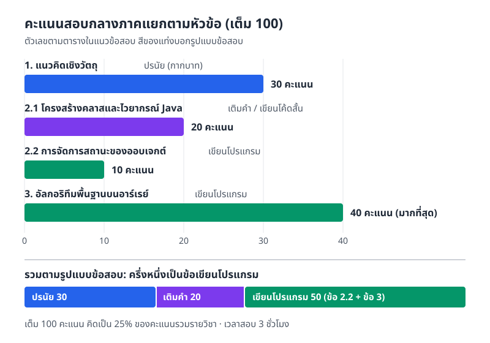
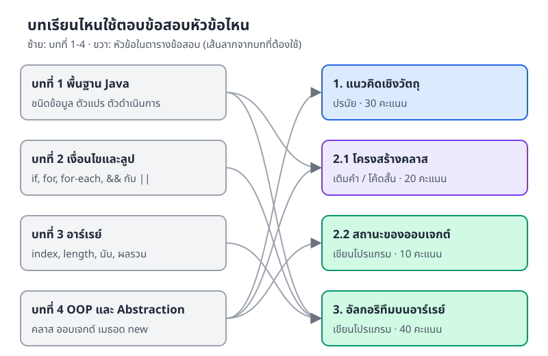
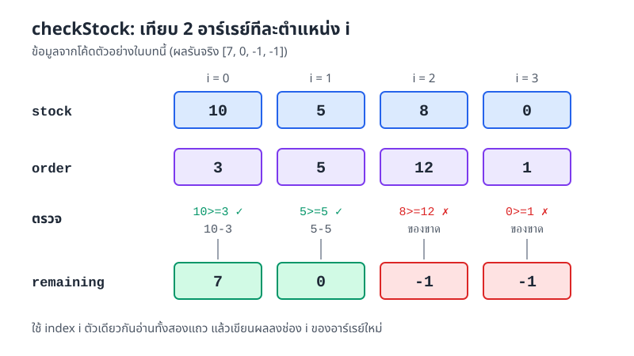
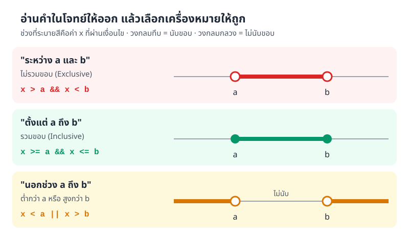
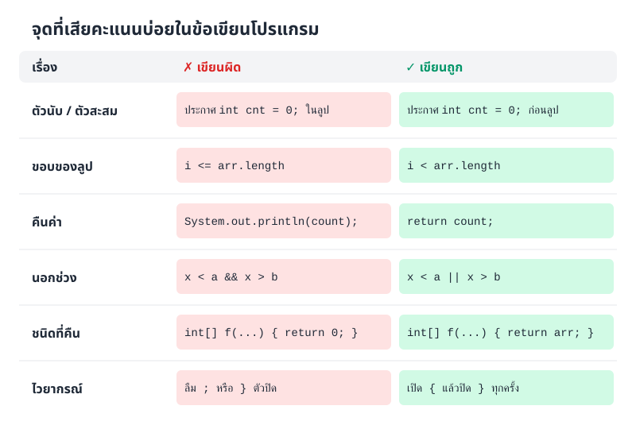
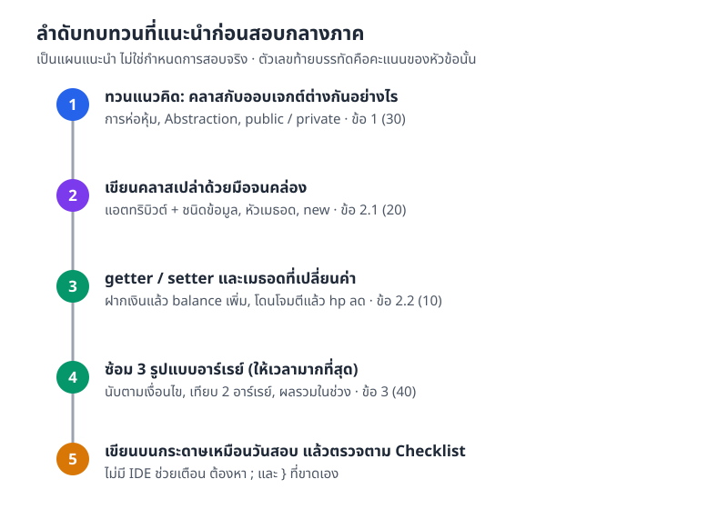

# แนวข้อสอบกลางภาค (Midterm Exam Guideline)

> ข้อสอบกลางภาควิชาการเขียนโปรแกรมเชิงวัตถุมี 4 หัวข้อ รวม 100 คะแนน ครึ่งหนึ่งเป็นข้อเขียนโปรแกรม และหัวข้อที่หนักที่สุดคืออาร์เรย์ (array) 40 คะแนน
> ไฟล์นี้สรุปว่าต้องรู้อะไร ใช้ความรู้จากบทไหน และพาซ้อมโจทย์ที่ใช้โครงเดียวกับข้อสอบจริง

## สิ่งที่จะทำได้หลังอ่านไฟล์นี้

- บอกได้ว่าข้อสอบมีกี่หัวข้อ แต่ละหัวข้อกี่คะแนน และเป็นข้อสอบแบบไหน
- รู้ว่าต้องกลับไปทวนบทไหนสำหรับหัวข้อไหน
- เขียนเมธอด (method) นับจำนวนตามเงื่อนไข เทียบ 2 อาร์เรย์ และหาผลรวมในช่วงข้อมูลได้
- เลือกตัวดำเนินการ (operator) `>` `>=` `&&` `||` ให้ตรงกับคำในโจทย์
- ตรวจโค้ดตัวเองตาม Checklist ก่อนส่ง

## ข้อมูลการสอบ

**วิชาการเขียนโปรแกรมเชิงวัตถุ (Object Oriented Programming)**

| รายการ | รายละเอียด |
|---|---|
| คะแนนเต็ม | 100 คะแนน (คิดเป็น 25% ของคะแนนรวมรายวิชา) |
| เวลา | 3 ชั่วโมง |

### ตารางเนื้อหาและผลลัพธ์การเรียนรู้ (Learning Outcomes)

| หัวข้อหลัก | สิ่งที่ต้องรู้ | CLO ที่ประเมิน | รูปแบบข้อสอบ | คะแนน |
|---|---|---|---|---:|
| **1. แนวคิดเชิงวัตถุ (OOP Concepts)** | • อธิบายความหมายและความแตกต่างระหว่างคลาส (class) กับออบเจกต์ (object)<br>• อธิบายหลักการ OOP (การห่อหุ้ม (encapsulation) และ Abstraction *เน้น 2 หลักนี้*)<br>• อธิบายหน้าที่ของตัวกำหนดสิทธิ์การเข้าถึง (access modifier) `public` และ `private` | CLO1, CLO2, CLO3 | ปรนัย (กากบาท) | 30 |
| **2.1 โครงสร้างคลาสและไวยากรณ์ Java (Class Anatomy & Syntax)** | • ประกาศแอตทริบิวต์ (attribute / field) พร้อมเลือกชนิดข้อมูล (data type) ที่เหมาะสม<br>• เขียน Method Signature, Return Type และ Parameter<br>• สร้างออบเจกต์ด้วย `new` และประกาศตัวแปรอ้างอิง (reference) | CLO1, CLO2 | เติมคำในช่องว่าง / เขียนโค้ดสั้น | 20 |
| **2.2 การจัดการสถานะของออบเจกต์ (Object State Manipulation)** | • เขียน getter / setter ให้แอตทริบิวต์ที่เป็น `private`<br>• เขียน logic ในเมธอดเพื่อเปลี่ยนค่า (เช่น `balance` เพิ่มเมื่อฝากเงิน, `hp` ลดเมื่อโดนโจมตี) | CLO3 | เขียนโปรแกรม (Coding) | 10 |
| **3. อัลกอริทึมพื้นฐานบนอาร์เรย์ (Array Logic & Algorithms)** | • ใช้ลูป (loop) เข้าถึงสมาชิกในอาร์เรย์<br>• ใช้ `if` นับจำนวนข้อมูลตามเงื่อนไข<br>• คำนวณผลรวม (ทั้งหมด / เฉพาะช่วง)<br>• เปรียบเทียบค่าระหว่าง 2 อาร์เรย์ในตำแหน่งเดียวกัน | CLO1, CLO2 | เขียนโปรแกรม (Coding) | 40 |
| **รวม** | | | | **100** |


ข้อเขียนโปรแกรมไม่จำเป็นต้องสร้างเมธอด `main` เพื่อแสดงการทดสอบโปรแกรม เขียนตามที่โจทย์กำหนดก็พอ


ภาพที่ M.1 วาดตัวเลขในตารางเป็นแท่ง จะเห็นว่าข้อ 3 เรื่องอาร์เรย์ได้ 40 คะแนน มากกว่าข้ออื่นชัดเจน และถ้ารวมตามรูปแบบข้อสอบ ข้อเขียนโปรแกรม (ข้อ 2.2 กับข้อ 3) รวมกันได้ 50 คะแนน คือครึ่งหนึ่งของข้อสอบ



*ภาพที่ M.1 สัดส่วนคะแนนตามตารางข้อสอบ แยกตามหัวข้อและตามรูปแบบข้อสอบ*

## หัวข้อไหนใช้ความรู้จากบทไหน

ข้อสอบไม่ได้แบ่งตามบทตรง ๆ หนึ่งหัวข้อมักใช้ความรู้หลายบทรวมกัน เช่น ข้อ 3 เรื่องอาร์เรย์ต้องใช้ทั้งตัวดำเนินการจากบทที่ 1 คำสั่งเงื่อนไขและลูปจากบทที่ 2 และอาร์เรย์จากบทที่ 3



*ภาพที่ M.2 ความเชื่อมโยงระหว่างบทเรียนกับหัวข้อข้อสอบ (เรียบเรียงจากเนื้อหาแต่ละบท)*

- **ข้อ 1 แนวคิดเชิงวัตถุ** ทวนบทที่ 4 เรื่องคลาสกับออบเจกต์ หลักการ OOP และ Abstraction
- **ข้อ 2.1 โครงสร้างคลาส** ใช้บทที่ 1 (ชนิดข้อมูล ตัวแปร) คู่กับบทที่ 4 (เขียนคลาส เมธอด และ `new`)
- **ข้อ 2.2 สถานะของออบเจกต์** ใช้บทที่ 4 เป็นหลัก
- **ข้อ 3 อาร์เรย์** ใช้บทที่ 1, 2 และ 3 รวมกัน


ตารางข้อสอบระบุ `public` / `private` และ getter / setter ไว้ด้วย บทที่ 4 พูดถึงเรื่องนี้แค่สั้น ๆ รายละเอียดเต็มอยู่ในบทที่ 5 การห่อหุ้ม ควรอ่านส่วนนั้นประกอบ


## ทวนส่วน OOP (ข้อ 1, 2.1, 2.2)

### คลาสกับออบเจกต์

นึกถึงแอปธนาคาร "บัญชีเงินฝาก" แบบหนึ่งกำหนดไว้ว่าทุกบัญชีต้องมีชื่อเจ้าของกับยอดเงิน และฝากเงินได้ นี่คือ **คลาส** หรือแม่แบบ ส่วนบัญชีของสมชายที่มียอด 500 บาทคือ **ออบเจกต์** หนึ่งตัวที่สร้างจากแม่แบบนั้น

- **คลาส** คือแบบพิมพ์ บอกว่าออบเจกต์มีข้อมูลอะไรและทำอะไรได้
- **ออบเจกต์** คือของจริงที่สร้างจากคลาสด้วย `new` แต่ละตัวมีค่าของตัวเอง
- **การห่อหุ้ม** คือซ่อนข้อมูลไว้เป็น `private` แล้วให้คนนอกเข้าถึงผ่านเมธอดที่เราคุมได้
- **Abstraction** คือเลือกเปิดให้เห็นเฉพาะสิ่งที่ผู้ใช้ต้องรู้ เช่น ผู้ใช้แค่เรียก `deposit(200)` ไม่ต้องรู้ว่าข้างในตรวจอะไรบ้าง
- **`public`** ใครก็เรียกใช้ได้ ส่วน **`private`** ใช้ได้เฉพาะในคลาสนั้น

### โครงคลาสที่ต้องเขียนได้คล่อง

ตัวอย่างนี้มีครบทุกอย่างที่ข้อ 2.1 และ 2.2 ถาม ได้แก่ แอตทริบิวต์ที่เลือกชนิดข้อมูลแล้ว คอนสตรักเตอร์ (constructor) getter / setter และเมธอดที่เปลี่ยนสถานะของออบเจกต์

```java
public class BankAccount {
    // แอตทริบิวต์เป็น private คนนอกแก้ตรง ๆ ไม่ได้
    private String owner;
    private double balance;

    // คอนสตรักเตอร์ กำหนดค่าเริ่มต้นตอนสร้างออบเจกต์
    public BankAccount(String owner, double balance) {
        this.owner = owner;
        this.balance = balance;
    }

    // getter อ่านค่าได้ แต่แก้ไม่ได้
    public double getBalance() {
        return balance;
    }

    public String getOwner() {
        return owner;
    }

    // setter มีด่านตรวจก่อนเปลี่ยนค่า
    public void setOwner(String owner) {
        if (owner != null && !owner.isEmpty()) {
            this.owner = owner;
        }
    }

    // เมธอดที่เปลี่ยนสถานะ: ฝากเงินแล้ว balance ต้องเพิ่ม
    public void deposit(double amount) {
        if (amount > 0) {
            balance += amount;
        }
    }
}
```

```java
public class Main {
    public static void main(String[] args) {
        BankAccount acc = new BankAccount("Somchai", 500.0); // ประกาศตัวแปรอ้างอิง แล้วสร้างออบเจกต์ด้วย new
        acc.deposit(200.0);
        acc.deposit(-50.0); // ไม่ผ่านเงื่อนไข amount > 0 ยอดจึงไม่เปลี่ยน
        System.out.println(acc.getOwner() + " " + acc.getBalance());
    }
}
```

ผลลัพธ์

```
Somchai 700.0
```

อ่าน Method Signature ให้ออกว่าแต่ละส่วนคืออะไร เพราะข้อเติมคำมักเว้นช่องตรงนี้

| ส่วน | ใน `public double getBalance()` | ใน `public void deposit(double amount)` |
|---|---|---|
| ตัวกำหนดสิทธิ์การเข้าถึง | `public` | `public` |
| Return Type | `double` (ต้องมี `return`) | `void` (ไม่คืนค่า) |
| ชื่อเมธอด | `getBalance` | `deposit` |
| Parameter | ไม่มี | `double amount` |

## ซ้อมข้อเขียนโปรแกรม (ข้อ 3 อาร์เรย์)

ส่วนนี้เน้นการวนลูปกับอาร์เรย์คู่กับการใช้ `if` ตัดสินใจ ให้ซ้อมจากโจทย์ที่ใช้โครงเดียวกับข้อสอบจริง


โจทย์ในส่วนนี้ไม่ใช่ข้อสอบจริง อย่าท่องโค้ดไปสอบ ให้จำ "รูปแบบ" แล้วเขียนเองให้ได้


### รูปแบบที่ 1: นับจำนวนตามเงื่อนไข (Counting Logic)

นึกถึงพนักงานร้านสะดวกซื้อที่หยิบของในตะกร้าขึ้นมาดูทีละชิ้น ชิ้นไหนตรงกับที่ต้องการก็กดเครื่องนับเพิ่ม 1 ในโค้ดก็ทำแบบเดียวกัน วนลูปดูสมาชิกทุกตัวในอาร์เรย์ ตัวไหนผ่านเงื่อนไขก็เพิ่มตัวนับทีละ 1

**โจทย์ซ้อม** จงเขียนคลาส `Counter` และเมธอด `countPositives` ที่รับอาร์เรย์เข้ามา แล้วนับว่ามี "จำนวนเต็มบวก" (ค่ามากกว่า 0) กี่ตัว

```java
public int countPositives(int[] arr) {
    int count = 0;                       // 1. เริ่มตัวนับที่ 0
    for (int i = 0; i < arr.length; i++) {
        if (arr[i] > 0) {                // 2. เงื่อนไขตามโจทย์ (ข้อสอบอาจเปลี่ยนเป็น เท่ากับ หรือ น้อยกว่า)
            count++;                     // 3. เจอแล้วนับเพิ่ม
        }
    }
    return count;                        // 4. ส่งจำนวนที่นับได้กลับไป
}
```

ข้อสอบจริงอาจเปลี่ยนเงื่อนไขจาก `> 0` เป็นอย่างอื่น ต้องแม่นเรื่องเครื่องหมายเปรียบเทียบ

**โจทย์** จงเขียนคลาส `ScoreCounter` และเมธอด `countFail` ที่รับอาร์เรย์คะแนนเข้ามา แล้วนับว่ามีกี่คนที่ได้คะแนน "น้อยกว่าเกณฑ์ที่กำหนด"

**แบบที่ 1 เขียนเป็นเมธอด** (แบบที่ใช้ทำข้อสอบข้อ 3) ฝึกเขียน Return Type และ Parameter ให้ถูก

```java
public class ScoreCounter {

    // โจทย์กำหนดให้รับอาร์เรย์และเกณฑ์คะแนน (threshold) เข้ามา
    public int countFail(int[] scores, int threshold) {
        int count = 0;

        // for-each: ดึงคะแนนออกมาทีละตัว (score) จากอาร์เรย์ scores
        for (int score : scores) {
            // ถ้าน้อยกว่าเกณฑ์ ให้นับสะสมไว้
            if (score < threshold) {
                count += 1; // เขียน count++; ก็ได้
            }
        }

        return count; // ส่งจำนวนคนที่นับได้กลับไป
    }
}
```

**แบบที่ 2 นำไปทดสอบ** (แบบที่อาจารย์ยกตัวอย่าง) ช่วยให้เห็นว่าโปรแกรมไหลอย่างไร

```java
public class TestLogic {
    public static void main(String[] args) {
        // 1. ชุดข้อมูลตัวอย่าง
        int[] scores = {85, 90, 78, 92, 88, 55, 63, 96};
        int target = 90;

        // 2. ตัวแปรสำหรับนับ
        int cnt = 0;

        // 3. วนลูป
        for (int score : scores) {
            // คะแนนตัวนี้น้อยกว่า 90 ไหม
            if (score < target) {
                cnt += 1; // ใช่ ก็นับเพิ่ม
            }
        }

        // 4. แสดงผล
        System.out.println("สมาชิกที่ค่าน้อยกว่า " + target + " มีจำนวน: " + cnt + " คน");
    }
}
```

ผลลัพธ์ (85, 78, 88, 55, 63 น้อยกว่า 90 รวม 5 ตัว)

```
สมาชิกที่ค่าน้อยกว่า 90 มีจำนวน: 5 คน
```

**จุดที่ต้องจำ**

1. **for-each** `for (int score : scores)` อ่านง่ายกว่า `for (int i = 0; i < scores.length; i++)` เหมาะเมื่อต้องการแค่ "ค่า" ไม่ต้องใช้ "ตำแหน่ง (index)"
2. **ตัวแปรสะสมค่า** ต้องประกาศ `int cnt = 0;` ไว้นอกลูปเสมอ ถ้าประกาศในลูป ค่าจะกลับเป็น 0 ทุกรอบ
3. **return กับ print** ถ้าโจทย์สั่งให้คืนค่า (`return`) ห้ามเขียน `System.out.println` ในเมธอดนับจำนวนแทนเด็ดขาด (เว้นแต่โจทย์สั่งให้แสดงผล)

### รูปแบบที่ 2: เปรียบเทียบ 2 อาร์เรย์ (Parallel Array Processing)

มีอาร์เรย์ 2 ตัวยาวเท่ากัน เราหยิบสมาชิกที่ตำแหน่งเดียวกัน (index `i`) มาเทียบกัน แล้วเก็บผลลงอาร์เรย์ใหม่

ตัวอย่างคือระบบตรวจสต็อกของร้านค้า (Inventory Check) ข้อสอบอาจให้อาร์เรย์คะแนนสองชุด แต่โครงเหมือนกัน ในที่นี้ใช้ `stock` (ของที่มี) กับ `order` (ยอดสั่งซื้อ)

- **โจทย์** รับ `int[] stock` และ `int[] order`
- **Logic**
  - ถ้าของพอขาย (`stock[i] >= order[i]`) ให้เก็บจำนวนที่เหลือ (`stock[i] - order[i]`)
  - ถ้าของไม่พอ (`else`) ให้เก็บค่า `-1` ไว้เตือนว่าของขาด

```java
public int[] checkStock(int[] stock, int[] order) {
    // 1. สร้างอาร์เรย์ผลลัพธ์ ขนาดเท่าอาร์เรย์ต้นทาง
    int[] remaining = new int[stock.length];

    for (int i = 0; i < stock.length; i++) {
        // 2. เงื่อนไข "พอ / ไม่พอ" ใช้ >=
        if (stock[i] >= order[i]) {
            remaining[i] = stock[i] - order[i]; // ตัดสต็อก
        } else {
            remaining[i] = -1;                  // ของขาด
        }
    }
    return remaining;
}
```

ถ้าใส่ `stock = {10, 5, 8, 0}` และ `order = {3, 5, 12, 1}` จะได้ `[7, 0, -1, -1]` ภาพที่ M.3 ไล่ให้ดูทีละช่อง สังเกตว่า `i` ตัวเดียวใช้อ่านทั้งสองอาร์เรย์และเขียนลงอาร์เรย์ผลลัพธ์



*ภาพที่ M.3 การทำงานของ checkStock ทีละตำแหน่ง (ค่าจากการรันจริง)*

### รูปแบบที่ 3: ผลรวมในช่วงข้อมูล (Range Summation)

รูปแบบนี้มี 3 แบบย่อย ต่างกันแค่คำในโจทย์ แต่ถ้าเลือกเครื่องหมายผิด คำตอบผิดทั้งข้อ ดูภาพที่ M.4 ก่อน แล้วค่อยอ่านโค้ด



*ภาพที่ M.4 คำในโจทย์กับเครื่องหมายที่ต้องใช้ วงกลมทึบคือนับขอบ วงกลมกลวงคือไม่นับขอบ*

#### Project 1: หาค่าระหว่าง (Strictly Between)

หาข้อมูลที่อยู่ "ระหว่าง" โดย **ไม่นับหัวและท้าย** (Exclusive)

- **สถานการณ์** หาราคาสินค้าที่ไม่ถูกไปและไม่แพงไป เช่น ระหว่าง 100 ถึง 500 บาท แต่ไม่เอา 100 และไม่เอา 500
- **คำในโจทย์** "ระหว่าง...และ..." (between ... and ...)
- **Logic** ต้องใช้ "และ" (`&&`) เท่านั้น

ไฟล์ `BetweenPrice.java`

```java
public class BetweenPrice {

    // โจทย์: หาผลรวมราคาที่อยู่ระหว่าง min กับ max (ไม่รวมขอบ)
    public int sumBetween(int[] prices, int min, int max) {
        int sum = 0;

        for (int p : prices) {
            // ใช้ > และ < (ไม่มี =)
            // อ่านว่า ต้องมากกว่า min "และ" ต้องน้อยกว่า max
            if (p > min && p < max) {
                sum += p;
            }
        }
        return sum;
    }
}
```


- **เป้าหมาย** หาผลรวม (sum)
- **Logic** ไม่เอาขอบ (Exclusive) จึงใช้แค่ `>` กับ `<`


ไฟล์ `Main.java` สำหรับ Project 1

```java
class Main {
    public static void main(String[] args) {
        // 100 กับ 500 คือขอบพอดี จึงไม่นับ
        int[] prices = {90, 100, 150, 300, 500, 600};

        BetweenPrice checker = new BetweenPrice();
        int result = checker.sumBetween(prices, 100, 500);

        System.out.println("ผลรวมราคากลาง ๆ (ควรได้ 450): " + result);
        // 150 + 300 = 450 ส่วน 100 กับ 500 ไม่นับ
    }
}
```

ผลลัพธ์

```
ผลรวมราคากลาง ๆ (ควรได้ 450): 450
```

<a href="https://onlinegdb.com/Q82to3165" class="button primary" data-icon="rectangle-code">คลิกเพื่อทดลองรัน Project 1</a>


กดปุ่ม Fork เพื่อสร้างสำเนาโปรเจกต์ของตัวเองก่อนเริ่มทำแบบฝึกหัด


#### Project 2: หาค่าในช่วง (Inclusive Range)

หาข้อมูลที่อยู่ "ตั้งแต่...ถึง..." โดย **นับรวมหัวและท้าย** (Inclusive)

- **สถานการณ์** ตรวจว่าคะแนนสอบผ่านเกณฑ์ไหม เช่น เกณฑ์ผ่านคือ 50 คะแนน ใครได้ 50 พอดีก็ถือว่าผ่าน
- **คำในโจทย์** "ตั้งแต่...ถึง...", "ในช่วง..."
- **Logic** ใช้ "และ" (`&&`) คู่กับเครื่องหมายที่มีเท่ากับ

ไฟล์ `GradeCheck.java`

```java
public class GradeCheck {

    // โจทย์: นับจำนวนคนที่สอบผ่าน (คะแนนตั้งแต่ minPass ถึง maxScore)
    public int countPass(int[] scores, int minPass, int maxScore) {
        int count = 0;

        for (int s : scores) {
            // ใช้ >= และ <= (มี =)
            // อ่านว่า ตั้งแต่ minPass ขึ้นไป จนถึง maxScore
            if (s >= minPass && s <= maxScore) {
                count++;
            }
        }
        return count;
    }
}
```


- **เป้าหมาย** หาจำนวนสมาชิกที่ผ่านเงื่อนไข (count)
- **Logic** เอาขอบด้วย (Inclusive) จึงต้องมีเครื่องหมาย `=`


ไฟล์ `Main.java`

```java
class Main {
    public static void main(String[] args) {
        // 50 คือคาบเส้น 100 คือคะแนนเต็ม ต้องนับทั้งคู่
        int[] scores = {49, 50, 75, 100, 101};

        GradeCheck checker = new GradeCheck();
        int passed = checker.countPass(scores, 50, 100);

        System.out.println("จำนวนคนผ่าน (ควรได้ 3 คน): " + passed);
        // 50, 75, 100 ผ่าน ส่วน 49 ตก และ 101 เกินช่วง
    }
}
```

ผลลัพธ์

```
จำนวนคนผ่าน (ควรได้ 3 คน): 3
```

<a href="https://onlinegdb.com/6VS4DIMZq" class="button primary" data-icon="rectangle-code">คลิกเพื่อทดลองรัน Project 2</a>

#### Project 3: หาค่านอกช่วง (Outliers)

หาข้อมูลที่ "ผิดปกติ" หรือ "หลุดเกณฑ์" คือน้อยเกินไปหรือมากเกินไป

- **สถานการณ์** เซนเซอร์วัดอุณหภูมิ ถ้าเย็นจัดหรือร้อนจัดให้แจ้งเตือน
- **คำในโจทย์** "อยู่นอกช่วง...", "ต่ำกว่า...หรือสูงกว่า..."
- **Logic** ต้องใช้ "หรือ" (`||`) เท่านั้น ห้ามใช้ `&&` เด็ดขาด

ไฟล์ `SensorCheck.java`

```java
public class SensorCheck {

    // โจทย์: หาผลรวมค่าที่ "อันตราย" (อยู่นอกช่วงปลอดภัย)
    public int sumErrors(int[] temps, int minSafe, int maxSafe) {
        int sum = 0;

        for (int t : temps) {
            // ใช้ || (หรือ)
            // อ่านว่า น้อยกว่า minSafe (เย็นไป) "หรือ" มากกว่า maxSafe (ร้อนไป) ถือว่าผิดปกติ
            if (t < minSafe || t > maxSafe) {
                sum += t;
            }
        }
        return sum;
    }
}
```


- **เป้าหมาย** หาผลรวม (sum)
- **Logic** หาค่าที่อยู่นอกช่วง จึงต้องใช้ "หรือ" (`||`) ห้ามใช้ `&&` เด็ดขาด


ทำไม `&&` ใช้ไม่ได้ เพราะ `t < 20 && t > 80` ต้องการตัวเลขที่ทั้งน้อยกว่า 20 และมากกว่า 80 พร้อมกัน ซึ่งไม่มีตัวเลขไหนเป็นได้ เงื่อนไขจึงเป็น `false` ทุกครั้ง และผลรวมจะได้ 0 เสมอ

ไฟล์ `Main.java`

```java
class Main {
    public static void main(String[] args) {
        // ช่วงปลอดภัยคือ 20-80
        // 10 (เย็นไป) กับ 90 (ร้อนไป) จึงเป็นค่าผิดปกติ
        int[] data = {10, 20, 50, 80, 90};

        SensorCheck sensor = new SensorCheck();
        int errorSum = sensor.sumErrors(data, 20, 80);

        System.out.println("ผลรวมค่าผิดปกติ: " + errorSum);
        // 10 + 90 = 100
    }
}
```

ผลลัพธ์

```
ผลรวมค่าผิดปกติ: 100
```

<a href="https://onlinegdb.com/vmGfrGjni" class="button primary" data-icon="rectangle-code">คลิกเพื่อทดลองรัน Project 3</a>

### สรุปการตีความคำว่า "ช่วงข้อมูล" (Range Logic)

คำเชื่อมในโจทย์เป็นตัวกำหนดว่าต้องใช้ตัวดำเนินการตัวไหน

| คำในโจทย์ | ความหมาย | คณิตศาสตร์ | Java |
|---|---|---|---|
| "อยู่ระหว่าง a และ b" (between) | ปกติ **ไม่รวมขอบ** (Exclusive) | $$a < x < b$$ | `if (x > a && x < b)` |
| "ตั้งแต่ a ถึง b" (from...to...) | ปกติ **รวมขอบ** (Inclusive) | $$a \le x \le b$$ | `if (x >= a && x <= b)` |
| "อยู่นอกช่วง a และ b" (outside range) | น้อยกว่า min **หรือ** มากกว่า max (ใช้ OR) | $$x < a$$ หรือ $$x > b$$ | <code>if (x &lt; a &#124;&#124; x &gt; b)</code> |

## ข้อผิดพลาดที่เจอบ่อย

ข้อเขียนโปรแกรมเขียนบนกระดาษ ไม่มี IDE คอยขีดเส้นแดงเตือน ภาพที่ M.5 รวมจุดที่เสียคะแนนบ่อยไว้ เทียบโค้ดที่ผิดกับที่ถูก



*ภาพที่ M.5 จุดที่เสียคะแนนบ่อยในข้อเขียนโปรแกรม*

### Checklist ก่อนส่งโค้ด

1. **วงเล็บปีกกาครบไหม** เปิด `{` แล้วต้องปิด `}`
2. **มี semicolon หรือยัง** จบคำสั่งด้วย `;`
3. **Array Index** วนลูปใช้ `i < arr.length` (ไม่มีเท่ากับ) และเรียกสมาชิกด้วย `arr[i]`
4. **Return Type** หัวเมธอดบอกว่าคืนค่าแบบไหน (`int` หรือ `int[]`) บรรทัด `return` ต้องส่งค่าแบบนั้นกลับไป

## ลำดับการทบทวนที่แนะนำ

ภาพที่ M.6 เป็นลำดับที่แนะนำ เริ่มจากแนวคิดซึ่งเป็นพื้นของข้ออื่น แล้วไล่ไปถึงข้อ 3 ที่คะแนนเยอะที่สุด ปิดท้ายด้วยการซ้อมเขียนบนกระดาษ ภาพนี้ไม่ได้บอกวันหรือกำหนดการสอบ ให้ดูวันสอบจริงจากประกาศของรายวิชา



*ภาพที่ M.6 ลำดับการทบทวนที่แนะนำ (แผนแนะนำ ไม่ใช่กำหนดการสอบ)*

## สรุป

- ข้อสอบเต็ม 100 คะแนน คิดเป็น 25% ของคะแนนรวมรายวิชา เวลา 3 ชั่วโมง
- 4 หัวข้อ: แนวคิดเชิงวัตถุ 30 (ปรนัย), โครงสร้างคลาส 20 (เติมคำ / โค้ดสั้น), สถานะของออบเจกต์ 10 (เขียนโปรแกรม), อาร์เรย์ 40 (เขียนโปรแกรม)
- ข้อเขียนโปรแกรมไม่ต้องเขียนเมธอด `main` เขียนตามที่โจทย์กำหนดก็พอ
- รูปแบบอาร์เรย์ที่ต้องเขียนเองให้ได้มี 3 แบบ คือ นับตามเงื่อนไข, เทียบ 2 อาร์เรย์ทีละตำแหน่ง และผลรวมในช่วงข้อมูล
- "ระหว่าง" ใช้ `>` `<` กับ `&&`, "ตั้งแต่...ถึง" ใช้ `>=` `<=` กับ `&&`, "นอกช่วง" ใช้ `||`

## แบบฝึกหัด

**ข้อ 1** ข้อใดอธิบายความต่างของคลาสกับออบเจกต์ได้ถูกต้อง

- ก. คลาสคือข้อมูลจริงที่อยู่ในหน่วยความจำ ออบเจกต์คือแบบพิมพ์
- ข. คลาสคือแบบพิมพ์ ออบเจกต์คือของจริงที่สร้างจากคลาสด้วย `new`
- ค. คลาสกับออบเจกต์คือสิ่งเดียวกัน
- ง. ออบเจกต์หนึ่งตัวสร้างได้จากหลายคลาสพร้อมกัน

<details>
<summary>ดูเฉลย</summary>

**ข.** คลาสบอกว่าออบเจกต์มีแอตทริบิวต์และเมธอดอะไร ส่วนออบเจกต์คือตัวจริงที่สร้างด้วย `new` แต่ละตัวเก็บค่าของตัวเอง

</details>

**ข้อ 2** เขียนคลาส `Player` ที่มีแอตทริบิวต์ `hp` เป็น `private` ชนิด `int` มีคอนสตรักเตอร์รับค่าเริ่มต้น มี getter `getHp()` และเมธอด `takeDamage(int damage)` ที่ลด `hp` ลงตามค่าที่รับมา โดย `hp` ต้องไม่ติดลบ

<details>
<summary>ดูเฉลย</summary>

```java
public class Player {
    private int hp;

    public Player(int hp) {
        this.hp = hp;
    }

    public int getHp() {
        return hp;
    }

    public void takeDamage(int damage) {
        hp -= damage;
        if (hp < 0) {
            hp = 0; // เลือดต้องไม่ติดลบ
        }
    }
}
```

ถ้าสร้าง `new Player(30)` แล้วเรียก `takeDamage(12)` ตามด้วย `takeDamage(25)` ค่า `getHp()` จะได้ `0` ไม่ใช่ `-7`

</details>

**ข้อ 3** เขียนเมธอด `countAtLeast(int[] arr, int x)` นับว่ามีสมาชิกที่ "ไม่น้อยกว่า x" กี่ตัว

<details>
<summary>ดูเฉลย</summary>

"ไม่น้อยกว่า" แปลว่ามากกว่าหรือเท่ากับ จึงใช้ `>=`

```java
public int countAtLeast(int[] arr, int x) {
    int count = 0;
    for (int v : arr) {
        if (v >= x) {
            count++;
        }
    }
    return count;
}
```

ถ้า `arr = {4, 9, 10, 2, 10}` และ `x = 9` จะได้ `3` (คือ 9, 10, 10)

</details>

**ข้อ 4** เขียนเมธอด `sumFromTo(int[] arr, int a, int b)` หาผลรวมของสมาชิกที่มีค่า "ตั้งแต่ a ถึง b"

<details>
<summary>ดูเฉลย</summary>

"ตั้งแต่...ถึง" คือรวมขอบ

```java
public int sumFromTo(int[] arr, int a, int b) {
    int sum = 0;
    for (int v : arr) {
        if (v >= a && v <= b) {
            sum += v;
        }
    }
    return sum;
}
```

ถ้า `arr = {5, 10, 15, 20, 25}`, `a = 10`, `b = 20` จะได้ `45` (10 + 15 + 20)

</details>

**ข้อ 5** เขียนเมธอด `countSame(int[] a, int[] b)` นับว่ามีกี่ตำแหน่งที่ค่าในอาร์เรย์ทั้งสองเท่ากัน (กำหนดให้ยาวเท่ากัน)

<details>
<summary>ดูเฉลย</summary>

ต้องรู้ตำแหน่ง `i` เพื่อเทียบสองอาร์เรย์ จึงใช้ `for` แบบมี index ไม่ใช่ for-each

```java
public int countSame(int[] a, int[] b) {
    int count = 0;
    for (int i = 0; i < a.length; i++) {
        if (a[i] == b[i]) {
            count++;
        }
    }
    return count;
}
```

ถ้า `a = {1, 2, 3, 4}` และ `b = {1, 0, 3, 5}` จะได้ `2` (ตำแหน่ง 0 และ 2)

</details>

**ข้อ 6** โค้ดนี้ตั้งใจหาผลรวมของค่าที่อยู่นอกช่วง 20 ถึง 80 แต่ได้ 0 ทุกครั้ง ผิดตรงไหน

```java
if (t < 20 && t > 80) {
    sum += t;
}
```

<details>
<summary>ดูเฉลย</summary>

ไม่มีตัวเลขไหนที่น้อยกว่า 20 และมากกว่า 80 ได้พร้อมกัน เงื่อนไขจึงเป็น `false` ตลอด ต้องเปลี่ยนเป็น `||`

```java
if (t < 20 || t > 80) {
    sum += t;
}
```

</details>
