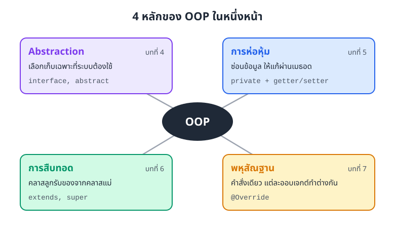
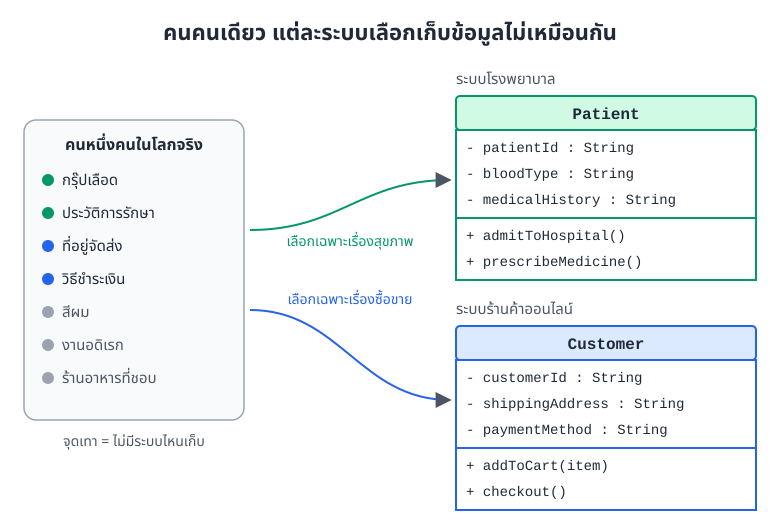
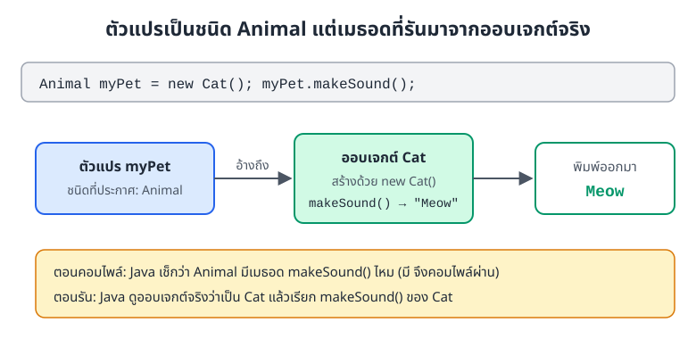

# สรุปรายวิชา

> OOP มีหลักใหญ่ 4 ข้อ คือ Abstraction การห่อหุ้ม การสืบทอด และพหุสัณฐาน
> หน้านี้สรุปแต่ละข้อพร้อมโค้ด Java สั้น ๆ แล้วไล่ทบทวนสิ่งที่เรียนมาตั้งแต่บทที่ 1 ถึงบทที่ 10

## หน้านี้ช่วยอะไรเรา

อ่านจบแล้วเราควรทำสิ่งเหล่านี้ได้

* บอกความหมายของหลัก OOP ทั้ง 4 ข้อได้ในประโยคเดียว และชี้ได้ว่าใช้ keyword อะไรใน Java
* ดูโค้ดแล้วบอกได้ว่าโค้ดนั้นใช้หลักข้อไหน
* อธิบายได้ว่าทำไม `Animal myPet = new Cat();` แล้วเรียก `makeSound()` จึงได้เสียงแมว
* เห็นภาพรวมว่าทั้ง 10 บทต่อกันอย่างไร และควรเรียนอะไรต่อ

## 4 หลักของ OOP ในหนึ่งหน้า

ภาพที่ S.1 รวมหลักทั้ง 4 ข้อไว้ด้วยกัน แต่ละกล่องบอกความหมายสั้น ๆ keyword ที่ใช้ใน Java และบทที่สอนเรื่องนั้น



*ภาพที่ S.1 หลัก OOP ทั้ง 4 ข้อ พร้อม keyword ที่ต้องจำ*

### 1. Abstraction (การดึงเฉพาะสาระสำคัญ)

ลองนึกถึงคนหนึ่งคน เขามีข้อมูลเยอะมาก ทั้งกรุ๊ปเลือด ที่อยู่ สีผม งานอดิเรก แต่โรงพยาบาลไม่สนว่าเขาชอบช้อปปิ้งอะไร ส่วนร้านค้าออนไลน์ก็ไม่สนว่าเขาเลือดกรุ๊ปไหน

Abstraction คือการเลือกเก็บเฉพาะข้อมูล (แอตทริบิวต์ หรือ attribute) และพฤติกรรม (เมธอด หรือ method) ที่ระบบของเราต้องใช้จริง แล้วตัดเรื่องที่ไม่เกี่ยวทิ้งไป ภาพที่ S.2 แสดงว่าคนคนเดียวกัน กลายเป็นคลาส (class) คนละแบบในสองระบบ



*ภาพที่ S.2 ข้อมูลชุดเดียวกัน แต่ละระบบหยิบไปใช้ไม่เหมือนกัน จุดเทาคือเรื่องที่ไม่มีระบบไหนเก็บ*

ระบบโรงพยาบาลเก็บแค่เรื่องการรักษา

```java
class Patient {
    // เก็บเฉพาะข้อมูลที่โรงพยาบาลต้องใช้
    private String patientId;
    private String bloodType;
    private String medicalHistory;

    // พฤติกรรมที่เกี่ยวกับโรงพยาบาลเท่านั้น
    public void admitToHospital() {
        System.out.println("Admitting patient...");
    }

    public void prescribeMedicine() {
        System.out.println("Prescribing medicine...");
    }
}
```

ระบบร้านค้าออนไลน์เก็บแค่เรื่องซื้อขาย

```java
class Customer {
    // เก็บเฉพาะข้อมูลที่ร้านค้าต้องใช้
    private String customerId;
    private String shippingAddress;
    private String paymentMethod;

    public void addToCart(String item) {
        System.out.println("Adding " + item + " to cart...");
    }

    public void checkout() {
        System.out.println("Processing payment...");
    }
}
```

ออกแบบคลาสแบบนี้ได้ประโยชน์ 3 อย่าง

* **คลาสไม่รก** แต่ละคลาสมีแค่สิ่งที่บริบทนั้นต้องใช้ และทำหน้าที่ชัดเจนเรื่องเดียว (single responsibility)
* **ไม่เก็บของเกิน** ไม่ต้องเปลืองหน่วยความจำกับข้อมูลที่ระบบไม่เคยใช้
* **ดูแลรักษาง่าย** เปิดคลาสมาก็รู้ทันทีว่าคลาสนี้รับผิดชอบเรื่องอะไร

Abstraction อีกมุมหนึ่งคือ **บอกว่าต้องทำอะไร (what) แต่ซ่อนว่าทำอย่างไร (how)** ใน Java มักใช้อินเทอร์เฟซ (interface) หรือคลาสนามธรรม (abstract class) วางโครงไว้ แล้วให้คลาสที่นำไปใช้เป็นคนลงรายละเอียด

```java
// อินเทอร์เฟซเหมือนสัญญา บอกว่าต้องมีเมธอดอะไรบ้าง
interface Playable {
    void play(); // บอกแค่ว่าต้อง "เล่นได้" ไม่บอกว่าเล่นอย่างไร
}

// คลาสที่นำสัญญาไปใช้ เป็นคนกำหนดว่าเล่นอย่างไร
class Guitar implements Playable {
    @Override
    public void play() {
        System.out.println("Strumming the guitar chords...");
    }
}
```

คลาสนามธรรมกับอินเทอร์เฟซต่างกันอย่างไร และควรเลือกแบบไหน อ่านได้ในหัวข้อ 10 ของ[บทที่ 7: พหุสัณฐาน (Polymorphism)](07-polymorphism.md)

### 2. การห่อหุ้ม (Encapsulation)

นึกถึงตู้กดน้ำ เราเปิดตู้ไปหยิบเงินในกล่องเองไม่ได้ ต้องหยอดเหรียญและกดปุ่มเท่านั้น ตู้จะเช็กเองว่าเงินพอไหม

การห่อหุ้มคือการรวมข้อมูลกับเมธอดที่จัดการข้อมูลนั้นไว้ในคลาสเดียว แล้วซ่อนข้อมูลด้วย `private` ใครอยากอ่านหรือแก้ต้องผ่านเมธอด `public` (เช่น getter และ setter) ซึ่งตรวจความถูกต้องก่อนทุกครั้ง ข้อมูลจึงไม่เพี้ยน

```java
class BankAccount {
    // ซ่อนยอดเงินไว้ คนนอกคลาสแก้ตรง ๆ ไม่ได้
    private double balance;

    // จะฝากเงินต้องผ่านเมธอดนี้ ซึ่งเช็กก่อนว่ายอดฝากมากกว่า 0
    public void deposit(double amount) {
        if (amount > 0) {
            balance += amount;
        }
    }

    // เปิดให้ดูยอดได้ แต่แก้ไม่ได้
    public double getBalance() {
        return balance;
    }
}
```

ถ้าเรียก `deposit(500)` แล้วตามด้วย `deposit(-200)` ยอดเงินจะยังเป็น `500.0` เพราะยอดติดลบไม่ผ่านเงื่อนไข `amount > 0`

### 3. การสืบทอด (Inheritance)

ไรเดอร์ส่งอาหารทุกคนเป็น "พนักงาน" ที่มีชื่อและรหัสพนักงานเหมือนพนักงานทั่วไป แต่มีงานเพิ่มคือส่งของ เราไม่ต้องเขียนเรื่องชื่อกับรหัสใหม่ทุกครั้ง

การสืบทอดคือการให้คลาสลูก (subclass) รับแอตทริบิวต์และเมธอดของคลาสแม่ (superclass) มาใช้ได้เลยผ่าน keyword `extends` แล้วเพิ่มของที่เป็นของตัวเองเข้าไป โค้ดเดิมจึงนำกลับมาใช้ซ้ำได้โดยไม่ต้องเขียนใหม่

```java
// คลาสแม่
class Animal {
    protected String name;

    public void eat() {
        System.out.println("Eating...");
    }
}

// คลาสลูกได้ eat() มาจากคลาสแม่ แล้วเพิ่ม bark() ของตัวเอง
class Dog extends Animal {
    public void bark() {
        System.out.println("Woof! Woof!");
    }
}
```

ออบเจกต์ (object) ของ `Dog` เรียกได้ทั้ง `eat()` ซึ่งได้มาจาก `Animal` และ `bark()` ซึ่งเป็นของ `Dog` เอง

### 4. พหุสัณฐาน (Polymorphism)

สั่งว่า "ส่งเสียงหน่อย" เหมือนกัน แมวร้องเหมียว หมาเห่าโฮ่ง คำสั่งเดียวกัน แต่แต่ละตัวทำในแบบของตัวเอง

พหุสัณฐานคือการที่ออบเจกต์ต่างคลาสกัน (ซึ่งสืบทอดจากคลาสแม่เดียวกัน) ตอบสนองต่อเมธอดเดียวกันได้ต่างกัน วิธีที่ใช้คือให้คลาสลูก override เมธอดของคลาสแม่

```java
class Animal {
    public void makeSound() {
        System.out.println("Some generic sound");
    }
}

class Cat extends Animal {
    @Override
    public void makeSound() {
        System.out.println("Meow");
    }
}

class Dog extends Animal {
    @Override
    public void makeSound() {
        System.out.println("Woof");
    }
}
```

ตอนใช้งาน เราประกาศตัวแปร (variable) เป็นชนิดคลาสแม่ แต่ให้ชี้ไปที่ออบเจกต์ของคลาสลูกได้

```java
Animal myPet = new Cat();
myPet.makeSound(); // พิมพ์ Meow

Animal[] pets = { new Cat(), new Dog() };
for (Animal p : pets) {
    p.makeSound(); // ตัวแรกพิมพ์ Meow ตัวที่สองพิมพ์ Woof
}
```

ผลลัพธ์

```
Meow
Meow
Woof
```

ทำไมได้ `Meow` ทั้งที่ตัวแปรเป็นชนิด `Animal` ภาพที่ S.3 อธิบายว่า Java ตัดสินใจเป็นสองจังหวะ ตอนคอมไพล์ดูแค่ชนิดของตัวแปร ส่วนตอนรันจะดูออบเจกต์จริงแล้วเลือกเมธอดของออบเจกต์นั้น กลไกนี้เรียกว่า dynamic binding



*ภาพที่ S.3 dynamic binding ตอนคอมไพล์เช็กชนิดตัวแปร ตอนรันใช้เมธอดของออบเจกต์จริง*

## สิ่งที่เรียนมาตลอดวิชา (บทที่ 1-10)

**ส่วนที่ 1 พื้นฐาน Java**

* โครงสร้างโปรแกรม ตัวแปร และชนิดข้อมูล (บทที่ 1)
* คำสั่งเงื่อนไข `if` `switch` และลูป (บทที่ 2)
* อาร์เรย์ (บทที่ 3)

**ส่วนที่ 2 หลัก OOP**

* Abstraction กำหนดว่าคลาสรับผิดชอบเรื่องอะไร (บทที่ 4)
* การห่อหุ้ม ควบคุมว่าใครเข้าถึงข้อมูลได้ (บทที่ 5)
* การสืบทอด สร้างโครงสร้างที่นำกลับมาใช้ซ้ำได้ (บทที่ 6)
* พหุสัณฐาน ให้ออบเจกต์แต่ละแบบทำงานต่างกัน รวมถึงคลาสนามธรรมและอินเทอร์เฟซ (บทที่ 7)

**ส่วนที่ 3 การออกแบบและแนวปฏิบัติที่ดี**

* แผนภาพคลาส (UML class diagram) และการเขียนโค้ดตามแผนภาพ (บทที่ 8)
* การจัดการข้อผิดพลาดด้วย exception (บทที่ 9)
* หลักการเขียนโค้ดที่ดูแลรักษาง่าย (บทที่ 10)

## จุดที่มักสับสน

* **การห่อหุ้มไม่ใช่แค่ใส่ getter กับ setter ให้ทุกแอตทริบิวต์** ถ้า setter รับค่าอะไรก็ได้โดยไม่ตรวจ ก็แทบไม่ต่างจากเปิด `public` ไว้ หัวใจอยู่ที่การตรวจค่าก่อนแก้
* **Abstraction กับการห่อหุ้มไม่ใช่เรื่องเดียวกัน** Abstraction ตอบว่า "คลาสนี้ควรมีอะไรบ้าง" ส่วนการห่อหุ้มตอบว่า "ของที่มีอยู่ ใครเข้าถึงได้บ้าง"
* **ตัวแปรชนิดคลาสแม่เรียกเมธอดที่มีเฉพาะในคลาสลูกไม่ได้** เช่น `Animal a = new Dog(); a.bark();` คอมไพล์ไม่ผ่าน เพราะตอนคอมไพล์ Java ดูแค่ว่า `Animal` มี `bark()` ไหม
* **overload กับ override ต่างกัน** overload คือเมธอดชื่อเดียวกันแต่พารามิเตอร์ต่างกันในคลาสเดียว ส่วน override คือคลาสลูกเขียนเมธอดของคลาสแม่ใหม่ ชื่อและพารามิเตอร์เหมือนเดิม

## สรุปท้ายรายวิชา

* Abstraction เลือกเก็บเฉพาะสิ่งที่ระบบต้องใช้ และแยก "ทำอะไร" ออกจาก "ทำอย่างไร"
* การห่อหุ้มซ่อนข้อมูลด้วย `private` แล้วให้แก้ผ่านเมธอดที่ตรวจค่าก่อน
* การสืบทอดใช้ `extends` ให้คลาสลูกได้ของจากคลาสแม่ ไม่ต้องเขียนซ้ำ
* พหุสัณฐานใช้ override ร่วมกับตัวแปรชนิดคลาสแม่ เมธอดที่รันจริงขึ้นกับออบเจกต์ ไม่ใช่ชนิดตัวแปร

## แบบฝึกหัดทบทวน

**ข้อ 1** โค้ดต่อไปนี้ใช้หลัก OOP ข้อไหนเป็นหลัก เพราะอะไร

```java
class Thermostat {
    private int temperature;

    public void setTemperature(int t) {
        if (t >= 16 && t <= 30) {
            temperature = t;
        }
    }
}
```

<details>
<summary>ดูเฉลย</summary>

การห่อหุ้ม เพราะ `temperature` เป็น `private` คนนอกคลาสแก้ค่าตรง ๆ ไม่ได้ ต้องผ่าน `setTemperature()` ซึ่งรับเฉพาะค่า 16 ถึง 30 ส่วนค่าที่อยู่นอกช่วง เมธอดจะไม่เก็บ ข้อมูลในออบเจกต์จึงไม่เพี้ยน

</details>

**ข้อ 2** ใช้คลาส `Animal` `Cat` `Dog` จากหัวข้อพหุสัณฐาน โค้ดนี้พิมพ์อะไรออกมา

```java
Animal[] pets = { new Dog(), new Cat(), new Animal() };
for (Animal p : pets) {
    p.makeSound();
}
```

<details>
<summary>ดูเฉลย</summary>

```
Woof
Meow
Some generic sound
```

แต่ละรอบ Java ดูออบเจกต์จริง ตัวแรกเป็น `Dog` ตัวที่สองเป็น `Cat` ทั้งสองคลาส override `makeSound()` ไว้แล้ว ส่วนตัวที่สามเป็น `Animal` จึงใช้เมธอดของ `Animal` เอง

</details>

**ข้อ 3** ทำไมบรรทัดที่สองคอมไพล์ไม่ผ่าน และแก้อย่างไรได้บ้าง

```java
Animal a = new Dog();
a.bark();
```

<details>
<summary>ดูเฉลย</summary>

ตอนคอมไพล์ Java ดูชนิดของตัวแปร `a` ซึ่งเป็น `Animal` และ `Animal` ไม่มีเมธอด `bark()` จึงแจ้ง error ว่า `cannot find symbol` ถึงออบเจกต์จริงจะเป็น `Dog` ก็ตาม

วิธีแก้ที่ง่ายที่สุดคือประกาศตัวแปรเป็น `Dog d = new Dog();` แล้วเรียก `d.bark();`

</details>

**ข้อ 4** ระบบยืมคืนของห้องสมุดมหาวิทยาลัยต้องการคลาส `Book` ข้อมูลไหนควรเก็บ ข้อมูลไหนไม่ควร ระหว่าง รหัสหนังสือ ชื่อเรื่อง สีปก จำนวนหน้า สถานะยืม/คืน และร้านที่ซื้อหนังสือมา

<details>
<summary>ดูเฉลย</summary>

ควรเก็บ รหัสหนังสือ ชื่อเรื่อง และสถานะยืม/คืน เพราะระบบยืมคืนต้องใช้ทุกครั้ง จำนวนหน้าเก็บไว้ก็ได้ถ้าระบบมีหน้าแสดงรายละเอียดหนังสือ

ไม่ควรเก็บ สีปก และร้านที่ซื้อมา เพราะระบบยืมคืนไม่ได้ใช้ นี่คือ Abstraction เลือกเฉพาะสิ่งที่ระบบนี้ต้องใช้ คำตอบเปลี่ยนได้ถ้าระบบมีงานอื่นเพิ่ม เช่น ระบบจัดซื้อจะต้องรู้ว่าซื้อจากร้านไหน

</details>

## เรียนอะไรต่อดี

* ลองทำโปรเจกต์จริงสักชิ้น เช่น ระบบสั่งกาแฟ หรือระบบยืมคืนหนังสือ แล้วใช้หลักทั้ง 4 ข้อ
* ศึกษารูปแบบการออกแบบที่คนใช้กันบ่อย (design patterns)
* เรียนรู้ framework ของ Java
* ฝึกหาจุดผิดในโค้ด (debugging) และเขียนโค้ดทดสอบ (testing)
